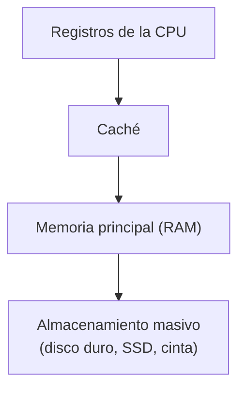
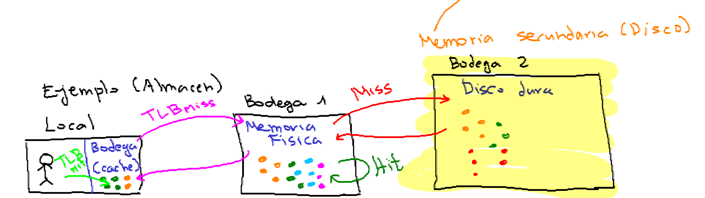
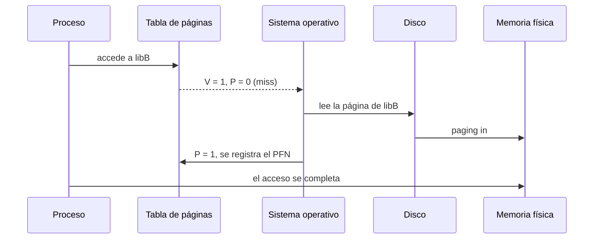
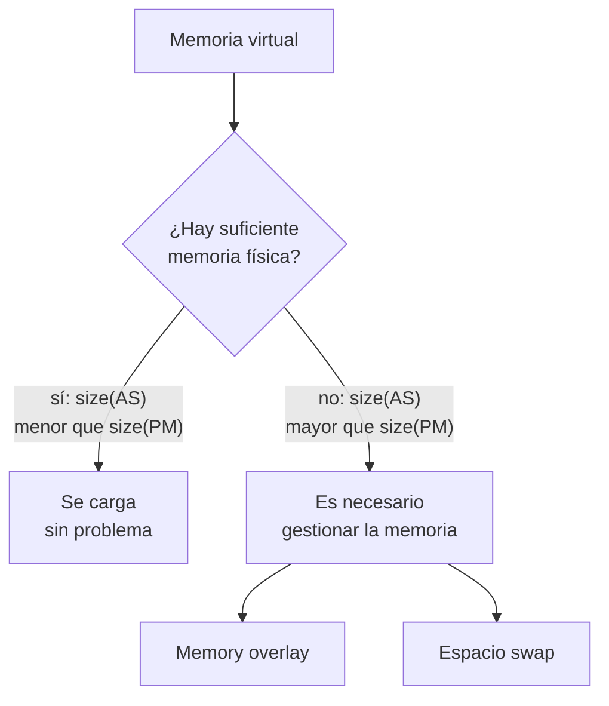
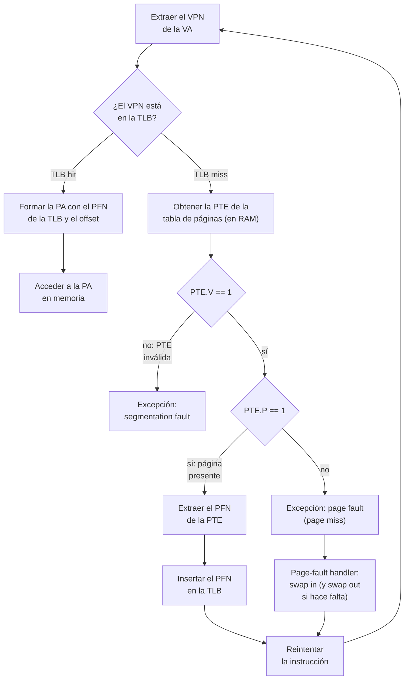
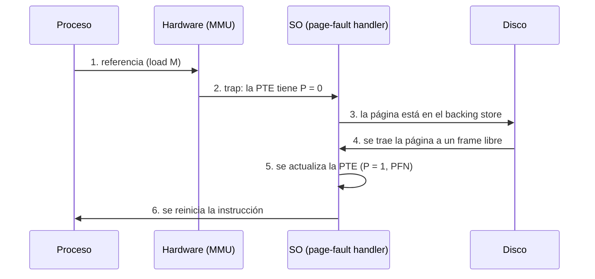
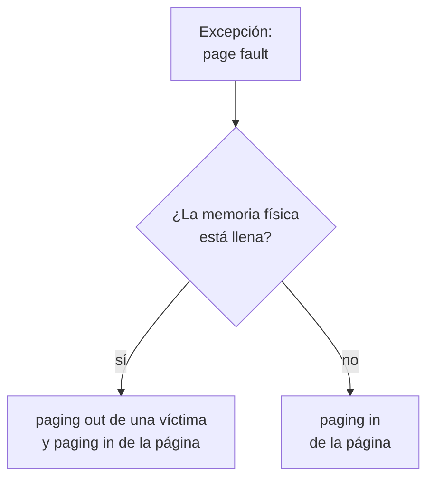
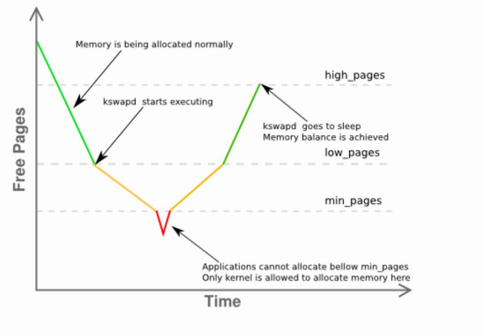
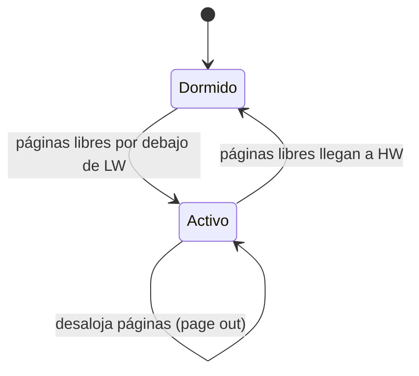

# Más allá de la memoria física: mecanismos de *swapping* (OSTEP, cap. 21)

## Objetivos de Aprendizaje

* **Explicar**: por qué el sistema operativo necesita un nivel adicional en la jerarquía de memoria cuando los espacios de direcciones no caben en la memoria física.
* **Comparar**: la superposición de memoria (*memory overlay*), manejada por el programador, con el espacio *swap*, manejado por el sistema operativo.
* **Interpretar**: los bits de validez (V) y de presencia (P) de una PTE para saber si una página está en memoria física, en disco o no está mapeada.
* **Describir**: el flujo completo de la traducción de una dirección virtual, con TLB, tabla de páginas y fallo de página, y lo que hace el *page-fault handler*.
* **Identificar**: cuándo ocurren realmente los reemplazos de páginas (umbrales *high*/*low watermark* y *swap daemon*).

## Punto de partida: los mecanismos vistos hasta ahora

La clase arrancó con un repaso del hilo conductor del módulo: cada mecanismo de traducción de direcciones resolvió un problema del anterior, pero dejó otros abiertos.

| Método | Problemas |
|---|---|
| *Dynamic Relocation* (base & bounds) | Fragmentación interna. |
| Segmentación (base & bounds generalizado) | Fragmentación externa. |
| Paginación | Gasto de memoria por las tablas de páginas de todo el *workload* (*overhead* de memoria) y doble acceso a memoria por referencia (ralentización). |
| TLB | *Overhead* de memoria y poca eficacia cuando no hay localidad (tasa alta de TLB *miss*). |

Hoy se agrega un nivel más al problema: el **disco**.

## El problema: memoria física insuficiente

Hasta ahora se había supuesto que:

1. El espacio de direcciones de un proceso es pequeño y cabe en memoria física: $size(AS) < size(PM)$, donde $size(PM)$ es el espacio de usuario disponible en la memoria física (*physical memory*).
2. Incluso los espacios de direcciones de **todos** los procesos en ejecución (el *workload*) caben a la vez: $size(\sum AS[P_i]) < size(PM)$.

Al relajar esas suposiciones aparecen dos casos en los que el SO **no** tiene memoria física suficiente:

* **Un único proceso con un espacio de direcciones muy grande**: $size(AS) > size(PM)$.
* **Muchos procesos cuya suma supera la memoria física**, aunque cada uno por separado sí cabría: $size(\sum AS[P_i]) > size(PM)$.

### Un caso real: 32 frente a 64 bits

| Bits de la memoria virtual | Tamaño de la memoria virtual |
|---|---|
| 32 | $2^{32} = 2^2 \cdot 2^{30} = 4$ GB |
| 64 | $2^{64} = 2^4 \cdot 2^{60} = 16$ EB (un valor enorme) |

Con 32 bits, cada proceso puede direccionar el rango $[0, 2^{32} - 1]$, es decir, 4 GB. Con una memoria física típica de 8 GB, bastan unos pocos procesos para agotarla. Con 64 bits el espacio virtual (16 exabytes) es imposible de respaldar completo con RAM: puede que **ni siquiera quepa un proceso, y mucho menos varios**.

### Pregunta clave

> **¿Cómo ir más allá de la memoria física?**
> ¿Cómo puede el sistema operativo usar un **dispositivo más grande y lento** para proporcionar de forma transparente la ilusión de un gran espacio de direcciones virtuales?

Ese dispositivo más grande y lento es la **memoria secundaria** (disco duro o SSD).

## Jerarquía de memoria

Para recordar los fundamentos se proyectó el video [*How computer memory works*](https://www.youtube.com/watch?v=p3q5zWCw8J4) (Kanawat Senanan, TED-Ed). Los niveles de la jerarquía, del más rápido y caro al más grande y barato, son:

| Nivel | Características |
|---|---|
| Registros de la CPU | Los más rápidos y caros, y los de menor capacidad. |
| Caché (SRAM) | Muy rápida. Según el video, cada celda usa 6 transistores y no necesita refresco, lo que la hace más cara y voluminosa que la DRAM. |
| Memoria principal (DRAM) | Latencia del orden de 100 ns. Cada celda es un transistor y un capacitor, y necesita refresco periódico. |
| Almacenamiento masivo (disco magnético, SSD, cinta) | Mucho más lento (el video habla de unas 100 000 veces la latencia de la DRAM para un disco), pero con mucha más capacidad y menor costo. |



La idea central es que **cada capa actúa como un espacio de almacenamiento de respaldo (*backing store*) de la capa superior**. Si lo que se busca está en la capa actual hay un *hit*. Si no está (*miss*), se baja a la capa inferior para traerlo y actualizar la superior.

### Analogía del almacén


<details>
<summary>Boceto dibujado en clase</summary>



</details>

* **Local con su bodeguita (caché/TLB)**: lo que más se vende está a la mano. Si el vendedor lo encuentra ahí, es un TLB *hit*. En rigor, la TLB guarda traducciones (VPN → PFN) y la caché guarda datos; en la analogía ambas hacen el papel de "lo que está a la mano".
* **Bodega 1 (memoria física)**: si no está en el local (TLB *miss*), se va a la bodega 1, que tiene el resto de productos. Si ahí está, es un *hit*.
* **Bodega 2 (disco duro)**: más grande y más lejana. Guarda lo que no cabe en la bodega 1. Si el producto no está en la bodega 1 (*miss*, fallo de página), hay que traerlo desde aquí, lo que es mucho más lento (*swap in*). Y si la bodega 1 está llena, antes hay que mandar algo de ella a la bodega 2 para hacer espacio (*page out*), que es justamente el problema de esta clase.

## Procesos, librerías y páginas poco usadas

**Programa sencillo.** El binario (código y datos) está en el disco. Al ejecutarlo se crea un proceso y se reserva memoria para él: código, datos, *heap* y *stack*.

**Programa más realista.** Suele usar muchas librerías, algunas de las cuales se usan raramente. Con **librerías estáticas** el código de cada librería (libA, libB, libC) se copia dentro del ejecutable. Si, como hasta ahora, todas las páginas virtuales tienen que estar mapeadas a memoria física mediante la tabla de páginas, se gastan *frames* en páginas que casi nunca se usan. **Problema: gasto de memoria.**

> [!NOTE]
> **Estáticas frente a dinámicas.** Con librerías estáticas, si varios programas usan la misma librería, cada proceso carga su propia copia en memoria. Con librerías dinámicas (compartidas), la librería no forma parte del ejecutable: se carga en tiempo de ejecución y sus páginas de código pueden **compartirse** entre procesos (los mismos *frames* mapeados en varias tablas de páginas), lo que ahorra memoria. Es una idea distinta de la de esta clase: que solo las páginas referenciadas ocupen RAM (lo que se explica a continuación) aplica tanto a librerías estáticas como dinámicas.

**Escenario:** ¿cómo evitar el desperdicio de páginas físicas (*frames*) empleadas para respaldar páginas virtuales (*pages*) poco usadas? Hace falta un espacio adicional en la jerarquía de memoria, usualmente en el disco duro, al cual enviar las porciones del espacio de direcciones que **no son muy demandadas**. Esa mejora es el ***swapping***.

### ¿Cómo funciona?

1. **Ejecución del programa**: se reserva la memoria virtual del proceso creado (libA, libB, libC, código, datos, *heap*, *stack*).
2. **Se crean las referencias**: solo algunas páginas quedan en memoria física; el resto se mapea al disco.
   * libC y el código → memoria física: $V = 1,\ P = 1$.
   * libA y libB → disco duro: $V = 1,\ P = 0$.
3. **Se accede a la librería B**: su PTE tiene $V = 1,\ P = 0$, así que la página no está en memoria física (*miss*).
4. **Se copia (o mueve) la página a la memoria principal** (*paging in*) y la referencia de libB se actualiza: $P$ pasa de 0 a 1.



> [!NOTE]
> **Complemento (OSTEP, cap. 21).** El espacio *swap* no es el único lugar del disco que respalda páginas. Las páginas de **código** de un binario (por ejemplo `ls` o un programa propio) están inicialmente en su archivo ejecutable. Si el SO necesita ese espacio, puede reutilizar sus *frames* sin escribirlas en ninguna parte, porque luego puede volver a leerlas desde el binario en el sistema de archivos.

## Soluciones: *memory overlay* frente a espacio *swap*



### *Memory overlay* (manual)

**Escenario:** el programa es más grande (en memoria virtual) que la memoria física disponible, por lo que no puede cargarse. Las posibles soluciones son **aumentar la memoria** (costoso) o usar ***memory overlay*** (superposición de memoria), la aproximación de los sistemas operativos viejos.

El programador divide el programa en secciones lógicas:

* **Código residente**: sección que permanece siempre en memoria mientras dura la ejecución.
* **Área de *overlay***: espacio donde se cargan, solo cuando se requieren, las demás secciones (*overlay* 1, 2, 3...), cada una con su código y datos especializados.

La suma de todas las secciones supera la memoria física, pero en cada momento solo hay una parte cargada:

$$size(PM) < size(AS) = size(Resident) + size(Ov_1) + size(Ov_2) + size(Ov_3)$$

El uso de la memoria corre por **cuenta del programador**, no del SO. Es él quien mueve los fragmentos (*overlays*) dentro y fuera de memoria según se necesiten; por ejemplo, al llamar a una función se carga en el área de *overlay* su código y sus datos. Es un proceso costoso y propenso a errores, y hoy está en desuso.

### Espacio *swap*

* Con la llegada de la **multiprogramación** apareció la necesidad de soportar más memoria de la que físicamente había.
* La adición de un **espacio *swap*** (espacio de intercambio) le permite al SO sostener la ilusión de una **memoria virtual muy grande** para los procesos concurrentes, sin intervención del programador.
* El espacio *swap* es una **región del disco duro empleada para almacenar páginas de memoria**.

> [!NOTE]
> **Complemento (OSTEP, cap. 21).** El atractivo de un espacio de direcciones grande es la comodidad: el programador escribe el programa con naturalidad, reservando memoria cuando la necesita, sin preguntarse si hay espacio suficiente. Con *overlays*, en cambio, antes de llamar una función o acceder a un dato había que asegurarse de haberlo cargado primero.

## El espacio *swap*

Es un espacio reservado en el disco duro para almacenar páginas:

* El SO divide el espacio *swap* en unidades del tamaño de una página y lee y escribe en él de a una página. Para ello debe recordar la **dirección en disco** de cada página.
* El tamaño del espacio *swap* determina el **número máximo de páginas** que el sistema puede usar en un momento dado.
* Las operaciones de transferencia entre memoria y *swap* son:
  * ***Swap out* / *Page out***: de memoria física al disco.
  * ***Swap in* / *Page in***: del disco a memoria física.

> [!TIP]
> En clase se mencionó la regla histórica de dimensionar el *swap* como el doble de la RAM. Hoy la recomendación depende del sistema: por ejemplo, para hibernar el *swap* debe poder guardar el contenido de la RAM, y algunas distribuciones de Linux usan *swap* comprimido en la propia RAM (zram).

### Notación

* **Frame**: espacio de memoria (página) en la memoria física. Hay $M$ *frames*, numerados de $0$ a $M-1$.
* **Bloque (*block*)**: espacio de memoria (página) en el espacio *swap*. Hay $N$ bloques, numerados de $0$ a $N-1$, con $N > M$.

Las tres unidades tienen el mismo tamaño:

$$size(page) = size(frame) = size(block)$$

### Ejemplo: 4 *frames*, 8 bloques y 4 procesos

* Memoria física de 4 páginas (*frames*).
* Espacio *swap* de 8 páginas (bloques).
* Cuatro procesos: P0, P1, P2 y P3.

Mapeo de las entradas de la tabla de páginas de cada proceso con bit de validez $V = 1$:

| Proceso | VPN | PFN | Bloque |
|---|---|---|---|
| P0 | VPN0 | PFN0 | --- |
| P0 | VPN1 | --- | Block0 |
| P0 | VPN2 | --- | Block1 |
| P1 | VPN0 | --- | Block3 |
| P1 | VPN1 | --- | Block4 |
| P1 | VPN2 | PFN1 | --- |
| P1 | VPN3 | PFN2 | --- |
| P2 | VPN0 | PFN3 | --- |
| P2 | VPN1 | --- | Block6 |
| P3 | VPN0 | --- | Block5 |
| P3 | VPN1 | --- | Block7 |

Representación de la memoria física ($V = 1,\ P = 1$) y del espacio *swap* ($V = 1,\ P = 0$):

| PFN 0 | PFN 1 | PFN 2 | PFN 3 |
|---|---|---|---|
| Proc 0 [VPN 0] | Proc 1 [VPN 2] | Proc 1 [VPN 3] | Proc 2 [VPN 0] |

| Block 0 | Block 1 | Block 2 | Block 3 | Block 4 | Block 5 | Block 6 | Block 7 |
|---|---|---|---|---|---|---|---|
| Proc 0 [VPN 1] | Proc 0 [VPN 2] | *Libre* | Proc 1 [VPN 0] | Proc 1 [VPN 1] | Proc 3 [VPN 0] | Proc 2 [VPN 1] | Proc 3 [VPN 1] |

**Observaciones:**

1. P0, P1, P2 y P3 están **compartiendo activamente** la memoria.
2. De las páginas válidas de cada proceso, solo algunas están en memoria; el resto está en el *swap* del disco.
3. Todas las páginas de P3 fueron sacadas de la memoria física (*swap out*) y llevadas al disco, por lo que este proceso no se está ejecutando en este momento.
4. Un bloque del *swap* (Block 2) permanece libre.

## El bit de presencia (*present bit*)

**Pregunta:** ¿cómo identifica el SO la localización de cada página del espacio de direcciones?

**Respuesta:** cada página tiene tres posibilidades de mapeo, que se distinguen con los bits de la PTE:

| V | P | Dónde está la página |
|---|---|---|
| 1 | 1 | En memoria física. |
| 1 | 0 | En memoria secundaria (espacio *swap*). |
| 0 | — | No se mapea (*free*): el proceso no ha asignado esa página. |

Para soportar el intercambio de páginas hacia y desde el disco, la PTE incluye, además del PFN, varios bits: **V** (*valid*), **R** (referencia), **P** (*present*), **M** (modificado), y los bits de protección (*Prot*). Cuando el hardware analiza la PTE, puede que la página requerida no esté en memoria física **a pesar de ser un acceso legal**; el bit de presencia permite saber dónde está:

| Valor de P | Significado |
|---|---|
| 1 | La página requerida está presente en la memoria física. |
| 0 | La página requerida no está presente en la memoria física, pero sí en el disco. |

> [!NOTE]
> Los bits R y M aparecen en la PTE pero no se trabajaron en esta clase; vuelven al estudiar las políticas de reemplazo.

### Ejemplo con el bit de presencia

Suponga el siguiente escenario de mapeo:

| VPN | Valid | Prot | Present | Dónde está |
|---|---|---|---|---|
| 10 | 1 | r-x | 1 | Memoria física |
| --- | 0 | --- | - | No mapeada |
| 23 | 1 | rw- | 0 | Disco |
| --- | 0 | --- | - | No mapeada |
| --- | 0 | --- | - | No mapeada |
| --- | 0 | --- | - | No mapeada |
| --- | 0 | --- | - | No mapeada |
| 28 | 1 | rw- | 0 | Disco |
| 4 | 1 | rw- | 1 | Memoria física |

#### Escenario 1: fallo de página con espacio libre en RAM

Se accede a la VPN 28 ($V = 1,\ P = 0$). La página está en el disco, así que se produce un **fallo de página** (*page fault*) y se ejecuta el *page-fault handler*. Como hay espacio en la RAM, el SO trae la página del disco (*swap in*) a un *frame* libre y actualiza la PTE: $P = 1$ y el PFN del *frame*.

#### Escenario 2: memoria llena

Si la memoria física está llena (*FULL*), el SO primero debe retirar una página (*page out*) para hacer espacio, usando una **política de reemplazo** (*page-replacement policy*):

1. Se accede a la VPN 28 ($V = 1,\ P = 0$): fallo de página.
2. La política elige desalojar (*evict*) la VPN 10. Su PTE pasa a $P = 0$ (sigue con $V = 1$, porque la página sigue siendo válida; ahora está en disco).
3. La VPN 28 se trae al *frame* liberado (*page in*) y su PTE pasa a $P = 1$.

A este proceso se le llama ***swapping*** o ***paging out***.

> [!IMPORTANT]
> **¿Qué pasa con la página desalojada?** Desalojar no es "borrar": el *frame* se sobrescribe con la página nueva, pero el contenido de la víctima debe quedar respaldado en disco. Si la página **no se modificó** desde que se cargó (como la VPN 10, que es de código, `r-x`), ya hay una copia válida en disco y basta con reutilizar el *frame*. Si **se modificó**, el SO tiene que escribirla en el *swap* antes de reutilizar el *frame*; para saberlo sirve el bit M de la PTE.

### Analogía: reventa de tiquetes en una aerolínea

El *frame* en RAM es un asiento en el avión y el *swap* es la lista de espera. Cuando el avión está lleno y llega un pasajero que necesita viajar (la página que generó el fallo), se desaloja a otro pasajero de su asiento (la víctima, *swap out*) y el nuevo ocupa el puesto (*swap in*). El pasajero desalojado no desaparece: queda esperando su turno en tierra, igual que la página queda en el disco.

## Traducción de direcciones con *swap*

### Rol de los bits V y P

| Entrada | Bit | Significado |
|---|---|---|
| TLB | *Valid* (V) | Dice si la entrada de la TLB es una traducción válida o no. |
| PT | *Valid* (V) | 1: el proceso asignó la página. 0: la página no ha sido asignada por el proceso. |
| PT | *Present* (P) | 1: la página está en memoria física. 0: la página está en el disco. |

Una entrada de la TLB tiene la forma `VPN | PFN | Valid | Prot | ASID`; una de la tabla de páginas, `PFN | Valid | Prot | Present`.

### Flujo completo

La dirección virtual es $VA = [VPN \mid offset]$ y la física, $PA = [PFN \mid offset]$.



Cuando hay un TLB *miss*, hay ahora **tres casos**:

1. **Página válida y presente**: se toma el PFN de la PTE, se inserta en la TLB y se reintenta la instrucción, que esta vez produce un TLB *hit*.
2. **Página válida pero no presente**: es un acceso legítimo, pero hay que ejecutar el *page-fault handler* para traerla del disco.
3. **Página inválida** (por ejemplo, por un error del programa): el resto de bits de la PTE no importan; el hardware genera una excepción y el SO probablemente termina el proceso.

### Algoritmo del hardware

```c
VPN = (VirtualAddress & VPN_MASK) >> SHIFT
(Success, TlbEntry) = TLB_Lookup(VPN)
if (Success == True)    // TLB Hit
    if (CanAccess(TlbEntry.ProtectBits) == True)
        Offset   = VirtualAddress & OFFSET_MASK
        PhysAddr = (TlbEntry.PFN << SHIFT) | Offset
        Register = AccessMemory(PhysAddr)
    else
        RaiseException(PROTECTION_FAULT)
else                    // TLB Miss
    PTEAddr = PTBR + (VPN * sizeof(PTE))
    PTE = AccessMemory(PTEAddr)
    if (PTE.Valid == False)
        RaiseException(SEGMENTATION_FAULT)
    else
        if (CanAccess(PTE.ProtectBits) == False)
            RaiseException(PROTECTION_FAULT)
        else if (PTE.Present == True)
            // assuming hardware-managed TLB
            TLB_Insert(VPN, PTE.PFN, PTE.ProtectBits)
            RetryInstruction()
        else if (PTE.Present == False)
            RaiseException(PAGE_FAULT)    // aquí entra el handler
```

### El fallo de página y el *page-fault handler*

Cuando ocurre un fallo de página, el SO:

1. Accede a la PTE.
2. Obtiene de ella la dirección de la página **en el disco** (los bits que normalmente guardan el PFN pueden guardar la dirección en disco).
3. Lanza el requerimiento de lectura al disco.

Antes de leer, el SO debe encontrar el *frame* que se asociará a la página que generó el fallo. Si no hay ninguno libre, debe esperar a que se ejecute el **algoritmo de reemplazo** para liberar espacio sacando alguna página de la memoria física (*swap out*, *evict*).

```c
PFN = FindFreePhysicalPage()
if (PFN == -1)                // no free page found
    PFN = EvictPage()         // run replacement algorithm
DiskRead(PTE.DiskAddr, PFN)   // sleep (waiting for I/O)
PTE.present = True            // update page table with present
PTE.PFN = PFN                 // bit and translation (PFN)
RetryInstruction()            // retry instruction
```



> [!NOTE]
> **Complemento (OSTEP, cap. 21).**
> * **El proceso queda bloqueado mientras se lee el disco.** El `sleep` de `DiskRead` significa que, mientras la E/S está en curso, el proceso pasa al estado *bloqueado* y el SO puede ejecutar otros procesos listos. Solapar la E/S de un proceso con la ejecución de otro es otra forma en que la multiprogramación aprovecha el hardware.
> * **¿Por qué los fallos de página los atiende el SO y no el hardware?** Primero, porque el disco es tan lento que el costo extra de ejecutar el *handler* en software es despreciable. Segundo, porque el hardware tendría que entender el espacio *swap* y cómo hacer E/S al disco, cosas que no conoce. Esto pasa incluso con TLB manejada por hardware.
> * **¿Por qué se llama "fallo"?** El acceso es legal (la página es válida, solo que no está en memoria); en rigor sería un *page miss*. El nombre viene de que el mecanismo es el mismo que con un acceso ilegal: el hardware no sabe qué hacer y lanza una excepción para que el SO tome el control.
> * **Reintentos.** Si el *handler* no actualiza la TLB, el primer reintento produce un TLB *miss* (que carga la traducción ya presente en la PTE) y el siguiente un TLB *hit*. En el peor caso, una sola instrucción puede tardar varios milisegundos.

## Reemplazo: ¿qué página sacar y cuándo?

### ¿Cuál página sacar? La política de reemplazo

La **política de reemplazo** (*page-replacement policy*) es el proceso de selección de la página que será retirada de la memoria física. Corresponde a la línea `PFN = EvictPage()` del *handler*. Elegir mal la víctima es caro: un programa puede terminar ejecutándose a velocidad de disco en lugar de velocidad de memoria. Las políticas concretas se estudian en la próxima clase.

### Proceso inicial (no realista)

Hasta aquí se supuso que el SO espera a que la memoria esté **completamente llena** para desalojar una página:



Esta aproximación **no es realista**: el SO prefiere mantener de forma proactiva una pequeña porción de memoria libre.

### Proceso real: *watermarks* y *swap daemon*

* El SO busca mantener una pequeña porción de memoria libre.
* Se manejan dos umbrales: **HW** (*high watermark*) y **LW** (*low watermark*).
* Un ***background thread*** llamado ***swap daemon*** (o *page daemon*) es el responsable de liberar memoria. En Linux se llama `kswapd`.



El funcionamiento es el siguiente: cuando el SO nota que hay **menos de LW páginas libres**, despierta al *swap daemon*, que desaloja páginas hasta que haya **HW páginas libres**; entonces vuelve a dormir. Mientras las páginas libres estén por encima de LW, la memoria se asigna normalmente. En la gráfica, además, por debajo de `min_pages` las aplicaciones ya no pueden reservar memoria: solo el kernel.



> [!NOTE]
> El diagrama de flujo de la diapositiva resume esto en tres ramas: libres < LW → el daemon empieza a desalojar; libres > HW → el daemon se duerme; en otro caso → asignación normal. Hay que leerlo con la precisión del diagrama de estados: si el daemon **ya está activo**, sigue desalojando aunque las páginas libres hayan superado LW, y solo se detiene al llegar a HW.

> [!NOTE]
> **Complemento (OSTEP, cap. 21).**
> * **Agrupamiento de escrituras.** Como el daemon reemplaza varias páginas a la vez, puede agrupar (*cluster*) muchas páginas y escribirlas juntas en el *swap*, lo que reduce el costo de posicionamiento del disco y mejora el desempeño.
> * **El *handler* cambia ligeramente.** En lugar de reemplazar directamente, verifica si hay páginas libres. Si no las hay, avisa al daemon y espera a que libere memoria; luego trae la página y continúa.
> * **Transparencia.** Todo esto ocurre sin que el proceso se entere: para él, su memoria virtual es privada y contigua, aunque sus páginas estén dispersas en memoria física o incluso en disco.

## Puente hacia la siguiente clase

Queda abierta la pregunta de la línea `EvictPage()`: cuando la memoria está llena, **¿qué página conviene desalojar?** La próxima clase estudia las políticas de reemplazo de páginas (OSTEP, cap. 22), con lo que se cierra el módulo de virtualización de memoria. Como preparación se recomienda el video del Prof. Danny [*Introducción Políticas de Reemplazo*](https://www.youtube.com/watch?v=fPop6B9RgeI&list=PLlTZ99qnw3zL4G_QZH9vVb_3UzZyoQZDU&index=10).

## Para probar por cuenta propia

> [!NOTE]
> Esta sección no se dictó en clase. Complementa el tema con actividades para explorar el *swapping* en un sistema real, tomando como base las notas del curso ECE 3600 sobre el capítulo 21 de OSTEP ([fog.misty.com](https://fog.misty.com/perry/os/Chapters/21-vm-beyondphys/)). Las salidas que se muestran son las publicadas en esas notas, no mediciones propias.

Requisitos: Linux con *swap* configurado (nativo, máquina virtual o WSL 2; **WSL 1 no sirve**, ver la tabla de entornos de la tarea en [`clase_12/simulador/`](../simulador/README.md)). La tarea de medición con `mem.c` y `vmstat` (las 7 preguntas del capítulo) está en ese mismo [`README.md`](../simulador/README.md); las actividades de aquí la complementan.

### 1. Ver el espacio *swap* del sistema

```sh
swapon -s          # o: swapon --show
cat /proc/swaps
free -h
```

Salida de ejemplo (de las notas de ECE 3600):

```
$ /sbin/swapon -s
Filename                                Type            Size    Used    Priority
/dev/md1                                partition       7806972 827184  -2
```

Los tamaños están en KiB: es un *swap* de unos 7,4 GiB, del que se usan unos 808 MiB.

* ¿Su *swap* es una partición o un archivo? ¿Qué tamaño tiene frente a su RAM (`free -h`)?

### 2. Páginas válidas pero no residentes: `VIRT` frente a `RES`

Ejecute `top` y observe las columnas `VIRT` y `RES` de los procesos. En el ejemplo de ECE 3600:

```
  PID USER      PR  NI    VIRT    RES    SHR S  %CPU %MEM     TIME+ COMMAND
 2488 perry     20   0 3944640 334564  74652 S   6.2  2.1 275:49.35 gnome-shell
```

`VIRT` es el tamaño de todo lo que el proceso tiene mapeado en su espacio de direcciones (unos 3,8 GiB), y `RES` lo que en ese momento está **residente** en memoria física (unos 327 MiB).

* ¿Por qué `VIRT` es mucho mayor que `RES`? Relaciónelo con las páginas con $V = 1$ y $P = 0$, y con las páginas reservadas que el proceso nunca ha tocado.

### 3. Leer un experimento con `mem` y `vmstat`

En las notas de ECE 3600 se ejecutó `./mem 12000` en una máquina con unos 15,4 GiB de RAM (16 188 300 KiB) y, en otra terminal, `vmstat 1`. Las marcas `<<-- time 1` y `<<-- time 2` indican cuándo se lanzó `mem` y cuándo se detuvo con control-c:

```
$ ./mem 12000                                    <<-- time 1
allocating 12582912000 bytes (12000.00 MB)
  number of integers in array: 3145728000
loop 0 in 5604.98 ms (bandwidth: 2140.95 MB/s)
loop 1 in 2092.22 ms (bandwidth: 5735.54 MB/s)
loop 2 in 2088.83 ms (bandwidth: 5744.85 MB/s)
loop 3 in 2103.87 ms (bandwidth: 5703.77 MB/s)
^C                                               <<-- time 2
```

```
$ vmstat 1
procs -----------memory----------    ---swap-- -----io---- -system-- ------cpu-----
 r  b   swpd    free    buff   cache   si   so    bi    bo   in   cs us sy id wa st
 1  0 827184 8436620 4084564 2224596    0    2   118    61    3    4  1  1 97  0  0
 0  0 827184 8436496 4084564 2224596    0    0     0     0  181  534  1  0 99  0  0
 0  0 827184 8436364 4084564 2224588    0    0     0     0  307 1054  2  1 96  0  0
 1  0 827184 8441324 4084564 2219468    0    0     0     0  318 1452  4  1 96  0  0
 1  0 827184 7307468 4084564 2224956    0    0     0   127  380  991  8  7 85  0  0  <<-- time 1
 1  0 827184 5073352 4084564 2225108    0    0     0     0  459  773 14 12 74  0  0
 1  0 827184 2856232 4084564 2224596    0    0     0     0  468  503 14 12 74  0  0
 1  0 827184  616916 4084564 2224596    0    0     0     0  463  467 15 11 74  0  0
 2  0 827184  165356 3384604 1191244    0   40     0    43  798 1245 13 20 66  0  0
 2  0 838704  153824 1897456  534920    0 11480  168 11516 1045 1368 13 25 62  0  0
 1  0 840496  258872 1662480  511156    0 1716   794  1717  700  952 25  4 71  1  0
 1  0 840496  258624 1662500  511664    0    0   264     0  458  499 26  0 74  0  0
 1  0 840496  258624 1662632  511664    0    0   132     0  469  468 25  0 74  0  0
 1  0 840496  258624 1662632  511664    0    0     0     0  439  504 25  0 74  0  0
 1  0 840496 10478440 1662632 513316    0    0  1652     0  490  817 17  9 74  0  0  <<-- time 2
 0  0 840496 12568236 1662632 513384    0    0    60     0  253  609  0  3 97  0  0
 0  0 840496 12573568 1662632 507976    0    0     0     3  183  570  1  0 99  0  0
 0  0 840496 12568112 1662632 513268    0    0     0     0  245  980  2  1 98  0  0
```

Las columnas de memoria (`swpd`, `free`, `buff`, `cache`) están en KiB. `si`/`so` son KiB/s traídos desde el *swap* y enviados al *swap*.

Preguntas guía:

1. ¿Por qué el `loop 0` tarda casi 2,7 veces más que los siguientes? Pista: `malloc` solo reserva el espacio virtual; cada página recibe un *frame* la primera vez que se toca (un fallo de página por cada página nueva). Compare el ritmo al que baja `free` en las filas después de `time 1` (unos 2 200 000 KiB por segundo) con el *bandwidth* del `loop 0`.
2. La columna `free` baja hasta unos 150 000 KiB, pero **nunca llega a cero**. ¿Qué mecanismo de esta clase explica ese comportamiento?
3. Al mismo tiempo, `buff` y `cache` se reducen mucho (de 4 084 564 a 1 662 480 y de 2 224 596 a 511 156 KiB). ¿De dónde saca el SO memoria antes de recurrir al *swap*?
4. El programa cabe en memoria, y aun así `so` es distinto de cero durante unos segundos (40 + 11 480 + 1 716 = 13 236 KiB) y `swpd` aumenta en 13 312 KiB (de 827 184 a 840 496). ¿Qué páginas cree que se enviaron al *swap*? ¿Por qué `si` es siempre 0?
5. Después de `time 2`, `free` sube de 258 624 a 12 568 236 KiB. ¿Cuánto es eso en MB y con qué se compara? ¿Por qué `buff` y `cache` no se recuperan?

<details>
<summary>Respuestas sugeridas</summary>

1. El `loop 0` es el primero que toca cada página del arreglo, así que cada página nueva provoca un fallo de página que el SO atiende asignándole un *frame* (en cero). Los *loops* siguientes encuentran las páginas ya presentes. El ritmo de caída de `free` (unos 2 234 116 KiB/s ≈ 2 182 MB/s) es parecido al *bandwidth* del `loop 0` (2 140,95 MB/s): la memoria se va asignando a medida que el programa la toca.
2. Los *watermarks*: cuando las páginas libres bajan del umbral inferior, `kswapd` empieza a liberar memoria para mantener siempre una reserva libre.
3. El SO libera primero la memoria usada como *buffers* y caché de archivos, que puede descartarse o recuperarse del disco con facilidad.
4. Páginas de **otros** procesos (o del sistema) poco usadas, que el daemon envió al *swap* para mantener libre la reserva. `si` es 0 porque `mem` cabía en memoria: ninguna de sus páginas tuvo que traerse desde el *swap*. La cantidad enviada al *swap* (13 236 KiB) es consistente con el aumento de `swpd` (13 312 KiB).
5. Son 12 309 612 KiB ≈ 12 021 MB, prácticamente los 12 000 MB del arreglo, que se liberan al terminar el proceso. Los *buffers* y la caché se vuelven a llenar solo a medida que el sistema lee archivos de nuevo.

</details>

### 4. Contar fallos de página menores y mayores

Linux lleva la cuenta de los fallos de página de cada proceso. Mientras `mem` se ejecuta en una terminal, en otra ejecute varias veces:

```sh
ps -o pid,min_flt,maj_flt,vsz,rss -C mem
```

* `min_flt` (fallos **menores**): se resuelven sin leer el disco, por ejemplo al tocar por primera vez una página recién reservada.
* `maj_flt` (fallos **mayores**): requieren leer la página desde el disco (por ejemplo, un *swap in*).

Preguntas:

* Con un tamaño que quepa cómodamente en memoria, ¿qué contador crece y cuándo deja de crecer? Compárelo con el número de páginas del arreglo (tamaño en bytes / 4096).
* Con un tamaño mayor que la memoria disponible, ¿qué pasa con `maj_flt` en los *loops* siguientes? Relaciónelo con las columnas `si` y `so` de `vmstat` y con el *bandwidth* que reporta `mem`.

## Referencias

* Arpaci-Dusseau, R. H. y Arpaci-Dusseau, A. C. *Operating Systems: Three Easy Pieces*, cap. 21, "Beyond Physical Memory: Mechanisms": <https://pages.cs.wisc.edu/~remzi/OSTEP/vm-beyondphys.pdf>
* Notas de ECE 3600 sobre el cap. 21 de OSTEP: <https://fog.misty.com/perry/os/Chapters/21-vm-beyondphys/>
* Senanan, K. *How computer memory works* (TED-Ed): <https://www.youtube.com/watch?v=p3q5zWCw8J4>

> [!NOTE]
> **Evaluaciones:** el primer parcial (módulos 1 y 2) está programado para el **22 de octubre** e incluye este tema y el de la próxima clase (políticas de reemplazo).

---

> [!IMPORTANT]
> **Nota de Transparencia:** Este documento fue generado y adaptado mediante el uso de **IA Generativa**, a partir del manuscrito anotado de la clase y el resumen de la sesión de Zoom, complementado con el capítulo 21 de OSTEP y las notas de ECE 3600. El contenido ha sido supervisado, validado y refinado por intervención humana para garantizar su precisión técnica y coherencia pedagógica. No obstante, pueden haber errores.
