# Políticas de reemplazo de páginas (OSTEP, cap. 22)

## Objetivos de Aprendizaje

* **Explicar**: por qué la memoria física puede verse como una caché de las páginas de memoria virtual y por qué el objetivo de una política de reemplazo es minimizar los fallos (*misses*).
* **Calcular**: el tiempo promedio de acceso a memoria (AMAT) y la tasa de *hits* de una traza de accesos.
* **Aplicar**: las políticas OPT, FIFO, aleatoria y LRU sobre una traza de referencias con un número dado de *frames*.
* **Identificar**: la anomalía de Belady y por qué afecta a FIFO pero no a LRU.
* **Comparar**: el desempeño de las políticas según el tipo de carga de trabajo (*workload*): sin localidad, 80-20 y secuencial en ciclo.

## Punto de partida: no hay suficiente memoria física

La clase anterior ([`clase_12`](../../clase_12/apuntes_zoom/README.md)) planteó el problema: el *workload* (la suma de los espacios de direcciones de todos los procesos) puede superar la memoria física,

$$size\Big(\sum_{i} AS[P_i]\Big) > size(PM)$$

y la solución es enviar a un nivel inferior de la jerarquía (usualmente el disco duro) las porciones del espacio de direcciones que no son muy demandadas. Esa región del disco es el **espacio *swap***, que actúa como respaldo (*backup*) de la RAM.

Cada nivel tiene su propio nombre para la porción de memoria, y las tres tienen el mismo tamaño:

| Lugar | Porción de memoria |
|---|---|
| Memoria virtual | Página (*page*) |
| Memoria física | *Frame* |
| Disco duro (espacio *swap*) | Bloque (*block*) |

$$size(page) = size(frame) = size(block)$$

Los bits de validez (V) y de presencia (P) de la PTE determinan qué pasa en cada acceso:

| V | P | Evento |
|---|---|---|
| 1 | 1 | Se obtiene la dirección física: $VA = [VPN \mid offset] \rightarrow PA = [PFN \mid offset]$. |
| 1 | 0 | Se genera una ausencia de página (fallo de página): la página se trae del disco a la memoria física (*paging in*). |
| 0 | x | Se produce un fallo de segmentación: la página no está mapeada. |

Las dos operaciones de intercambio son ***swap in* = *page in*** (del disco a la RAM) y ***swap out* = *page out*** (de la RAM al disco, reemplazando o sobrescribiendo un *frame*).

Cuando ocurre un fallo de página y la memoria física está llena, el SO tiene que sacar (sobrescribir) alguna página para traer la nueva. **¿Cuál?** Eso lo decide la política de reemplazo.

## Contextualización

### Pregunta clave

> **¿Cómo decidir cuál página reemplazar?**
> ¿Cómo decide el SO cuál página (o páginas) sacar de memoria?

**Respuesta:** mediante una **política de reemplazo** (*replacement policy*), que define los criterios para seleccionar cuál página debe salir de memoria.

### La memoria física como caché

La memoria física mantiene un **subconjunto** de todas las páginas, por lo que puede verse como una especie de **memoria caché para las páginas de memoria virtual**: la RAM es la caché del disco duro. En ese sentido, un fallo de página equivale a un *miss* de caché:

$$\text{Page fault} \longleftrightarrow \text{Cache miss}$$

**Objetivo de la política de reemplazo:** minimizar el número de ausencias en memoria (*cache misses*). Cuando el uso de memoria es alto, el SO saca páginas (*page out*) de la memoria física para dejar espacio libre a las páginas con mayor uso: reemplaza páginas viejas por nuevas, que son las altamente usadas.

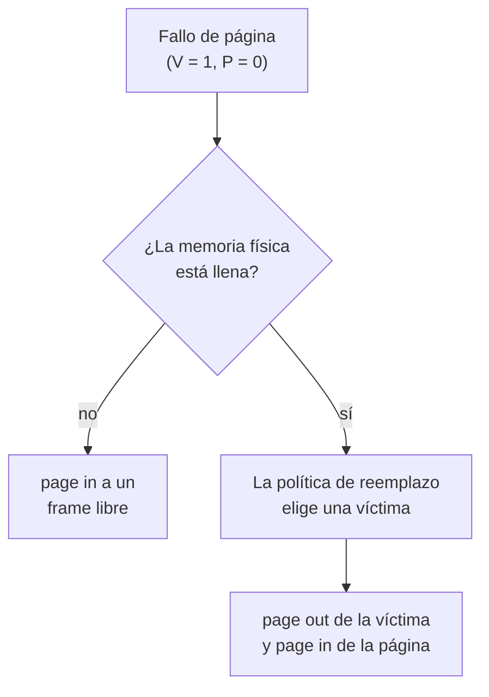

### Métrica: tiempo promedio de acceso a memoria (AMAT)

Con el número de *hits* y *misses* en la memoria se puede calcular el **AMAT** (*Average Memory Access Time*):

$$AMAT = P_{Hit} \cdot T_M + P_{Miss} \cdot T_D$$

| Argumento | Significado |
|---|---|
| $T_M$ | Costo de acceder a la memoria. |
| $T_D$ | Costo de acceder al disco. |
| $P_{Hit}$ | Probabilidad de encontrar el dato en la caché (un *hit*: $V = 1,\ P = 1$). |
| $P_{Miss}$ | Probabilidad de no encontrar el dato en la caché (un *miss*: $V = 1,\ P = 0$). |

**Simplificación.** Como el objetivo de la política de reemplazo es mejorar la tasa de *hits*, idealmente $P_{Hit} \to 1$, y la expresión queda:

$$AMAT \approx T_M + P_{Miss} \cdot T_D$$

> [!NOTE]
> **Complemento (OSTEP, cap. 22).** El libro define directamente $AMAT = T_M + P_{Miss} \cdot T_D$ y lo justifica así: el costo de acceder a la memoria **siempre** se paga, y cuando hay un *miss* se paga **además** el costo de traer el dato del disco. Por eso la forma simplificada de la clase coincide con la del libro.

### Ejemplo: formato de la dirección virtual

Se tiene un espacio de direcciones de 4 KB dividido en páginas de 256 B. Determine el formato de la dirección virtual.

* $size(AS) = 4\text{ KB} = 2^2 \cdot 2^{10} = 2^{12}$ B
* $size(page) = 256\text{ B} = 2^8$ B

$$n(VA) = \log_2(size(AS)) = \log_2(2^{12}) = 12 \text{ bits}$$
$$n(offset) = \log_2(size(page)) = \log_2(2^8) = 8 \text{ bits}$$
$$n(VPN) = n(VA) - n(offset) = 12 - 8 = 4 \text{ bits}$$

| Bits 11–8 | Bits 7–0 |
|---|---|
| VPN (4 bits) | *offset* (8 bits) |

Con 4 bits de VPN, el proceso tiene $2^4 = 16$ páginas virtuales (VPN 0 a 15).

### Ejemplo: cálculo del AMAT

Suponga que las referencias a memoria del proceso se resumen así:

| V | P | VPN |
|---|---|---|
| 1 | 1 | 0, 1, 2, 4, 5, 6, 7, 8, 9 |
| 1 | 0 | 3 |
| 0 | x | 10, 11, 12, 13, 14, 15 |

Es decir, las páginas 0 a 9 son válidas, todas están en memoria física excepto la 3 (que está en disco), y las páginas 10 a 15 no están mapeadas. El proceso accede a memoria según la siguiente traza (*reference row*):

| Traza | 0 | 1 | 2 | 3 | 4 | 5 | 6 | 7 | 8 | 9 |
|---|---|---|---|---|---|---|---|---|---|---|
| Resultado | H | H | H | **M** | H | H | H | H | H | H |

Suponiendo $T_D = 10$ ms y $T_M = 100$ ns, ¿cuál es el valor del AMAT?

* Total de accesos: 10. *Hits*: 9 ($P_{Hit} = 0.9$). *Misses*: 1 ($P_{Miss} = 0.1$).
* $T_M = 100 \text{ ns} = 100 \times 10^{-9} \text{ s} = 10^{-7}$ s.
* $T_D = 10 \text{ ms} = 10 \times 10^{-3} \text{ s} = 10^{-2}$ s.

Con la fórmula completa:

$$AMAT = (0.9)(10^{-7}) + (0.1)(10^{-2}) = 0.00100009 \text{ s} \approx 1 \text{ ms}$$

Con la fórmula simplificada:

$$AMAT = T_M + P_{Miss} \cdot T_D = 100 \text{ ns} + 0.1 \cdot 10 \text{ ms} = 0.0001 \text{ ms} + 1 \text{ ms} = 1.0001 \text{ ms} \approx 1 \text{ ms}$$

### Conclusión sobre el AMAT

Con los mismos valores ($T_D = 10$ ms y $T_M = 100$ ns) y la fórmula simplificada:

| $P_{Hit}$ | $P_{Miss}$ | AMAT |
|---|---|---|
| 90 % | 10 % | 1.0001 ms |
| 99.9 % | 0.1 % | 10.1 µs |
| 100 % | 0 % | 100 ns |

* **Conclusión:** el costo de acceder al disco es tan alto que **aun $P_{Miss}$ pequeños dominan el AMAT** de los programas en ejecución. Basta un 10 % de fallos para que el acceso promedio pase de nanosegundos a un milisegundo.
* **Solución:** evitar tantos *misses* como sea posible. Ese es el objetivo de la política de reemplazo.

## Políticas de reemplazo

Las políticas definen los criterios para seleccionar cuál página debe salir de memoria (*swap out*). Se estudiaron cuatro:

1. Política de reemplazo óptimo (*Optimal Replacement Policy*, OPT).
2. Política de reemplazo FIFO.
3. Política de reemplazo aleatoria.
4. Política de reemplazo LRU (*Least Recently Used*).

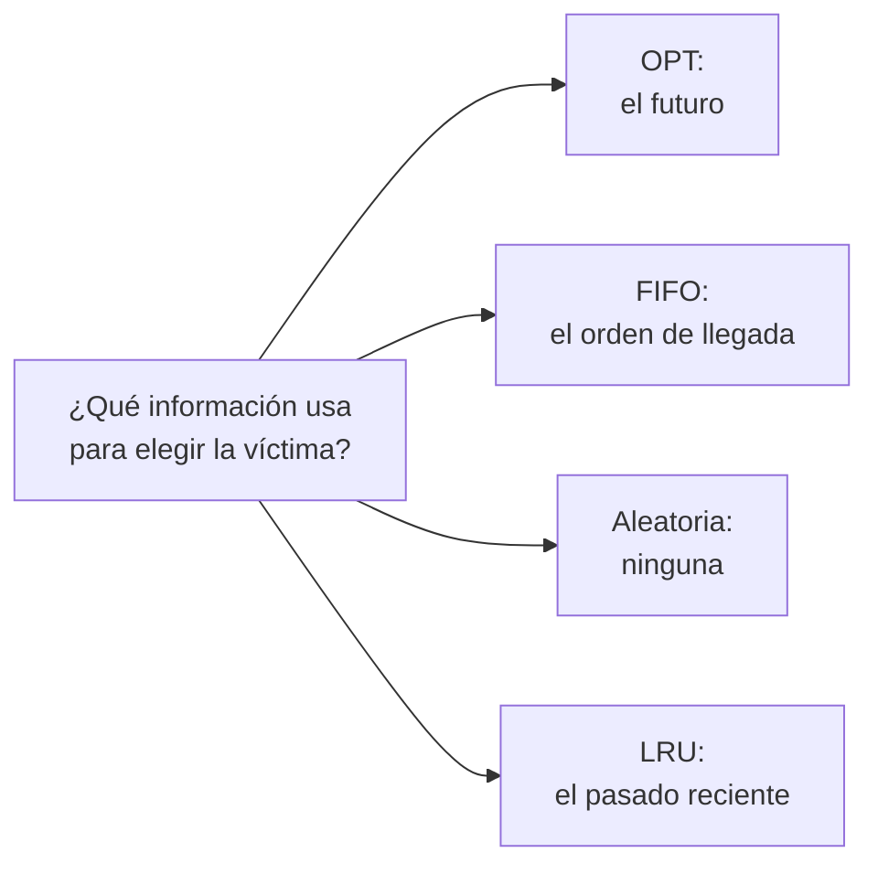

Todas se aplicaron sobre el **mismo ejemplo**: un programa accede a páginas virtuales en el orden de la siguiente traza, con una memoria de **tres *frames***.

| Traza (*reference row*) | 0 | 1 | 2 | 0 | 1 | 3 | 0 | 3 | 1 | 2 | 1 |
|---|---|---|---|---|---|---|---|---|---|---|---|

La tasa de *hits* se calcula como:

$$P_{Hit} = \frac{Hits}{Hits + Misses}$$

### Política de reemplazo óptimo (OPT)

* Propuesta por László Bélády en 1966.
* Reemplaza la página que se accederá **más lejos en el futuro**.
* Asegura el **menor número de *misses*** posible.
* Es fácil de describir, pero **imposible de implementar**: requiere que el sistema conozca los eventos futuros. No es práctica; solo sirve para **comparar** (es el caso ideal).

**Solución** (mirar al futuro):

| Acceso | ¿Hit/Miss? | Desalojo | Estado resultante |
|---|---|---|---|
| 0 | Miss | | 0 |
| 1 | Miss | | 0, 1 |
| 2 | Miss | | 0, 1, 2 |
| 0 | Hit | | 0, 1, 2 |
| 1 | Hit | | 0, 1, 2 |
| 3 | Miss | 2 | 0, 1, 3 |
| 0 | Hit | | 0, 1, 3 |
| 3 | Hit | | 0, 1, 3 |
| 1 | Hit | | 0, 1, 3 |
| 2 | Miss | 3 | 0, 1, 2 |
| 1 | Hit | | 0, 1, 2 |

Al llegar el acceso a 3, la memoria tiene 0, 1 y 2. Mirando la traza hacia adelante, 0 y 1 se vuelven a usar pronto, mientras que 2 es la que se usa más lejos en el futuro: se desaloja 2. Al llegar el acceso a 2, de las páginas 0, 1 y 3 la 3 no se vuelve a usar: se desaloja 3.

* *Hits*: 6. *Misses*: 5.
* $P_{Hit} = 6/11 = 0.545 \Rightarrow$ **54.5 %**.

**Problema:** el futuro no se conoce; la solución no es real.

### Política de reemplazo FIFO

* Reemplaza la página que **entró primero**.
* Las páginas entran a una cola cada vez que llegan a memoria.
* Cuando se requiere un reemplazo, se selecciona la página al **frente de la cola** (la primera que entró).

| Ventajas | Desventajas |
|---|---|
| Fácil de implementar. | No puede determinar la importancia de las páginas. |

**Solución** (el estado se lista desde la primera que entró):

| Acceso | ¿Hit/Miss? | Desalojo | Estado resultante (primera en entrar →) |
|---|---|---|---|
| 0 | Miss | | 0 |
| 1 | Miss | | 0, 1 |
| 2 | Miss | | 0, 1, 2 |
| 0 | Hit | | 0, 1, 2 |
| 1 | Hit | | 0, 1, 2 |
| 3 | Miss | 0 | 1, 2, 3 |
| 0 | Miss | 1 | 2, 3, 0 |
| 3 | Hit | | 2, 3, 0 |
| 1 | Miss | 2 | 3, 0, 1 |
| 2 | Miss | 3 | 0, 1, 2 |
| 1 | Hit | | 0, 1, 2 |

* *Hits*: 4. *Misses*: 7.
* $P_{Hit} = 4/11 = 0.364 \Rightarrow$ **36.4 %**, peor que el ideal (OPT).

Por ejemplo, cuando se accede a la página 3 y la memoria tiene 0, 1 y 2, sale la 0 porque fue la primera en entrar, aunque se acababa de usar y se vuelve a necesitar justo después.

#### Anomalía de Belady

Lo esperable es que el número de *hits* **aumente** cuando se aumenta la memoria. Con FIFO, **a veces es peor**. Con la traza:

| Traza | 1 | 2 | 3 | 4 | 1 | 2 | 5 | 1 | 2 | 3 | 4 | 5 |
|---|---|---|---|---|---|---|---|---|---|---|---|---|
| FIFO, 3 *frames* | M | M | M | M | M | M | M | H | H | M | M | H |
| FIFO, 4 *frames* | M | M | M | M | H | H | M | M | M | M | M | M |

* Con 3 *frames*: 3 *hits* y 9 *misses* (tasa de fallos de 9/12).
* Con 4 *frames*: 2 *hits* y 10 *misses* (tasa de fallos de 10/12).

Número de fallos de página según el número de *frames*, para la misma traza:

| *Frames* | 1 | 2 | 3 | 4 | 5 | 6 | 7 |
|---|---|---|---|---|---|---|---|
| Fallos de página | 12 | 12 | 9 | **10** | 5 | 5 | 5 |

Al pasar de 3 a 4 *frames* los fallos **suben** de 9 a 10: esa es la anomalía.

> [!NOTE]
> En la gráfica de la diapositiva, los puntos de 5, 6 y 7 *frames* aparecen en 7 fallos. El valor correcto es 5: a partir de 5 *frames* caben las 5 páginas distintas de la traza y solo quedan los 5 fallos de la primera vez que se toca cada una (7 es el número de *hits*).

> [!NOTE]
> **Complemento (OSTEP, cap. 22): ¿por qué LRU no sufre la anomalía?** LRU tiene la llamada **propiedad de pila** (*stack property*): con una caché de $N + 1$ páginas, su contenido siempre incluye el que tendría con $N$ páginas. Por eso, al aumentar el tamaño, la tasa de *hits* se mantiene o mejora. OPT también la cumple. FIFO y la aleatoria no la cumplen, y por eso pueden presentar este comportamiento anómalo.

### Política de reemplazo aleatoria

* **Selecciona de manera aleatoria** la página a reemplazar (por ejemplo, con un generador de números aleatorios entre los *frames* 0, 1 y 2).
* No tiene en cuenta qué bloque de datos se saca de memoria.
* Su desempeño es **aleatorio**: depende de la suerte que se tenga al elegir la página a reemplazar.

**Solución** (una ejecución; los desalojos los eligió el "dado"):

| Acceso | ¿Hit/Miss? | Desalojo | Estado resultante |
|---|---|---|---|
| 0 | Miss | | 0 |
| 1 | Miss | | 0, 1 |
| 2 | Miss | | 0, 1, 2 |
| 0 | Hit | | 0, 1, 2 |
| 1 | Hit | | 0, 1, 2 |
| 3 | Miss | 0 | 1, 2, 3 |
| 0 | Miss | 1 | 2, 3, 0 |
| 3 | Hit | | 2, 3, 0 |
| 1 | Miss | 3 | 2, 0, 1 |
| 2 | Hit | | 2, 0, 1 |
| 1 | Hit | | 2, 0, 1 |

* *Hits*: 5. *Misses*: 6.
* $P_{Hit} = 5/11 = 0.4545 \Rightarrow$ **45.45 %**.

En **esta** ejecución quedó entre FIFO y OPT. Con otra suerte el resultado cambia: puede igualar a OPT o quedar por debajo de FIFO.

> [!NOTE]
> **¿Qué tan seguido le va bien?** La diapositiva mostró el desempeño de la política aleatoria sobre esta traza en 10 000 ensayos. Calculando la probabilidad exacta (eligiendo la víctima uniformemente entre los 3 *frames*), el resultado es:
>
> | *Hits* | 2 | 3 | 4 | 5 | 6 |
> |---|---|---|---|---|---|
> | Probabilidad | 0.4 % | 3.3 % | 14.8 % | 37.0 % | 44.4 % |
>
> En algo más del 40 % de las ejecuciones iguala a OPT (6 *hits*), y en cerca del 4 % queda por debajo de FIFO (2 o 3 *hits*).

### Comparación de las políticas vistas

| Política | Tasa de *hits* (ejemplo) |
|---|---|
| OPT | 54.5 % |
| FIFO | 36.4 % |
| Aleatoria | 45.45 % (en la ejecución mostrada) |

* La política **FIFO** fue la peor, porque no puede determinar la importancia de los bloques accedidos.
* El desempeño de la política **aleatoria** varía y depende de la suerte que se tenga al elegir los reemplazos.

### Política LRU (*Least Recently Used*)

**Uso de la información del pasado:** si no se puede ver el futuro... ¡analice el pasado! Hay dos tipos de información histórica:

| Información histórica | Descripción | Algoritmo |
|---|---|---|
| Frecuencia (*frequency*) | Si una página ha sido accedida muchas veces, no debería ser reemplazada. | LFU (*Least Frequently Used*) |
| Recencia (*recency*) | Una página que haya sido accedida recientemente es muy probable que sea accedida de nuevo. | LRU (*Least Recently Used*) |

LRU:

* Reemplaza la página **menos recientemente usada**.
* Usa el pasado para predecir el futuro (aprovecha la localidad temporal).
* Cuando hay localidad, **LRU se aproxima a OPT**.

**Solución** (mirar al pasado; el estado se lista desde la menos recientemente usada):

| Acceso | ¿Hit/Miss? | Desalojo | Estado resultante (LRU →) |
|---|---|---|---|
| 0 | Miss | | 0 |
| 1 | Miss | | 0, 1 |
| 2 | Miss | | 0, 1, 2 |
| 0 | Hit | | 1, 2, 0 |
| 1 | Hit | | 2, 0, 1 |
| 3 | Miss | 2 | 0, 1, 3 |
| 0 | Hit | | 1, 3, 0 |
| 3 | Hit | | 1, 0, 3 |
| 1 | Hit | | 0, 3, 1 |
| 2 | Miss | 0 | 3, 1, 2 |
| 1 | Hit | | 3, 2, 1 |

* *Hits*: 6. *Misses*: 5.
* $P_{Hit} = 6/11 = 0.545 \Rightarrow$ **54.5 %**: en este ejemplo LRU **iguala a OPT**. Su desempeño depende del pasado.

> [!NOTE]
> **Complemento (OSTEP, cap. 22, y notas de ECE 3600): sin contar los fallos obligatorios.** Los primeros accesos a cada página son fallos inevitables para cualquier política (*compulsory misses*, o fallos de "arranque en frío"): la caché empieza vacía. La traza tiene 4 páginas distintas (0, 1, 2 y 3), así que hay 4 fallos obligatorios. Si se descuentan:
>
> | Política | *Hits* | *Misses* no obligatorios | Tasa de *hits* |
> |---|---|---|---|
> | OPT | 6 | 1 | 6/7 = 85.7 % |
> | LRU | 6 | 1 | 6/7 = 85.7 % |
> | FIFO | 4 | 3 | 4/7 = 57.1 % |
>
> Esto muestra que, en una traza corta, buena parte de los fallos no depende de la política sino de que la caché arranca vacía.

## Cargas de trabajo (*workloads*)

Las trazas anteriores son pequeñas. Para ver cómo se comportan las políticas con cargas de trabajo más complejas, se analizan tres casos con los experimentos de OSTEP. En las gráficas, el eje horizontal es el tamaño de la caché (número de bloques, de 1 a 100) y el vertical, la tasa de *hits*.

> [!NOTE]
> Las gráficas de esta sección reproducen las Figs. 22.6, 22.7 y 22.8 de OSTEP, que son las que se mostraron en clase. Se regeneraron para este apunte simulando las mismas cargas (100 o 50 páginas, 10 000 referencias, cachés de 1 a 100 bloques) con las cuatro políticas, y se les agregaron anotaciones que resumen lo que explica cada una. Los valores pueden diferir un poco de las figuras del libro porque las referencias aleatorias son otras; el comportamiento es el mismo.

### Sin localidad

Cada referencia es una página aleatoria dentro del conjunto de páginas a las que se accede.

* **Experimento:** se accede a 100 páginas únicas (0 a 99) a lo largo del tiempo, sobre un total de 10 000 referencias. La próxima página a elegir se toma al azar (por ejemplo: 1, 3, 3, 99, 34, ..., 3).
* El tamaño de la caché varía desde 1 hasta 100.

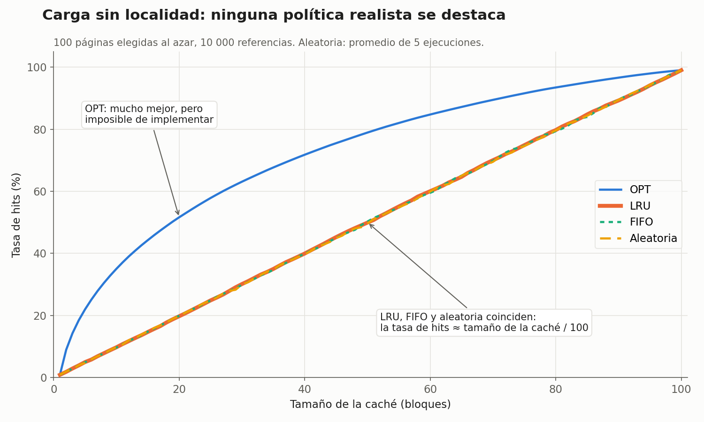

**Comportamiento:**

* No importa cuál de las políticas implementables (FIFO, aleatoria o LRU) se use: el desempeño (tasa de *hits*) es el mismo en todos los casos.
* A medida que aumenta el tamaño de la caché, el desempeño mejora.
* Cuando la caché es lo suficientemente grande para el *workload*, no importa cuál política se use: todas convergen al 100 % cuando los bloques referenciados llenan la caché.
* OPT se desempeña notablemente mejor que las políticas realistas, porque mirar el futuro hace mejor el trabajo de reemplazo.

### Con localidad 80-20

* **Localidad:** el 20 % de las páginas (las páginas "calientes", *hot pages*) reciben el 80 % de las referencias; el 20 % restante de las referencias se hace al otro 80 % de las páginas (las "frías").
* **Experimento:** accesos con ese patrón sobre un conjunto de 100 páginas; el tamaño de la caché varía desde 1 hasta 100.

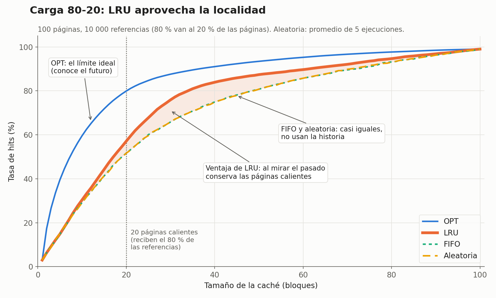

**Comportamiento** (es el caso más cercano a la realidad):

* **LRU tiene mejor desempeño que FIFO y la aleatoria** gracias a la localidad: es más probable que mantenga en memoria las páginas calientes.
* FIFO y la aleatoria se comportan de forma muy parecida entre sí.
* OPT nuevamente es la mejor, lo que muestra que la información histórica de LRU no es perfecta.

### Secuencial en ciclo (*looping sequential*)

Se hace referencia a 50 páginas (0, 1, 2, ..., 49) de manera secuencial, repitiendo estos accesos (0, 1, ..., 49, 0, 1, ..., 49, ...) hasta completar 10 000 accesos sobre esas 50 páginas.

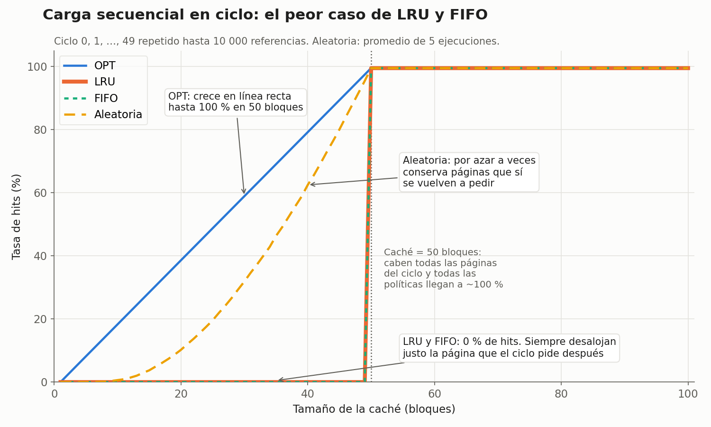

**Comportamiento:**

* Cuando la caché tiene menos de 50 bloques y el acceso es ordenado, siempre hay fallos:
  * **LRU y FIFO tienen 0 % de tasa de *hits***: siempre sacan justo la página más vieja, que es precisamente la que se va a necesitar a continuación en el ciclo.
  * **La aleatoria se comporta un poco mejor**, porque al elegir al azar a veces conserva páginas que sí se van a volver a usar. Es el caso en que la aleatoria supera a LRU.
* Con 50 bloques o más caben todas las páginas, y todas las políticas llegan prácticamente al 100 %.

## Implementación de algoritmos históricos

> [!NOTE]
> Esta parte no se desarrolló en clase (la diapositiva quedó "en construcción") y se estudia con los videos del Prof. Danny Múnera del curso ISI485 – Sistemas Operativos. El resumen que sigue es un **complemento** que integra esos videos con OSTEP (cap. 22, secciones 22.7 a 22.12) y con la descripción de los algoritmos de reemplazo de Wikipedia; en cada subsección se indica el video y la fuente correspondientes.

| Video | Tema | Sección de OSTEP |
|---|---|---|
| [C11P09 – Algoritmos de Reemplazo LRU Aproximados](https://www.youtube.com/watch?v=VrHt4aiFLKA&list=PLlTZ99qnw3zLKxI5vy8JuSZRHn9pR8G8P&index=9) | Por qué LRU exacto es costoso; bit de uso y algoritmo del reloj. | 22.7 y 22.8 |
| [C11P10 – Bit de modificado (*dirty bit*)](https://www.youtube.com/watch?v=L5JXVZ185lU&list=PLlTZ99qnw3zLKxI5vy8JuSZRHn9pR8G8P&index=10) | Páginas limpias y sucias en el reemplazo. | 22.9 |
| [C11P11 – Otras Políticas y Trashing](https://www.youtube.com/watch?v=PcqicMY1I-4&list=PLlTZ99qnw3zLKxI5vy8JuSZRHn9pR8G8P&index=11) | Cuándo traer páginas, cómo escribirlas y qué pasa cuando la memoria no alcanza. | 22.10 y 22.11 |

### ¿Por qué es costoso implementar LRU exacto?

*Fuente: OSTEP §22.7; video C11P09.*

Con FIFO, la lista de páginas solo se toca cuando entra una página nueva o cuando se desaloja una. Con LRU exacto, en cambio, **cada acceso a memoria** (cada búsqueda de instrucción, cada *load* o *store*) obliga a actualizar la estructura para mover la página al extremo de "más recientemente usada". Hacer ese trabajo de contabilidad en todos los accesos reduciría mucho el desempeño.

Una ayuda posible del hardware sería guardar, en cada acceso, la hora del acceso en un campo por página; al reemplazar, el SO buscaría la página con la hora más antigua. Pero eso tampoco escala: una máquina con 4 GB de memoria y páginas de 4 KB tiene $2^{32} / 2^{12} = 2^{20}$, es decir, alrededor de **un millón de páginas**, y recorrerlas todas en cada reemplazo es demasiado lento.

> **Pregunta clave (OSTEP):** si implementar LRU exacto es tan costoso, ¿se puede **aproximar** y obtener un comportamiento parecido?

### Aproximar LRU: el bit de uso y el algoritmo del reloj

*Fuente: OSTEP §22.8; Wikipedia, "Page replacement algorithm" (secciones *Second-chance* y *Clock*); video C11P09.*

> [!NOTE]
> Las figuras de los relojes de esta subsección se dibujaron para este apunte, siguiendo la representación del algoritmo del reloj (páginas en círculo, manecilla y bit de uso) de los videos del Prof. Danny Múnera.

La respuesta es sí, con un poco de apoyo del hardware:

* **Bit de uso** (o **bit de referencia**, el bit **R** de la PTE que se vio en la clase 12): hay uno por página. El **hardware** lo pone en 1 cada vez que la página se lee o se escribe; **nunca** lo pone en 0: eso le corresponde al SO.
* **Algoritmo del reloj** (*clock*): las páginas en memoria se organizan en una lista circular, con una "manecilla" que apunta a una de ellas. Cuando hay que reemplazar:
  * si la página apuntada tiene el bit de uso en **1**, se usó recientemente: el SO lo pone en 0 (le da una "segunda oportunidad") y avanza la manecilla;
  * si tiene el bit en **0**, no se ha usado desde la última pasada: esa es la **víctima**.

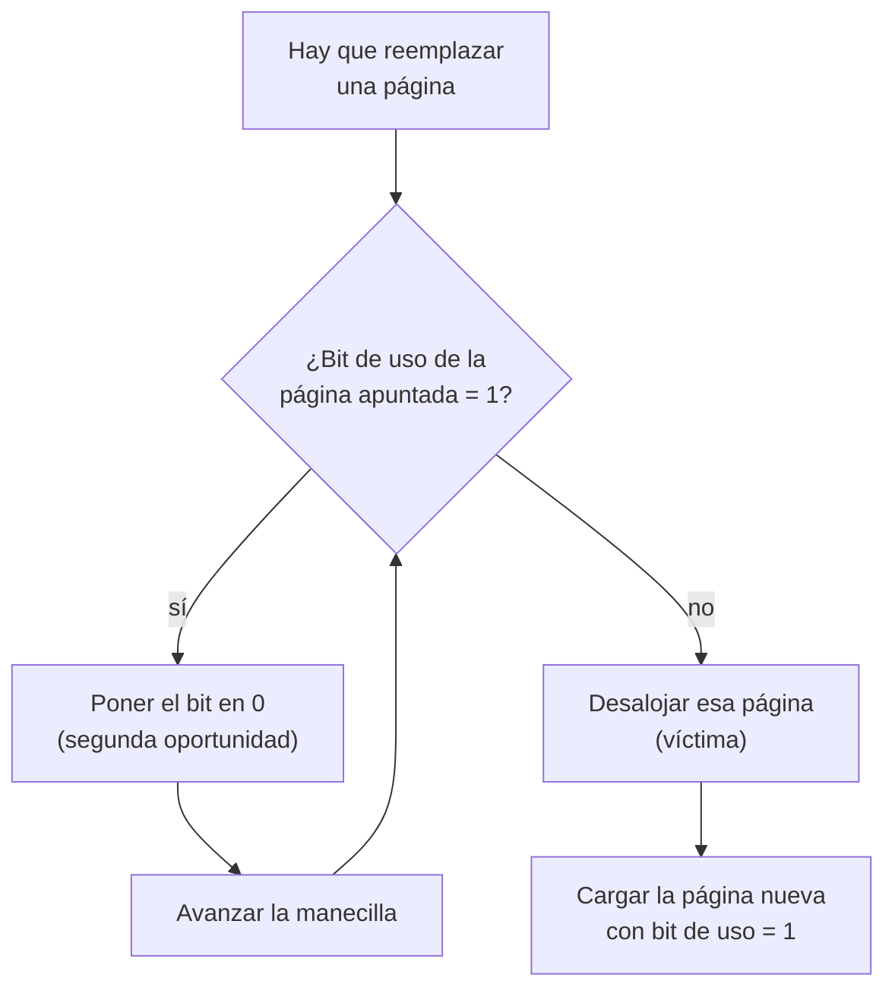

Visto como un reloj: las páginas son las horas, el bit de uso va en el círculo pequeño de cada una, y la manecilla apunta a la próxima candidata. En la figura, al ocurrir un fallo de página la manecilla está en C, que tiene bit 1: se le da una segunda oportunidad (su bit pasa a 0) y la manecilla avanza a D, que tiene bit 0, así que D es la víctima.

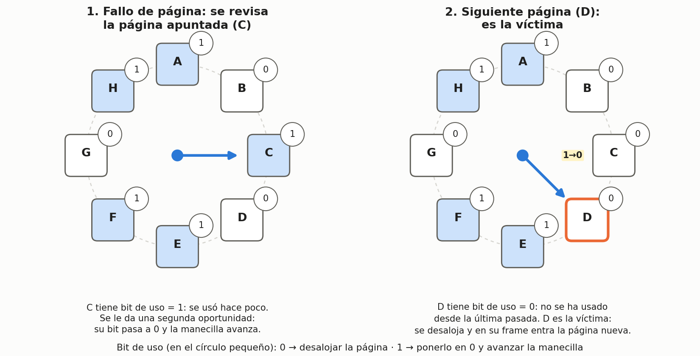

En el peor caso todas las páginas tienen el bit en 1: la manecilla da una vuelta completa poniéndolos en 0 y termina desalojando la primera que revisó. Por eso el reloj es una versión de FIFO "con segunda oportunidad" (Wikipedia lo describe como una implementación más eficiente del algoritmo *second-chance*, que en lugar de mover páginas al final de una cola solo avanza una manecilla).

**Ejemplo** (construido para este apunte, no dictado en clase): la traza de la clase, `0 1 2 0 1 3 0 3 1 2 1`, con 3 *frames*. Entre paréntesis va el bit de uso de cada *frame*; la manecilla avanza al *frame* siguiente después de cada carga.

| Acceso | ¿Hit/Miss? | Bits revisados por la manecilla | Desalojo | *Frames* (bit de uso) |
|---|---|---|---|---|
| 0 | Miss | | | 0(1), –, – |
| 1 | Miss | | | 0(1), 1(1), – |
| 2 | Miss | | | 0(1), 1(1), 2(1) |
| 0 | Hit | | | 0(1), 1(1), 2(1) |
| 1 | Hit | | | 0(1), 1(1), 2(1) |
| 3 | Miss | 0, 1 y 2 pasan de 1 a 0; vuelve a 0 | 0 | 3(1), 1(0), 2(0) |
| 0 | Miss | 1 tiene bit 0 | 1 | 3(1), 0(1), 2(0) |
| 3 | Hit | | | 3(1), 0(1), 2(0) |
| 1 | Miss | 2 tiene bit 0 | 2 | 3(1), 0(1), 1(1) |
| 2 | Miss | 3, 0 y 1 pasan de 1 a 0; vuelve a 3 | 3 | 2(1), 0(0), 1(0) |
| 1 | Hit | | | 2(1), 0(0), 1(1) |

La misma secuencia, dibujada como relojes de 3 *frames*. Cada reloj muestra el estado justo después del acceso indicado (sin los *hits* intermedios, que solo vuelven a poner en 1 el bit de la página accedida):

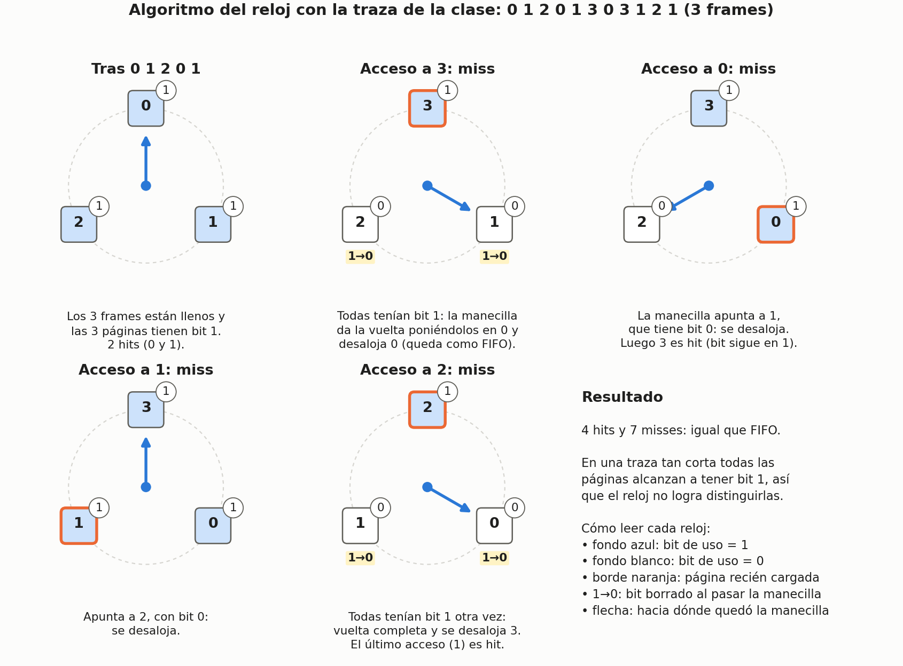

Resultado: 4 *hits* y 7 *misses*, igual que FIFO. En una traza tan corta todas las páginas alcanzan a tener el bit en 1 y el reloj no logra distinguirlas, así que se comporta como FIFO. Con más páginas y más accesos el bit de uso sí marca la diferencia, como muestra la siguiente gráfica de OSTEP para la carga 80-20 (aquí con una variante del reloj que revisa páginas al azar):

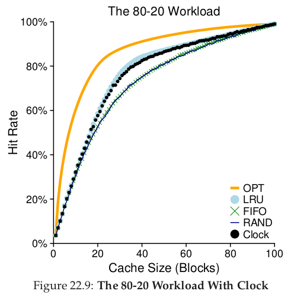

El reloj (puntos negros) no llega a LRU exacto, pero queda claramente por encima de FIFO y la aleatoria, que no usan historia. Esa es la idea: **una aproximación barata de LRU captura buena parte de su beneficio**.

### Páginas sucias: el bit de modificado

*Fuente: OSTEP §22.9; Wikipedia, "Page replacement algorithm" (sección *Not recently used*); video C11P10.*

> [!NOTE]
> Las figuras de esta subsección se dibujaron para este apunte a partir del esquema de memoria virtual, tabla de páginas, memoria física y disco de *Operating System Concepts* (Silberschatz, Galvin y Gagne), el mismo que se usó en las diapositivas de las clases 12 y 13.

Desalojar una página no siempre cuesta lo mismo:

* Si la página fue **modificada** mientras estaba en memoria (está **sucia**, *dirty*), hay que **escribirla en el disco** antes de reutilizar su *frame*: es costoso.
* Si **no** fue modificada (está **limpia**, *clean*), ya hay una copia válida en el disco y el *frame* se puede reutilizar sin ninguna E/S.

Las dos figuras comparan ambos casos con la misma situación: hay un fallo de página al acceder a B ($V = 1,\ P = 0$), la memoria física está llena y la política de reemplazo eligió como víctima a la página A. Lo único que cambia es el bit M de la PTE de A (fondo amarillo):

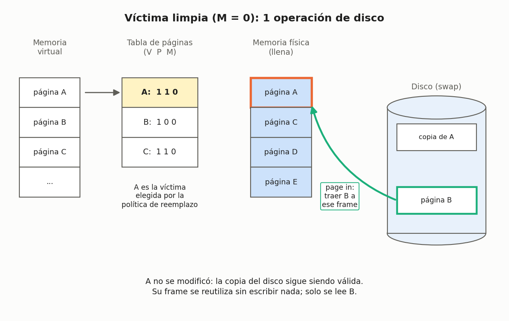

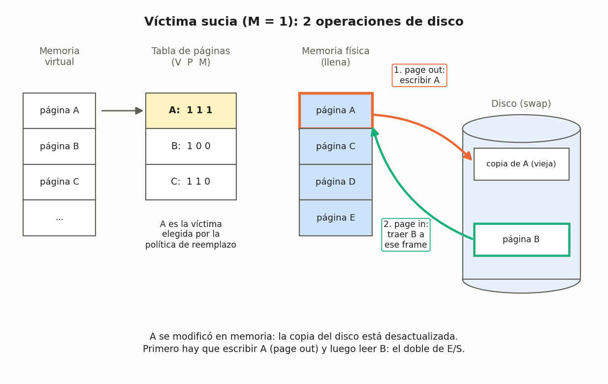

Con la víctima limpia, el fallo cuesta **una** operación de disco (leer B); con la víctima sucia cuesta **dos** (escribir A y leer B). Como cada acceso al disco domina el AMAT, elegir víctimas limpias puede reducir casi a la mitad el costo de esos fallos.

Por eso el hardware incluye un **bit de modificado** (*dirty bit*, el bit **M** de la PTE de la clase 12), que se pone en 1 cada vez que se escribe en la página, y muchos sistemas **prefieren desalojar páginas limpias**. Combinando el bit de uso (R) y el de modificado (M), las páginas quedan en cuatro clases, y se desaloja primero de la clase más baja:

| Clase | R (usada recientemente) | M (modificada) | Preferencia para desalojar |
|---|---|---|---|
| 0 | 0 | 0 | Primera: ni usada ni sucia. |
| 1 | 0 | 1 | Segunda: no usada, pero hay que escribirla al disco. |
| 2 | 1 | 0 | Tercera: usada recientemente, pero limpia. |
| 3 | 1 | 1 | Última: usada recientemente y sucia. |

OSTEP describe la misma idea aplicada al reloj: buscar primero páginas **no usadas y limpias**; si no hay, páginas no usadas pero sucias; y así sucesivamente.

### Otras políticas de la memoria virtual

*Fuente: OSTEP §22.10; video C11P11.*

El reemplazo no es la única decisión del subsistema de memoria virtual:

* **¿Cuándo traer una página a memoria?** (política de selección de páginas). Lo usual es la **paginación por demanda** (*demand paging*): la página se trae cuando se accede a ella. El SO también puede adivinar que una página se va a usar pronto y traerla por adelantado (***prefetching***); por ejemplo, si se trae la página de código P, es probable que pronto se necesite la P + 1. Solo conviene si la probabilidad de acierto es razonable.
* **¿Cómo escribir las páginas al disco?** En lugar de escribirlas una a una, muchos sistemas acumulan varias escrituras pendientes y las hacen juntas (***clustering*** o agrupamiento de escrituras), porque el disco es mucho más eficiente con una escritura grande que con muchas pequeñas. Es lo mismo que hace el *swap daemon* de la clase 12.

### *Thrashing*: cuando la memoria no alcanza

*Fuente: OSTEP §22.11; video C11P11.*

Si la memoria que necesitan los procesos en ejecución simplemente **excede** la memoria física disponible, el sistema pasa todo el tiempo trayendo y sacando páginas del disco: esto se llama ***thrashing***. Ninguna política de reemplazo lo resuelve, porque el problema es que no hay memoria suficiente.


Dos respuestas que menciona OSTEP:

* **Control de admisión** (*admission control*): ejecutar solo un subconjunto de procesos, de modo que sus ***working sets*** (las páginas que cada proceso está usando activamente) quepan en memoria y puedan avanzar. A veces es mejor hacer menos trabajo, pero bien, que todo a la vez y mal.
* **El *out-of-memory killer*** de algunas versiones de Linux: un *daemon* que, cuando la memoria está sobresuscrita, elige un proceso que usa mucha memoria y lo termina. Es efectivo, pero brusco.

> [!TIP]
> **Hacia dónde va el tema (OSTEP §22.12).** Los algoritmos modernos, como ARC, son parecidos a LRU pero tratan de evitar su peor caso, que es justamente la carga secuencial en ciclo (*scan resistance*). Y durante años la mejor "solución" al reemplazo fue comprar más memoria, porque el disco era tan lento que cualquier reemplazo frecuente volvía insoportable el sistema; con los SSD, mucho más rápidos, los algoritmos de reemplazo vuelven a importar.

## Actividades sugeridas

### 1. Vuelva a intentarlo: política aleatoria

Repita a mano el ejemplo de la política aleatoria con la traza `0 1 2 0 1 3 0 3 1 2 1` y tres *frames*, eligiendo la víctima al azar (por ejemplo, con un dado: 1–2 → *frame* 0, 3–4 → *frame* 1, 5–6 → *frame* 2). ¿Cuál es su tasa de *hits*? Compárela con la de sus compañeros y con la tabla de probabilidades de la sección de la política aleatoria.

### 2. Verifique los ejemplos de clase con el simulador

El simulador [`paging-policy.py`](../simulador/paging-policy.py) permite comprobar las tablas de esta clase. Desde la carpeta [`clase_13/simulador/`](../simulador/), por ejemplo para LRU:

```sh
python3 paging-policy.py -a 0,1,2,0,1,3,0,3,1,2,1 -p LRU -C 3 -c
```

Salida del simulador del curso:

```
Access: 0  MISS LRU ->          [0] <- MRU Replaced:- [Hits:0 Misses:1]
Access: 1  MISS LRU ->       [0, 1] <- MRU Replaced:- [Hits:0 Misses:2]
Access: 2  MISS LRU ->    [0, 1, 2] <- MRU Replaced:- [Hits:0 Misses:3]
Access: 0  HIT  LRU ->    [1, 2, 0] <- MRU Replaced:- [Hits:1 Misses:3]
Access: 1  HIT  LRU ->    [2, 0, 1] <- MRU Replaced:- [Hits:2 Misses:3]
Access: 3  MISS LRU ->    [0, 1, 3] <- MRU Replaced:2 [Hits:2 Misses:4]
Access: 0  HIT  LRU ->    [1, 3, 0] <- MRU Replaced:- [Hits:3 Misses:4]
Access: 3  HIT  LRU ->    [1, 0, 3] <- MRU Replaced:- [Hits:4 Misses:4]
Access: 1  HIT  LRU ->    [0, 3, 1] <- MRU Replaced:- [Hits:5 Misses:4]
Access: 2  MISS LRU ->    [3, 1, 2] <- MRU Replaced:0 [Hits:5 Misses:5]
Access: 1  HIT  LRU ->    [3, 2, 1] <- MRU Replaced:- [Hits:6 Misses:5]

FINALSTATS hits 6   misses 5   hitrate 54.55
```

La lista entre corchetes va de la página menos recientemente usada (`LRU ->`) a la más recientemente usada (`<- MRU`), igual que la columna "Estado resultante" de la tabla de LRU.

* Cambie `-p LRU` por `-p OPT`, `-p FIFO` y `-p RAND` y compare con las tablas de la clase. Con `RAND`, cambie la semilla (`-s 1`, `-s 2`, ...) y observe cómo varía el resultado.
* Compruebe la anomalía de Belady:

  ```sh
  python3 paging-policy.py -a 1,2,3,4,1,2,5,1,2,3,4,5 -p FIFO -C 3 -c
  python3 paging-policy.py -a 1,2,3,4,1,2,5,1,2,3,4,5 -p FIFO -C 4 -c
  ```

  Luego repita con `-p LRU`: ¿aparece la anomalía?

### 3. Ejercicio: FIFO frente a LRU con una traza aleatoria

Este ejercicio se tomó de las notas del curso ECE 3600 sobre el cap. 22 de OSTEP ([fog.misty.com](https://fog.misty.com/perry/os/Chapters/22-vm-beyondphys-policy/all-notes.html)). Con la opción `-s` el simulador genera una traza aleatoria (`-m 6` limita las páginas a 0–6); por defecto usa FIFO con una caché de 3 páginas:

```sh
python3 paging-policy.py -m 6 -c -s 10
```

```
Access: 3  MISS FirstIn ->          [3] <- Lastin  Replaced:- [Hits:0 Misses:1]
Access: 2  MISS FirstIn ->       [3, 2] <- Lastin  Replaced:- [Hits:0 Misses:2]
Access: 3  HIT  FirstIn ->       [3, 2] <- Lastin  Replaced:- [Hits:1 Misses:2]
Access: 1  MISS FirstIn ->    [3, 2, 1] <- Lastin  Replaced:- [Hits:1 Misses:3]
Access: 4  MISS FirstIn ->    [2, 1, 4] <- Lastin  Replaced:3 [Hits:1 Misses:4]
Access: 4  HIT  FirstIn ->    [2, 1, 4] <- Lastin  Replaced:- [Hits:2 Misses:4]
Access: 3  MISS FirstIn ->    [1, 4, 3] <- Lastin  Replaced:2 [Hits:2 Misses:5]
Access: 0  MISS FirstIn ->    [4, 3, 0] <- Lastin  Replaced:1 [Hits:2 Misses:6]
Access: 3  HIT  FirstIn ->    [4, 3, 0] <- Lastin  Replaced:- [Hits:3 Misses:6]
Access: 1  MISS FirstIn ->    [3, 0, 1] <- Lastin  Replaced:4 [Hits:3 Misses:7]

FINALSTATS hits 3   misses 7   hitrate 30.00
```

Resuelva a mano la misma traza (`3 2 3 1 4 4 3 0 3 1`) con LRU y compare con FIFO. Luego verifique con `-p LRU`.

<details>
<summary>Respuesta</summary>

Con LRU se obtienen 4 *hits* y 6 *misses* (tasa de *hits* del 40 %). La diferencia está en el acceso a la página 3 en la séptima posición: FIFO ya la había sacado porque fue la primera en entrar, mientras que LRU la conservó porque se había usado recientemente.

| Acceso | 3 | 2 | 3 | 1 | 4 | 4 | 3 | 0 | 3 | 1 |
|---|---|---|---|---|---|---|---|---|---|---|
| FIFO | M | M | H | M | M | H | M | M | H | M |
| LRU | M | M | H | M | M | H | **H** | M | H | M |

</details>

### 4. Tarea del simulador

Las 5 preguntas de la tarea del capítulo (peores casos para FIFO y LRU, trazas con y sin localidad, el algoritmo `CLOCK` y trazas reales con `valgrind`) están en [`clase_13/simulador/README.md`](../simulador/README.md).

## Resumen y Conclusión

Con esta clase se cierra el **Módulo 2 – Virtualización de memoria**. Cada mecanismo resolvió un problema del anterior y dejó otro abierto:

| Mecanismo | Idea | Problema que deja |
|---|---|---|
| *Dynamic Relocation* (base & bounds) | Un par de registros base/límite por proceso. | Fragmentación interna. |
| Segmentación | Base & bounds por segmento (*code*, *heap*, *stack*). | Fragmentación externa. |
| Paginación | Páginas de tamaño fijo y una tabla de páginas por proceso. | Tablas grandes (*overhead* de memoria) y doble acceso a memoria por referencia. |
| TLB | Caché de traducciones en la CPU. | *Overhead* de memoria y tasas de *miss* altas cuando no hay localidad. |
| *Swapping* (espacio *swap*) | El disco respalda las páginas que no caben en la RAM. | Cada fallo de página cuesta un acceso al disco, que domina el AMAT. |
| Políticas de reemplazo | Elegir bien qué página sacar cuando la memoria está llena. | — |

Y entre las políticas de reemplazo:

| Política | Información que usa | Implementación | Anomalía de Belady | Desempeño |
|---|---|---|---|---|
| OPT | El futuro | Imposible (solo sirve para comparar) | No | El máximo posible |
| LRU | El pasado reciente | Costosa; en la práctica se aproxima (bit de uso, reloj) | No | La mejor de las realistas cuando hay localidad |
| Aleatoria | Ninguna | Simple | Puede presentarla | Variable: depende de la suerte |
| FIFO | El orden de llegada | Simple | Sí | La peor en el ejemplo de clase |

La conclusión del módulo: la memoria virtual le da a cada proceso la ilusión de un espacio de direcciones privado, grande y contiguo, pero mantener esa ilusión con buen desempeño depende de **evitar viajes lentos**: a la tabla de páginas (TLB) y, sobre todo, al disco (una buena política de reemplazo). Con esto termina la virtualización de memoria; el siguiente módulo aborda la **concurrencia**.

## Referencias

* Arpaci-Dusseau, R. H. y Arpaci-Dusseau, A. C. *Operating Systems: Three Easy Pieces*, cap. 22, "Beyond Physical Memory: Policies": <https://pages.cs.wisc.edu/~remzi/OSTEP/vm-beyondphys-policy.pdf>. Los experimentos de las cargas de trabajo reproducen sus Figs. 22.6, 22.7 y 22.8, y la Fig. 22.9 se incluye tal cual.
* Tarea original del simulador `paging-policy.py`: <https://github.com/remzi-arpacidusseau/ostep-homework/tree/master/vm-beyondphys-policy>
* Notas de ECE 3600 sobre el cap. 22 de OSTEP: <https://fog.misty.com/perry/os/Chapters/22-vm-beyondphys-policy/all-notes.html>
* Múnera, D. Videos del curso ISI485 – Sistemas Operativos (enlazados en la sección "Implementación de algoritmos históricos").
* Silberschatz, A., Galvin, P. B. y Gagne, G. *Operating System Concepts*, 10.ª ed.: <https://www.os-book.com/OS10/index.html>. Las figuras de páginas limpias y sucias se basan en su esquema de memoria virtual.
* Wikipedia, "Page replacement algorithm" (secciones *Second-chance*, *Clock* y *Not recently used*): <https://en.wikipedia.org/wiki/Page_replacement_algorithm>
* La Fig. 22.9 de OSTEP (carga 80-20 con el reloj) se tomó de la copia publicada en las notas de ECE 3600: <https://fog.misty.com/perry/os/Chapters/22-vm-beyondphys-policy/>

---

> [!IMPORTANT]
> **Nota de Transparencia:** Este documento fue generado y adaptado mediante el uso de **IA Generativa**, a partir del manuscrito anotado de la clase y el resumen de la sesión de Zoom, complementado con el capítulo 22 de OSTEP, las notas de ECE 3600, los videos del Prof. Danny Múnera y Wikipedia. El contenido ha sido supervisado, validado y refinado por intervención humana para garantizar su precisión técnica y coherencia pedagógica. No obstante, pueden haber errores.
