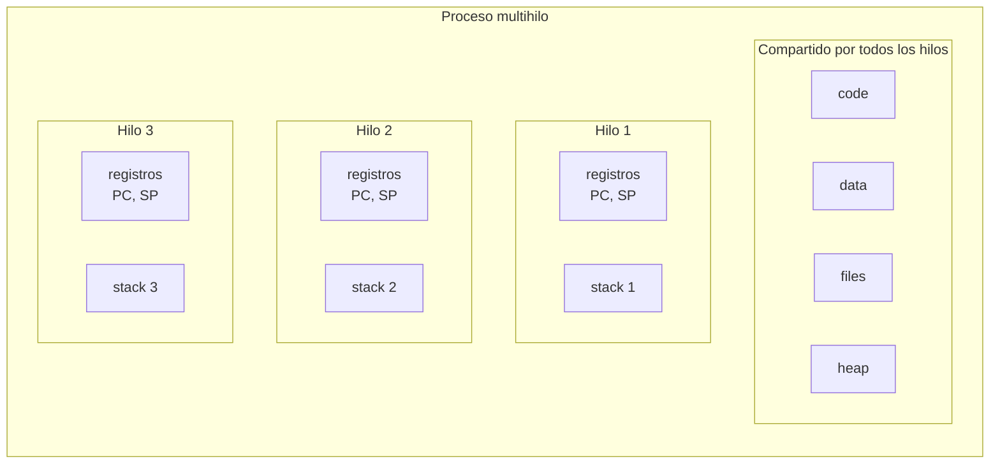
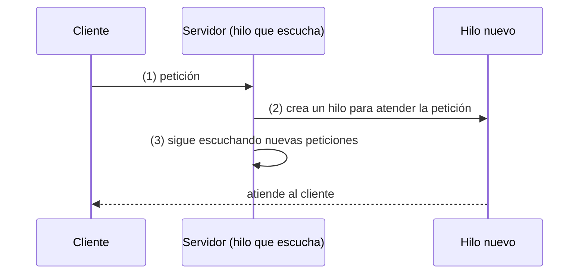
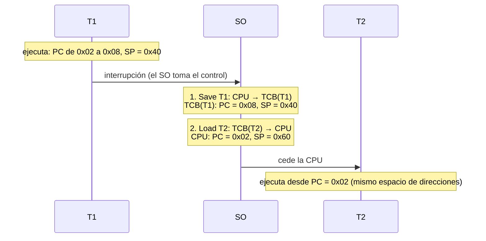
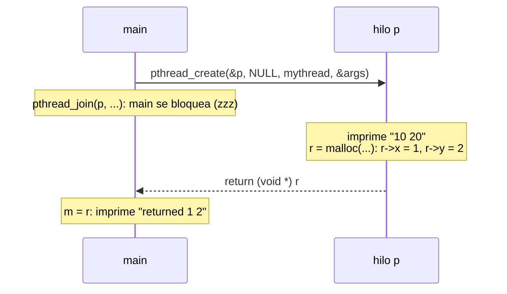

# Hilos (*threads*): introducción a la concurrencia y API POSIX (OSTEP, caps. 26 y 27)

## Objetivos de Aprendizaje

* **Explicar**: qué es un hilo de ejecución, qué tiene propio cada hilo (TID, registros, *stack*) y qué comparten los hilos de un mismo proceso (código, datos y *heap*).
* **Describir**: el papel del TCB en el cambio de contexto entre hilos y por qué, a diferencia del cambio entre procesos, el espacio de direcciones no cambia.
* **Diferenciar**: concurrencia de paralelismo, y paralelismo de datos de paralelismo de tareas.
* **Aplicar**: la API POSIX (`pthread_create`, `pthread_join`) para crear hilos, pasarles argumentos y recibir sus valores de retorno.
* **Analizar**: por qué dos hilos que actualizan una variable compartida producen resultados no deterministas (*race condition*), y qué son la sección crítica, la atomicidad y la exclusión mutua.

> Sesión del 13/10/2026: inicio del Módulo 3 (Concurrencia).

## Punto de partida: lo visto en los Módulos 1 y 2

Los dos primeros módulos estudiaron la **virtualización**: dar a cada programa la ilusión de tener un recurso propio cuando en realidad lo comparte.

| Módulo | Recurso virtualizado | Abstracción | Lo que se estudió |
|---|---|---|---|
| 1 | CPU | Proceso | Mecanismo: ejecución directa limitada (LDE: excepción, *syscall*, interrupción). Políticas del *scheduler*: FCFS, SJF, STCF y RR, que se combinan en el planificador general MLFQ. |
| 2 | Memoria | Espacio de direcciones (*address space*) | Traducción de direcciones $PA = AT(VA)$ con *dynamic relocation* (base y límite), segmentación, paginación y TLB (las *advanced page tables* no se vieron). Memoria virtual cuando $size(\sum VM_i) > PM$, usando memoria secundaria, y políticas de reemplazo OPT, FIFO, RANDOM y LRU ([`clase_13`](../../clase_13/apuntes_zoom/README.md)). |

Un proceso reúne ambas virtualizaciones:

$$\text{Proceso} = \text{CPU} + \text{Memoria} + \text{Información de I/O}$$

* **Contexto de CPU**: los registros (PC, SP, registros de propósito general).
* **Recursos del SO**: el espacio de direcciones (código, *heap*, *stack*), los archivos abiertos, etc.
* **Otra información**: PID, estado, dueño, etc.

Todo esto lo guarda el kernel en el **PCB** (*Process Control Block*): estado, número de proceso, *program counter* y registros (la parte de CPU), límites de memoria (la parte de memoria) y lista de archivos abiertos, entre otros.

## Del proceso al hilo

### Proceso con un solo hilo

Hasta ahora, cada proceso tenía **un único hilo de ejecución**:

* A ese hilo se asocian los registros de la CPU: PC, SP y registros de propósito general.
* El proceso tiene un **espacio de direcciones único** (código, *heap* y *stack*).

### Proceso multihilo

El Módulo 3 actualiza ese modelo: un proceso puede tener **varios hilos de ejecución**. Un proceso multihilo se caracteriza por:

* Múltiples puntos de ejecución.
* Múltiples PC (*program counter*), uno por hilo.
* Compartir el mismo espacio de direcciones entre los hilos.



En el espacio de direcciones esto se ve como **varios *stacks***, uno por hilo, mientras que el código, los datos y el *heap* son únicos y compartidos.

### Tendencias de las CPU

La tendencia del hardware es **mantener la misma velocidad de reloj y agregar más núcleos**: subir la frecuencia tiene un límite físico, porque genera calor. Por ejemplo, la máquina del profesor tiene 4 núcleos con 2 hilos de hardware cada uno, es decir, hasta 8 hilos simultáneos (en Linux se consulta con `lscpu`).

Un programa de un solo hilo usa un solo núcleo, sin importar cuántos tenga la máquina. Por eso, para tener programas más rápidos se necesita **ejecución concurrente**.

**Objetivo:** escribir aplicaciones que utilicen varias CPU. La herramienta para lograrlo es una nueva abstracción del SO: el **hilo** (*thread*).

## Desarrollo de aplicaciones concurrentes

Hay dos aproximaciones:

| | Aproximación 1 | Aproximación 2 |
|---|---|---|
| Idea | Construir la aplicación a partir de **procesos que se comunican** entre sí (por ejemplo, con tuberías o *pipes*). | Usar una nueva abstracción, el **hilo** (también llamado hebra, proceso ligero o miniproceso). Los hilos son como los procesos, excepto que los hilos de un mismo proceso **comparten el mismo espacio de direcciones**. |
| Ejemplo | Pestañas de un navegador | Procesador de texto |

Un ejemplo de la aproximación 1 en la terminal es una tubería, en la que la salida de un proceso es la entrada del otro:

```sh
cat /etc/os-release | head -2
```

`cat` (el proceso padre) escribe por su `fd(1)` en el *pipe*, y `head` (el hijo) lee del *pipe* por su `fd(0)`. En clase también se mostró la variante con `grep -i "version"` en lugar de `head -2`.

La aproximación 2 consume menos memoria, porque no hay que crear un proceso completo (con su propio espacio de direcciones) por cada tarea. Es la aproximación central del Módulo 3.

## Ejemplos de aplicaciones concurrentes

### Navegador web (multiproceso)

Muchos navegadores modernos permiten navegar en varias páginas usando pestañas, y **cada pestaña es un proceso separado**.

* **Problema** (con un solo proceso): cuando el contenido dinámico de un sitio (JavaScript, Flash, HTML5) tiene errores, puede ralentizar o bloquear el navegador. Si una aplicación web bloquea una pestaña, se bloquea el proceso entero, incluidas las demás pestañas.
* **Solución**: la arquitectura multiproceso de Google Chrome, que separa:
  * **Browser**: la interfaz de usuario, el disco y la red.
  * **Render**: la lógica para renderizar las páginas web (HTML, JavaScript, imágenes); si falla, solo se cae su pestaña ("Aw, Snap!").
  * **Plug-in**: un proceso por cada tipo de *plugin*.
  * También hay un proceso dedicado a la **GPU**.

### Procesador de texto (multihilo)

Un procesador de texto como Word puede verse como **un proceso con varios hilos**, por ejemplo tres:

* **Hilo 1**: interacción con el usuario (teclado y ratón).
* **Hilo 2**: dar formato al documento cuando se le indica y mostrarlo en pantalla.
* **Hilo 3**: escribir periódicamente el contenido de la RAM al disco (el guardado automático que permite recuperar el archivo si el programa se cierra).

Los tres hilos operan sobre el mismo documento, que está en la **memoria común compartida por los hilos** del proceso.

### Servidor

Un servidor acepta y atiende peticiones hechas por clientes. Hay tres formas de construirlo:

| Modelo | Funcionamiento | Ventaja | Desventaja |
|---|---|---|---|
| 1. Un solo proceso | Atiende a un cliente a la vez. | Bajo consumo de memoria. | Ineficiente y bloqueante: los demás clientes deben esperar. |
| 2. Varios procesos | Un proceso recibe las peticiones y, por cada una, crea un proceso nuevo que la atiende. | Atiende varios clientes a la vez. | Crear procesos consume tiempo y memoria. |
| 3. Multihilo | Un proceso con un hilo que escucha las peticiones y, por cada una, crea un hilo nuevo que la atiende. | Atiende varios clientes a la vez con menos memoria que el modelo 2. | Programar con hilos es más complejo (se verá en las siguientes secciones). |



Servidores web como Apache usan hilos para atender a los clientes. Nginx, también mencionado en clase, sigue otro enfoque: unos pocos procesos, cada uno atendiendo muchas conexiones con un modelo basado en eventos.

### Otros ejemplos

* **Sistemas operativos**: muchos son multihilo. En Linux, durante el arranque se crean varios hilos del kernel para tareas específicas (administrar dispositivos, gestionar memoria, manejar interrupciones), además de los que atienden las llamadas al sistema.
* **Otras aplicaciones**: Spotify (un hilo adelanta la descarga mientras otro reproduce), YouTube y Google Earth (cada hilo dibuja o descarga una parte del mapa).
* **Algoritmos y aplicaciones que hacen uso intensivo de la CPU**: ordenamiento, árboles, algoritmos sobre grafos, simulaciones, minería de datos, inteligencia artificial, *machine learning* y gráficos.

> Continuación: sesión del 15/10/2026.

## Hilos

### Aspectos importantes

Un **hilo de control** hace referencia a una secuencia de instrucciones que se están ejecutando en un programa. Es el ciclo de instrucción: el PC apunta a una instrucción del segmento de código, la CPU la trae al registro de instrucción (IR), la decodifica y la ejecuta, y así sucesivamente.

| Cada hilo tiene (propio) | Cada hilo comparte (con los demás hilos del proceso) |
|---|---|
| Un identificador de hilo (**TID**), análogo al PID de un proceso | **Código**: el segmento de texto (*text*) y el de datos (*data*), donde viven las variables globales |
| Un conjunto de **registros**, incluidos el **PC** y el **SP** | **Heap**: la memoria dinámica (`malloc`) |
| Un **stack**: variables locales, argumentos de funciones, valores de retorno | |

**Analogía de la casa:** el *stack* de cada hilo es una habitación privada; el código, los datos y el *heap* son las áreas comunes donde todos los habitantes interactúan.

### Espacio de direcciones con varios *stacks* (*multi-stack*)

Todos los hilos comparten los segmentos de código y *heap* del espacio de direcciones, pero **cada hilo tiene su propio *stack***. En el ejemplo de OSTEP (Fig. 26.1), con un espacio de direcciones de 16 KB:

| Un solo hilo | Dos hilos |
|---|---|
| 0 KB – 1 KB: código del programa | 0 KB – 1 KB: código del programa (PC del hilo 1 y PC del hilo 2) |
| 1 KB – 2 KB: *heap* (crece hacia direcciones mayores) | 1 KB – 2 KB: *heap* |
| libre | libre |
| | *Stack* (2) |
| | libre |
| 15 KB – 16 KB: *stack* (1) (crece hacia direcciones menores) | 15 KB – 16 KB: *stack* (1) |

Como los *stacks* ya no están solo al final del espacio de direcciones, el espacio libre entre *heap* y *stack* queda dividido.

### TCB (*Thread Control Block*)

Así como cada proceso tiene un PCB, cada hilo tiene un **TCB**: la estructura que **almacena el estado de cada hilo** para poder guardar y restaurar su contexto. Contiene, entre otros, el PC, el SP, el estado y los demás registros. El PC de cada TCB apunta al código compartido y el SP, al *stack* propio de ese hilo.

### Cambio de contexto entre hilos

El cambio de contexto entre hilos es **similar al de los procesos**, pero **el espacio de direcciones no cambia**. Para pasar de T1 a T2:

1. **Save T1**: se almacenan los registros de la CPU en el TCB de T1 (CPU → TCB(T1)).
2. **Load T2**: se cargan en la CPU los registros guardados en el TCB de T2 (TCB(T2) → CPU).
3. Se mantiene el mismo espacio de direcciones.

#### Ejemplo

Estado inicial:

| | PC | SP |
|---|---|---|
| TCB de T1 | 0x02 | 0x40 |
| TCB de T2 | 0x02 | 0x60 |
| CPU | ? | ? |

T1 empieza a ejecutarse (CPU: PC = 0x02, SP = 0x40) y avanza hasta PC = 0x08. En ese momento el SO hace el cambio de contexto T1 → T2:



| Paso | CPU (PC, SP) | TCB de T1 (PC, SP) | TCB de T2 (PC, SP) |
|---|---|---|---|
| Inicio | ?, ? | 0x02, 0x40 | 0x02, 0x60 |
| Se carga T1 | 0x02, 0x40 | 0x02, 0x40 | 0x02, 0x60 |
| T1 avanza | 0x08, 0x40 | 0x02, 0x40 | 0x02, 0x60 |
| Save T1 | 0x08, 0x40 | **0x08, 0x40** | 0x02, 0x60 |
| Load T2 | **0x02, 0x60** | 0x08, 0x40 | 0x02, 0x60 |

Cuando T1 vuelva a ejecutarse, continuará desde PC = 0x08, que es lo que quedó en su TCB.

### Concurrencia frente a paralelismo

| | Concurrencia | Paralelismo |
|---|---|---|
| Idea | Permite ejecutar **más de una tarea conforme transcurre el tiempo**. | Permite hacer **de manera simultánea (a la vez)** más de una tarea. |
| Recurso | Un solo procesador: el *scheduler* proporciona la concurrencia alternando las tareas. | Propio de sistemas *multicore* o multiprocesador. |
| En un instante | **Una** tarea a la vez. | **Varias** tareas a la vez. |
| Analogía | Un trabajador que alterna entre tareas. | Varios trabajadores, cada uno en una tarea. |

Línea de tiempo con cuatro hilos:

| | | | | | | | | | |
|---|---|---|---|---|---|---|---|---|---|
| Un núcleo (concurrencia) | T1 | T2 | T3 | T4 | T1 | T2 | T3 | T4 | … |
| Núcleo 1 (paralelismo) | T1 | T3 | T1 | T3 | T1 | … | | | |
| Núcleo 2 (paralelismo) | T2 | T4 | T2 | T4 | T2 | … | | | |

En el sistema paralelo hay concurrencia dentro de cada núcleo, y además dos núcleos trabajan al mismo tiempo.

### Retos de la programación con varios núcleos

El aprovechamiento de los sistemas *multicore* o multiprocesador impone nuevos retos a los programadores:

* **División de actividades**: qué tarea hace cada hilo.
* **Balance de carga**: repartir el trabajo de forma equitativa.
* **Segmentación de datos**: qué porción de los datos procesa cada hilo.
* **Dependencia de datos**: un hilo no puede hacer su tarea hasta que otro produzca un resultado previo (como las dependencias en un *pipeline*).
* **Testeo y depuración**: el comportamiento no determinista hace que los errores sean difíciles de reproducir.

### Tipos de paralelismo

* **Paralelismo de datos**: se dividen los datos en subconjuntos, y cada núcleo aplica **la misma operación** sobre su subconjunto. Por ejemplo, cuatro hilos suman cada uno una cuarta parte de un arreglo con la misma función.
* **Paralelismo de tareas**: se distribuyen hilos entre los núcleos de modo que **cada hilo realiza una operación distinta** sobre los datos.

**Analogía del lote de cultivo:** en paralelismo de datos, el lote se divide en parcelas y cada trabajador ara la suya (misma función f sobre datos distintos). En paralelismo de tareas, sobre el mismo lote un trabajador ara la tierra (f), otro pone la semilla (g) y otro riega el agua (h).

### ¿Por qué se usan los hilos?

#### Paralelizar

Suponga que se desean sumar dos arreglos muy grandes, A y B, y llevar el resultado a un tercero, C. ¿Cómo mejorar el desempeño?

* **Una sola CPU**: un hilo recorre todo el arreglo calculando `C[i] = A[i] + B[i]`.
* **Varias CPU**: se usa un hilo por CPU. Con dos CPU, un hilo suma la primera mitad (índices $[0, N/2)$) y el otro la segunda (índices $[N/2, N)$), ambos con la misma función `C[i] = A[i] + B[i]`. Es paralelismo de datos.

**Paralelizar** consiste en transformar un programa estándar de un solo hilo en uno de **varios hilos** de ejecución. Este ejemplo se ejecutó en la sesión del 20/10 (ver [Suma de vectores en paralelo](#suma-de-vectores-en-paralelo)).

#### *Overlap* (solapamiento con I/O)

Los hilos también evitan que el progreso de un programa se bloquee por una operación de I/O, que es mucho más lenta que la CPU:

* **Sin *overlap***: mientras T1 espera su I/O, la CPU queda ociosa; T2 solo corre cuando T1 termina.
* **Con *overlap***: mientras T1 espera su I/O, T2 usa la CPU; cuando la I/O termina, T1 retoma.

Casos típicos son las aplicaciones cliente-servidor (servidores web, DBMS, etc.).

## Creación de hilos con la API POSIX (*pthreads*)

Hay similitudes en la gestión de procesos y de hilos:

| | Procesos | Hilos |
|---|---|---|
| Crear | `fork()` | `pthread_create()` |
| Terminar | `return` / `exit` | `return` de la rutina del hilo |
| Esperar a que termine | `waitpid()` | `pthread_join()` |

### Ejemplo: orden de ejecución (`t0.c`)

El programa crea dos hilos independientes (`p1` y `p2`) que ejecutan la misma tarea, `mythread`, que imprime el argumento que recibe:

```c
void *mythread(void *arg) {
    printf("%s\n", (char *) arg);
    return NULL;
}

int main(int argc, char *argv[]) {
    ...
    pthread_t p1, p2;
    printf("main: begin\n");
    pthread_create(&p1, NULL, mythread, "A");
    pthread_create(&p2, NULL, mythread, "B");
    // join waits for the threads to finish
    pthread_join(p1, NULL);
    pthread_join(p2, NULL);
    printf("main: end\n");
    return 0;
}
```

Al ejecutarse hay tres hilos: `main`, T1 (`mythread("A")`) y T2 (`mythread("B")`).

**Pregunta:** ¿cuál hilo se ejecuta primero?

**Respuesta:** el orden es **indeterminado**: depende del *scheduler*. La salida es **no determinista**.

Tres trazas posibles (OSTEP, Figs. 26.3 a 26.5):

| Traza | Secuencia | Qué ocurre | Salida |
|---|---|---|---|
| 1 | main → T1 → main → T2 → main | `main` crea ambos hilos y espera a T1; T1 imprime "A"; `main` espera a T2; T2 imprime "B"; `main` termina. | `main: begin`, `A`, `B`, `main: end` |
| 2 | main → T1 → main → T2 → main | T1 corre en cuanto se crea e imprime "A"; `main` crea T2, que corre e imprime "B"; los dos `pthread_join` retornan de inmediato porque los hilos ya terminaron. | `main: begin`, `A`, `B`, `main: end` |
| 3 | main → T2 → main → T1 → main | `main` crea ambos hilos, pero el *scheduler* ejecuta primero a T2, que imprime "B"; `main` espera a T1, que imprime "A"; el `join` de T2 retorna de inmediato. | `main: begin`, **`B`, `A`**, `main: end` |

Las trazas 1 y 2 producen la misma salida, pero con secuencias de instrucciones diferentes; la traza 3 cambia la salida. Que el mismo programa pueda dar resultados distintos en ejecuciones distintas va contra una característica fundamental de un algoritmo: ser predecible.

En la ejecución de referencia de [`ejemplos/api/`](ejemplos/api/README.md#t0-orden-de-ejecución), de 1000 corridas 995 imprimieron A antes que B y 5 imprimieron B antes que A: el orden "habitual" no está garantizado.

> Continuación: sesión del 20/10/2026.

## Datos compartidos

### Ejemplo: dos hilos que actualizan un contador (`t1.c`)

El programa crea dos hilos (`p1` y `p2`) que ejecutan `mythread`, y ambos intentan actualizar una **variable global**, `counter`. **Pregunta:** ¿qué implicaciones trae esto?

```c
int max;
volatile int counter = 0; // shared global variable

void *mythread(void *arg) {
    char *letter = arg;
    int i; // stack (private per thread)
    printf("%s: begin [addr of i: %p]\n", letter, &i);
    for (i = 0; i < max; i++) {
        counter = counter + 1; // shared: only one
    }
    printf("%s: done\n", letter);
    return NULL;
}
```

`main` lee `max` del primer argumento, crea los dos hilos, espera a ambos e imprime el valor final de `counter` y el que debería tener, `max * 2`.

* `max` y `counter` son **globales**: están en el segmento de datos, que comparten todos los hilos. Hay **un solo** `counter`.
* `letter` e `i` son **locales**: cada hilo tiene los suyos en su propio *stack*. Por eso cada hilo imprime una dirección distinta para `i`.

**Analogía:** las variables locales son el "baño privado" de cada hilo; las globales, un "baño público" por el que todos compiten.

En clase se ejecutó `./t1` con valores crecientes:

| Iteraciones por hilo (`max`) | Valor esperado | Resultado |
|---|---|---|
| 1 000 y 10 000 | 2 000 y 20 000 | Correcto |
| 100 000 o más | 200 000 o más | Menor que el esperado, y distinto en cada ejecución |
| 10 000 000 (tres veces) | 20 000 000 | Ninguna de las tres coincidió |

Las salidas completas de una ejecución de referencia están en [`ejemplos/api/`](ejemplos/api/README.md#t1-datos-compartidos).

> [!NOTE]
> La diapositiva de "Posibles resultados" muestra la salida del programa de OSTEP (`main: done with both (counter = …)`), que tiene otro formato. El `t1.c` que se ejecutó recibe el número de iteraciones como argumento (`./t1 10000000`) e imprime `[counter: …]` y `[should: …]`.

### ¿Por qué estos resultados tan raros?

La salida es **no determinista**: hay un orden de ejecución diferente en cada caso y, por eso, valores diferentes de `counter`.

La instrucción `counter = counter + 1` **no es una sola instrucción** de máquina. El compilador la traduce a tres instrucciones x86 (las direcciones son las del ejemplo de OSTEP; `0x8049a1c` es la dirección de `counter`):

```asm
100  mov 0x8049a1c, %eax   ; carga counter en el registro eax
105  add $0x1, %eax        ; suma 1 a eax
108  mov %eax, 0x8049a1c   ; escribe eax de vuelta en counter
```

Si el SO hace un cambio de contexto **entre** estas instrucciones, otro hilo puede leer un valor de `counter` que todavía no se ha actualizado.

### Análisis paso a paso

Estado inicial: `counter` vale 50 y ambos hilos tienen su PC en 100 (en su TCB). Secuencia de ejecución, una instrucción por paso:

$$T1 \rightarrow T1 \xrightarrow{\ CS\ } T2 \rightarrow T2 \rightarrow T2 \xrightarrow{\ CS\ } T1$$

| SO | Hilo 1 | Hilo 2 | PC | `%eax` | `counter` |
|---|---|---|---|---|---|
| | antes de la sección crítica | | 100 | 0 | 50 |
| | `mov 0x8049a1c, %eax` | | 105 | 50 | 50 |
| | `add $0x1, %eax` | | 108 | **51** | 50 |
| interrupción: guarda T1 (TCB de T1: `%eax` = 51, PC = 108), restaura T2 | | | 100 | 0 | 50 |
| | | `mov 0x8049a1c, %eax` | 105 | 50 | 50 |
| | | `add $0x1, %eax` | 108 | 51 | 50 |
| | | `mov %eax, 0x8049a1c` | 113 | 51 | **51** |
| interrupción: guarda T2, restaura T1 (`%eax` = 51, PC = 108) | | | 108 | 51 | 51 |
| | `mov %eax, 0x8049a1c` | | 113 | 51 | **51** ❌ |

**Conclusión:** tras ejecutar `counter = counter + 1` en ambos hilos se esperaba un valor final de **52**, pero el resultado fue **51**. T1 había leído 50 antes de la interrupción y, al reanudar, escribió su 51 encima del 51 de T2: uno de los dos incrementos se perdió. Repetido millones de veces, esto explica los valores menores que el esperado de `t1`.

Si `counter` fuera, por ejemplo, el totalizador de las transacciones de un banco en un día, el error significaría pérdidas o inconsistencias reales.

### Condición de carrera, sección crítica y exclusión mutua

* **Condición de carrera** (*race condition*, *data race*): dos o más hilos **compiten modificando variables compartidas** y los resultados son **no deterministas** (por eso no se obtuvo lo esperado).
* **Sección crítica**: **porción de código donde se accede a una variable compartida**. En el ejemplo es `counter = counter + 1`, es decir, las tres instrucciones de ensamblador.
* La sección crítica **no debería ser accedida de manera concurrente**: si varios hilos la ejecutan al mismo tiempo, pueden generar una *race condition*.
* **Atomicidad**: para las regiones críticas se requiere soporte de instrucciones especiales que **no pueden ser interrumpidas**. Por ejemplo, una instrucción hipotética (OSTEP, §26.5) que haga en un solo paso lo que hacen las tres anteriores:

  | No hay atomicidad | Instrucción atómica (hipotética) |
  |---|---|
  | `mov 0x8049a1c, %eax`<br/>`add $0x1, %eax`<br/>`mov %eax, 0x8049a1c` | `memory-add 0x8049a1c, $0x1` |

* **Exclusión mutua**: propiedad que garantiza que **un solo hilo** se encuentre ejecutando el código de la región crítica.

**Analogía del vestidor** (*wrong fitting room*): un vestidor con varias puertas, cada una con su propio candado, no protege a quien está adentro; para que haya exclusión mutua debe haber una sola forma de entrar.

## API de hilos: argumentos y valores de retorno (OSTEP, cap. 27)

### Crear un hilo: `pthread_create`

```c
#include <pthread.h>

int pthread_create(pthread_t *thread,
                   const pthread_attr_t *attr,
                   void *(*start_routine)(void *),
                   void *arg);
```

* `thread`: permite manejar el hilo (es su identificador, de tipo `pthread_t`).
* `attr`: atributos del hilo (tamaño del *stack*, prioridad en el planificador, …). En el curso se pasa `NULL` (atributos por defecto).
* `start_routine`: la función con la que inicia el hilo (la rutina del hilo o *handler*).
* `arg`: el argumento que se pasa a `start_routine`. Al ser un apuntador a `void`, permite pasar argumentos de **cualquier tipo**.

Al llamar a `pthread_create` el programa pasa de tener un hilo a tener dos: el padre, que sigue ejecutando `main`, y el hijo, que ejecuta `start_routine`.

Si la rutina usara otros tipos, la declaración cambiaría. Por ejemplo, con un argumento entero sería `void *(*start_routine)(int)` con `int arg`, y con un retorno entero, `int (*start_routine)(void *)`. Para no depender del tipo, la API usa `void *` en ambos lugares y la rutina hace el *cast* adentro.

### Pasar varios argumentos: un `struct`

Para pasar varios datos (posiblemente de tipos distintos), se empaquetan en un `struct`, se pasa su dirección y, dentro de la rutina, se hace *cast* del `void *` al tipo del `struct`:

```c
typedef struct __myarg_t {
    int a;
    int b;
} myarg_t;

void *mythread(void *arg) {
    myarg_t *m = (myarg_t *) arg;
    printf("%d %d\n", m->a, m->b);
    return NULL;
}

int main(int argc, char *argv[]) {
    pthread_t p;
    myarg_t args;
    args.a = 10;
    args.b = 20;
    pthread_create(&p, NULL, mythread, &args);
    ...
}
```

Como `m` es un apuntador, a los campos se accede con el operador `->`.

### Esperar a que un hilo termine: `pthread_join`

```c
int pthread_join(pthread_t thread, void **value_ptr);
```

* `thread`: el hilo por el cual se va a esperar.
* `value_ptr`: un apuntador al valor de retorno. Como `pthread_join` cambia (internamente) ese valor, se le debe **pasar un apuntador** a la variable donde se quiere recibir; por eso es un doble apuntador (`void **`).

El hilo que llama a `pthread_join` queda bloqueado ("dormido") hasta que el hilo indicado termina su rutina.

### Ejemplo: argumentos y retorno con `struct` (`t2.c`)

```c
typedef struct __myret_t {
    int x;
    int y;
} myret_t;

void *mythread(void *arg) {
    myarg_t *m = (myarg_t *) arg;
    printf("%d %d\n", m->a, m->b);
    myret_t *r = malloc(sizeof(myret_t)); // en el heap
    r->x = 1;
    r->y = 2;
    return (void *) r;
}

int main(int argc, char *argv[]) {
    pthread_t p;
    myret_t *m;
    myarg_t args;
    args.a = 10;
    args.b = 20;
    pthread_create(&p, NULL, mythread, &args);
    pthread_join(p, (void **) &m); // main espera dentro de pthread_join
    printf("returned %d %d\n", m->x, m->y);
    free(m);
    return 0;
}
```

Salida: `10 20` (impresa por el hilo) y luego `returned 1 2` (impresa por `main`).



> [!IMPORTANT]
> **Cuidado con cómo se devuelven los valores desde un hilo.** Esta versión es incorrecta:
>
> ```c
> void *mythread(void *arg) {
>     myarg_t *m = (myarg_t *) arg;
>     printf("%d %d\n", m->a, m->b);
>     myret_t r; // ALLOCATED ON STACK: BAD!
>     r.x = 1;
>     r.y = 2;
>     return (void *) &r;
> }
> ```
>
> `r` es una variable local: vive en el *stack* del hilo, y esa memoria se **libera automáticamente** cuando la rutina retorna. `main` recibiría la dirección de una memoria que ya no es válida. Por eso el resultado se reserva en el *heap* con `malloc` (y quien lo recibe lo libera con `free`).

### Pasar un valor simple (`t3.c`)

Si solo hay que pasar un número, no hace falta `struct` ni `malloc`: el valor puede viajar directamente dentro del `void *`. La diapositiva lo muestra con `int`:

```c
void *mythread(void *arg) {
    int m = (int) arg;
    printf("%d\n", m);
    return (void *) (arg + 1);
}
...
    int rc, m;
    pthread_create(&p, NULL, mythread, (void *) 100);
    pthread_join(p, (void **) &m);
    printf("returned %d\n", m);
```

> [!WARNING]
> Esta versión **no es correcta en un sistema de 64 bits**: allí `sizeof(int)` es 4 y `sizeof(void *)` es 8, de modo que `pthread_join` escribe 8 bytes sobre un `int` de 4. La versión corregida, [`t3.c`](ejemplos/api/t3.c), usa `long long int`, que tiene el mismo tamaño que `void *`. Este ejemplo no se ejecutó en clase; su salida de referencia (`100` y `returned 101`) está en [`ejemplos/api/`](ejemplos/api/README.md#t3-valor-simple). Para profundizar, ver el *Interlude: Thread API* (OSTEP, cap. 27).

### Compilación

Para usar la API se incluye `pthread.h` en el archivo, y se le indica al compilador que enlace la biblioteca de hilos con `-pthread` (o `-lpthread`):

```sh
gcc -o t1 t1.c -Wall -pthread
```

Los ejemplos de esta clase indican `-lpthread` en sus comentarios (`gcc -o t1 t1.c -lpthread -Wall`); con `gcc` en Linux ambas formas funcionan.

## Suma de vectores en paralelo

Se ejecutaron las dos versiones del ejemplo de [paralelizar](#paralelizar), sobre vectores de 100 000 000 de enteros (unos 1.2 GB entre los tres arreglos):

* `suma_s.c`: la versión serial, con un solo hilo.
* `suma_p.c`: la versión paralela. Usa el mismo patrón visto en clase: un `struct` con los argumentos de cada hilo (su identificador, los vectores y el tamaño), `pthread_create` para lanzar los hilos y `pthread_join` para esperarlos. Cada hilo suma un trozo contiguo del vector. Por defecto usa un hilo por núcleo lógico (8 en la máquina del profesor).

En clase la versión paralela con 8 hilos fue **unas 3 veces más rápida** que la serial (cerca de 0.47 s frente a 0.15 s). Los comandos y una ejecución de referencia están en [`ejemplos/suma_vectores/`](ejemplos/suma_vectores/README.md).

Queda como ejercicio analizar el código de `suma_p.c` e identificar en él cada elemento de la API visto en clase.

## Puente hacia la siguiente sesión

La exclusión mutua se implementa con un **lock** (o **mutex**, de *mutual exclusion*): una estructura que funciona como un candado sobre la sección crítica, con dos operaciones, `lock` (cerrarlo antes de entrar) y `unlock` (abrirlo al salir). Si un hilo intenta cerrar un candado que ya está cerrado, debe esperar a que se libere. Su API en POSIX (`pthread_mutex_lock`, `pthread_mutex_unlock`, inicialización y chequeo de errores) se desarrolla en la siguiente sesión.

## Para probar por cuenta propia

* **Simulador `x86.py`** ([`simulacion/`](../simulacion/README.md)): reproduce la *race condition* de `counter` eligiendo dónde caen las interrupciones, y permite observar la sección crítica instrucción por instrucción. Su guía explica cómo leer la traza y trae las 10 preguntas de la tarea del cap. 26 de OSTEP.
* **Guías completas de los ejemplos** ([`clase_14/ejemplos/`](../ejemplos/)): `t0` a `t3` y la suma de vectores, con preguntas para modificar el código, el ensamblador de `counter++` en el propio binario y las versiones equivalentes en Python.

## Referencias

* Arpaci-Dusseau, R. H. y Arpaci-Dusseau, A. C. *Operating Systems: Three Easy Pieces*, cap. 26, "Concurrency: An Introduction": <https://pages.cs.wisc.edu/~remzi/OSTEP/threads-intro.pdf>
* Arpaci-Dusseau, R. H. y Arpaci-Dusseau, A. C. *Operating Systems: Three Easy Pieces*, cap. 27, "Interlude: Thread API": <https://pages.cs.wisc.edu/~remzi/OSTEP/threads-api.pdf>
* Silberschatz, A., Galvin, P. B. y Gagne, G. *Operating System Concepts*, 10.ª ed., cap. 4, "Threads & Concurrency".
* Google. *Inside look at modern web browser (part 1)*: <https://developer.chrome.com/blog/inside-browser-part1>
* Evans, J. *Mutexes* (Wizard Zines): <https://wizardzines.com/comics/mutexes/>

---

> [!IMPORTANT]
> **Nota de Transparencia:** Este documento fue generado y adaptado mediante el uso de **IA Generativa**, a partir del manuscrito anotado de la clase y los resúmenes de las sesiones de Zoom (13/10, 15/10 y 20/10/2026), complementado con los capítulos 26 y 27 de OSTEP. El contenido ha sido supervisado, validado y refinado por intervención humana para garantizar su precisión técnica y coherencia pedagógica. No obstante, pueden haber errores.
