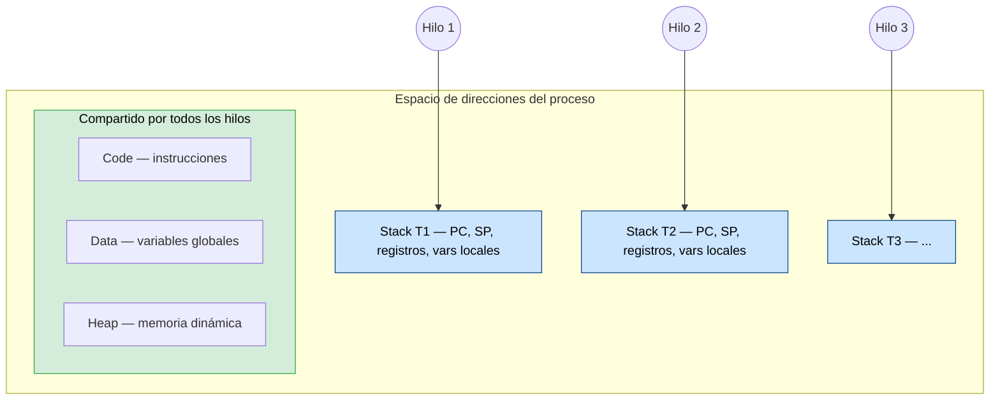
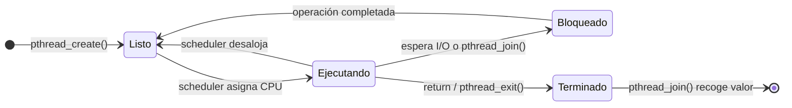
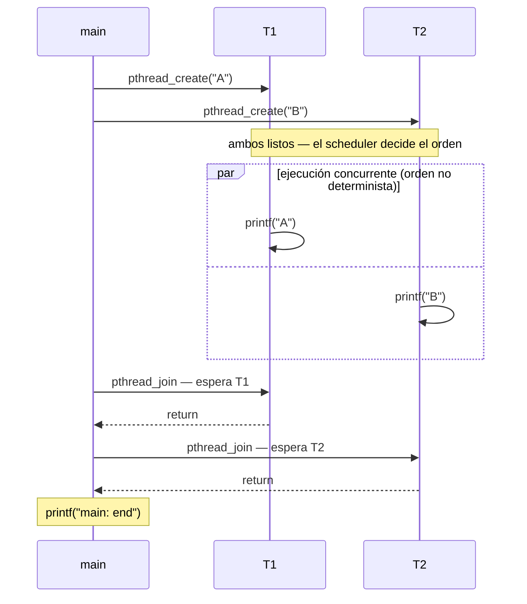
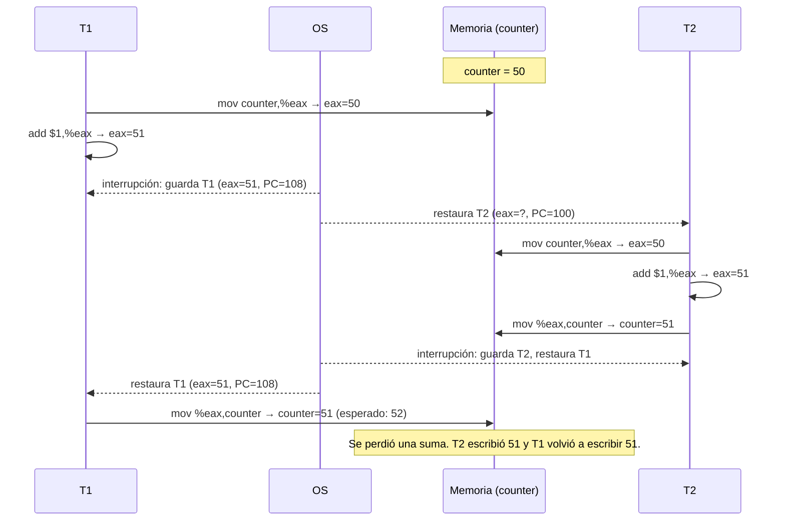
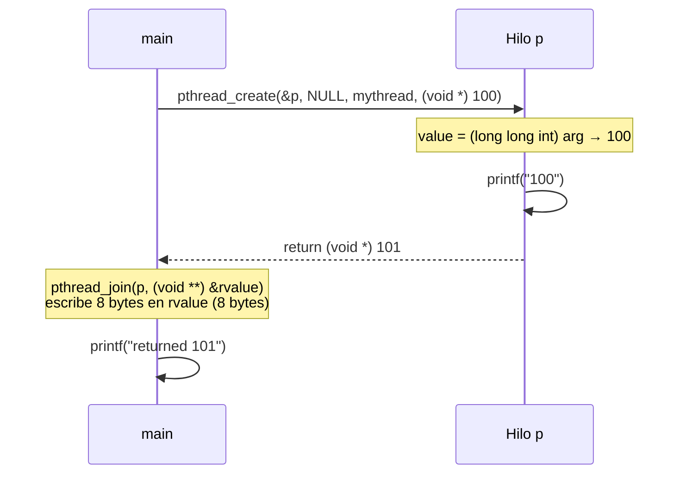

# Sistemas Operativos — Clase 14: Threads

Guía de ejemplos autónoma para estudiantes. Cubre la creación de hilos con la API POSIX (`pthreads`) y su equivalente en Python, el no-determinismo en el orden de ejecución, los datos compartidos y la condición de carrera (*race condition*), y el paso de argumentos y valores de retorno entre hilos.

### Relación con el libro

Los ejemplos siguen dos capítulos de *Operating Systems: Three Easy Pieces* (OSTEP) y el código de referencia del libro:

| Ejemplo | Capítulo y sección de OSTEP | Equivalente en [`ostep-code/threads-api`](https://github.com/remzi-arpacidusseau/ostep-code/tree/master/threads-api) |
|---|---|---|
| `t0` — creación de hilos y orden no determinista | Cap. 26, §26.2 *An Example: Thread Creation* (Fig. 26.2) | — |
| `t1` — datos compartidos y race condition | Cap. 26, §26.3 *Why It Gets Worse: Shared Data* (Fig. 26.6) y §26.4 *The Heart Of The Problem: Uncontrolled Scheduling* | — |
| `t2` — argumentos y retorno vía structs | Cap. 27, §27.1 *Thread Creation* y §27.2 *Thread Completion* (Figs. 27.1 y 27.2) | `thread_create.c` y `thread_create_with_return_args.c` |
| `t3` — paso de un valor simple | Cap. 27, §27.2 (Fig. 27.3) | `thread_create_simple_args.c` |
| Preguntas de `pthread_mutex_*` en `t1` | Cap. 27, §27.3 *Locks* (uso de la API) | — |

El cap. 27 enseña a **usar** la API, incluida la de locks. *Cómo se construye* un lock por dentro es tema del cap. 28 (*Locks*), que no se cubre aquí. El simulador `x86.py` de la carpeta [`simulacion/`](../../simulacion/) es la tarea del cap. 26 y complementa a `t1`.

---

## Requisitos

Los ejemplos en C necesitan Linux (nativo, WSL, máquina virtual o contenedor). Las salidas que aparecen en esta guía se obtuvieron en la máquina descrita en [entorno de ejecución](../entorno_ejecucion.md), donde también se explica cómo cambian los resultados según el entorno.

### C

Compilador `gcc` y la librería `pthreads` (incluida en cualquier distribución Linux estándar).

```bash
gcc --version        # debe ser >= 7
```

### Python

Python 3.6 o superior (por el uso de f-strings).

```bash
python3 --version    # debe ser >= 3.6
```

### Verificar `pthreads`

```bash
echo '#include <pthread.h>' | gcc -x c - -lpthread -o /dev/null && echo "OK"
```

---

## Conceptos previos

### Procesos e hilos

Un proceso es la unidad de ejecución clásica del sistema operativo: tiene su propio espacio de direcciones (código, datos, heap y stack), sus registros de CPU y su información de estado. Cuando un proceso tiene un solo hilo, hay exactamente un contador de programa (PC) y un stack: una única secuencia de instrucciones ejecutándose en cada momento.

Un **hilo** (*thread*, hebra, proceso ligero) es una unidad de ejecución dentro de un proceso. Cada hilo tiene lo suyo — su propio PC, su propio stack y su propio conjunto de registros — pero todos los hilos del proceso **comparten** el mismo código, los mismos datos globales y el mismo heap. Esto contrasta con tener múltiples procesos, donde cada uno tiene su propio espacio de direcciones completamente separado.



### Thread Control Block (TCB)

Al igual que el sistema operativo mantiene un PCB (*Process Control Block*) por cada proceso, mantiene un **TCB** por cada hilo. El TCB almacena el PC, el stack pointer (SP) y el resto de los registros del hilo. Cuando el scheduler hace un cambio de contexto entre hilos, guarda los registros del hilo saliente en su TCB y carga los del entrante. A diferencia del cambio de contexto entre procesos, el espacio de direcciones no cambia.

### Ciclo de vida de un hilo



### ¿Por qué usar hilos?

Hay dos razones principales:

**Paralelizar trabajo en sistemas multicore.** Si se deben sumar dos arreglos grandes, se puede asignar la mitad a un hilo y la otra mitad a otro, y ambos corren simultáneamente en núcleos distintos. Un solo proceso secuencial no puede aprovechar más de un núcleo a la vez.

**Superponer cómputo con I/O (overlap).** Mientras un hilo espera que termine una operación de red o disco — que es miles de veces más lenta que la CPU — otro hilo puede seguir trabajando. Esto es la base de los servidores web, bases de datos y cualquier aplicación cliente-servidor.

### Concurrencia vs. paralelismo

Estos dos términos no son sinónimos. **Concurrencia** significa que más de una tarea progresa con el tiempo — en un sistema de un solo núcleo el scheduler las intercala, dando la ilusión de simultaneidad. **Paralelismo** significa que las tareas se ejecutan literalmente al mismo tiempo, en núcleos distintos. Los hilos permiten ambas cosas: concurrencia en un solo núcleo y paralelismo en multicore.

### No-determinismo

Cuando se crean varios hilos, el orden en que el scheduler los ejecuta no está definido por el programa: depende de la carga del sistema, del número de núcleos, de las prioridades y de otros factores externos. Ejecutar el mismo programa dos veces puede producir salidas en distinto orden. Esto no es un bug — es el comportamiento normal y esperado de un programa multihilo sin sincronización explícita.

### Race condition y sección crítica

Cuando dos hilos acceden a una variable compartida y al menos uno de ellos la modifica, puede ocurrir una **condición de carrera** (*race condition*). El problema surge porque una operación aparentemente simple como `counter = counter + 1` no es atómica a nivel de CPU: se expande en al menos tres instrucciones (cargar el valor, incrementarlo, almacenarlo). Si el scheduler interrumpe un hilo entre esas instrucciones y deja correr al otro, ambos pueden leer el mismo valor original y producir un resultado incorrecto.

```
Instrucciones reales de counter = counter + 1:
    mov  0x(...), %eax    ← lee counter en un registro
    add  $0x1,   %eax    ← suma 1
    mov  %eax,   0x(...)  ← escribe de vuelta
```

Si T1 lee `counter = 50`, luego es interrumpido antes de escribir, y T2 también lee `50`, incrementa a `51` y escribe, cuando T1 retoma escribe también `51` — una de las dos actualizaciones se pierde. Al final del día esto equivale al problema de dos cajeros que consultan simultáneamente el saldo de una cuenta bancaria antes de procesar un depósito: ambos ven el saldo original y cada uno lo actualiza por separado, perdiendo una de las dos transacciones.

El fragmento de código donde ocurre el acceso a la variable compartida se llama **sección crítica**. Para protegerla se necesita **exclusión mutua**: garantizar que solo un hilo esté ejecutando esa sección en un momento dado. El mecanismo más común para esto son los *mutex* (`pthread_mutex_lock` / `pthread_mutex_unlock`, OSTEP §27.3): ningún ejemplo los trae ya resueltos, pero la pregunta 5 de `t1` te pide usarlos. Cómo se implementan por dentro es tema del cap. 28.

### La API POSIX de hilos (`pthreads`)

Las funciones centrales que usan los ejemplos son:

`pthread_create(&tid, NULL, funcion, arg)` — crea un nuevo hilo que empieza ejecutando `funcion(arg)`. El identificador del hilo se guarda en `tid`.

`pthread_join(tid, &retval)` — bloquea al hilo que lo llama hasta que el hilo `tid` termine. El valor de retorno del hilo se deposita en `retval`.

En Python, el módulo `threading` ofrece `Thread(target=f, args=(...))`, `.start()` y `.join()` con la misma semántica.

---

## Organización de los ejemplos

| Archivo | Concepto que ilustra |
|---------|----------------------|
| `t0.c`  | Creación de hilos, `pthread_join`, orden de ejecución no determinista |
| `t0.py` | Equivalente Python de `t0.c` |
| `t1.c`  | Variables compartidas, race condition en un contador global |
| `t1.py` | Equivalente Python de `t1.c` — con nota sobre el GIL |
| `t2.c`  | Paso de `struct` como argumento y retorno de valor desde un hilo vía heap |
| `t2.py` | Equivalente Python de `t2.c` |
| `t3.c`  | Paso de un valor simple dentro del `void *` (sin `struct` ni `malloc`) y por qué importa el tamaño de los tipos |
| `t3.py` | Equivalente Python de `t3.c` |
| [`anexo_c_python.md`](anexo_c_python.md) | Comparación lado a lado de las versiones en C y en Python: mismo concepto, distinta API |

---

## Ejemplo 1 — Creación de hilos y orden no determinista (`t0`)

### Contexto

Este ejemplo crea dos hilos independientes (`p1` y `p2`) que ejecutan la misma función `mythread`, cada uno con un argumento distinto (`"A"` y `"B"`), y muestra que el orden en que se ejecutan no está definido por el programa. Es el primer contacto con `pthread_create` y `pthread_join`.

El siguiente diagrama muestra el flujo de ejecución de `t0.c` (y de `t0.py`, que es equivalente). Los dos hilos están listos al mismo tiempo después de los dos `pthread_create` — el bloque `par` indica que corren concurrentemente y el scheduler decide cuál imprime primero:



`main` hace `pthread_join` sobre ambos hilos antes de imprimir `"main: end"`, por lo que ese mensaje siempre aparece al final. Lo que **no** está garantizado es si `A` se imprime antes que `B` o al revés. En `t0.py` la estructura es la misma: dos `threading.Thread`, dos `.start()` y dos `.join()`.

### Compilación y ejecución

**C:**
```bash
gcc -o t0 t0.c -lpthread -Wall
./t0
```

**Python:**
```bash
python3 t0.py
```

### Salida esperada

La salida puede variar entre ejecuciones. Estas son las dos salidas posibles, ambas obtenidas con el mismo binario de `t0`:

```
main: begin
A
B
main: end
```

```
main: begin
B
A
main: end
```

En la máquina de prueba (ver [entorno de ejecución](../entorno_ejecucion.md)) se ejecutó `t0` 1000 veces: el orden `A B` apareció 998 veces y `B A` solo 2. Con `t0.py`, en 200 ejecuciones siempre salió `A B`. Que un orden sea mucho más frecuente **no** lo convierte en garantizado: es la razón por la que los errores de concurrencia son tan difíciles de reproducir.

### Por qué el output demuestra el concepto

El orden de las letras cambia porque el scheduler decide qué hilo corre en cada momento. El programa no controla ese orden — solo garantiza (mediante `join`) que `"main: end"` se imprima después de que ambos hilos hayan terminado. Que `A` salga casi siempre primero se explica porque `p1` se crea antes y su trabajo (un solo `printf`) es tan corto que suele terminar antes de que `p2` empiece.

Para observar el orden poco frecuente, ejecuta el binario muchas veces y cuenta cada orden distinto:

```bash
for i in $(seq 1 1000); do ./t0 | tr '\n' ' '; echo; done | sort | uniq -c
```

### Preguntas para probar cambios

1. **De 2 a 5 hilos.** Modifica `t0.c` para que cree cinco hilos que impriman `A`, `B`, `C`, `D` y `E`. ¿Qué partes del código debes cambiar? Identifica concretamente: (a) la declaración de las variables `pthread_t`, (b) las llamadas a `pthread_create` y (c) las llamadas a `pthread_join`. ¿Cambia en algo la función `mythread`? ¿Por qué no? Como reto, reescribe la solución con un arreglo `pthread_t hilos[5]` y dos ciclos `for`.
2. Con la versión de 5 hilos, ejecuta el comando de conteo anterior. ¿Cuántos órdenes distintos observas? ¿Cuántos son posibles en teoría? ¿Por qué observas tantos menos?
3. Comenta las llamadas a `pthread_join` (de la versión de 2 o de 5 hilos) y ejecuta varias veces. ¿Se imprimen siempre todas las letras? ¿Pueden aparecer después de `main: end`? ¿Qué pasa con los hilos que no han terminado cuando `main` retorna?
4. Descomenta el `sleep(3)` de `t0.c` (con los `join` aún comentados). ¿Cambia el resultado de la pregunta anterior? ¿Es `sleep` una forma correcta de esperar a un hilo? Justifica.
5. Agrega un `sleep(1)` dentro de `mythread` **solo** cuando el argumento sea `"A"` (compara con `strcmp`). ¿Qué orden observas ahora? ¿Ese cambio garantiza el orden o solo lo hace más probable?

---

## Ejemplo 2 — Datos compartidos y race condition (`t1`)

### Contexto

Este ejemplo muestra qué ocurre cuando dos hilos incrementan concurrentemente una variable global sin ningún mecanismo de sincronización. El resultado final del contador debería ser `max * 2` (cada hilo suma `max` veces), pero frecuentemente no lo es.

El escenario es idéntico al de dos procesos que intentan incrementar simultáneamente el contador de votos de una elección, o dos hilos de un e-commerce que actualizan el stock de un producto: ambos leen el valor actual, calculan el nuevo valor, y escriben — pero si los dos leen antes de que cualquiera escriba, una de las dos actualizaciones se pierde.

El siguiente diagrama traza exactamente cómo ocurre esa pérdida. El scheduler interrumpe a T1 después de que cargó `counter` en su registro pero antes de que lo escribiera de vuelta. T2 lee el mismo valor original, completa su ciclo, y cuando T1 retoma, sobreescribe el resultado de T2 con su valor obsoleto:



La variable `counter` se declara `volatile` para indicarle al compilador que no la optimice en registros — así cada acceso va a memoria y el race es observable.

**Nota sobre `t1.py` y el GIL:** CPython tiene un *Global Interpreter Lock* (GIL) que impide que dos hilos ejecuten bytecode de Python al mismo tiempo. Eso **no** hace atómica la instrucción `counter.value += 1`: se compila en varios bytecodes (leer el atributo, sumar, escribir el atributo) y el intérprete puede cambiar de hilo entre ellos. Por eso la race condition también puede aparecer en Python, como muestran las salidas de abajo (obtenidas con Python 3.8). Qué tan seguido aparece depende de la versión del intérprete, porque cada versión decide en qué puntos permite cambiar de hilo; si tienes otra versión, compruébalo tú mismo (ver las preguntas al final de este ejemplo). En resumen: el GIL protege al **intérprete**, no a los datos de **tu programa**; para eso está `threading.Lock`. Desde Python 3.14 existe además una variante oficial de CPython sin GIL (*free-threaded*, no instalada por defecto) en la que los hilos sí corren en paralelo; ver el [anexo C vs. Python](anexo_c_python.md#una-advertencia-sobre-el-paralelismo-en-python).

### Compilación y ejecución

**C:**
```bash
gcc -o t1 t1.c -lpthread -Wall
./t1 1000000
```

**Python:**
```bash
python3 t1.py 1000000
```

### Salida esperada

Las salidas de esta sección se obtuvieron en la máquina de prueba descrita en [entorno de ejecución](../entorno_ejecucion.md). Las direcciones cambian en cada ejecución.

Con un valor pequeño (sin race observable):
```
main: begin [counter = 0] [7FA02302702C]
A: begin [addr of i: 0x7fa022dafedc]
A: done
B: begin [addr of i: 0x7fa02259fedc]
B: done
main: done
 [counter: 20]
 [should: 20]
```

Con un valor grande (race condition activa):
```
main: begin [counter = 0] [7F1D253E002C]
A: begin [addr of i: 0x7f1d2514fedc]
B: begin [addr of i: 0x7f1d2493fedc]
A: done
B: done
main: done
 [counter: 1269993]
 [should: 2000000]
```

Nótese que `A: begin` y `B: begin` aparecen antes de que cualquiera imprima `done` — ambos hilos están corriendo al mismo tiempo. El resultado `1269993` en vez de `2000000` es la evidencia de actualizaciones perdidas. En la salida con valor pequeño, en cambio, `A` termina antes de que `B` empiece: los hilos nunca se solapan y no hay pérdidas.

Valores finales de `counter` en 5 ejecuciones por cada `loopcount`:

| `loopcount` | Esperado | C (`./t1`) | Python 3.8 (`t1.py`) |
|---|---|---|---|
| 1 000 | 2 000 | 2 000 en las 5 | — |
| 10 000 | 20 000 | 20 000 en las 5 | — |
| 100 000 | 200 000 | entre 129 800 y 146 450 | 200 000 dos veces; entre 155 119 y 178 388 las otras tres |
| 1 000 000 | 2 000 000 | entre 1 022 046 y 1 343 076 | entre 1 269 744 y 1 791 060 |

Con valores pequeños cada hilo termina su ciclo dentro de su primer *time slice*, antes de que el otro alcance a empezar, y el resultado es correcto aunque el código esté mal. El error aparece cuando el ciclo es lo bastante largo para que los dos hilos se solapen.

### Por qué el output demuestra el concepto

La diferencia entre el valor obtenido y el esperado cuantifica exactamente cuántas actualizaciones se perdieron por la race condition. La dirección de `i` en cada hilo muestra que cada uno tiene su propio stack (direcciones distintas), mientras que `counter` es una sola dirección compartida — esa asimetría es el origen del problema.

### Del C al ensamblador: las tres instrucciones en tu propio binario

El análisis de OSTEP (§26.4, Fig. 26.7) parte de que `counter = counter + 1` se compila en tres instrucciones. No hace falta creerlo: se puede ver en el binario que acabas de compilar con el desensamblador `objdump`:

```bash
objdump -d --no-show-raw-insn t1 | awk '/<mythread>:/,/^$/'
```

Este es el fragmento del ciclo `for` en la máquina de prueba (gcc 9.4, sin optimización, x86-64). Las direcciones pueden variar en tu máquina:

```
    1255:	mov    0x2dd1(%rip),%eax        # 402c <counter>
    125b:	add    $0x1,%eax
    125e:	mov    %eax,0x2dc8(%rip)        # 402c <counter>
    1264:	mov    -0x14(%rbp),%eax
    1267:	add    $0x1,%eax
    126a:	mov    %eax,-0x14(%rbp)
```

Las tres primeras líneas son `counter = counter + 1`: **cargar** `counter` desde memoria al registro `%eax`, **sumar** 1 al registro y **guardar** el registro de vuelta en `counter`. Son las mismas tres instrucciones del diagrama de arriba; solo cambia la forma de escribir la dirección. En OSTEP (x86 de 32 bits) aparece como la dirección absoluta `0x8049a1c`; en x86-64 se escribe relativa al contador de programa (`0x2dd1(%rip)`), y `objdump` anota que corresponde a `counter`. Las tres siguientes son `i++`, el mismo patrón pero sobre `-0x14(%rbp)`: una dirección dentro del **stack** del hilo, por lo que cada hilo tiene la suya y no hay carrera sobre `i`.

Si el timer interrumpe a un hilo después de `1255` o de `125b` pero antes de completar `125e`, el otro hilo puede leer el valor viejo de `counter`: esa es la ventana de la race condition. El simulador de la carpeta [`simulacion/`](../../simulacion/) permite elegir exactamente dónde caen esas interrupciones y ver el efecto paso a paso.

En Python ocurre lo mismo un nivel más arriba: el módulo `dis` muestra que `counter.value += 1` de `t1.py` se ejecuta como varios **bytecodes** (`LOAD_ATTR` → `INPLACE_ADD` → `STORE_ATTR` en Python 3.8), el mismo patrón leer–modificar–escribir. Ver la sección [*Ver lo que no es atómico*](anexo_c_python.md#ver-lo-que-no-es-atómico-objdump-en-c-dis-en-python) del anexo.

### Preguntas para probar cambios

1. Busca el menor `loopcount` para el que `./t1` falla al menos una vez en 10 ejecuciones. ¿Coincide con el de un compañero que usa otra máquina u otro entorno (WSL, máquina virtual, Linux nativo)? ¿Por qué podría no coincidir?
2. Agrega un tercer hilo `p3` con la letra `"C"` (crearlo y hacerle `join`) y cambia el valor esperado a `max*3`. ¿La cantidad de actualizaciones perdidas aumenta, disminuye o se mantiene?
3. Quita la palabra `volatile` de la declaración de `counter` y compila **con y sin** `-O2`. Compara el valor final con el de la versión original. Luego genera el ensamblador de la función `mythread` con `gcc -S -O2 t1.c` en cada caso y busca el ciclo. ¿Qué hizo el compilador con `counter`? ¿El programa sin `volatile` es correcto?
4. Ejecuta el programa restringido a un solo núcleo con `taskset -c 0 ./t1 1000000`. ¿Sigue habiendo race condition? ¿Por qué puede haber race condition incluso con un solo núcleo? (Pista: piensa en las interrupciones del timer y en el diagrama de arriba). **Ojo:** en WSL1 `taskset` se acepta pero no tiene efecto (ver [entorno de ejecución](../entorno_ejecucion.md)); haz esta pregunta en Linux nativo, WSL2 o una máquina virtual.
5. Protege la sección crítica con un `pthread_mutex_t` global, llamando a `pthread_mutex_lock` antes y a `pthread_mutex_unlock` después de `counter = counter + 1`. ¿Ahora el resultado es siempre correcto? Mide con `time ./t1 10000000` la versión con y sin mutex. ¿Cuánto cuesta la corrección?
6. Ejecuta `python3 t1.py 1000000` varias veces y compara con la tabla de arriba. ¿Qué versión de Python tienes (`python3 --version`)? Si tienes acceso a otra versión, repite la prueba y compara. Luego corrige `t1.py` usando un `threading.Lock` (`with lock:` alrededor del incremento).
7. **Ensamblador.** Desensambla tu `t1` con el comando `objdump` de la sección anterior y localiza las tres instrucciones de `counter = counter + 1`. Construye una tabla como la de la Fig. 26.7 de OSTEP (columnas: hilo que ejecuta, dirección de la instrucción, `%eax` y valor de `counter` en memoria) para este orden: T1 ejecuta **solo la carga**, ocurre una interrupción, T2 completa **dos** iteraciones del ciclo (dos veces las tres instrucciones), y T1 retoma con la suma y el guardado. Parte de `counter = 50`. ¿Cuánto vale `counter` al final? ¿Cuánto debería valer? ¿Cuántas actualizaciones se perdieron? Con la versión de la pregunta 5 (con mutex), ¿podría ocurrir este mismo orden? ¿Por qué?

---

## Ejemplo 3 — Argumentos y valores de retorno vía structs (`t2`)

### Contexto

Este ejemplo muestra el patrón correcto para pasar múltiples argumentos a un hilo y recibir múltiples valores de retorno. Como `pthread_create` acepta un único `void *` como argumento y `pthread_join` devuelve un único `void *`, la solución estándar es empaquetar los datos en structs.

El detalle crítico del retorno: la memoria del resultado debe estar en el **heap** (allocada con `malloc`), no en el stack del hilo. Si se retorna un puntero a una variable local del hilo, esa memoria es liberada automáticamente cuando la función termina, y el puntero que recibe `main` apunta a basura. Por eso en `t2.c` el resultado se reserva con `malloc` dentro del hilo y `main` lo libera con `free` después de usarlo (la pregunta 2 de este ejemplo te pide probar el anti-patrón).

### Compilación y ejecución

**C:**
```bash
gcc -o t2 t2.c -lpthread -Wall
./t2
```

**Python:**
```bash
python3 t2.py
```

### Salida esperada

**C:**
```
10 20
returned 1 2
```

**Python:**
```
10 20
main: result = 1, 2
```

### Por qué el output demuestra el concepto

`10 20` confirma que los argumentos llegaron correctamente al hilo a través del struct. `returned 1 2` confirma que el valor de retorno viajó de vuelta a `main` a través de la memoria heap — si se hubiera usado el stack (anti-patrón), el resultado sería basura o un crash.

En Python el equivalente de pasar un `struct` es una instancia de clase (`MyArg`), y el equivalente de `value_ptr` en `pthread_join` es una lista mutable compartida (`result_container`) donde el hilo deposita su resultado antes de terminar, porque `thread.join()` en Python no retorna el valor del hilo directamente.

### Preguntas para probar cambios

1. Agrega un tercer campo `int c` a `myarg_t`, asígnale un valor en `main` e imprímelo dentro del hilo. ¿Por qué no fue necesario cambiar la firma de `mythread` ni la llamada a `pthread_create`?
2. **El anti-patrón.** Cambia `mythread` para que el resultado sea una variable local (`myret_t r;`) y retorne `(void *) &r`. Compila con `-Wall`: ¿qué advertencia da `gcc`? Ejecuta varias veces y explica lo que imprime `main`. ¿Por qué un programa con este error puede "funcionar" a veces?
3. Elimina la línea `free(m);` y ejecuta con `valgrind --leak-check=full ./t2` (instálalo con `sudo apt install valgrind` si no lo tienes). ¿Qué reporta? ¿Quién es responsable de liberar la memoria que reservó el hilo?
4. Crea **dos** hilos con argumentos distintos (por ejemplo `10 20` y `30 40`), cada uno con su propio `myarg_t`. ¿Qué pasaría si ambos hilos recibieran un puntero al **mismo** `args` y `main` lo modificara entre los dos `pthread_create`?
5. En `t2.py`, reemplaza la lista `result_container` por un atributo del objeto `MyArg` (por ejemplo `arg.resultado = MyRet(1, 2)`). ¿Funciona? ¿Qué tienen en común ambas soluciones?

---

## Ejemplo 4 — Paso de un valor simple (`t3`)

### Contexto

Cuando un hilo solo necesita **un número** como argumento y devuelve otro número, armar un `struct` y reservar memoria con `malloc` (como en `t2`) es más de lo necesario. La alternativa es guardar el número **directamente dentro del `void *`**: `pthread_create(&p, NULL, mythread, (void *) 100)` no pasa la dirección de nada, pasa el valor 100 disfrazado de puntero. El hilo lo recupera con un *cast* y devuelve su resultado de la misma forma. `pthread_join` escribe ese `void *` en la variable cuya dirección recibe.

El detalle que hace que esto funcione o falle es el **tamaño de los tipos**. En un sistema de 64 bits un `void *` ocupa 8 bytes; la variable que recibe el valor también debe ocupar 8 bytes. Por eso `t3.c` usa `long long int`, como la versión actual de OSTEP (Fig. 27.3) y su código de referencia `thread_create_simple_args.c`.

**La versión de las diapositivas tiene un error.** La diapositiva "Pasando un valor simple a un hilo" conserva una versión antigua del ejemplo que usa `int` (4 bytes). Esa versión está copiada como comentario al inicio de `t3.c`; el ejercicio es encontrar y explicar el error (pregunta 1).



### Compilación y ejecución

**C:**
```bash
gcc -o t3 t3.c -lpthread -Wall
./t3
```

**Python:**
```bash
python3 t3.py
```

### Salida esperada

La misma en ambos lenguajes:

```
100
returned 101
```

### Por qué el output demuestra el concepto

`100` confirma que el valor llegó al hilo sin `struct` ni `malloc`, viajando dentro del propio `void *`. `returned 101` confirma que el valor de retorno volvió a `main` por el mismo camino. Como no se reservó memoria, tampoco hay nada que liberar: a cambio, solo sirve para valores que quepan en un puntero.

En `t3.py` el número se pasa directamente en `args=(100, result_container)` y, como en `t2.py`, el resultado vuelve a través de una lista compartida porque `Thread.join()` no devuelve nada. En Python no hay punteros ni tamaños de tipo que coordinar, así que el error de la versión de las diapositivas no se puede cometer: el [anexo C vs. Python](anexo_c_python.md#t3--paso-de-un-valor-simple) compara las dos versiones lado a lado.

### Preguntas para probar cambios

1. **Encuentra el error de la versión de las diapositivas.** Copia la versión comentada al inicio de `t3.c` en un archivo `t3_diapositiva.c` y compílalo con `-Wall`. ¿Qué advertencias da `gcc`? Ejecútalo: ¿la salida parece correcta? Usa `sizeof(int)` y `sizeof(void *)` para explicar qué está mal en `int m = (int) arg;` y, sobre todo, en `pthread_join(p, (void **) &m);` cuando `m` es un `int`.
2. **Haz visible el daño.** En `t3_diapositiva.c` cambia la declaración de `m` en `main` por un `struct { int m; int vecino; } s = { 0, 7 };`, pasa `&s.m` a `pthread_join` e imprime `s.vecino` antes y después del `join`. ¿Qué valor queda en `vecino`? ¿De dónde salió? (En la máquina de prueba `vecino` pasó de 7 a 0.) ¿Por qué con `int m` suelto el programa "parece funcionar"?
3. Cambia el argumento a `(void *) 5000000000` (un número que no cabe en un `int`) en las dos versiones. ¿Qué imprime cada una?
4. ¿Por qué `t2` no podría reescribirse con esta técnica? ¿Cuándo conviene cada una?
5. Al final de §27.2, OSTEP comenta que crear un hilo con `pthread_create` y hacerle `pthread_join` inmediatamente es "una forma muy rara de crear un hilo": existe una más sencilla, la **llamada a procedimiento**. ¿Por qué? ¿Qué tendría que cambiar en `main` para que crear el hilo valga la pena?

---

## Anexo: C vs. Python

Los ejemplos en Python son traducciones de los originales en C del libro. El [anexo C vs. Python](anexo_c_python.md) los compara lado a lado, con una tabla de equivalencias de la API (`pthread_create` ↔ `threading.Thread` + `start`, `pthread_join` ↔ `join`, `pthread_mutex_*` ↔ `threading.Lock`, ...) y las diferencias de comportamiento entre lenguajes. La idea central: el concepto es el mismo; cambia la API.

---

## Limpieza

```bash
rm -f t0 t1 t2 t3 t3_diapositiva
```

---

## Conclusiones

Los ejemplos recorren una cadena de complejidad creciente:

| Mecanismo | Qué resuelve | Qué limitación introduce |
|-----------|--------------|--------------------------|
| `pthread_create` + `pthread_join` | Permite ejecutar tareas en paralelo dentro de un proceso | El orden de ejecución es no determinista |
| Variables globales compartidas | Permite que los hilos se comuniquen sin IPC | El acceso concurrente sin control produce resultados incorrectos (race condition) |
| Structs en heap para args/retorno | Permite pasar y recibir datos complejos entre hilos de forma segura | La gestión manual de memoria (`malloc`/`free`) introduce riesgo de leaks |
| Valor simple dentro del `void *` | Pasa y recibe un número sin `struct` ni `malloc` | Solo sirve para valores que caben en un puntero, y exige tipos del mismo tamaño |
| Mutex (`pthread_mutex_lock`) | Protege las secciones críticas garantizando exclusión mutua | Introduce riesgo de deadlock si los locks no se adquieren en orden consistente |

El hilo conductor es que cada solución al problema anterior abre un problema nuevo. Los hilos resuelven el paralelismo, pero exponen los datos compartidos. Los datos compartidos resuelven la comunicación, pero requieren sincronización. La sincronización resuelve la race condition, pero puede causar deadlock. Entender esa cadena es el núcleo de la programación concurrente.

---

## Referencias

**Libro de texto principal:**
- Arpaci-Dusseau, R. & Arpaci-Dusseau, A. *Operating Systems: Three Easy Pieces*. Disponible en: https://pages.cs.wisc.edu/~remzi/OSTEP/
  - Cap. 26, *Concurrency: An Introduction* (`t0`, `t1` y el simulador `x86.py`): https://pages.cs.wisc.edu/~remzi/OSTEP/threads-intro.pdf
  - Cap. 27, *Interlude: Thread API* (`t2`, `t3` y la API de locks): https://pages.cs.wisc.edu/~remzi/OSTEP/threads-api.pdf
  - Lectura siguiente — cap. 28, *Locks* (cómo se implementan): https://pages.cs.wisc.edu/~remzi/OSTEP/threads-locks.pdf

**Documentación de APIs:**
- `pthread_create(3)`, `pthread_join(3)`, `pthread_mutex_lock(3)` — disponibles localmente con `man pthread_create`
- Python `threading` module: https://docs.python.org/3/library/threading.html

**Repositorio de código de referencia (OSTEP):**
- https://github.com/remzi-arpacidusseau/ostep-code/tree/master/threads-api (`thread_create.c`, `thread_create_with_return_args.c`, `thread_create_simple_args.c`)

**Lectura complementaria sobre el GIL de Python:**
- https://docs.python.org/3/glossary.html#term-global-interpreter-lock

---

> [!note]
> **Nota sobre IA:** esta guía fue elaborada con asistencia de un modelo de inteligencia artificial. El código fue compilado y ejecutado para verificar su corrección.