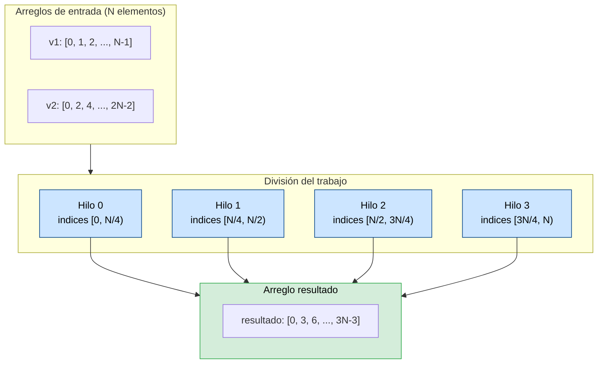
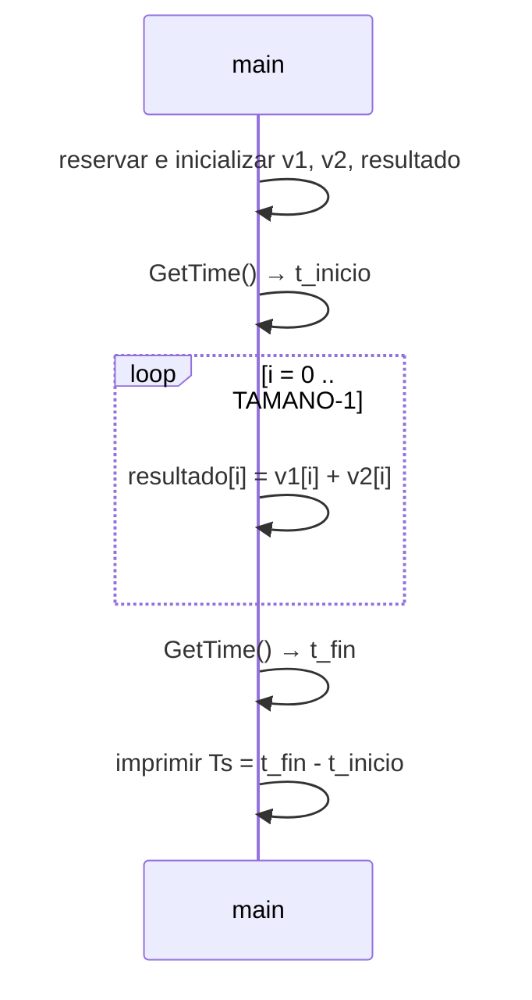
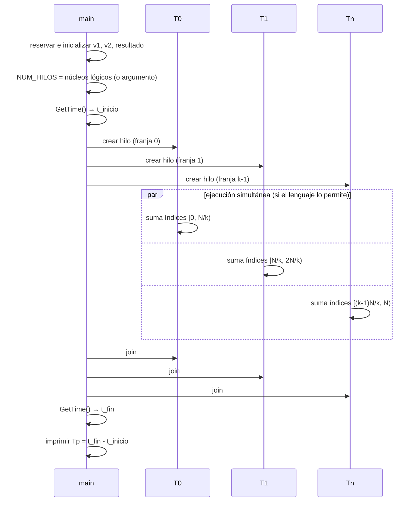

# Sistemas Operativos — Clase 14: Paralelismo de datos

Guía de ejemplos autónoma para estudiantes. Muestra cómo transformar un programa serial que suma dos arreglos grandes en una versión paralela que distribuye el trabajo entre varios hilos, y cómo medir la ganancia de velocidad resultante. El mismo par de programas está escrito en **C** y en **Python**: el algoritmo y los conceptos son idénticos, pero los resultados no, y entender por qué es parte de la lección.

Corresponde a la §26.1 de OSTEP (*Why Use Threads?*): usar hilos para **paralelizar** un cálculo entre varios núcleos.

---

## Organización

| Carpeta / archivo | Contenido |
|---|---|
| `README.md` (este archivo) | Conceptos comunes a ambos lenguajes y **comparación** de resultados C vs. Python |
| [`c/`](c/README.md) | `suma_s.c`, `suma_p.c` y los headers de OSTEP; cómo compilar y ejecutar, y resultados detallados en C |
| [`python/`](python/README.md) | `suma_s.py`, `suma_p.py` y `common.py`; cómo ejecutar, y resultados detallados en Python |

Orden sugerido: lee los conceptos de este archivo, recorre la guía de [C](c/README.md), luego la de [Python](python/README.md), y vuelve aquí para la [comparación](#comparación-c-vs-python).

---

## Requisitos comunes

- Linux (nativo, WSL, máquina virtual o contenedor). Los tiempos de las guías se midieron en la máquina descrita en [entorno de ejecución](../entorno_ejecucion.md); allí se explica por qué tus números pueden ser distintos.
- **Memoria RAM:** cada arreglo de `100000000` enteros de 4 bytes ocupa ~400 MB, y los programas usan tres: se necesitan **~1.2 GB libres** con el tamaño por defecto, en ambos lenguajes. Verifícalo con `free -h`.
- Para interpretar los resultados conviene conocer los núcleos de tu máquina:

```bash
nproc                                   # núcleos lógicos
lscpu | grep -E "Thread|Core|Socket"    # núcleos físicos vs. hilos por núcleo
```

---

## Conceptos previos

### Paralelismo de datos

El **paralelismo de datos** consiste en dividir un conjunto grande de datos en subconjuntos independientes y procesar cada subconjunto en un núcleo distinto al mismo tiempo. Es la estrategia natural cuando la misma operación se aplica a todos los elementos y no hay dependencia entre ellos.

La suma de dos arreglos es el caso más limpio posible: `resultado[i] = v1[i] + v2[i]` para cada `i` no depende de ningún otro índice. Esto permite cortar el arreglo en tantas franjas como núcleos tenga la máquina y asignar cada franja a un hilo.



Como cada hilo escribe en una porción **disjunta** de `resultado`, dos hilos nunca escriben en la misma posición: **no hay race condition** y no se necesita ninguna sincronización entre ellos, solo esperar a que todos terminen.

### Las dos versiones del programa

La versión **serial** (`suma_s`) establece la línea base: un único hilo recorre todo el arreglo. Su tiempo de ejecución (Ts) es el denominador del speedup.



La versión **paralela** (`suma_p`) crea un hilo por núcleo lógico (o el número de hilos indicado como argumento). Cada hilo recibe una estructura con referencias a los arreglos compartidos y su número de hilo, y suma solo su franja. `main` espera a todos con `join`.



### Speedup

El **speedup** es la razón entre el tiempo de la versión serial y el tiempo de la versión paralela:

```
Speedup = Ts / Tp
```

Un speedup de 2 significa que la versión paralela terminó en la mitad del tiempo. En teoría, con N núcleos el speedup máximo es N (speedup lineal). En la práctica siempre es menor por el overhead de crear hilos, la contención de memoria y la parte serial del programa que no se puede paralelizar. Un speedup **menor que 1** significa que la versión paralela es más **lenta** que la serial.

### Cómo se divide el trabajo

Dado un arreglo de `TAMANO` elementos y `NUM_HILOS` hilos, cada hilo recibe una franja contigua:

```
tamano_trozo = TAMANO / NUM_HILOS   (división entera)
inicio = id * tamano_trozo
fin    = inicio + tamano_trozo      // excepto el último hilo
```

El último hilo extiende su `fin` hasta el final del arreglo para absorber el residuo de la división entera. Ejemplo con 10 elementos y 3 hilos:

```
Hilo 0: índices [0, 3)  → 3 elementos
Hilo 1: índices [3, 6)  → 3 elementos
Hilo 2: índices [6, 10) → 4 elementos  ← absorbe el residuo
```

### Núcleos lógicos y físicos

Ambas versiones obtienen el número de hilos por defecto con la misma llamada al sistema, `sysconf(_SC_NPROCESSORS_ONLN)` (en Python, `os.sysconf("SC_NPROCESSORS_ONLN")`), que devuelve el número de núcleos **lógicos**. Con *hyperthreading* (SMT), cada núcleo físico aparece como dos lógicos: una CPU de 4 núcleos físicos reporta 8, pero los dos hilos de un mismo núcleo comparten sus unidades de ejecución y sus cachés L1/L2.

### Qué se mide (y qué no)

Ambas versiones miden **solo la suma** con `GetTime()` (la hora actual en segundos): la reserva de memoria y la inicialización quedan fuera del cronómetro.

```
t_inicio = GetTime()
... trabajo a medir ...
tiempo = GetTime() - t_inicio
```

La inicialización escribe también en `resultado` (lo llena de ceros) aunque ese valor se sobrescriba después. La razón es que reservar memoria solo reserva memoria **virtual**: el sistema operativo asigna el marco físico de cada página la primera vez que se toca (un **fallo de página**, tema de las clases de memoria). Si `resultado` no se tocara antes, el primer acceso a cada una de sus ~98 000 páginas de 4 KiB ocurriría **dentro** de la medición, y lo que se mediría sería en buena parte el costo de esos fallos de página y no el de la suma.

### Simular trabajo más pesado: `Spin()`

El ciclo de suma de todas las versiones tiene una línea comentada con `Spin(0.000001)`, pensada para simular trabajo más pesado por elemento. Ojo con un detalle: en el `common.h` de OSTEP, `Spin` recibe un `int`, así que el argumento `0.000001` se convierte a `0` y la función **no espera nada**; lo que sí hace es leer el reloj dos veces con `GetTime()`. Ese costo es suficiente para que cada elemento pase a ser trabajo de CPU en lugar de trabajo de memoria. El `common.py` de la versión en Python reproduce exactamente ese comportamiento. Al activarlo se usa `TAMANO = 1000000` para que las ejecuciones no tarden demasiado.

---

## Comparación C vs. Python

Las dos versiones se midieron en la misma sesión, en la misma máquina (AMD Ryzen 5 3500U, 4 núcleos físicos y 8 lógicos, WSL1; ver [entorno de ejecución](../entorno_ejecucion.md)), con tres ejecuciones por caso. Las tablas completas, con rangos, están en las guías de [C](c/README.md#resultados-en-la-máquina-de-prueba) y de [Python](python/README.md#resultados-en-la-máquina-de-prueba); aquí se condensan las medianas.

| Medida | C sin optimizar | C con `-O2` | Python 3.8 (`threading`) |
|---|---|---|---|
| **Suma de 100 M elementos** | | | |
| Ts — serial | 0.64 s | 0.135 s | 22.7 s |
| Tp — paralela, 1 hilo | 0.64 s | 0.141 s | 22.0 s |
| Tp — paralela, 2 hilos | 0.29 s | 0.118 s | 36.0 s |
| Tp — paralela, 4 hilos | 0.19 s | 0.117 s | 32.6 s |
| Tp — paralela, 8 hilos | 0.15 s | 0.113 s | 27.9 s |
| Speedup con 2 / 4 / 8 hilos | ≈ 2.2 / 3.4 / 4.4 | ≈ 1.1 / 1.2 / 1.2 | ≈ 0.6 / 0.7 / 0.8 |
| **Con `Spin()`, 1 M elementos** | | | |
| Ts — serial | 0.63 s | — | 1.89 s |
| Speedup con 2 / 4 / 8 hilos | ≈ 1.6 / 2.8 / 4.1 | — | ≈ 0.7 / 0.7 / 0.7 |
| Uso de CPU con 8 hilos (`%CPU`) | ~450 % | — | ~100 % |
| **Recursos** | | | |
| Memoria máxima (`suma_s`, 100 M) | 1.17 GB | — | 1.18 GB |
| Ts de Python ÷ Ts de C | — | — | ≈ 35× (vs. sin optimizar), ≈ 170× (vs. `-O2`) |
| **¿Qué limita el speedup?** | Los núcleos físicos (CPU) | El ancho de banda de memoria | El GIL: un solo hilo ejecuta Python a la vez |

### Qué muestra la comparación

1. **El concepto es el mismo; el resultado depende de la implementación.** Ambos lenguajes dividen el trabajo igual, crean un hilo por franja, esperan con `join` y obtienen el mismo `resultado`. Pero en C los hilos corren en núcleos distintos al mismo tiempo (~450 % de CPU), y en CPython se turnan el intérprete por el GIL (~100 % de CPU). Por eso el mismo diseño da un speedup de ≈ 4.4 en C y una **desaceleración** en Python.
2. **Paralelizar solo ayuda si el recurso que limita se puede multiplicar.** C sin optimizar está limitado por la CPU y escala con los núcleos físicos; C con `-O2` está limitado por la memoria y casi no escala, aunque los hilos sí corran en paralelo; Python está limitado por el GIL y no escala con hilos. Tres comportamientos distintos para el mismo algoritmo.
3. **El paralelismo no compensa un lenguaje más lento.** Incluso si Python escalara perfectamente con 8 hilos, sus ~22.7 s serían ~2.8 s: todavía más que la versión serial de C (0.64 s). La elección del lenguaje y de la implementación pesa tanto como el número de núcleos.
4. **La memoria es la misma porque se eligieron bien los tipos.** Gracias a `array('i')`, Python guarda los datos igual que C (4 bytes por entero contiguos). Con listas, la versión en Python no cabría en la máquina de prueba (ver la [guía de Python](python/README.md#decisiones-de-la-traducción)).

---

## Preguntas sobre los conceptos

Las guías de [C](c/README.md#preguntas-para-probar-cambios) y [Python](python/README.md#preguntas-para-probar-cambios) tienen preguntas específicas de cada lenguaje. Estas son comunes a ambos:

1. **Partición del trabajo.** Con `TAMANO = 10` y 3 hilos, ¿qué franja procesa cada hilo según el código de `sumar_porcion_vector`? Modifica el código (en el lenguaje que prefieras) para repartir el residuo entre los primeros hilos (por ejemplo 4, 3, 3) en lugar de dárselo todo al último. Con `TAMANO = 100000000`, ¿se nota la diferencia en el tiempo? ¿Por qué no?
2. **¿Por qué no hay race condition?** Compara `suma_p` con `t1` de [`api-thread/`](../api-thread/README.md): en ambos varios hilos escriben en memoria compartida. ¿Por qué `t1` pierde actualizaciones y `suma_p` no? ¿Qué cambiaría si todos los hilos acumularan la suma total de los elementos en una sola variable global?
3. **Entorno.** Si tienes acceso a otro entorno (Linux nativo, WSL2, VirtualBox con distinto número de CPUs virtuales, Docker), repite las mediciones allí y compara con un compañero. ¿Qué diferencias observas y a qué las atribuyes? Usa como guía el documento de [entorno de ejecución](../entorno_ejecucion.md).
4. **Ley de Amdahl, informalmente.** Mide también el tiempo de la inicialización (agrega un `GetTime()` antes de reservar los arreglos). Si se incluyera en Tp, ¿cuánto bajaría el speedup? ¿Qué parte del programa limita la ganancia total, aunque tuvieras infinitos núcleos?

---

## Conclusiones

| Situación | Tp esperado | Ejemplo en esta guía |
|---|---|---|
| Trabajo limitado por CPU, hilos que corren en paralelo | Tp ≈ Ts/k mientras k ≤ núcleos físicos | C sin optimizar, C con `Spin()` |
| Trabajo limitado por memoria | Tp ≈ Ts: los hilos compiten por el mismo bus | C con `-O2` |
| Hilos que no pueden correr en paralelo | Tp ≥ Ts: se turnan y pagan el costo de cada cambio | Python con GIL |

La lección central es que el paralelismo de datos es la forma más limpia de paralelizar: cuando no hay dependencias entre elementos no se necesita ninguna sincronización entre hilos. Pero **no** garantiza un speedup: la ganancia depende de cuál recurso limita el programa y de si la implementación del lenguaje permite que los hilos corran realmente al mismo tiempo. Antes de paralelizar hay que medir, y medir bien: solo la parte que interesa, varias veces, y con las mismas condiciones en las dos versiones.

Este patrón — dividir datos, crear hilos, hacer `join`, comparar tiempos — es la base de herramientas como OpenMP, Intel TBB y los pools de hilos y procesos presentes en cualquier lenguaje moderno.

---

## Referencias

**Libro de texto principal:**
- Arpaci-Dusseau, R. & Arpaci-Dusseau, A. *Operating Systems: Three Easy Pieces*. Cap. 26, §26.1 (*Why Use Threads?*): https://pages.cs.wisc.edu/~remzi/OSTEP/threads-intro.pdf. Cap. 27 (*Thread API*): https://pages.cs.wisc.edu/~remzi/OSTEP/threads-api.pdf

**Repositorio de código y headers OSTEP:**
- https://github.com/remzi-arpacidusseau/ostep-code/tree/master/threads-api

Las referencias específicas de cada lenguaje están en las guías de [C](c/README.md#referencias) y [Python](python/README.md#referencias).

> [!note]
> **Nota sobre IA:** esta guía fue elaborada con asistencia de un modelo de inteligencia artificial. El código fue compilado y ejecutado para verificar su corrección.
