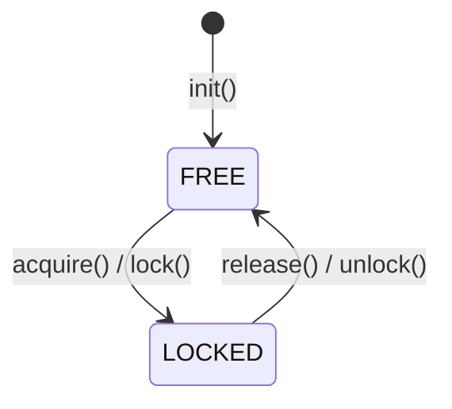
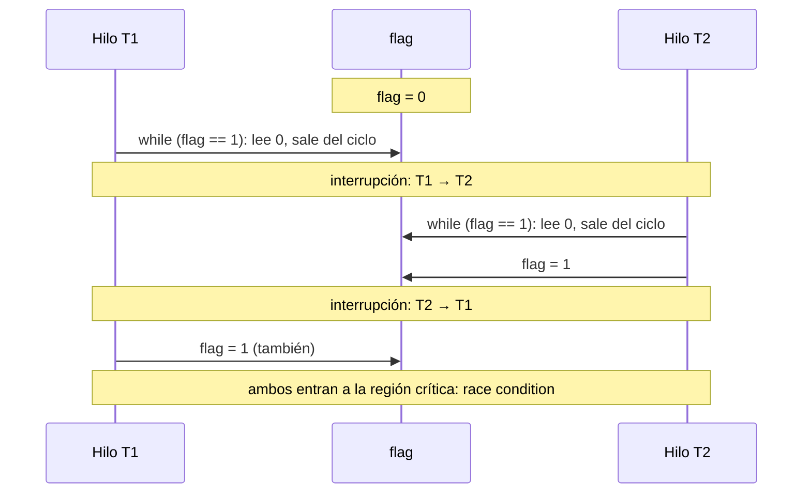
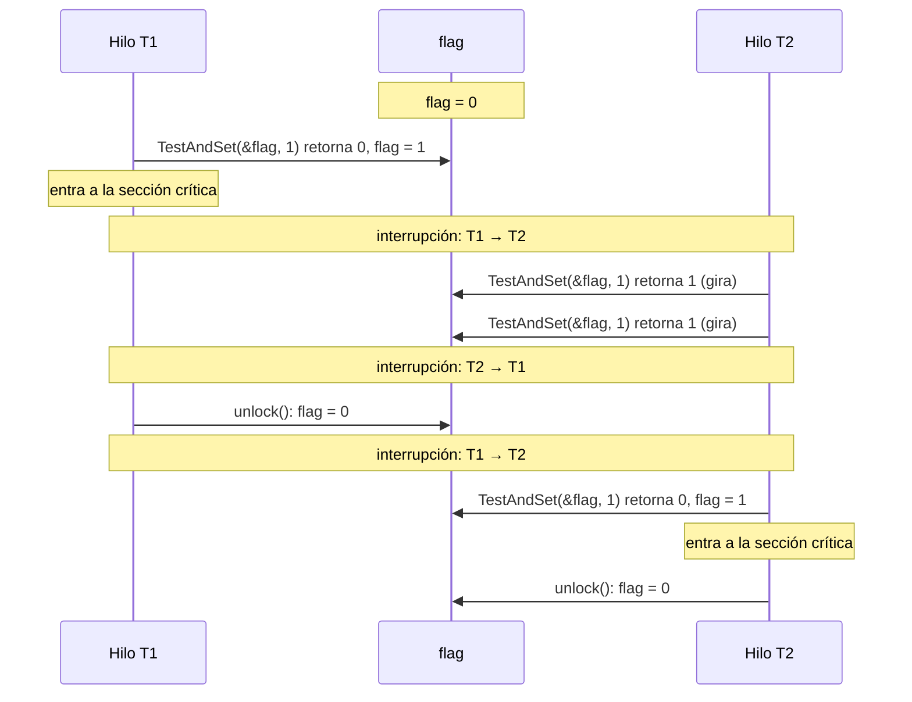
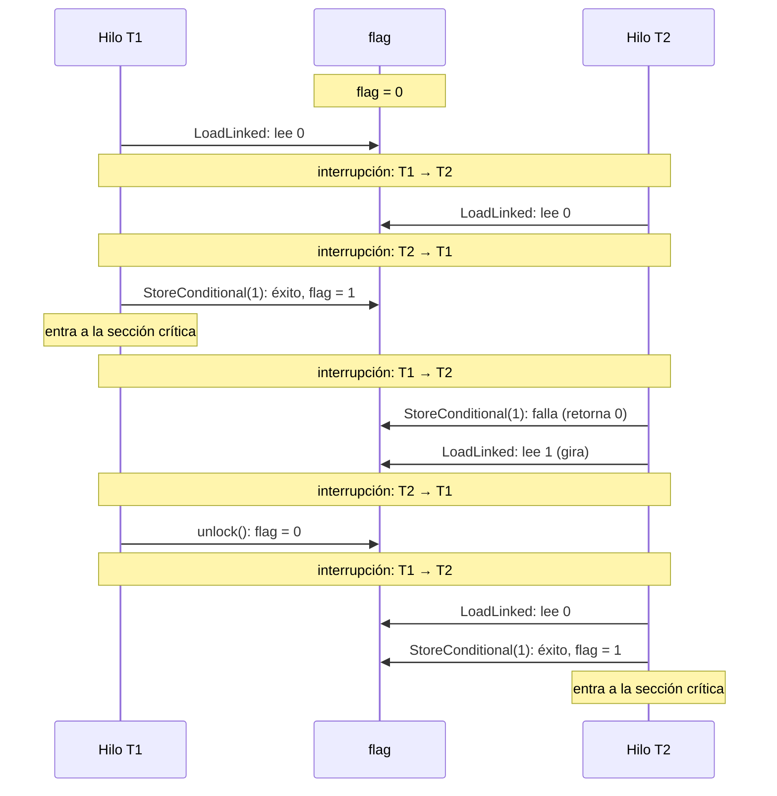
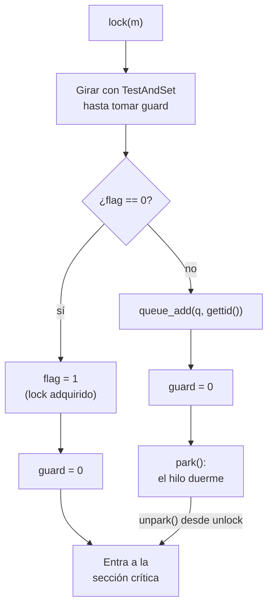

# Locks: exclusión mutua con soporte del hardware y del SO (OSTEP, cap. 28)

## Objetivos de Aprendizaje

* **Explicar**: qué es un lock, sus estados (libre y ocupado), sus operaciones (`lock`/`unlock`) y el patrón para proteger una sección crítica.
* **Evaluar**: una implementación de lock con las tres métricas del curso: exclusión mutua, equidad y desempeño.
* **Analizar**: con pruebas de escritorio, por qué el control de interrupciones y el intento con *load*/*store* no sirven como solución general, y por qué test-and-set, compare-and-swap y LL/SC sí garantizan exclusión mutua.
* **Identificar**: el costo del *spin-waiting* y cómo lo reducen `yield()` y, con ayuda del SO, los locks con colas.
* **Comparar**: las implementaciones de locks vistas (y las que se dejaron para revisar de forma autónoma) según su exclusión mutua, equidad y desempeño.

> Sesión del 27/10/2026.

## Punto de partida: repaso de hilos

La sesión empezó con un repaso de lo visto en la [clase 14](../../clase_14/apuntes_zoom/README.md). Un proceso reúne la virtualización de la CPU (Módulo 1) y la de la memoria (Módulo 2). Un proceso **multihilo** tiene varios hilos de ejecución que comparten el código, los datos (variables globales) y el *heap*, pero cada hilo tiene sus propios registros (PC, SP) y su propio *stack*: el mapa de memoria es *multi-stack* (un *stack* por hilo: `stack[T1]`, `stack[T2]`, `stack[T3]`). El contexto de cada hilo se guarda en su **TCB** (*Thread Control Block*), y el cambio de contexto entre hilos guarda la CPU en el TCB del hilo saliente y carga la del entrante.

También se repasaron la diferencia entre concurrencia (un solo núcleo que intercala las tareas) y paralelismo (varios núcleos que las ejecutan a la vez, ya sea repartiendo los datos o repartiendo las tareas; ejemplo de la parcela de tierra que se labra entre varios trabajadores) y la API `pthread_create`/`pthread_join`, análoga a `fork`/`waitpid` en procesos.

Programar con hilos plantea dos situaciones:

1. **Orden de ejecución aleatorio**: el orden en que corren los hilos lo decide el *scheduler*, así que la salida puede cambiar de una ejecución a otra (`t0` de la clase 14).
2. **Condición de carrera** (*race condition*): dos hilos que ejecutan `counter = counter + 1` sobre la misma variable global pueden perder un incremento, porque esa línea son **tres instrucciones** de máquina y un cambio de contexto puede caer entre ellas:

```asm
100  mov 0x8049a1c, %eax   ; carga counter en eax
105  add $0x1, %eax        ; suma 1 a eax
108  mov %eax, 0x8049a1c   ; escribe eax en counter
```

Con `counter = 50`, T1 ejecuta las dos primeras instrucciones (`%eax` = 51) y es interrumpido; T2 ejecuta las tres y escribe 51; al volver, T1 escribe su 51. Tras dos incrementos el resultado es **51** en lugar de 52. La traza completa, instrucción por instrucción, está en el [apunte de la clase 14](../../clase_14/apuntes_zoom/README.md).

## Sección crítica, condición de carrera y exclusión mutua

* **Sección crítica**: pieza de código que accede a un recurso compartido, usualmente una variable o una estructura de datos. En el ejemplo, `counter = counter + 1` dentro del ciclo `for` de cada hilo (`counter` es global; la `i` del ciclo está en el *stack* de cada hilo y no es compartida).
* **Condición de carrera**: se da cuando múltiples hilos de ejecución ingresan en la sección crítica a la vez. Si intentan modificar datos compartidos, los resultados son inesperados.
* **Exclusión mutua**: garantía de que, si un hilo se encuentra dentro de una sección crítica, ningún otro hilo puede acceder a ella. Si T2 intenta entrar mientras T1 está adentro, T2 queda **bloqueado** hasta que T1 sale.

La analogía usada en clase es la de un baño compartido (o un vestidor, *fitting room*): sin seguro en la puerta, cualquiera puede entrar mientras otro está adentro; con seguro, quien llega mientras está ocupado espera afuera, y si llegan varios forman una cola (contención).

## Locks

Un **lock** es un objeto (en memoria) que proporciona exclusión mutua. Se modela como un tipo abstracto de datos (ADT) con un estado y tres operaciones:

| Estado | Significado |
|---|---|
| **LOCKED** (*acquired*, *locked*, *held*) | Un hilo adquirió el lock y está ejecutando la sección crítica. |
| **FREE** (*available*, *unlocked*, *free*) | Ningún hilo tiene el lock. |

* `init()`: deja el lock en estado libre.
* `acquire()` (o `lock()`): espera hasta que el lock esté libre y, cuando lo está, lo toma.
* `release()` (o `unlock()`): libera el lock, permitiendo que cualquier hilo que esté esperando por él lo tome.



### Patrón de uso

1. Inicialmente el lock está libre.
2. Se llama `acquire()` (`L`) antes de entrar a la región crítica.
3. Se ejecuta el código de la región crítica (`RC`).
4. Se llama `release()` (`U`) para liberar el lock previamente adquirido.

```c
lock(&mutex);              // 1. L: adquirir
balance = balance + 1;     // 2. RC: región crítica
unlock(&mutex);            // 3. U: liberar
```

Si T1 adquiere el lock y T2 intenta entrar a la región crítica, T2 espera; solo cuando T1 llama `unlock`, T2 adquiere el lock, ejecuta su región crítica y lo libera: `L(T1) → RC(T1) → U(T1) → L(T2) → RC(T2) → U(T2)`.

### Estrategias: grano grueso y grano fino

* **Grano grueso** (*coarse-grained locking*): un único lock global se emplea cada vez que se accede a cualquier región crítica. Es la forma antigua y más simple, pero serializa todo.
* **Grano fino** (*fine-grained locking*): se protegen diferentes secciones críticas con diferentes locks, de modo que los hilos que acceden a datos independientes pueden ejecutarse en paralelo.

```c
lock_t lock_balance;   // protege 'balance'
lock_t lock_other;     // protege 'other' (otra sección crítica, independiente)

// Hilo que actualiza 'balance'
lock(&lock_balance);
balance = balance + 1;
unlock(&lock_balance);

// Hilo que actualiza 'other': puede ejecutarse en paralelo, NO espera a lock_balance
lock(&lock_other);
other = other + 1;
unlock(&lock_other);
```

## ¿Cómo construir un lock?

Las preguntas que guían el resto de la clase son: ¿cómo construir un lock que sea eficiente?, ¿qué hardware se necesita (primitivas del ISA)? y ¿qué soporte del SO se necesita? El **objetivo** es obtener **exclusión mutua con el menor costo posible**.

| Nivel | Herramientas |
|---|---|
| Software | **locks** (esta clase); monitores, semáforos y variables de condición (más adelante en el curso) |
| Hardware | ***loads* y *stores*** simples, **deshabilitar interrupciones** e **instrucciones atómicas** (test-and-set y similares) |

### Evaluación de locks

Para evaluar la efectividad de la implementación de un lock se usan tres métricas:

* **Exclusión mutua** (*mutual exclusion*, *correctness*): solo un hilo en la sección crítica.
* **Equidad** (*fairness*): cada hilo que compite por el lock tiene una oportunidad justa de adquirirlo cuando queda libre. Visto desde el caso extremo: ¿algún hilo que espera el lock sufre **inanición** (*starvation*), es decir, no lo obtiene nunca?
* **Desempeño** (*performance*): el *overhead* de tiempo que añade el lock al adquirirlo y liberarlo, sin competencia y con competencia (en una sola CPU y en varias).

### Formas de implementación

| Algoritmos de solo software | Instrucciones atómicas |
|---|---|
| Algoritmo de Dekker (1965) | Test-and-set |
| Algoritmo de Peterson (1981) | Compare-and-swap |
| Algoritmo de Lamport para más de dos procesos (1974) | Load-linked (LL) y store-conditional (SC) |
| | Fetch-and-add |

> [!NOTE]
> **Complemento (OSTEP, cap. 28).** Los algoritmos de Dekker y de Peterson usan solo *loads* y *stores*, suponiendo que son atómicos entre sí (algo que era cierto en el hardware antiguo). Hoy son sobre todo de interés histórico: es mucho más sencillo apoyarse en un poco de soporte del hardware, que existe desde los primeros multiprocesadores, y además estos algoritmos **no funcionan en el hardware moderno**, por sus modelos de consistencia de memoria relajados.

## Implementación mediante el control de interrupciones

La primera solución consiste en **deshabilitar las interrupciones al entrar a la región crítica** y habilitarlas al salir:

```c
void lock() {
  DisableInterrupts();
}

void unlock() {
  EnableInterrupts();
}
```

* Al deshabilitar las interrupciones se bloquean los eventos externos (como la interrupción del temporizador) que podrían generar un cambio de contexto, así que el código de la sección crítica no será interrumpido.
* No se requiere una variable de estado explícita: el propio hardware de interrupciones cumple ese papel.
* **Solo garantiza exclusión mutua en sistemas de un solo procesador.** Cada CPU tiene su propia línea de interrupciones: deshabilitarlas en una no impide que otro hilo entre a la sección crítica desde otra CPU.
* Requiere confiar en que el código vuelva a habilitar las interrupciones, y se usa solo en secciones críticas pequeñas dentro del propio SO.

| Lo bueno | Lo malo |
|---|---|
| Simple. | Uso inadecuado al abusar de la capacidad de habilitar y deshabilitar interrupciones. |
| Útil para un sistema con un solo procesador. | No funciona en sistemas con varios procesadores. |
| | Si las interrupciones se desactivan durante un periodo largo, se pueden **perder interrupciones importantes**. |
| | **Ineficiente**: el código para habilitar y deshabilitar interrupciones es lento (respecto al código que se ejecuta normalmente) en procesadores modernos. |

> [!NOTE]
> **Complemento (OSTEP, cap. 28, §28.5).** Deshabilitar interrupciones es una operación privilegiada; permitírsela a cualquier hilo exige confiar en él. Un programa abusivo podría llamar `lock()` al inicio y monopolizar el procesador, y uno defectuoso o malicioso podría llamar `lock()` y entrar en un ciclo infinito: el SO no volvería a tomar el control y la única salida sería reiniciar el equipo. Un ejemplo de interrupción perdida: si la CPU no se entera de que el disco terminó una lectura, el SO no sabrá que debe despertar al proceso que la esperaba. Por eso esta técnica solo la usa el propio SO, que sí confía en sí mismo, para garantizar atomicidad al acceder a sus estructuras de datos.

> Sesión del 29/10/2026.

## Intento fallido: instrucciones *load*/*store*

En esta solución por software se usa una variable `flag` para representar el **estado** del lock (`0` = libre, `1` = ocupado), y se actualiza con instrucciones **no atómicas** (lecturas y escrituras normales):

```c
typedef struct __lock_t {
  int flag;
} lock_t;

void init(lock_t *mutex) {
  // 0 -> lock is available, 1 -> held
  mutex->flag = 0;
}

void lock(lock_t *mutex) {           // línea 10
  while (mutex->flag == 1)           // línea 11: TEST the flag
    ; // spin-wait (do nothing)
  mutex->flag = 1;                   // línea 12: now SET it!
}                                    // línea 13

void unlock(lock_t *mutex) {
  mutex->flag = 0;
}
```

### Caso 1 (caso feliz)

T1 llama `lock()`, encuentra `flag = 0`, sale del `while` y pone `flag = 1` antes de que ocurra el cambio de contexto. Cuando T2 llama `lock()`, encuentra `flag = 1` y queda girando en el `while` hasta que T1 llama `unlock()`.

| Turno | T1 | T2 | `flag` |
|---|---|---|---|
| T1 | líneas 10, 11, 12 | | 0 → 1 |
| T2 | | líneas 10, 11, 11, … (gira) | 1 |
| T1 | línea 13: entra a la región crítica | | 1 |

### Caso 2: la exclusión mutua deja de satisfacerse

El cambio de contexto cae **entre** la comprobación (línea 11) y la asignación (línea 12):

| Turno | T1 | T2 | `flag` |
|---|---|---|---|
| T1 | líneas 10, 11 (ve `flag = 0`) | | 0 |
| T2 | | líneas 10, 11, 12 | 0 → 1 |
| T1 | línea 12 | | 1 → 1 |



Ambos hilos retornan de `lock()` y entran a la región crítica: no hay exclusión mutua.

### Los dos problemas

* **Problema 1, exclusión mutua**: no se asegura; ambos hilos pueden ingresar a la región crítica (caso 2).
* **Problema 2, desempeño**: gasto intensivo de CPU por la forma como el hilo chequea la bandera. Se llama ***spin-waiting*** (espera activa): el chequeo continuo del valor de `flag` mientras el hilo que tiene el lock no lo libera. El gasto es especialmente alto con un solo procesador, donde el hilo que tiene el lock ni siquiera puede ejecutarse mientras el otro gira.

**Conclusión:** una solución como la anterior, que es **solo de software**, no sirve. Se necesita **soporte del hardware**: instrucciones especiales **atómicas**, que no pueden ser interrumpidas.

## Instrucción test-and-set

Las **instrucciones atómicas** garantizan que las operaciones de lectura, modificación y escritura (*read-modify-write*) se ejecuten atómicamente, sin interrupciones. La instrucción **test-and-set** (intercambio atómico) se llama `xchg` en x86 y `amoswap` en RISC-V. Su comportamiento, descrito en pseudocódigo C, es:

```c
int TestAndSet(int *old_ptr, int new) {
  int old = *old_ptr;   // fetch old value at old_ptr
  *old_ptr = new;       // store 'new' into old_ptr
  return old;           // return the old value
}
```

La instrucción **devuelve el valor anterior y actualiza, de manera simultánea, el valor de una posición de memoria**. Por ejemplo, con `int flag = 0, res;`:

| Llamada | `res` (valor retornado) | `flag` después |
|---|---|---|
| `res = TestAndSet(&flag, 1);` | 0 | 1 |
| `res = TestAndSet(&flag, 1);` | 1 | 1 |

### Spinlock con test-and-set

Comparado con el intento fallido, la comprobación y la asignación de `flag` se reemplazan por una sola llamada a `TestAndSet` dentro del `while`:

```c
typedef struct __lock_t {
  int flag;
} lock_t;

void init(lock_t *lock) {
  // 0: lock is available, 1: lock is held
  lock->flag = 0;
}

void lock(lock_t *lock) {
  while (TestAndSet(&lock->flag, 1) == 1)
    ; // spin-wait (do nothing)
}

void unlock(lock_t *lock) {
  lock->flag = 0;
}
```

* Si `TestAndSet` retorna **0**, el lock estaba libre: el hilo lo acaba de cerrar (dejó `flag = 1`), sale del ciclo y entra a la región crítica.
* Si retorna **1**, el lock estaba ocupado: la condición es verdadera y el hilo queda girando (*spin-wait*).

Las diapositivas muestran también la variante de **xv6** (`spinlock.h`, `spinlock.c`), que inicializa y libera con `TestAndSet(&lock->flag, 0)` en lugar de `lock->flag = 0`. Ambas formas son correctas.

### Análisis

**Caso 1**: un hilo adquiere el lock y ningún otro intenta adquirirlo mientras lo tiene (por lo tanto, nadie espera).

`T1[L] → T1[SC] → T1[U] → (cambio de contexto) → T2[L] → T2[SC] → T2[U]`, donde `SC` es la sección crítica. `flag` pasa por 0 → 1 → 0 → 1 → 0.

**Caso 2**: un hilo adquiere el lock y, una vez adquirido, otro hilo intenta adquirirlo.

`T1[L] → T1[SC] → (CS) → T2[L] → T2[L] → (CS) → T1[SC] → T1[U] → (CS) → T2[L] → T2[SC] → T2[U]`



En ambos casos **sí hay exclusión mutua**: como la lectura del valor viejo y la escritura del nuevo son una sola operación atómica, solo un hilo puede recibir el 0.

### Conclusión

| Métrica | Resultado | Observaciones |
|---|---|---|
| Exclusión mutua | **Sí** | Solo permite que un hilo se encuentre en la región crítica. |
| Equidad | **No** | No proporciona acceso equitativo a todos los hilos: un hilo podría quedarse eternamente en el ciclo de *spin-wait* (inanición). |
| Desempeño | **No** | Alto costo con un solo procesador. Si el número de procesadores es comparable con el número de hilos en ejecución, el sistema trabaja bien. |

> [!NOTE]
> **Complemento (OSTEP, cap. 28, §28.7 y §28.8).**
> * **Con una sola CPU**, un spinlock solo funciona con un *scheduler* apropiativo (que interrumpe a los hilos con el temporizador); sin apropiación, el hilo que gira nunca soltaría la CPU. Y es costoso: si el hilo que tiene el lock es interrumpido dentro de la sección crítica, cada uno de los otros $N-1$ hilos puede gastar un *time slice* completo girando.
> * **Con varias CPU** funciona razonablemente bien: si T1 (en la CPU 1) tiene el lock y T2 (en la CPU 2) lo pide, T2 gira poco, porque la sección crítica suele ser corta y T1 la termina mientras tanto.
> * **Pensar como un *scheduler* malicioso**: para saber si una implementación falla basta con encontrar *un* orden de interrupciones, por improbable que sea, que la haga fallar. Es la técnica que se usó en el caso 2 del intento con *load*/*store*.

## Instrucción compare-and-swap

Esta instrucción atómica actualiza una posición de memoria con un valor **nuevo** solo cuando **su valor actual** es igual al esperado. En x86 se llama `cmpxchg`. Trabaja de manera similar a test-and-set, pero es más poderosa:

```c
int CompareAndSwap(int *ptr, int expected, int new) {
  int original = *ptr;
  if (original == expected)
    *ptr = new;
  return original;
}
```

* Si `*ptr == expected`, actualiza la memoria al valor `new`.
* Si `*ptr != expected`, no la modifica.
* En ambos casos **retorna el valor original**, de modo que quien la llama sabe si tuvo éxito.

Por ejemplo, con `int flag = 0, res;`:

| Llamada | `res` (valor retornado) | `flag` después |
|---|---|---|
| `res = CompareAndSwap(&flag, 0, 1);` | 0 | 1 |
| `res = CompareAndSwap(&flag, 0, 1);` | 1 | 1 (no cambia) |

El lock se construye igual que con test-and-set; solo cambia `lock()`:

```c
void lock(lock_t *lock) {
  while (CompareAndSwap(&lock->flag, 0, 1) == 1)
    ; // spin
}

void unlock(lock_t *lock) {
  lock->flag = 0;
}
```

### Análisis

Secuencia: `T1[L] → T1[SC] → (CS) → T2[L] … → (CS) → T1[SC] → T1[U] → T2[SC] → T2[U]`

| Paso | `flag` antes → después | `expected` | `new` | `original` (retornado) | Efecto |
|---|---|---|---|---|---|
| `L(t1)` | 0 → 1 | 0 | 1 | 0 | T1 adquiere el lock |
| `L(t2)` | 1 → 1 | 0 | 1 | 1 | T2 gira |
| `U(t1)` | 1 → 0 | | | | T1 libera el lock |
| `L(t2)` (reintento) | 0 → 1 | 0 | 1 | 0 | T2 adquiere el lock |
| `U(t2)` | 1 → 0 | | | | T2 libera el lock |

También garantiza exclusión mutua, con el mismo *spin-wait* como limitación.

> [!NOTE]
> **Complemento (OSTEP, cap. 28, §28.9).** Usado para construir un spinlock simple como este, compare-and-swap **se comporta exactamente igual** que el spinlock con test-and-set, con las mismas conclusiones de equidad y desempeño. Su poder adicional (actualizar solo si el valor es el esperado) se aprovecha en otras técnicas, como la sincronización sin locks (*lock-free*).

## Instrucciones LL/SC (*load-linked* y *store-conditional*)

Algunas arquitecturas ofrecen un **par** de instrucciones que trabajan juntas:

* **LL** (*load-linked*): opera como una instrucción *load* típica, trayendo un valor de memoria y poniéndolo en un registro.
* **SC** (*store-conditional*): el almacenamiento **solo funciona si no se ha realizado otro almacenamiento en esa misma dirección desde el último LL**:
  * **Éxito**: actualiza `*ptr` al nuevo valor y retorna **1**.
  * **Falla**: retorna **0** sin actualizar la memoria.

```c
int LoadLinked(int *ptr) {
  return *ptr;
}

int StoreConditional(int *ptr, int value) {
  if (no update to *ptr since LoadLinked to this address) {
    *ptr = value;
    return 1; // success!
  } else {
    return 0; // failed to update
  }
}
```

Implementación del lock:

```c
void lock(lock_t *lock) {
  while (1) {
    while (LoadLinked(&lock->flag) == 1)
      ; // spin until it's zero
    if (StoreConditional(&lock->flag, 1) == 1)
      return; // if set-it-to-1 was a success: all done
              // otherwise: try it all over again
  }
}

void unlock(lock_t *lock) {
  lock->flag = 0;
}
```

El hilo primero gira con LL hasta ver el lock libre (`flag = 0`); luego intenta tomarlo con SC. Si SC tiene éxito, el hilo cambió `flag` a 1 de forma atómica y entra a la región crítica; si falla, vuelve a empezar.

### Análisis

**Caso 1, secuencia LL1 - SC1 - LL2 - SC2**: T1 hace LL (lee 0) y SC (escribe 1, retorna 1) sin interrupción y entra. T2 hace LL y lee 1, así que gira en el `while` interno. Cuando T1 libera (`flag = 0`), el LL de T2 lee 0 y su SC tiene éxito.

**Caso 2, secuencia LL1 - LL2 - SC1 - SC2**: el cambio de contexto cae entre el LL y el SC de cada hilo.

| Paso | `flag` | Retorna | Efecto |
|---|---|---|---|
| LL de T1 | 0 | 0 | T1 ve el lock libre |
| LL de T2 | 0 | 0 | T2 también lo ve libre |
| SC de T1 | 0 → 1 | 1 | Nadie escribió desde el LL de T1: éxito, T1 entra |
| SC de T2 | 1 (no cambia) | 0 | T1 escribió desde el LL de T2: **falla**, T2 vuelve a empezar y gira con LL |
| `unlock` de T1 | 1 → 0 | | |
| LL de T2 | 0 | 0 | |
| SC de T2 | 0 → 1 | 1 | T2 entra |



Incluso con el cambio de contexto entre LL y SC, **solo uno de los dos SC tiene éxito**: hay exclusión mutua. Como en las soluciones anteriores, el hilo que espera sigue girando.

> [!NOTE]
> **Complemento (OSTEP, cap. 28, §28.10).**
> * **Dónde existen**: LL/SC están en MIPS y, con instrucciones similares, en Alpha, PowerPC y ARM.
> * **Cuándo falla SC**: un hilo hace su LL y obtiene 0; antes de su SC lo interrumpen y otro hilo hace también su LL (también obtiene 0). Ambos están a punto de hacer SC, pero solo el primero logra escribir el 1; el segundo falla porque el valor de `flag` cambió entre su LL y su SC, y debe intentar adquirir el lock de nuevo.
> * **Versión corta** (propuesta por el estudiante David Capel): aprovecha la evaluación en cortocircuito del `||`. Si LL lee 1, el `||` ya es verdadero y no se intenta el SC; si lee 0, se intenta el SC, y el ciclo sigue solo si el SC falló.
>
>   ```c
>   void lock(lock_t *lock) {
>     while (LoadLinked(&lock->flag) ||
>            !StoreConditional(&lock->flag, 1))
>       ; // spin
>   }
>   ```

> Sesión del 03/11/2026.

## ¿Cómo evitar el gasto en la CPU?

### El problema con los spinlocks

Mientras un hilo espera el lock, gasta tiempo de procesador chequeando un valor que no sabe cuándo cambiará: el `;` del ciclo `while (TestAndSet(&lock->flag, 1) == 1);` es **espera activa**. Entre más hilos ($N$), más ciclos de CPU se gastan ($N-1$ hilos girando), de modo que el problema empeora.

Ejemplo con $N = 4$ hilos y *time slices* de 20 unidades: t1 adquiere el lock y es interrumpido dentro de la sección crítica; t2, t3 y t4 gastan cada uno su *time slice* completo girando (de 20 a 80) antes de que t1 vuelva, termine y libere el lock. El gasto es de **unas 60 unidades** de CPU. Después, t2 adquiere el lock y t3 y t4 vuelven a girar.

**Idea clave**: ¿cómo desarrollar un lock que no gaste innecesariamente tiempo de la CPU iterando?

### *Yield* en vez de *spin*

Cuando se va a hacer espera activa, el hilo simplemente **libera voluntariamente la CPU** con la llamada al sistema `yield()`:

```c
typedef struct __lock_t {
  int flag;
} lock_t;

void init(lock_t *lock) {
  lock->flag = 0;
}

void lock(lock_t *lock) {
  while (TestAndSet(&lock->flag, 1) == 1)
    yield(); // give up the CPU
}

void unlock(lock_t *lock) {
  lock->flag = 0;
}
```

* El SO mueve el hilo del estado *running* a *ready*, y otro hilo pasa a ejecutarse.
* En el mismo ejemplo, t2, t3 y t4 solo ocupan la CPU un instante (lo que tardan en comprobar el lock y ceder), así que t1 vuelve mucho antes, termina la sección crítica y libera el lock: el gasto baja a **menos de 20 unidades**.
* Aún se gasta tiempo en los **cambios de contexto**.
* **Puede existir inanición**.

| | Costo de la espera |
|---|---|
| Sin `yield()` | $O(\text{threads} \times \text{time\_slice})$ |
| Con `yield()` | $O(\text{threads} \times \text{context\_switch})$ |

En la sesión surgieron tres preguntas:

* **¿`yield` no devuelve la CPU sabiendo que el hilo todavía necesita tiempo?** Sí, pero al cederla los hilos que esperan favorecen que el hilo de la región crítica, que es el único que puede cambiar el estado del lock, termine antes; así el lock se libera antes que si todos estuvieran girando.
* **¿Se parece a cómo se planifican los procesos?** Sí, es análogo a la política cooperativa: un proceso que no puede avanzar cede la CPU en lugar de monopolizarla.
* **¿Quién decide usar `yield`?** El diseñador del lock: al implementarlo, lo incluye en el ciclo de espera, de modo que todo hilo que espere entrar a la región crítica lo invoca.

> [!NOTE]
> **Complemento (OSTEP, cap. 28, §28.13).** Con dos hilos en una CPU, `yield` funciona bien: el hilo que encuentra el lock ocupado cede la CPU y el otro termina su sección crítica. Pero con muchos hilos, por ejemplo 100, compitiendo por el lock: si el que lo tiene es interrumpido antes de liberarlo, los otros 99 llaman `lock()`, lo encuentran ocupado y ceden la CPU, uno tras otro (con un *scheduler* tipo *round robin*), antes de que el dueño vuelva a ejecutarse. Es mejor que desperdiciar 99 *time slices* girando, pero cada cambio de contexto tiene un costo importante. Y no resuelve la inanición: un hilo puede quedar atrapado indefinidamente en el ciclo de *yield* mientras otros entran y salen de la sección crítica. Para controlar **quién** obtiene el lock a continuación hace falta algo más (ver [Locks con colas](#locks-con-colas-dormir-en-vez-de-girar)).

## Para revisar de forma autónoma

> [!NOTE]
> Esta parte quedó en las diapositivas (p. 55–59 y 64–66) para revisarla en los videos del Prof. Danny Múnera; no se desarrolló en clase. Aquí se explica con apoyo del cap. 28 de OSTEP.

### Fetch-and-add y el *ticket lock*

La instrucción **fetch-and-add** incrementa atómicamente una posición de memoria, retornando (de manera simultánea) el valor antiguo:

```c
int FetchAndAdd(int *ptr) {
  int old = *ptr;
  *ptr = old + 1;
  return old;
}
```

Mellor-Crummey y Scott la usaron para construir el ***ticket lock***. En vez de un solo valor (`flag`), el lock usa dos: un **`ticket`** y un **`turn`**.

```c
typedef struct __lock_t {
  int ticket;
  int turn;
} lock_t;

void lock_init(lock_t *lock) {
  lock->ticket = 0;
  lock->turn = 0;
}

void lock(lock_t *lock) {
  int myturn = FetchAndAdd(&lock->ticket);
  while (lock->turn != myturn)
    ; // spin
}

void unlock(lock_t *lock) {
  lock->turn = lock->turn + 1;
}
```

Al llamar `lock()`, el hilo hace un fetch-and-add atómico sobre `ticket`: el valor retornado es su turno (`myturn`). El `turn` compartido indica a qué hilo le toca; cuando `turn == myturn`, ese hilo entra a la sección crítica. `unlock()` solo incrementa `turn`, para que entre el siguiente hilo que espera (si lo hay).

Traza de la diapositiva con tres hilos A, B y C (R = ejecuta la sección crítica, S(n) = gira esperando el turno n):

| Operación | `ticket` | `turn` | Estado |
|---|---|---|---|
| `lock_init` | 0 | 0 | — |
| A `lock()` | 1 | 0 | A: R (su turno es 0) |
| B `lock()` | 2 | 0 | B: S(1) |
| C `lock()` | 3 | 0 | C: S(2) |
| A `unlock()` | 3 | 1 | — |
| B | | | B: R |
| A `lock()` | 4 | 1 | A: S(3) |
| B `unlock()` | 4 | 2 | — |
| C | | | C: R |
| C `unlock()` | 4 | 3 | — |
| A | | | A: R |
| A `unlock()` | 4 | 4 | — |
| C `lock()` | 5 | 4 | C: R (su turno es 4) |

La diferencia importante con las soluciones anteriores es que el ticket lock **garantiza progreso a todos los hilos**: una vez que un hilo tiene su número, entrará cuando pasen los que están antes que él. Con test-and-set no existía esa garantía; un hilo podía girar para siempre mientras otros adquirían y liberaban el lock. Así, el ticket lock resuelve la **equidad** que test-and-set no tenía (los hilos entran en orden de llegada), aunque los que esperan siguen girando.

### El problema de fondo: demasiado *spinning*

Resumen de los spinlocks (diapositiva p. 59):

* Son simples de implementar.
* El hilo que está en espera activa **desperdicia todo el *quantum* de tiempo** sin hacer nada (solo chequea la variable): gran gasto de CPU, que los hace costosos.
* Los spinlocks (y deshabilitar interrupciones en sistemas con una única CPU) son mecanismos de sincronización primitivos, que se emplean para crear construcciones de sincronización de alto nivel.
* Para evitar el gran gasto de CPU se requiere **asistencia del sistema operativo**.

OSTEP (§28.12) lo resume así: el soporte del hardware por sí solo no puede resolver el problema; se necesita también soporte del SO. Y el `yield` de la sección anterior deja demasiado al azar: el *scheduler* decide qué hilo corre después y, si elige mal, el hilo que corre solo puede girar o ceder la CPU de inmediato. En ambos casos hay desperdicio y no se evita la inanición.

### Locks con colas: dormir en vez de girar

La idea (OSTEP, §28.14) es controlar explícitamente qué hilo obtiene el lock cuando el dueño lo libera:

* Poner los hilos que esperan en una **cola** (*queue*).
* Indicarle al kernel que **no agende** (*don't schedule*) los hilos que están en la cola.
* Al desbloquear (`unlock`), indicarle al kernel que puede volver a ejecutar uno de ellos.

Para eso se usan dos llamadas, tomadas de Solaris:

* `park()`: el hilo que la llama se va a dormir.
* `unpark(threadID)`: despierta un hilo en particular.

```c
typedef struct __lock_t {
  int flag;
  int guard;
  queue_t *q;
} lock_t;

void lock_init(lock_t *m) {
  m->flag = 0;
  m->guard = 0;
  queue_init(m->q);
}

void lock(lock_t *m) {
  while (TestAndSet(&m->guard, 1) == 1)
    ; //acquire guard lock by spinning
  if (m->flag == 0) {
    m->flag = 1; // lock is acquired
    m->guard = 0;
  } else {
    queue_add(m->q, gettid());
    m->guard = 0;
    park();
  }
}

void unlock(lock_t *m) {
  while (TestAndSet(&m->guard, 1) == 1)
    ; //acquire guard lock by spinning
  if (queue_empty(m->q))
    m->flag = 0; // let go of lock; no one wants it
  else
    unpark(queue_remove(m->q)); // hold lock
                                // (for next thread!)
  m->guard = 0;
}
```



Puntos clave del código:

* **Dos variables con dos papeles distintos.** `guard` es un spinlock (con test-and-set) que protege solo la manipulación de `flag` y de la cola; `flag` es el lock que ven los usuarios. Todavía hay espera activa, pero limitada a las pocas instrucciones de `lock()` y `unlock()`, no a la sección crítica del usuario, que puede ser larga.
* **El hilo que no obtiene el lock se duerme** en vez de girar: se agrega a la cola con su identificador (`gettid()`), libera `guard` y llama `park()`.
* **`flag` no vuelve a 0 cuando se despierta a otro hilo.** No es un error: el hilo que despierta no tiene `guard`, así que no podría poner `flag` en 1. El lock se **pasa directamente** del hilo que lo libera al siguiente de la cola.
* **Equidad**: como la cola decide quién sigue, se evita la inanición.

**La carrera *wakeup/waiting*.** Si un hilo está a punto de llamar `park()` y justo en ese momento es interrumpido, y el dueño del lock lo libera y llama `unpark()` sobre él, el `park()` posterior podría dormirlo para siempre. Solaris lo resuelve con una tercera llamada, `setpark()`: el hilo indica que está a punto de dormirse, y si alguien lo despierta antes de que llame `park()`, ese `park()` retorna de inmediato en vez de dormirlo:

```c
queue_add(m->q, gettid());
setpark(); // new code
m->guard = 0;
```

Pregunta que deja el libro: ¿qué pasaría si `guard` se liberara **después** de `park()` y no antes? (Pista: algo malo.)

> [!NOTE]
> **Complemento (OSTEP, cap. 28, §28.15 y §28.16): así funciona un mutex real.**
> * **Linux** ofrece el ***futex***, parecido a `park`/`unpark` pero con más funcionalidad dentro del kernel: cada futex está asociado a una posición de memoria y a una cola en el kernel. `futex_wait(address, expected)` duerme al hilo solo si el valor en `address` es igual a `expected` (si no, retorna de inmediato, lo que evita la carrera anterior); `futex_wake(address)` despierta a un hilo de la cola. Es lo que hay debajo de `pthread_mutex_lock` en Linux.
> * El mutex de la biblioteca NPTL de glibc usa **un solo entero** para dos cosas: el bit alto indica si el lock está tomado (por eso el entero es negativo cuando lo está) y el resto de los bits cuenta los hilos que esperan. Está optimizado para el caso común **sin competencia**: tomar el lock es un solo test-and-set atómico sobre el bit alto y liberarlo, una suma atómica; solo si hay hilos esperando se llama `futex_wake`.
> * Esto es un **lock de dos fases**: en la primera fase el hilo gira un poco, con la esperanza de que el lock se libere pronto (girar sí es útil cuando el lock está a punto de soltarse); si no lo obtiene, en la segunda fase se duerme hasta que el lock quede libre.
>
> En resumen, los locks reales combinan **soporte del hardware** (una instrucción atómica) con **soporte del SO** (`park`/`unpark` en Solaris, futex en Linux).

> [!NOTE]
> **Complemento (OSTEP, cap. 28, recuadro de §28.14): inversión de prioridad.** Además del desempeño, hay una razón de corrección para evitar los spinlocks. Si T2 tiene más prioridad que T1 y el *scheduler* siempre prefiere a T2: mientras T2 está bloqueado (por ejemplo, esperando una E/S), T1 corre y toma un spinlock; T2 se desbloquea, desplaza a T1 e intenta tomar el lock; como T1 nunca vuelve a correr, T2 gira para siempre y el sistema se cuelga. Una solución general es la **herencia de prioridad**: el hilo de baja prioridad que tiene el lock hereda temporalmente la prioridad del que lo espera.

## Resumen y Conclusión

| Implementación | Exclusión mutua | Equidad | Desempeño |
|---|---|---|---|
| Control de interrupciones | Solo con un procesador | — | Simple, pero lento; puede perder interrupciones |
| *Load*/*store* con `flag` | **No** | No | *Spin-waiting* |
| Test-and-set (`xchg`) | Sí | No (inanición) | *Spin-waiting*: malo con una CPU, bueno si hay tantas CPU como hilos |
| Compare-and-swap (`cmpxchg`) | Sí | No | Igual que test-and-set |
| LL/SC | Sí | No | Igual que test-and-set |
| Ticket lock (fetch-and-add) | Sí | **Sí** (orden de llegada) | *Spin-waiting* |
| Test-and-set + `yield()` | Sí | No (inanición) | Mejor que girar, pero cuesta un cambio de contexto por hilo |
| Locks con colas (`park`/`unpark`) | Sí | **Sí** (la cola decide) | El hilo que espera duerme; solo gira unas pocas instrucciones sobre `guard` |

La lección del capítulo: el **hardware** aporta la atomicidad (sin ella no hay exclusión mutua) y el **SO** aporta la forma de esperar sin desperdiciar la CPU.

## Puente hacia la siguiente clase

Al final de la sesión del 03/11 se empezó el tema siguiente (OSTEP, cap. 29): cómo agregar locks a **estructuras de datos** para que sean seguras con hilos (*thread-safe*), siguiendo el mismo patrón `lock` → región crítica → `unlock`. El primer ejemplo fue un **contador**: sin lock pierde incrementos (*race condition*); con un mutex (contador **preciso**) es correcto pero escala mal cuando aumentan los hilos; y el contador **aproximado** (*sloppy counter*), con contadores locales por CPU que se transfieren a un contador global al llegar a un umbral, escala mejor a cambio de que el valor global no sea exacto en todo momento. Este tema se desarrolla en el apunte de la clase 16.

## Para probar por cuenta propia

* **Ejemplos de la clase** ([`clase_15/ejemplos/`](../ejemplos/README.md)): reproducen la *race condition* y su solución con mutex (en C y en Python), y muestran test-and-set (`xchg`), el spinlock, compare-and-swap (`cmpxchg`) y el spinlock con `yield` sobre el hardware real (x86-64). Atención: en `compare-and-swap.c` la función retorna 1 cuando **tuvo éxito**, a diferencia del pseudocódigo de clase, que retorna el valor original; la guía explica la diferencia.
* **Preguntas del libro** para pensar sin computador: ¿por qué es equivalente la versión corta de LL/SC?; en el lock con colas, ¿qué pasa si `guard` se libera después de `park()`?

## Recursos complementarios

* **Videos del Prof. Danny Múnera** sobre locks: LL/SC, fetch-and-add y ticket lock, `yield` y locks con colas. Son la referencia para la parte que quedó para revisar de forma autónoma.
* **Canal Core Dumped** (YouTube): videos animados en inglés sobre sistemas operativos, recomendados en clase. Los de hilos están enlazados en la [guía de la clase 14](../../clase_14/README.md). Se pueden ver con subtítulos automáticos.

## Referencias

* Arpaci-Dusseau, R. H. y Arpaci-Dusseau, A. C. *Operating Systems: Three Easy Pieces*, cap. 28, "Locks" (v1.10): <https://pages.cs.wisc.edu/~remzi/OSTEP/threads-locks.pdf>
* Arpaci-Dusseau, R. H. y Arpaci-Dusseau, A. C. *Operating Systems: Three Easy Pieces*, cap. 26, "Concurrency: An Introduction": <https://pages.cs.wisc.edu/~remzi/OSTEP/threads-intro.pdf>
* Código de OSTEP para el capítulo (`threads-locks`): <https://github.com/remzi-arpacidusseau/ostep-code/tree/master/threads-locks>
* Mellor-Crummey, J. M. y Scott, M. L. "Algorithms for Scalable Synchronization on Shared-Memory Multiprocessors". *ACM Transactions on Computer Systems*, 9(1), 1991.

---

> [!IMPORTANT]
> **Nota de Transparencia:** Este documento fue generado y adaptado mediante el uso de **IA Generativa**, a partir del manuscrito anotado de la clase y los resúmenes de las sesiones de Zoom (27/10, 29/10 y 03/11/2026), complementado con el capítulo 28 de OSTEP. El contenido ha sido supervisado, validado y refinado por intervención humana para garantizar su precisión técnica y coherencia pedagógica. No obstante, pueden haber errores.
