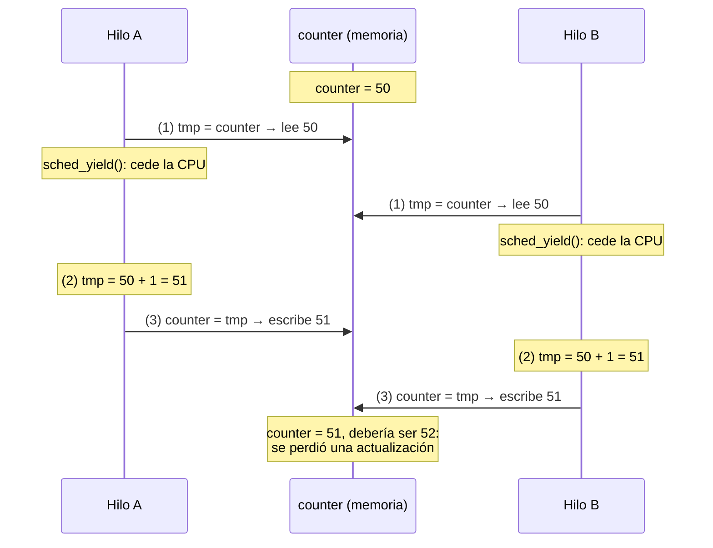
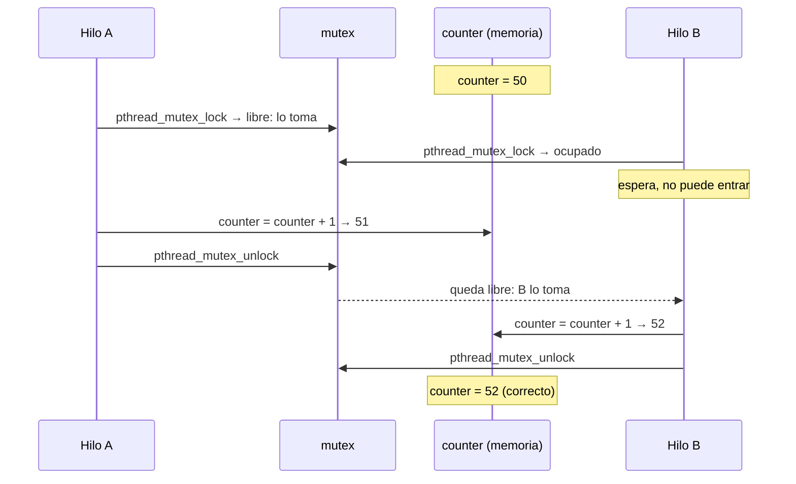
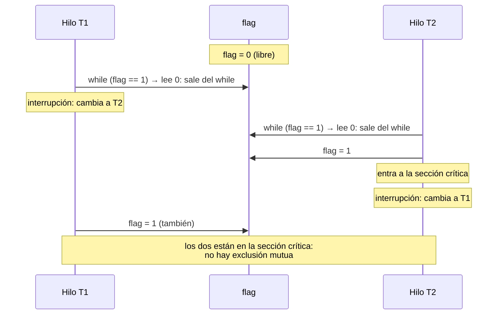
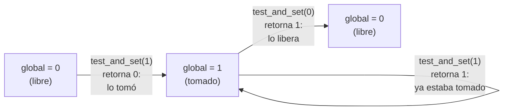
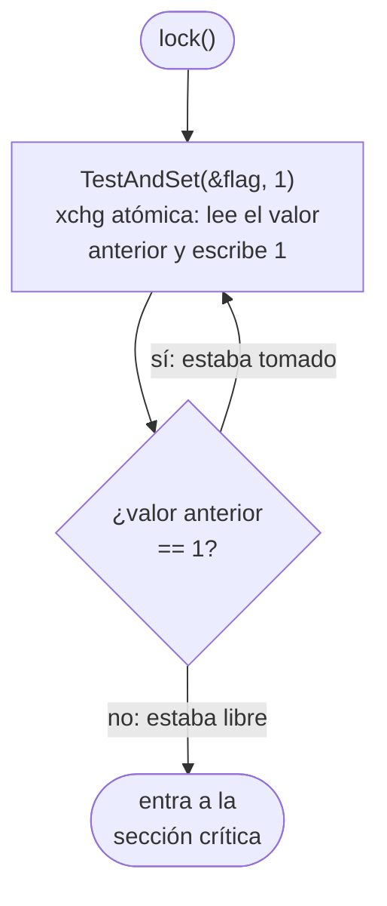
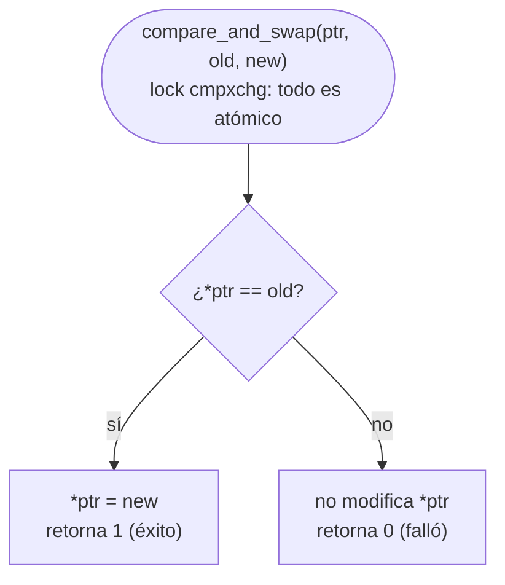
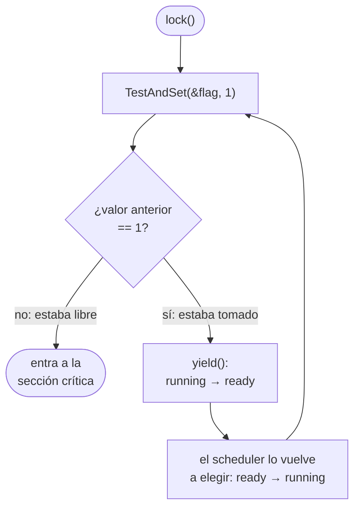

# Sistemas Operativos — Clase 15: Locks

Esta guía permite explorar los conceptos de sincronización entre hilos ejecutando código real. Los ejemplos recorren la evolución completa: desde el problema que origina la necesidad de los locks hasta las primitivas de hardware que los hacen posibles.

### Relación con el libro

Los ejemplos siguen el capítulo 28 (*Locks*) de *Operating Systems: Three Easy Pieces* (OSTEP), con el uso de la API de la sección §27.3:

| Ejemplo | Capítulo y sección de OSTEP | Equivalente en [`ostep-code/threads-locks`](https://github.com/remzi-arpacidusseau/ostep-code/tree/master/threads-locks) |
|---|---|---|
| `t1_nolock` — race condition sobre un contador compartido | Cap. 26, §26.3 y §26.4 (es el `t1` de la [clase 14](../../clase_14/ejemplos/api-thread/README.md) con la carrera forzada) | — |
| `t1_lock` — el mismo contador protegido con un mutex | Cap. 27, §27.3 *Locks* y cap. 28, §28.1 *Locks: The Basic Idea* y §28.2 *Pthread Locks* | — |
| `test-and-set` — la primitiva `xchg` | Cap. 28, §28.7 *Building Working Spin Locks with Test-And-Set* | — |
| `spinlock` — spinlock sobre test-and-set | Cap. 28, §28.7 (Fig. 28.3) y §28.8 *Evaluating Spin Locks* | — |
| `compare-and-swap` — la primitiva `cmpxchg` | Cap. 28, §28.9 *Compare-And-Swap* (Fig. 28.4) | `compare-and-swap.c` (versión adaptada) |
| `spinlock_yield` — spinlock que cede la CPU | Cap. 28, §28.12 *Too Much Spinning: What Now?* y §28.13 *A Simple Approach: Just Yield, Baby* (Fig. 28.8) | — |

---

## Requisitos

Los ejemplos en C necesitan Linux (nativo, WSL, máquina virtual o contenedor) sobre un procesador **x86-64**: `test-and-set.c`, `spinlock.c`, `compare-and-swap.c` y `spinlock_yield.c` usan ensamblador en línea de x86 (`xchg`, `cmpxchg`) y no compilan en ARM (por ejemplo, Mac con Apple Silicon o Raspberry Pi).

Las salidas que aparecen en esta guía se obtuvieron en la máquina descrita en el [entorno de ejecución](../../clase_14/ejemplos/entorno_ejecucion.md) de la clase 14, donde también se explica cómo cambian los resultados según el entorno.

| Herramienta | Verificación |
|---|---|
| GCC | `gcc --version` |
| Python 3.6 o superior (por el uso de f-strings) | `python3 --version` |
| pthreads | incluido en cualquier distribución Linux estándar |

---

## Conceptos previos

Los conceptos de hilo, memoria compartida, sección crítica y race condition se vieron en la clase 14; si alguno no es familiar, la guía de [`api-thread`](../../clase_14/ejemplos/api-thread/README.md) los desarrolla con el ejemplo `t1`. Aquí se resumen los que se usan en esta guía.

### Hilos y memoria compartida

Un **hilo** (thread) es una unidad de ejecución dentro de un proceso. A diferencia de los procesos, los hilos de un mismo proceso **comparten el espacio de memoria**: el código, el heap y las variables globales son visibles para todos. Cada hilo tiene su propia pila (stack) y sus propios registros.

```
Proceso
├── Código         ← compartido por todos los hilos
├── Heap           ← compartido por todos los hilos
├── Variables glob ← compartidas por todos los hilos
├── Stack hilo A   ← privado de A
└── Stack hilo B   ← privado de B
```

Esa memoria compartida es lo que permite la comunicación entre hilos, pero también es la fuente de todos los problemas de sincronización.

### Sección crítica

Una **sección crítica** es cualquier fragmento de código que accede a un recurso compartido — típicamente una variable o estructura de datos — y cuya ejecución debe ser **exclusiva**: si un hilo la está ejecutando, ningún otro debería poder hacerlo al mismo tiempo.

```c
// Esto es una sección crítica:
counter = counter + 1;   // lee, modifica y escribe una variable compartida
```

### Race condition (condición de carrera)

Una **race condition** ocurre cuando el resultado de un programa depende del orden relativo en que los hilos ejecutan sus instrucciones, y ese orden no está controlado. El resultado es **no determinista**: el programa puede producir valores diferentes en cada ejecución aunque el código sea idéntico.

La causa más común es que una operación que parece atómica en el código fuente se traduce a múltiples instrucciones de ensamblador:

```c
counter = counter + 1;
```

Se compila a:

```asm
mov 0x<addr>, %eax     ; (1) lee counter desde memoria al registro
add $0x1,     %eax     ; (2) incrementa el registro
mov %eax,     0x<addr> ; (3) escribe el resultado en memoria
```

Si el scheduler interrumpe un hilo entre (1) y (3) y otro hilo ejecuta sus tres pasos completos, la escritura del segundo hilo se pierde cuando el primero ejecuta (3) con su valor desactualizado. Una actualización se pierde.

### Exclusión mutua

La **exclusión mutua** es la garantía de que si un hilo está ejecutando una sección crítica, ningún otro hilo puede entrar a ella hasta que el primero salga. Es la propiedad fundamental que los locks implementan.

### Lock

Un **lock** (también llamado mutex, de *mutual exclusion*) es un objeto en memoria con dos estados posibles:

- **libre** (`free`): ningún hilo lo tiene, cualquiera puede tomarlo.
- **tomado** (`held`): un hilo lo tiene y está en la sección crítica.

Y dos operaciones:

- `acquire()` / `lock()`: espera hasta que el lock esté libre y lo toma.
- `release()` / `unlock()`: libera el lock para que otro hilo pueda tomarlo.

El patrón de uso es siempre:

```c
acquire(lock);
    sección crítica   // solo un hilo aquí a la vez
release(lock);
```

### Instrucciones atómicas

Una **instrucción atómica** es una instrucción de hardware que ejecuta múltiples pasos (leer, modificar, escribir) como una unidad indivisible — no hay punto intermedio donde otro hilo pueda interrumpir. Son el soporte de hardware que hace posible implementar locks correctamente.

Las dos más importantes en x86:

- **`xchg`** (exchange): intercambia el valor de un registro con el de una posición de memoria de forma atómica. Retorna el valor anterior. Base del *test-and-set* (OSTEP lo llama también *atomic exchange*).
- **`cmpxchg`** (compare-and-exchange): compara el valor de una posición de memoria con un valor esperado y, solo si coinciden, lo reemplaza con un nuevo valor. Deja el valor que había en memoria en el registro `%eax` y la bandera ZF indica si hubo reemplazo. Base del *compare-and-swap*.

### Spinlock

Un **spinlock** es la implementación más simple de un lock usando instrucciones atómicas. Cuando el lock está tomado, el hilo que espera **gira** en un loop revisando la bandera continuamente hasta que se libere. Es correcto, pero no garantiza equidad (un hilo puede girar para siempre) y en una sola CPU desperdicia ciclos sin hacer trabajo útil (OSTEP §28.8).

### yield

`yield()` es una llamada al sistema que mueve el hilo que la llama de estado **running** a estado **ready**, cediendo voluntariamente la CPU al scheduler. Usado dentro del loop de espera de un spinlock, evita desperdiciar el quantum completo girando sin hacer nada.

---

## Organización de los ejemplos

```
Bloque 1 — El problema          t1_nolock.c   /  t1_nolock.py
Bloque 2 — La solución          t1_lock.c     /  t1_lock.py
Bloque 3 — Cómo funciona        test-and-set.c / spinlock.c / compare-and-swap.c
Bloque 4 — Mejora del spinlock  spinlock_yield.c
```

Todas las salidas que siguen son de una ejecución de referencia del 28/10/2026 en la máquina descrita en el [entorno de ejecución](../../clase_14/ejemplos/entorno_ejecucion.md) (WSL1, `gcc` 9.4.0, Python 3.8.10). Las de los bloques 3 y 4 son deterministas; las de los bloques 1 y 2 varían entre ejecuciones y entre máquinas.

---

## Bloque 1 — El problema: race condition

Dos hilos incrementan un contador compartido. Sin protección, algunas actualizaciones se pierden por la race condition descrita en los conceptos previos.

### `t1_nolock.c`

```bash
gcc -O0 -o t1_nolock t1_nolock.c -lpthread -Wall
./t1_nolock 1000
```

Salida de referencia:
```
main: begin [counter = 0]
A: done
B: done
main: done
[counter: 1091]      <- incorrecto (debería ser 2000)
[should:  2000]
```

En cinco ejecuciones seguidas el contador terminó en 1091, 1079, 1098, 1139 y 1149: cambia en cada corrida y en ninguna llega a 2000. El orden de `A: done` y `B: done` también varía.

A diferencia del `t1` de la clase 14, aquí `counter = counter + 1` está escrito en tres pasos con una variable local `tmp`, y entre la lectura (1) y la escritura (3) hay un `sched_yield()`. Esa llamada agranda la ventana en la que el otro hilo puede leer el mismo valor, por lo que la race condition aparece incluso con solo 1000 iteraciones. Sin ella ocurre igual, pero de forma menos frecuente y con más iteraciones (en la clase 14 se usó `./t1 1000000`).

Lo que pasa cuando se pierde una actualización, con los mismos valores del ejemplo de las diapositivas (p. 11–14), donde `counter` vale 50:



Los dos hilos leyeron el mismo 50 antes de que alguno escribiera, así que los dos escriben 51. En cada ejecución esto pasa cientos de veces, y por eso el contador queda lejos de 2000.

### `t1_nolock.py`

```bash
python3 t1_nolock.py 100
```

Salida de referencia:
```
main: begin [counter = 0]
A: done
B: done
main: done
[counter: 110]       <- incorrecto (debería ser 200)
[should:  200]
```

En cinco ejecuciones seguidas el contador terminó en 110, 100, 100, 106 y 100.

El problema es el mismo en Python. Aquí el papel de `sched_yield()` lo cumple `time.sleep(0)`, que libera el GIL de CPython entre los pasos (1) y (3) y permite que el otro hilo corra en ese punto.

> El GIL (Global Interpreter Lock) es un mutex interno de CPython que garantiza que solo un hilo ejecuta bytecode Python a la vez. Protege la integridad del intérprete pero no es un mecanismo de sincronización para el programador — no debe dependerse de él.

El GIL **no** evita la race condition, solo la hace más rara: CPython cambia de hilo cada cierto tiempo (5 ms por defecto), y si ese cambio cae entre (1) y (3) se pierde una actualización. Con el mismo programa sin `time.sleep(0)`, en la máquina de referencia el resultado fue correcto con 100, 1000 y 10000 iteraciones (cada hilo termina antes de que lo cambien), falló en 1 de 3 ejecuciones con 100000 (160769 de 200000) y falló siempre con 1000000 (entre 1337899 y 1433296 de 2000000).

> Se usan 100 iteraciones y no 1000000 porque `time.sleep(0)` hace cada iteración mucho más lenta.

---

## Bloque 2 — La solución: locks

Los mismos dos hilos incrementando el mismo contador, ahora con un lock protegiendo la sección crítica.

### `t1_lock.c`

```bash
gcc -o t1_lock t1_lock.c -lpthread -Wall
./t1_lock 1000000
```

Salida de referencia:
```
main: begin [counter = 0]
B: done
A: done
main: done
 [counter: 2000000]
 [should: 2000000]
```

Respecto a `t1_nolock.c`, el ciclo de los hilos vuelve a `counter = counter + 1` en una sola línea (sin `tmp` ni `sched_yield()`) y la rodea con `pthread_mutex_lock` y `pthread_mutex_unlock`. Esas dos llamadas son todo lo que separa un programa con race condition de uno correcto: el resultado es 2000000 en cada ejecución, aunque el orden de `A: done` y `B: done` siga variando.

El mismo escenario del bloque 1, ahora con el mutex (como en la línea de tiempo de las diapositivas, p. 20):



El lock no evita que los hilos se intercalen; evita que se intercalen **dentro** de la sección crítica. Mientras A tiene el lock, B no puede leer `counter`, así que siempre lee el valor ya actualizado.

### `t1_lock.py`

```bash
python3 t1_lock.py 1000000
```

Salida de referencia:
```
main: begin [counter = 0]
A: done
B: done
main: done
 [counter: 2000000]
 [should: 2000000]
```

`with lock:` en Python es el equivalente de `pthread_mutex_lock / pthread_mutex_unlock`. El context manager garantiza que el lock siempre se libera aunque ocurra una excepción dentro de la sección crítica.

El lock tiene un costo: en la máquina de referencia `./t1_lock 1000000` tardó entre 0.12 y 0.19 s y `python3 t1_lock.py 1000000` entre 7 y 16 s, según la ejecución (en un portátil los tiempos varían mucho; ver el [entorno de ejecución](../../clase_14/ejemplos/entorno_ejecucion.md)).

---

## Bloque 3 — Cómo se construye un lock

`pthread_mutex_t` es una caja negra. Este bloque la abre y muestra que por dentro hay instrucciones atómicas de hardware que garantizan que leer-modificar-escribir ocurra sin interrupciones posibles.

¿Por qué hace falta el hardware? El primer intento natural es un lock con una variable `flag` y lecturas y escrituras normales (diapositivas p. 29–36, OSTEP §28.6, Fig. 28.1): `lock()` espera mientras `flag == 1` y luego pone `flag = 1`. Ese lock falla con esta intercalación (diapositivas p. 32–34, OSTEP Fig. 28.2):



El problema es el mismo del bloque 1: entre **revisar** el flag y **cambiarlo** hay un intervalo en el que otro hilo puede intervenir. Las instrucciones atómicas eliminan ese intervalo, porque realizan las dos operaciones en un solo paso.

### `test-and-set.c` — la primitiva `xchg`

Demuestra la instrucción `xchg` de forma aislada sobre una variable global. Es la versión real, en x86, de la función `TestAndSet()` que OSTEP escribe en C como pseudocódigo en §28.7.

```bash
gcc -o test-and-set test-and-set.c -Wall
./test-and-set
```

Salida de referencia (las anotaciones `<-` no forman parte de la salida):
```
before acquiring lock: 0
after  acquiring lock: 1 (old: 0)                <- estaba libre (0), retorna 0
before acquiring lock (already held): 1
after  acquiring lock (already held): 1 (old: 1) <- estaba tomado (1), retorna 1
before releasing lock: 1
after  releasing lock: 0 (old: 1)                <- libera, retorna valor anterior
```

`xchg` intercambia `*ptr` con `new_val` y retorna el valor anterior, todo en una sola instrucción atómica. No necesita el prefijo `lock` explícito porque x86 lo aplica implícitamente a cualquier `xchg` con operando en memoria.

Las tres llamadas del programa, una por línea `after` de la salida:



El valor que retorna es lo que importa para un lock: **0** indica que el lock estaba libre y el hilo que llamó acaba de adquirirlo; **1** indica que otro hilo ya lo tenía.

### `spinlock.c` — spinlock sobre test-and-set

Construye el spinlock de la Fig. 28.3 de OSTEP y demuestra su ciclo completo: init, acquire, intento fallido, release, acquire de nuevo.

```bash
gcc -o spinlock spinlock.c -Wall
./spinlock
```

Salida de referencia:
```
before lock:  flag = 0
after  lock:  flag = 1 (lock adquirido)

before spin attempt:  flag = 1
after  spin attempt:  flag = 1 (old: 1) -> lock ocupado, seguir girando

before unlock: flag = 1
after  unlock: flag = 0 (lock liberado)

before lock:  flag = 0
after  lock:  flag = 1 (lock adquirido de nuevo)
```

El programa tiene un solo hilo: el "intento fallido" es una llamada aislada a `TestAndSet()` que muestra qué vería un segundo hilo en una vuelta del `while`, sin quedarse girando para siempre.

Una diferencia con la Fig. 28.3: OSTEP libera el lock con una escritura simple (`lock->flag = 0`), mientras que este `unlock()` usa `TestAndSet(&lock->flag, 0)`, como la variante basada en xv6 que aparece en las diapositivas de la clase (p. 39). Ambas son correctas; la versión con `xchg` además actúa como barrera de memoria.

Lo que hace `lock()` (diapositivas p. 39–42):



La flecha que vuelve a `TestAndSet` es el **giro** (*spin*): el hilo repite `TestAndSet` sin hacer nada útil hasta que el dueño del lock ponga `flag = 0`. A diferencia del primer intento, aquí revisar y cambiar el flag ocurren en el mismo paso atómico, así que dos hilos nunca pueden leer 0 a la vez.

La cadena de abstracción que este archivo hace visible:

```
lock()  →  TestAndSet()  →  xchg  (hardware)
```

La correctitud no depende de `lock()` ni de `TestAndSet()` sino de que `xchg` sea atómica. Si se reemplazara `xchg` por una lectura y una escritura separadas, se volvería al primer intento fallido de OSTEP (§28.6, Figs. 28.1 y 28.2), donde dos hilos pueden ver el flag en 0 y entrar ambos a la sección crítica.

### `compare-and-swap.c` — la primitiva `cmpxchg`

Demuestra la instrucción `cmpxchg` de forma aislada: una operación exitosa y una fallida. Es una adaptación del `compare-and-swap.c` de `ostep-code/threads-locks`, la versión x86 que OSTEP cita en §28.9.

```bash
gcc -o compare-and-swap compare-and-swap.c -Wall
./compare-and-swap
```

Salida de referencia (las anotaciones `<-` no forman parte de la salida):
```
before successful cas: 0
after successful cas: 100 (success: 1)  <- valor coincidía: actualiza, retorna 1
before failing cas: 100
after failing cas: 100 (success: 0)     <- valor no coincidía: no actualiza, retorna 0
```

Conviene prestar atención al valor de retorno: el pseudocódigo de OSTEP (Fig. 28.4), que es el mismo de las diapositivas (p. 46–48), retorna el **valor original** de `*ptr`, y quien llama compara ese valor con el esperado para saber si tuvo éxito (por eso el `lock()` de las diapositivas pregunta `== 1`). Esta versión en x86 retorna directamente un **indicador de éxito** (1 o 0), que obtiene de la bandera ZF con `sete`. Las dos formas dan la misma información.

Lo que hace `compare_and_swap()` en este archivo (versión x86, que retorna 1/0):



En la salida: la primera llamada pide cambiar 0 por 100 y `global` vale 0, por lo que lo reemplaza; la segunda pide cambiar 0 por 200, pero `global` ya vale 100, por lo que no lo modifica.

Diferencia respecto a `xchg`:

| | `xchg` (test-and-set) | `cmpxchg` (compare-and-swap) |
|---|---|---|
| Modifica el valor en memoria | Siempre | Solo si coincide con el esperado |
| Retorna (en estos ejemplos) | Valor anterior | Indicador de éxito (1 o 0) |
| Prefijo `lock` | Implícito en x86 | Debe escribirse explícitamente para que sea atómica entre CPUs |

Para construir un spinlock, las dos se comportan igual (OSTEP §28.9): basta con cambiar el `while` de `lock()` por `while (CompareAndSwap(&lock->flag, 0, 1) == 1)`. `cmpxchg` es más poderosa y se usa en la sincronización sin locks (*lock-free*), pero eso está fuera de esta clase.

---

## Bloque 4 — Mejora del spinlock: yield

Con un spinlock puro, si el hilo que tiene el lock pierde la CPU dentro de la sección crítica, cada hilo que espera gasta su time slice completo girando: con N hilos se pueden desperdiciar N−1 time slices (OSTEP §28.12; diapositivas p. 60). `yield()` mitiga esto moviendo el hilo de **running → ready** y cediendo la CPU apenas encuentra el lock tomado (§28.13; diapositivas p. 61–63).

La comparación de las diapositivas (p. 63):

```
Sin yield:  o(threads × time_slice)       <- cada hilo en espera gasta su time slice girando
Con yield:  o(threads × context_switch)   <- cada hilo en espera solo paga un cambio de contexto
```

El costo con `yield()` es menor, pero no es cero: con muchos hilos (OSTEP usa el ejemplo de 100) los cambios de contexto también suman.

### `spinlock_yield.c`

```bash
gcc -o spinlock_yield spinlock_yield.c -Wall
./spinlock_yield
```

Salida de referencia:
```
before lock:  flag = 0
after  lock:  flag = 1 (lock adquirido)

before yield attempt:  flag = 1
after  yield attempt:  flag = 1 (old: 1) -> lock ocupado, yield()

before unlock: flag = 1
after  unlock: flag = 0 (lock liberado)

before lock:  flag = 0
after  lock:  flag = 1 (lock adquirido de nuevo)
```

Igual que en `spinlock.c`, el programa tiene un solo hilo y el intento fallido se muestra con una llamada aislada, seguida de un `yield()`.

El único cambio respecto a `spinlock.c`:

```c
// spinlock.c
while (TestAndSet(&lock->flag, 1) == 1)
    ;           // spin-wait (do nothing)

// spinlock_yield.c
while (TestAndSet(&lock->flag, 1) == 1)
    yield();    // give up the CPU
```

Lo que hace `lock()` ahora (diapositivas p. 61–62):



Comparado con el diagrama de `spinlock.c`, el ciclo ya no gira en la CPU: el hilo la cede y otro hilo (posiblemente el que tiene el lock) puede avanzar.

`yield()` mejora el desempeño, pero no resuelve la **inanición** que ya tenía el spinlock (diapositivas p. 45 y 62: "puede existir inanición"): un hilo puede quedar atrapado en un ciclo infinito de `yield()` mientras otros entran y salen de la sección crítica una y otra vez. La solución son los locks con colas (*queue locks*, `park`/`unpark`, §28.14; diapositivas p. 64–66), donde se mantiene una cola explícita de hilos en espera y el SO los duerme y despierta en orden.

---

## Limpieza

```bash
rm -f compare-and-swap test-and-set spinlock spinlock_yield t1_nolock t1_lock
```

---

## Conclusiones

Los ejemplos de esta guía recorren las capas que hay debajo de un lock:

```
lock() / unlock()           nivel de biblioteca (spinlock.c, spinlock_yield.c)
        ↓
TestAndSet() / CompareAndSwap()   nivel de primitiva (función en C)
        ↓
xchg / cmpxchg              nivel de hardware (ISA)
```

> [!NOTE]
> **Complemento (OSTEP, cap. 28), no está en las diapositivas.** `pthread_mutex_lock()` no es uno de estos spinlocks: en Linux combina una instrucción atómica con la llamada al sistema `futex` para dormir al hilo cuando el lock está ocupado (OSTEP §28.15 y §28.16, *two-phase locks*). Pero en su base está el mismo tipo de instrucción atómica.

Cada mecanismo resuelve el problema del anterior y deja otro pendiente:

| Mecanismo | Resuelve | Limitación |
|---|---|---|
| Load/Store simple (§28.6) | — | No garantiza exclusión mutua |
| Spinlock con test-and-set o compare-and-swap (§28.7–28.9) | Exclusión mutua | No es equitativo; gasta CPU girando |
| Ticket lock con fetch-and-add (§28.11; sin ejemplo en esta guía) | Equidad: cada hilo espera su turno | Sigue girando mientras espera |
| Spinlock + yield (§28.13) | Reduce el gasto de CPU | No resuelve la inanición; cada `yield()` cuesta un cambio de contexto |
| Lock con colas, `park`/`unpark` (§28.14) | Evita la inanición y el giro | Necesita soporte del SO y es más complejo |
| `pthread_mutex_t` en Linux (§28.15–28.16, complemento) | Usa el mecanismo anterior con `futex` | Depende del SO |

La conclusión central, como en las diapositivas (p. 36), es que **una solución solo con lecturas y escrituras normales como la del primer intento no sirve: se necesita soporte del hardware (instrucciones atómicas)**. Las diapositivas (p. 25) también mencionan algoritmos de solo software que sí logran exclusión mutua (Dekker, Peterson, Lamport); OSTEP (recuadro *Aside* de §28.7) explica que no funcionan en el hardware moderno por sus modelos de consistencia de memoria relajados, así que en la práctica los locks se construyen con `xchg`, `cmpxchg` u otras instrucciones atómicas.

---

## Referencias

### Libro de texto

- **Arpaci-Dusseau, R. & Arpaci-Dusseau, A.** — *Operating Systems: Three Easy Pieces* (OSTEP), disponible gratuitamente en [ostep.org](https://ostep.org).
  - Capítulo 26 — *Concurrency: An Introduction* — hilos, memoria compartida y el problema del contador.
  - Capítulo 27 — *Thread API* — uso de `pthread_create`, `pthread_join`, `pthread_mutex_t`.
  - Capítulo 28 — *Locks* [[pdf]](https://pages.cs.wisc.edu/~remzi/OSTEP/threads-locks.pdf) — implementación de locks, test-and-set, compare-and-swap, ticket lock, yield y queue locks.

### Diapositivas del curso

- **Clase 15 — Locks** · Sistemas Operativos · Universidad de Antioquia: [SO_apuntes_clase_15.pdf](../SO_apuntes_clase_15.pdf).

### Documentación de APIs

- **pthreads (C)**
  - `man pthread_create` / `man pthread_mutex_lock` — manual del sistema.
  - [POSIX Threads Programming — LLNL](https://hpc-tutorials.llnl.gov/posix/) — guía completa con ejemplos.

- **threading (Python)**
  - [threading — Thread-based parallelism](https://docs.python.org/3/library/threading.html) — documentación oficial.
  - [threading.Lock](https://docs.python.org/3/library/threading.html#threading.Lock) — referencia del objeto Lock.

- **sched.h (C)**
  - `man sched_yield` — documentación de la llamada al sistema yield en Linux.

- **GIL de CPython**
  - [What is the Python GIL?](https://realpython.com/python-gil/) — explicación accesible del Global Interpreter Lock.

### Código fuente de referencia

- [ostep-code/threads-locks](https://github.com/remzi-arpacidusseau/ostep-code/tree/master/threads-locks) — código oficial del capítulo 28 de OSTEP.
- [xv6 spinlock](https://github.com/mit-pdos/xv6-public/blob/master/spinlock.c) — implementación real de spinlock en el kernel educativo xv6 del MIT.

### Sobre esta guía

> [!IMPORTANT]
> **Esta guía y sus ejemplos se elaboraron con asistencia de un modelo de inteligencia artificial.** El contenido se revisó contra OSTEP (cap. 28) y contra las diapositivas de la clase, y todos los programas se compilaron y ejecutaron para obtener las salidas de referencia. Aun así, si se encuentra alguna diferencia con lo visto en clase, prevalece lo explicado por el docente; le agradecemos reportarla en los foros del curso.

---

> [!warning]
> Algunos ejemplos usan mecanismos artificiales (`sched_yield`, `time.sleep(0)`) para hacer observable un comportamiento que en producción ocurre de forma no determinista. Los resultados deben interpretarse en ese contexto.
