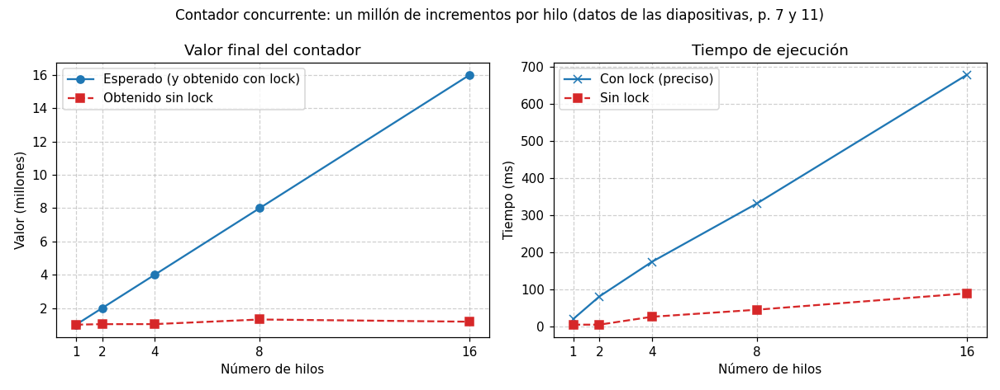
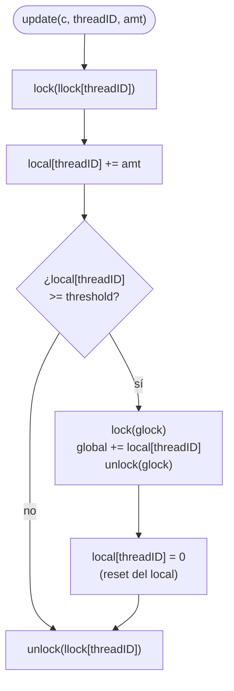
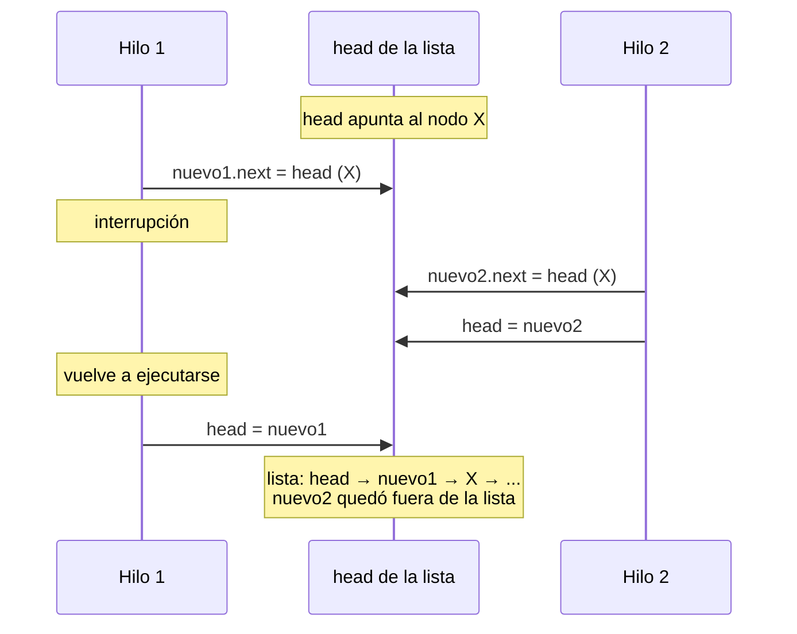

# Estructuras de datos basadas en locks (OSTEP, cap. 29)

## Objetivos de Aprendizaje

* **Explicar**: qué significa que una estructura de datos sea segura con hilos (*thread-safe*) y el patrón básico para lograrlo con un lock.
* **Analizar**: por qué el contador sin lock pierde incrementos y por qué el contador preciso, aunque correcto, escala pobremente cuando aumentan los hilos.
* **Explicar**: cómo funciona el contador aproximado (*sloppy counter*) y el compromiso entre exactitud y desempeño que regula el umbral $S$.
* **Aplicar**: el patrón `lock` → región crítica → `unlock` a una lista enlazada, y reescribirla para que el lock rodee solo la región crítica y tenga una única salida.
* **Comparar**: las estrategias de *locking* del contador, la lista, la cola y la tabla hash concurrentes.

> Sesión del 03/11/2026. La primera parte de esa sesión (el costo de los spinlocks y la mejora con `yield()`) está en el [apunte de la clase 15](../../clase_15/apuntes_zoom/README.md#cómo-evitar-el-gasto-en-la-cpu).

## Punto de partida: de los locks a las estructuras de datos

La clase empezó con un repaso de los locks. Un lock tiene dos caras: su **uso**, con la API de POSIX (`pthread_mutex_lock`/`pthread_mutex_unlock`) y el patrón `acquire(lock)` → región crítica → `release(lock)`, y su **implementación**, vista en la clase 15: deshabilitar interrupciones, el intento fallido con instrucciones *load*/*store*, test-and-set, compare-and-swap y LL/SC (*load-linked* y *store-conditional*). Fetch-and-add (*ticket lock*) y los locks con colas quedaron para los videos del Prof. Danny Múnera.

Esta clase responde la pregunta siguiente: ¿cómo usar los locks dentro de una **estructura de datos**? Incorporar un lock a una estructura de datos la hace **segura con hilos** (*thread-safe*): el lock garantiza la exclusión mutua cuando varios hilos la usan a la vez. La idea clave tiene dos partes:

* **Funcionamiento correcto** (*correctness*): dada una estructura de datos, ¿cómo agregarle locks para que trabaje adecuadamente?
* **Rendimiento** (*performance*): ¿cómo agregarlos de manera que muchos hilos accedan a la estructura sin que el rendimiento caiga?

Agregar concurrencia a estructuras de datos es una disciplina ampliamente estudiada, con miles de artículos de investigación; en la clase se vio una introducción con cuatro estructuras: el contador, la lista enlazada, la cola y la tabla hash.

## Contadores concurrentes

### El patrón básico

Para hacer un contador *thread-safe* se sigue el patrón básico:

1. Agregar el lock a la estructura y adquirirlo.
2. Manipular la estructura de datos (región crítica).
3. Liberar el lock.

El campo `value` del contador vive en memoria compartida (variables globales o *heap*), no en el *stack* de un hilo, así que todos los hilos lo ven. Aplicar el patrón consiste en "reescribir" la estructura: al `counter_t`, que solo tenía `value`, se le agrega un campo `lock`.

### Contador sin lock

```c
typedef struct __counter_t {
  int value;
} counter_t;

void init(counter_t *c) {
  c->value = 0;
}

void increment(counter_t *c) {
  c->value++;
}

void decrement(counter_t *c) {
  c->value--;
}

int get(counter_t *c) {
  return c->value;
}
```

Con un solo hilo funciona: en la prueba de escritorio de clase, `counter_t A; init(&A); increment(&A); increment(&A); int v = get(&A);` deja `v = 2`. Pero **no se protege el acceso a la región crítica**: con varios hilos se producen condiciones de carrera y el contador **no es *thread-safe***.

El programa de prueba (`counter_without_locks.c`) crea `NUMTHREADS` hilos que ejecutan la misma rutina sobre un contador global `cnt`, al que reciben por referencia (`&cnt`):

```c
void *counting(void *cnt_t) {
  counter_t *r_cnt = (counter_t *)cnt_t;
  for (int i = 0; i < CNT_END; i++) {
    increment(r_cnt);
  }
  return NULL;
}
```

Con `NUMTHREADS = 8` y `CNT_END = 1 000 000`, el contador debería quedar en 8 000 000. En la ejecución de clase quedó en **1 162 851**: *race condition*, el contador no es *thread-safe*. La causa es la misma vista en las clases 14 y 15: `c->value++` son tres instrucciones de máquina (leer, sumar, escribir), y si dos hilos leen el mismo valor antes de que alguno escriba, se pierde un incremento.

La tabla de las diapositivas (p. 7) repite la prueba con 1, 2, 4, 8 y 16 hilos:

| Hilos | Valor esperado | Valor obtenido | Tiempo (s) |
|---|---|---|---|
| 1 | 1 000 000 | 1 000 000 | 0.004213 |
| 2 | 2 000 000 | 1 030 174 | 0.004213 |
| 4 | 4 000 000 | 1 033 970 | 0.025465 |
| 8 | 8 000 000 | 1 309 698 | 0.044530 |
| 16 | 16 000 000 | 1 177 806 | 0.088573 |

Solo con un hilo el valor es correcto. Los valores cambian de una ejecución a otra (con 8 hilos la tabla dice 1 309 698 y la ejecución de clase dio 1 162 851).

### Contador preciso (con un único lock)

**Se protege el acceso a la región crítica**: se incorpora un único lock, de la API de POSIX, que protege el acceso al contador.

```c
typedef struct __counter_t {
  int value;
  pthread_mutex_t lock;
} counter_t;

void init(counter_t *c) {
  c->value = 0;
  Pthread_mutex_init(&c->lock, NULL);
}

void increment(counter_t *c) {
  Pthread_mutex_lock(&c->lock);
  c->value++;
  Pthread_mutex_unlock(&c->lock);
}

void decrement(counter_t *c) {
  Pthread_mutex_lock(&c->lock);
  c->value--;
  Pthread_mutex_unlock(&c->lock);
}

int get(counter_t *c) {
  Pthread_mutex_lock(&c->lock);
  int rc = c->value;
  Pthread_mutex_unlock(&c->lock);
  return rc;
}
```

Cada operación es un `lock` → región crítica → `unlock`. (`Pthread_mutex_lock`, con mayúscula, es una macro de OSTEP que llama a `pthread_mutex_lock` y verifica con `assert` que no falle.) Con el mismo programa de prueba, el valor obtenido es igual al esperado en todos los casos: el contador **es *thread-safe***. Pero el tiempo crece con el número de hilos (p. 11):

| Hilos | Valor esperado = obtenido | Tiempo (s) |
|---|---|---|
| 1 | 1 000 000 | 0.019288 |
| 2 | 2 000 000 | 0.080396 |
| 4 | 4 000 000 | 0.173779 |
| 8 | 8 000 000 | 0.331235 |
| 16 | 16 000 000 | 0.678422 |



*Figura elaborada con los datos de las tablas de las diapositivas (p. 7 y 11).*

A más hilos, más tiempo: el contador preciso **no escala bien**; es ineficiente. El lock obliga a que los incrementos se hagan de a uno, así que agregar hilos no agrega paralelismo.

La gráfica de OSTEP de las diapositivas (p. 12, Fig. 29.5) muestra lo mismo en la máquina del autor (un iMac con 4 CPU Intel i5 de 2.7 GHz), con cada hilo actualizando el contador un millón de veces: con un hilo la tarea tarda unos 0.03 s, y con dos hilos, más de 5 s. **El contador sincronizado escala pobremente.**

Para medir el tiempo, el programa toma una marca con `gettimeofday()` antes de crear los hilos ($t_i$) y otra después de esperarlos con `pthread_join` ($t_f$); el tiempo transcurrido es $\Delta t = t_f - t_i$, en microsegundos:

```c
gettimeofday(&start, NULL);
// ... pthread_create y pthread_join de todos los hilos ...
gettimeofday(&end, NULL);
time_elapsed = ((end.tv_sec * 1000000 + end.tv_usec)
              - (start.tv_sec * 1000000 + start.tv_usec));
```

El objetivo sería un **escalamiento perfecto** (*perfect scaling*): aunque se haga más trabajo, se hace en paralelo, así que el tiempo para completar la tarea no debería aumentar.

En la sesión se preguntó si no sería más eficiente usar un solo hilo, o dividir la suma entre los hilos y sumar los resultados al final. La observación es correcta para este caso, y es justamente la idea del contador aproximado: repartir el conteo para que los hilos no compitan por un único lock.

### Contador aproximado (*sloppy counter*)

OSTEP v1.10 lo llama *approximate counter*. Un contador lógico se implementa con **múltiples contadores físicos**, uno por *core*, más un contador global. Hay un lock por contador local y uno para el contador global (OSTEP, Fig. 29.4):

```c
typedef struct __counter_t {
  int global;                       // global count
  pthread_mutex_t glock;            // global lock
  int local[NUMCPUS];               // local count (per cpu)
  pthread_mutex_t llock[NUMCPUS];   // ... and locks
  int threshold;                    // update frequency
} counter_t;
```

El `threshold` (umbral) es el valor con el que se comparan los contadores locales para actualizar el global.

**Cuando un hilo desea incrementar el contador:**

* Incrementa solo su **contador local** (`local[cpu_i]`); cada CPU tiene el suyo.
* Los hilos que corren en **diferentes CPU** pueden actualizar su contador sin competencia, así que la actualización de los contadores escala adecuadamente.

**Los valores de los contadores locales se envían al contador global periódicamente:** el hilo adquiere el lock global (`glock`), incrementa `global` con el valor del contador local, y el contador local se "resetea" (se lleva a 0).

```c
// init: record threshold, init locks, init values
//       of all local counts and global count
void init(counter_t *c, int threshold) {
  c->threshold = threshold;
  c->global = 0;
  pthread_mutex_init(&c->glock, NULL);
  int i;
  for (i = 0; i < NUMCPUS; i++) {
    c->local[i] = 0;
    pthread_mutex_init(&c->llock[i], NULL);
  }
}

// update: usually, just grab local lock and update local amount
//         once local count has risen by 'threshold', grab global
//         lock and transfer local values to it
void update(counter_t *c, int threadID, int amt) {
  pthread_mutex_lock(&c->llock[threadID]);
  c->local[threadID] += amt;   // assumes amt > 0
  if (c->local[threadID] >= c->threshold) { // transfer to global
    pthread_mutex_lock(&c->glock);
    c->global += c->local[threadID];
    pthread_mutex_unlock(&c->glock);
    c->local[threadID] = 0;
  }
  pthread_mutex_unlock(&c->llock[threadID]);
}

// get: just return global amount (which may not be perfect)
int get(counter_t *c) {
  pthread_mutex_lock(&c->glock);
  int val = c->global;
  pthread_mutex_unlock(&c->glock);
  return val; // only approximate!
}
```

`amt` es lo que se suma al contador local en cada llamada. `update()` tiene dos regiones críticas anidadas: la del contador local, protegida por `llock[threadID]`, y dentro de ella la del contador global, protegida por `glock`.



`get()` solo lee `global`: lo que todavía está en los contadores locales no se cuenta. Por eso el valor es **aproximado** (*only approximate!*).

#### El parámetro $S$ (*threshold*)

¿Con qué frecuencia se actualiza el contador global? Lo decide el umbral $S$:

* **$S$ pequeño**: el contador se comporta como uno no escalable (el contador preciso).
* **$S$ grande**: el contador es más escalable, pero el valor del contador **global** se aleja del valor real.

En la sesión se preguntó si el umbral sirve para no esperar hasta el final e ir actualizando el resultado cada cierto tiempo. Sí: define cada cuánto se transfiere al global lo acumulado en los contadores locales.

#### Ejemplo: máquina con 4 *cores* (prueba de escritorio)

Hay 4 contadores locales ($L_1$, $L_2$, $L_3$, $L_4$), uno por CPU, asociados al hilo por medio de su `threadID` (`local[threadID]`), y un contador global $G$. El umbral es $S = 5$. Hay 4 hilos, uno por CPU, y cada uno actualiza su propio contador local sumando 1 (OSTEP, Fig. 29.3):

| Tiempo | $L_1$ | $L_2$ | $L_3$ | $L_4$ | $G$ |
|---|---|---|---|---|---|
| 0 | 0 | 0 | 0 | 0 | 0 |
| 1 | 0 | 0 | 1 | 1 | 0 |
| 2 | 1 | 0 | 2 | 1 | 0 |
| 3 | 2 | 0 | 3 | 1 | 0 |
| 4 | 3 | 0 | 3 | 2 | 0 |
| 5 | 4 | 1 | 3 | 3 | 0 |
| 6 | 5 → 0 | 1 | 3 | 4 | 5 (de $L_1$) |
| 7 | 0 | 2 | 4 | 5 → 0 | 10 (de $L_4$) |

En el tiempo 6, $L_1$ llega al umbral: se toma `glock`, se suman sus 5 unidades a $G$ y $L_1$ vuelve a 0. En el tiempo 7 ocurre lo mismo con $L_4$. Al final, $G = 10$, pero los contadores locales todavía guardan $0 + 2 + 4 + 0 = 6$: el conteo real es $16$. Eso es lo que significa que `get()` sea aproximado.

> [!NOTE]
> **Complemento (OSTEP, cap. 29, §29.1).**
> * **¿Por qué cada contador local tiene un lock, si cada hilo usa el suyo?** Se preguntó en la sesión. OSTEP lo explica en una nota al pie: los locks locales hacen falta porque puede haber **más de un hilo por *core***. Si solo corriera un hilo en cada *core*, no se necesitarían. En los [ejemplos de la clase](../ejemplos/counters/sloppy_counter/README.md), por ejemplo, 16 hilos se reparten 8 contadores locales, así que cada contador local lo actualizan dos hilos.
> * **¿Cuánto se puede retrasar el global?** Después de cada `update()`, el contador local queda por debajo de $S$, así que en cada contador local quedan a lo sumo $S - 1$ unidades sin transferir; en total, el global puede estar por debajo del valor real hasta en $\text{NUMCPUS} \times (S - 1)$.
> * **¿Y si se necesita el valor exacto?** `get()` podría adquirir todos los locks locales y el global (en un orden fijo, para evitar un *deadlock*) y sumar todo. Daría el valor exacto, pero no es escalable: es volver a competir por todos los locks.

#### Análisis de desempeño

En la gráfica de OSTEP (diapositivas p. 24, Fig. 29.5), cada hilo actualiza el contador un millón de veces, con $S = 1024$, en el mismo iMac de 4 CPU. El contador aproximado tarda prácticamente lo mismo con 1 que con 4 hilos: actualizar el contador cuatro millones de veces en cuatro procesadores tarda casi lo mismo que actualizarlo un millón de veces en uno. El contador preciso, en cambio, pasa de unos 0.03 s a más de 5 s con dos hilos.

La segunda gráfica (p. 25, Fig. 29.6) fija cuatro hilos, cada uno incrementando el contador un millón de veces, y varía $S$ entre 1 y 1024:

* **$S$ pequeño**: pobre desempeño (más de 10 s con $S = 1$), pero el valor global siempre es exacto.
* **$S$ grande**: excelente desempeño, pero el valor global se retrasa.

## Lista enlazada concurrente

> Continuación: sesión del 05/11/2026.

### Lista enlazada sin concurrencia

Se repasaron las estructuras de datos vistas en Lógica 2 y Estructuras de Datos (allí en Java, con programación orientada a objetos). Como C no tiene clases, se usan `struct`, y `typedef` les da un alias (`node_t` en lugar de `struct __node_t`):

```c
// basic node structure
typedef struct __node_t {
  int key;
  struct __node_t *next;
} node_t;

// basic list structure (one used per list)
typedef struct __list_t {
  node_t *head;
} list_t;
```

A diferencia de un arreglo, el tamaño de la lista puede cambiar en tiempo de ejecución. Las operaciones básicas son:

```c
void List_Init(list_t *L) {
  L->head = NULL;
}

int List_Insert(list_t *L, int key) {
  node_t *new = malloc(sizeof(node_t));
  if (new == NULL) {
    perror("malloc");
    return -1; // fail
  }
  new->key = key;
  new->next = L->head;
  L->head = new;
  return 0; // success
}

int List_Lookup(list_t *L, int key) {
  node_t *curr = L->head;
  while (curr) {
    if (curr->key == key) {
      return 0; // success
    }
    curr = curr->next;
  }
  return -1; // failure
}
```

* **Inicialización**: `head` apunta a `NULL`.
* **Inserción**: crea un nodo con `malloc`, le asigna la clave, lo enlaza con el que era el primero y lo vuelve la nueva cabeza. Se inserta siempre al inicio.
* **Búsqueda**: recorre la lista desde la cabeza comparando claves; retorna 0 si encuentra la clave y −1 si llega al final sin encontrarla.

En el ejemplo de clase, que se recorrió con una simulación visual de la memoria (*stack* y *heap*):

```c
int main() {
  int found;
  list_t L;
  List_Init(&L);
  List_Insert(&L, 3);
  List_Insert(&L, 8);
  found = List_Lookup(&L, 8);
  printf("8 in L? %d\n", found);
  found = List_Lookup(&L, 5);
  printf("5 in L? %d\n", found);
  return 0;
}
```

Después de las dos inserciones la lista es `head → 8 → 3 → NULL` (el último insertado queda de primero). El 8 está en la lista y el 5 no:

```
8 in L? 0
5 in L? -1
```

### El problema con varios hilos

Esta lista funciona con un solo hilo. En la sesión se ejecutó un programa en el que dos hilos insertan a la vez en la misma lista global (uno los números pares y otro los impares, 50 000 en total) y luego se cuentan los nodos: quedaron **49 931**. Se perdieron inserciones.

La razón es que los dos hilos leen y modifican los mismos punteros. `new->next = L->head;` y `L->head = new;` son la región crítica: si los dos hilos leen la misma cabeza antes de que alguno la actualice, el último en escribir `L->head` sobrescribe el trabajo del otro:



### Lista enlazada con un lock

Se agrega un lock (de la API de POSIX) a la estructura de la lista; el nodo no cambia:

```c
typedef struct __list_t {
  node_t *head;
  pthread_mutex_t lock;
} list_t;

void List_Init(list_t *L) {
  L->head = NULL;
  pthread_mutex_init(&L->lock, NULL);
}
```

El lock se inicializa libre (abierto).

**Inserción**: el código adquiere el lock a la entrada de la rutina y lo libera a la salida. Si `malloc` falla, también libera el lock antes de retornar:

```c
int List_Insert(list_t *L, int key) {
  pthread_mutex_lock(&L->lock);
  node_t *new = malloc(sizeof(node_t));
  if (new == NULL) {
    perror("malloc");
    pthread_mutex_unlock(&L->lock);
    return -1; // fail
  }
  new->key = key;
  new->next = L->head;
  L->head = new;
  pthread_mutex_unlock(&L->lock);
  return 0; // success
}
```

¿Por qué hay que liberar el lock cuando falla `malloc`? Porque si no se libera, ningún otro hilo podrá volver a entrar a la región crítica y el programa queda bloqueado indefinidamente. El lock se debe liberar siempre, sin importar el resultado de la operación.

**Búsqueda**: igual, adquiere el lock a la entrada y lo libera en **cada** salida: cuando encuentra la clave (*found*) y cuando llega al final sin encontrarla (*not found*):

```c
int List_Lookup(list_t *L, int key) {
  pthread_mutex_lock(&L->lock);
  node_t *curr = L->head;
  while (curr) {
    if (curr->key == key) {
      pthread_mutex_unlock(&L->lock);
      return 0; // success
    }
    curr = curr->next;
  }
  pthread_mutex_unlock(&L->lock);
  return -1; // failure
}
```

Esta es la lista concurrente de OSTEP (Fig. 29.7). Con el lock, el programa de dos hilos ya no pierde nodos: se puede comprobar con los [ejemplos de listas](../ejemplos/lists/README.md), donde la versión con lock inserta los 50 000 valores.

### Versión mejorada

En las versiones anteriores, en `List_Insert` se podía dar una falla en el `malloc`, y en `List_Lookup` la rutina sale apenas encuentra el elemento: en los dos casos hay que acordarse de liberar el lock en un camino de salida adicional. Ese **manejo de flujo de control excepcional es propenso a errores**. La mejora que propone el autor (Remzi) es **adquirir y liberar el lock solo alrededor de la región crítica**:

```c
void List_Insert(list_t *L, int key) {
  // synchronization not needed
  node_t *new = malloc(sizeof(node_t));
  if (new == NULL) {
    perror("malloc");
    return;
  }
  new->key = key;

  // just lock critical section
  pthread_mutex_lock(&L->lock);
  new->next = L->head;
  L->head = new;
  pthread_mutex_unlock(&L->lock);
}

int List_Lookup(list_t *L, int key) {
  int rv = -1;
  pthread_mutex_lock(&L->lock);
  node_t *curr = L->head;
  while (curr) {
    if (curr->key == key) {
      rv = 0;
      break;
    }
    curr = curr->next;
  }
  pthread_mutex_unlock(&L->lock);
  return rv; // now both success and failure
}
```

* En `List_Insert`, `malloc` y la asignación de la clave no necesitan sincronización (`malloc` es *thread-safe* y el nodo nuevo todavía no es visible para otros hilos). La región crítica es solo la **actualización de los punteros**, y si `malloc` falla, la función sale sin haber tomado el lock.
* En `List_Lookup`, la región crítica es recorrer y buscar en la lista, pero en lugar de retornar dentro del ciclo se guarda el resultado en `rv` y se sale con `break`: hay **un único punto de salida** y un único `unlock`.

Además, la región crítica de la inserción es más corta, así que cada hilo retiene el lock menos tiempo.

> [!NOTE]
> **Complemento (OSTEP, cap. 29, recuadro *Be Wary Of Locks And Control Flow*).** Un estudio de parches del kernel de Linux encontró que una gran parte de los errores (cerca del 40 %) está en caminos de código que se ejecutan rara vez, como la falla de `malloc`. Muchas funciones empiezan adquiriendo un lock o reservando memoria, y cuando ocurre un error deben deshacer todo antes de retornar, lo que es propenso a errores. Por eso conviene estructurar el código para minimizar ese patrón, como en la versión mejorada. OSTEP deja `List_Insert` retornando `int` (−1 si falla `malloc`, 0 si tiene éxito); las diapositivas la dejan `void`.

### Escalamiento: *hand-over-hand locking*

La lista con un único lock es correcta, pero no escala bien: todos los hilos compiten por el mismo lock. Una técnica para obtener más concurrencia es el ***hand-over-hand locking*** (también llamado *lock coupling*):

* Incluye un **lock por nodo** de la lista, en lugar de un solo lock por lista.
* Al recorrer la lista, **primero se adquiere el lock del siguiente nodo** y **luego se libera el del nodo actual**.

Permite un alto grado de concurrencia en las operaciones, pero en la práctica el **sobrecosto** (*overhead*) de adquirir y liberar un lock por cada nodo del recorrido es **prohibitivo**. Por eso en la clase se trabajó con un único lock para toda la lista.

> [!NOTE]
> **Complemento (OSTEP, cap. 29, §29.2 y recuadro *More Concurrency Isn't Necessarily Faster*).** Aun con listas muy grandes y muchos hilos, es poco probable que permitir varios recorridos simultáneos sea más rápido que simplemente tomar un solo lock, hacer la operación y liberarlo. OSTEP sugiere que un híbrido (tomar un nuevo lock cada cierto número de nodos) podría valer la pena investigarse. La regla general: si un diseño agrega mucho *overhead* (por ejemplo, adquirir y liberar locks con frecuencia), que sea más concurrente puede no importar; la única forma de saberlo es construir las dos alternativas y **medir**.

## Colas concurrentes

### Cola sin concurrencia

Una cola es una estructura FIFO (el primero en entrar es el primero en salir) que se implementa con una lista enlazada con dos punteros: uno a la cabeza (`head`), por donde se desencola, y otro al final (`tail`), por donde se encola.

```c
typedef struct __node_t {
  int value;
  struct __node_t *next;
} node_t;

typedef struct __queue_t {
  node_t *head;
  node_t *tail;
} queue_t;

void Queue_Init(queue_t *q) {
  node_t *tmp = malloc(sizeof(node_t));
  tmp->next = NULL;
  q->head = q->tail = tmp;
}

void Queue_Enqueue(queue_t *q, int value) {
  node_t *tmp = malloc(sizeof(node_t));
  assert(tmp != NULL);
  tmp->value = value;
  tmp->next = NULL;
  q->tail->next = tmp;
  q->tail = tmp;
}

int Queue_Dequeue(queue_t *q, int *value) {
  node_t *tmp = q->head;
  node_t *new_head = tmp->next;
  if (new_head == NULL) {
    return -1; // queue was empty
  }
  *value = new_head->value;
  q->head = new_head;
  free(tmp);
  return 0;
}
```

(En las diapositivas el campo del nodo aparece como `key`, pero las funciones usan `value`; aquí se usa `value` en todo el código, como en OSTEP.)

* **`Queue_Init`** crea un **nodo *dummy*** (ficticio, sin valor) al que apuntan tanto `head` como `tail`: la cola vacía tiene un nodo.
* **`Queue_Enqueue`** crea un nodo con el valor, lo enlaza después del último (`q->tail->next = tmp`) y mueve `tail` al nodo nuevo.
* **`Queue_Dequeue`** toma el valor del nodo **siguiente** a `head` (el primero real, porque `head` siempre apunta a un *dummy*), lo deja en `*value`, mueve `head` a ese nodo, que pasa a ser el nuevo *dummy*, y libera el anterior con `free`. Si `head->next` es `NULL`, la cola está vacía y retorna −1. El parámetro `int *value` es donde queda el valor que sale de la cola.

En el ejemplo de clase, que también se recorrió con la simulación visual, se encolan 3, −10 y 8, y al desencolar dos veces salen en el mismo orden en que entraron:

```c
int main() {
  queue_t Q;
  int v;
  Queue_Init(&Q);
  Queue_Enqueue(&Q, 3);
  Queue_Enqueue(&Q, -10);
  Queue_Enqueue(&Q, 8);
  Queue_Dequeue(&Q, &v);
  printf("Valor desencolado: %d\n", v);
  Queue_Dequeue(&Q, &v);
  printf("Valor desencolado: %d\n", v);
  return 0;
}
```

```
Valor desencolado: 3
Valor desencolado: -10
```

La cola concurrente y la tabla hash concurrente se presentaron en la sesión y se dejaron para los videos del Prof. Danny Múnera; se explican en la sección siguiente.

## Para revisar de forma autónoma

> [!NOTE]
> Esta parte quedó en las diapositivas (p. 40–45) para revisarla en los videos del Prof. Danny Múnera; no se desarrolló en clase. Aquí se explica con apoyo del cap. 29 de OSTEP (§29.3 y §29.4).

### Cola concurrente (Michael y Scott)

La forma estándar de hacer concurrente una estructura es agregarle un lock grande, pero la cola de Michael y Scott (OSTEP, Fig. 29.9) permite más concurrencia:

* Usa **dos locks**: uno para la cabeza (`head_lock`) y otro para el final (`tail_lock`). El objetivo es que encolar y desencolar puedan ocurrir a la vez: en el caso común, `Queue_Enqueue` solo toma `tail_lock` y `Queue_Dequeue` solo toma `head_lock`.
* Incluye el **nodo *dummy***, creado en la inicialización. Gracias a él, las operaciones sobre la cabeza y sobre el final de la cola quedan separadas.

```c
typedef struct __queue_t {
  node_t *head;
  node_t *tail;
  pthread_mutex_t head_lock, tail_lock;
} queue_t;

void Queue_Init(queue_t *q) {
  node_t *tmp = malloc(sizeof(node_t));
  tmp->next = NULL;
  q->head = q->tail = tmp;
  pthread_mutex_init(&q->head_lock, NULL);
  pthread_mutex_init(&q->tail_lock, NULL);
}

void Queue_Enqueue(queue_t *q, int value) {
  node_t *tmp = malloc(sizeof(node_t));
  assert(tmp != NULL);
  tmp->value = value;
  tmp->next = NULL;

  pthread_mutex_lock(&q->tail_lock);
  q->tail->next = tmp;
  q->tail = tmp;
  pthread_mutex_unlock(&q->tail_lock);
}

int Queue_Dequeue(queue_t *q, int *value) {
  pthread_mutex_lock(&q->head_lock);
  node_t *tmp = q->head;
  node_t *new_head = tmp->next;
  if (new_head == NULL) {
    pthread_mutex_unlock(&q->head_lock);
    return -1; // queue was empty
  }
  *value = new_head->value;
  q->head = new_head;
  pthread_mutex_unlock(&q->head_lock);
  free(tmp);
  return 0;
}
```

El código es el de la cola sin concurrencia con los locks agregados. Igual que en la versión mejorada de la lista, la reserva del nodo en `Queue_Enqueue` va fuera del lock, y en `Queue_Dequeue` el lock se libera en las dos salidas (cola vacía y éxito); el `free` del nodo viejo se hace después de liberarlo.

Las colas se usan mucho en programas multihilo, pero una cola como esta, solo con locks, a menudo no basta: un hilo que quiere desencolar de una cola vacía simplemente recibe −1. Una **cola acotada** (*bounded queue*), en la que un hilo **espera** si la cola está vacía o llena, necesita las variables de condición del capítulo siguiente.

### Tabla hash concurrente

Una tabla hash usa una **función hash** para asignar cada clave a uno de varios cubos (*buckets*); así, buscar, insertar y eliminar son operaciones eficientes. La implementación de OSTEP (Fig. 29.10) es simple (la tabla no cambia de tamaño) y está construida con las **listas concurrentes** vistas antes: cada cubo es una lista, con su propio lock.

```c
#define BUCKETS (101)

typedef struct __hash_t {
  list_t lists[BUCKETS];
} hash_t;

void Hash_Init(hash_t *H) {
  int i;
  for (i = 0; i < BUCKETS; i++)
    List_Init(&H->lists[i]);
}

int Hash_Insert(hash_t *H, int key) {
  return List_Insert(&H->lists[key % BUCKETS], key);
}

int Hash_Lookup(hash_t *H, int key) {
  return List_Lookup(&H->lists[key % BUCKETS], key);
}
```

La función hash es `key % BUCKETS`. Como `Hash_Insert` retorna el resultado de `List_Insert`, usa la versión que retorna `int` (la de OSTEP, Fig. 29.8), no la versión `void` de las diapositivas.

En lugar de un solo lock para toda la estructura, hay **un lock por cubo**: operaciones sobre cubos distintos no compiten entre sí y pueden ocurrir al mismo tiempo. En la gráfica de OSTEP (diapositivas p. 44, Fig. 29.11), cuatro hilos hacen entre 10 000 y 50 000 inserciones cada uno, en el mismo iMac de 4 CPU: la tabla hash concurrente casi no tarda más con más inserciones (**excelente escalamiento**), mientras que la lista con un solo lock pasa a tardar más de 10 s con 50 000.

## Resumen y Conclusión

| Estructura | Estrategia de *locking* | Correcta | Escala |
|---|---|---|---|
| Contador sin lock | Ninguna | No: pierde incrementos | — |
| Contador preciso | Un lock para el contador | Sí | No: el tiempo crece con los hilos |
| Contador aproximado | Un lock por contador local y uno global; transferencia cada $S$ | Sí, pero `get()` es aproximado (hasta $\text{NUMCPUS} \times (S-1)$ por debajo) | Sí, con $S$ grande |
| Lista enlazada | Un lock para la lista, solo alrededor de la región crítica | Sí | No: todos compiten por el lock |
| Lista con *hand-over-hand* | Un lock por nodo | Sí | En la práctica no: el *overhead* es prohibitivo |
| Cola de Michael y Scott | Dos locks (cabeza y final) y un nodo *dummy* | Sí | Encolar y desencolar pueden ocurrir a la vez |
| Tabla hash | Un lock por cubo (una lista concurrente por cubo) | Sí | Sí: excelente escalamiento |

Las lecciones del capítulo:

* Agregar un lock con el patrón básico hace correcta una estructura, pero un único lock la serializa.
* Para escalar, se reparte la estructura en partes con su propio lock (contadores locales, cubos, cabeza y final), para que los hilos no compitan por el mismo.
* Más concurrencia no siempre es más rápido: cada lock tiene un costo, y hay que medir.
* Cuidado con el flujo de control: cada salida de una región crítica debe liberar el lock; conviene que haya una sola.

## Puente hacia la siguiente clase

Con locks, un hilo puede proteger una región crítica, pero no puede **esperar** a que se cumpla una condición, por ejemplo, que una cola deje de estar vacía para poder desencolar. Ese es el problema de la cola acotada que menciona OSTEP al final de §29.3 y el tema de las **variables de condición** (OSTEP, cap. 30), que se estudian en la clase siguiente.

## Para probar por cuenta propia

* **Ejemplos de la clase** ([`clase_16/ejemplos/`](../ejemplos/README.md)), en C, con salidas de una ejecución de referencia:
  * [Contadores](../ejemplos/counters/README.md): el contador sin lock, el preciso y el aproximado de las diapositivas, con *benchmarks* que repiten las tablas y gráficas de la clase (incluido el barrido de $S$ con cuatro hilos). La [comparación](../ejemplos/counters/comparison/README.md) muestra además por qué, en un computador actual, la versión de las diapositivas del contador aproximado casi no escala y cómo se corrige (*false sharing*, un tema que no se vio en clase).
  * [Listas](../ejemplos/lists/README.md): la lista sin lock (pierde nodos con dos hilos) y con un lock (versión mejorada).
* **Tarea de código del cap. 29 de OSTEP** (sección *Homework (Code)* del [capítulo](https://pages.cs.wisc.edu/~remzi/OSTEP/threads-locks-usage.pdf)): medir el contador simple y el aproximado al variar los hilos y el umbral (lo que hacen los ejemplos de contadores), construir una lista con *hand-over-hand locking* y comparar cuándo es mejor que la lista con un solo lock, y aplicar una estrategia de *locking* a otra estructura (por ejemplo, un árbol B).

## Recursos complementarios

* **Videos del Prof. Danny Múnera** del Módulo 3, en este orden: contadores concurrentes, listas enlazadas basadas en locks, colas concurrentes y tablas hash concurrentes. Son la referencia para la parte que quedó para revisar de forma autónoma.
* **"The search for fast, scalable counters"**, de Jonathan Corbet (LWN, 2006), sobre contadores aproximados en el kernel de Linux; aparece en las referencias de las diapositivas y de OSTEP: <https://lwn.net/Articles/170003/>

## Referencias

* Arpaci-Dusseau, R. H. y Arpaci-Dusseau, A. C. *Operating Systems: Three Easy Pieces*, cap. 29, "Lock-based Concurrent Data Structures" (v1.10): <https://pages.cs.wisc.edu/~remzi/OSTEP/threads-locks-usage.pdf>
* Arpaci-Dusseau, R. H. y Arpaci-Dusseau, A. C. *Operating Systems: Three Easy Pieces*, cap. 28, "Locks" (v1.10): <https://pages.cs.wisc.edu/~remzi/OSTEP/threads-locks.pdf>
* Michael, M. y Scott, M. "Nonblocking Algorithms and Preemption-safe Locking on Multiprogrammed Shared-memory Multiprocessors". *Journal of Parallel and Distributed Computing*, 51(1), 1998.
* Moir, M. y Shavit, N. "Concurrent Data Structures". En *Handbook of Data Structures and Applications*, Chapman and Hall/CRC Press, 2004.

---

> [!IMPORTANT]
> **Nota de Transparencia:** Este documento fue generado y adaptado mediante el uso de **IA Generativa**, a partir del manuscrito anotado de la clase y los resúmenes y notas de las sesiones de Zoom (03/11 y 05/11/2026), complementado con el capítulo 29 de OSTEP. El contenido ha sido supervisado, validado y refinado por intervención humana para garantizar su precisión técnica y coherencia pedagógica. No obstante, pueden haber errores.
