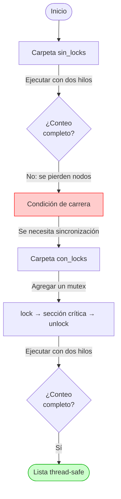

# Listas enlazadas y concurrencia (OSTEP, cap. 29)

Este directorio contiene dos ejemplos de **estructuras de datos concurrentes**, basados en el capítulo 29 del libro *Operating Systems: Three Easy Pieces* (Remzi H. Arpaci-Dusseau y Andrea C. Arpaci-Dusseau).

El objetivo es analizar qué ocurre cuando varios hilos acceden a una estructura de datos compartida y cómo un lock evita que la estructura se corrompa.

## Organización del código

El ejercicio se divide en dos partes, con el mismo programa de prueba: dos hilos insertan de forma concurrente en una lista compartida (uno los números pares y otro los impares), y luego el hilo principal verifica cuántos valores quedaron en la lista.

| Carpeta | Contenido | Resultado esperado |
| --- | --- | --- |
| [`sin_locks/`](sin_locks/) (el problema) | Lista enlazada sin sincronización. | Condición de carrera: se pierden nodos y el conteo final es menor que el esperado (p. ej., 49 922 de 50 000). |
| [`con_locks/`](con_locks/) (la solución) | La misma lista protegida con un `pthread_mutex_t` (un único lock para toda la lista). | Exclusión mutua: el conteo coincide con el esperado (50 000 de 50 000). |

Cada carpeta tiene su propio `README.md` con la explicación del código, las instrucciones de compilación y salidas de una ejecución de referencia.

## Ruta del ejercicio

## Instrucciones

1. En la carpeta [`sin_locks/`](sin_locks/), compilar con `make` y ejecutar `./main.out` varias veces. Observar que el conteo real suele ser menor que el esperado y que varía de una ejecución a otra. Ocasionalmente puede no perderse ningún nodo: eso no significa que el código sea correcto.
2. En la carpeta [`con_locks/`](con_locks/), analizar el uso de `pthread_mutex_lock` y `pthread_mutex_unlock` en [`linked_list.c`](con_locks/linked_list.c).
3. Compilar con `make` y ejecutar `./main.out`. Verificar que el conteo coincide con el esperado.

Los dos programas usan el mismo `main.c`, así que la única diferencia entre ellos está en la lista. Ambos aceptan un argumento opcional con la cantidad de valores a insertar (`END_VALUE`, por defecto `50000`), por ejemplo `./main.out 10000`.

> **Referencia teórica:** [OSTEP, cap. 29: *Lock-based Concurrent Data Structures*](https://pages.cs.wisc.edu/~remzi/OSTEP/threads-locks-usage.pdf)

> [!NOTE]
> **Nota sobre IA:** este contenido fue elaborado y estructurado con la asistencia de un modelo de inteligencia artificial y puede contener errores.
