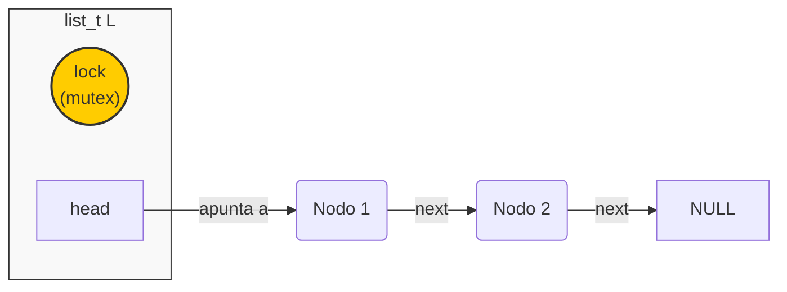
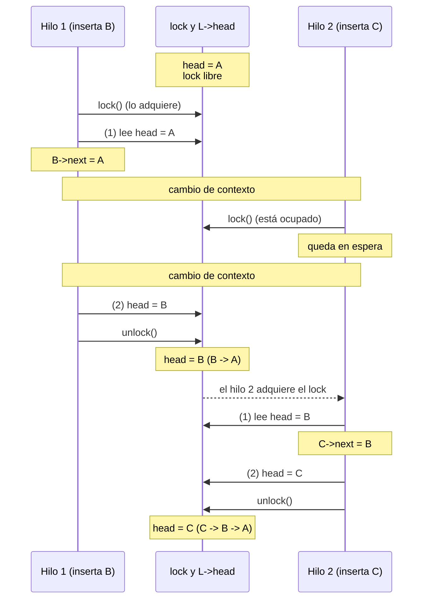

# Lista enlazada con locks (versión *thread-safe*)

Este directorio contiene la versión **segura para hilos** (*thread-safe*) de la lista enlazada de la carpeta [`sin_locks/`](../sin_locks/). Es la misma estructura de datos, a la que se agrega un *mutex* que garantiza la **exclusión mutua** sobre la lista y elimina la condición de carrera de la versión sin protección.

---

## Descripción técnica

Se sigue la estrategia más sencilla del capítulo 29 de OSTEP: un **único lock para toda la lista** (*coarse-grained locking*, bloqueo de grano grueso).

* **Mecanismo:** `pthread_mutex_t`, incluido dentro de la propia estructura `list_t`.
* **Estrategia:** cada operación adquiere el lock antes de acceder a los punteros de la lista y lo libera al terminar.
* **Garantía:** en todo momento, a lo sumo un hilo lee o modifica la lista.

### Archivos

| Archivo | Contenido |
| --- | --- |
| [`linked_list.h`](linked_list.h) | Definición de `node_t` y `list_t` (con el lock) y prototipos de las funciones. |
| [`linked_list.c`](linked_list.c) | Implementación de `List_Init`, `List_Insert` y `List_Lookup` con el lock. |
| [`main.c`](main.c) | Programa de prueba con dos hilos que insertan de forma concurrente. |
| [`Makefile`](Makefile) | Compila los dos `.c` y genera el ejecutable `main.out`. |

### Estructuras de datos (`linked_list.h`)

La única diferencia con la versión sin locks es el campo `lock`:

```c
typedef struct __node_t {
  int key;
  struct __node_t *next;
} node_t;

typedef struct __list_t {
  node_t *head;
  pthread_mutex_t lock;   // protege el acceso a toda la lista
} list_t;
```

### Representación de la estructura



## Funciones principales

Implementadas en `linked_list.c`:

1. **`void List_Init(list_t *L)`**: asigna `NULL` a `head` e inicializa el lock con `pthread_mutex_init`. Sin esta inicialización, el uso del mutex no está definido.
2. **`void List_Insert(list_t *L, int key)`**:
   * Reserva el nodo con `malloc` y le asigna `key` **fuera** de la sección crítica: ese trabajo solo afecta al nodo nuevo, que todavía no es visible para otros hilos (`malloc` es, además, *thread-safe*).
   * Adquiere el lock solo para las dos instrucciones que leen y modifican `head`, y lo libera inmediatamente después.
   * Si `malloc` falla, imprime el error y retorna sin haber tomado el lock, de modo que no queda ninguna ruta de salida con el lock adquirido.
3. **`int List_Lookup(list_t *L, int key)`**: adquiere el lock durante todo el recorrido para que ningún hilo modifique la lista mientras se lee. Usa una variable `rv` y un `break`, de manera que la función tiene **un único punto de salida** y el `unlock` se ejecuta siempre. Retorna `0` si encuentra `key` y `-1` en caso contrario.

La sección crítica de `List_Insert` queda así:

```c
pthread_mutex_lock(&L->lock);
new->next = L->head;   // (1) leer head y enlazar el nodo nuevo
L->head = new;         // (2) escribir head
pthread_mutex_unlock(&L->lock);
```

Esta organización (reducir la sección crítica al mínimo y tener un solo camino de salida) corresponde a la versión reescrita de la lista que presenta OSTEP en la sección 29.2 (Fig. 29.8). En esa misma versión `List_Insert` deja de retornar un código de error y pasa a ser `void`, a diferencia de la versión sin locks.

## Programa de prueba (`main.c`)

El [`main.c`](main.c) es idéntico al de [`sin_locks/`](../sin_locks/main.c): la única diferencia entre las dos versiones está en la lista. **Dos hilos** insertan en la lista global `L`, uno los números pares y otro los impares menores que `END_VALUE`. Luego el hilo principal cuenta con `List_Lookup` cuántos valores entre `0` y `END_VALUE - 1` están en la lista e imprime los 10 primeros nodos, es decir, los 10 últimos que se insertaron.

El número de hilos (dos) está fijo. `END_VALUE` vale `50000` por defecto y puede cambiarse con el primer argumento del programa.

## Compilación y ejecución

Se requiere `gcc` y la biblioteca de hilos POSIX (Linux o WSL).

### 1. Compilar

```bash
make          # genera main.out
make clean    # elimina los .o y el ejecutable
```

O bien, directamente:

```bash
gcc -Wall -O2 -g -pthread -o main.out main.c linked_list.c
```

### 2. Ejecutar

```bash
./main.out            # END_VALUE = 50000
./main.out 10         # END_VALUE = 10
```

### Salida posible

Ejecuciones de referencia del 05/11/2026 en la máquina descrita en [`entorno_ejecucion.md`](../../../../clase_14/ejemplos/entorno_ejecucion.md) (WSL1, 8 CPU lógicas):

```text
$ ./main.out
- Cantidad esperada de valores insertados: 50000
- Cantidad real de valores insertados: 50000
- Primeros 10 nodos de la lista: 49998 -> 49996 -> 49994 -> 49992 -> 49990 -> 49988 -> 49986 -> 49984 -> 49982 -> 49980 -> ...
$ ./main.out
- Cantidad esperada de valores insertados: 50000
- Cantidad real de valores insertados: 50000
- Primeros 10 nodos de la lista: 49999 -> 49997 -> 49995 -> 49993 -> 49991 -> 49989 -> 49987 -> 49985 -> 49983 -> 49981 -> ...
$ ./main.out 10
- Cantidad esperada de valores insertados: 10
- Cantidad real de valores insertados: 10
- Primeros 10 nodos de la lista: 9 -> 7 -> 5 -> 3 -> 1 -> 8 -> 6 -> 4 -> 2 -> 0 -> NULL
```

El conteo coincidió con el valor esperado en las 13 ejecuciones realizadas con el valor por defecto. Cada una tardó alrededor de 2 s, casi todo en la verificación final: se hacen 50 000 búsquedas sobre una lista de hasta 50 000 nodos, es decir, del orden de 10⁹ comparaciones. Duplicar `END_VALUE` multiplica ese tiempo por cerca de cuatro.

El orden de la lista varía de una ejecución a otra porque depende de cómo se intercalan los hilos. Al insertar en la cabeza, el primer nodo de la lista es el último que se insertó. En las dos primeras ejecuciones, los 10 primeros nodos son todos de un mismo hilo (el que terminó último). Con `END_VALUE = 10`, el hilo de los pares insertó todos sus valores antes de que el de los impares empezara, lo cual es esperable porque crear un hilo toma más tiempo que hacer cinco inserciones. El mutex garantiza que no se pierdan nodos, pero **no impone un orden** entre los hilos.

## Comparación con `sin_locks`

En la versión [`sin_locks`](../sin_locks/), un hilo podía ser interrumpido entre las instrucciones (1) y (2), y otro hilo podía completar su propia inserción en ese intervalo. Con el lock, si el hilo 1 lo tiene adquirido y el hilo 2 intenta insertar, `pthread_mutex_lock` deja al hilo 2 **en espera** hasta que el hilo 1 lo libere. Las dos inserciones quedan **serializadas**:



El cambio de contexto en el mismo punto que en la versión sin locks ya no causa daño: el hilo 2 no puede leer `head` hasta que el hilo 1 termine de actualizarlo. Al final se conservan todos los nodos (`C -> B -> A`).

## Consideración de rendimiento

La solución es **correcta**, pero el lock único hace que todas las operaciones sobre la lista se ejecuten de a una, aunque haya varios hilos y varias CPU disponibles. Cuando muchos hilos acceden a la lista, pasan buena parte del tiempo esperando el lock y se pierde el paralelismo.

> [!NOTE]
> **Complemento (OSTEP, cap. 29).** Una alternativa para aumentar la concurrencia es el *hand-over-hand locking* (*lock coupling*): un lock por nodo, y al recorrer la lista se toma el lock del nodo siguiente antes de soltar el del actual. OSTEP advierte que, en la práctica, adquirir y liberar un lock en cada nodo suele hacer esta versión **más lenta** que la de un único lock, salvo en listas muy grandes con muchos hilos. Como regla general, el libro recomienda empezar con un lock único (más simple) y refinar solo si aparece un problema de rendimiento medido.

> **Referencia teórica:** [OSTEP, cap. 29: *Lock-based Concurrent Data Structures*](https://pages.cs.wisc.edu/~remzi/OSTEP/threads-locks-usage.pdf), sección 29.2 (*Concurrent Linked Lists*).

> [!NOTE]
> **Nota sobre IA:** este contenido fue elaborado y estructurado con la asistencia de un modelo de inteligencia artificial.

> [!WARNING]
> **Aclaración:** como todo código, en especial los ejemplos didácticos, este puede contener errores y debe revisarse de forma crítica.
