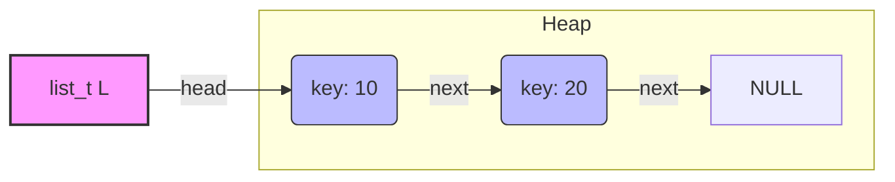
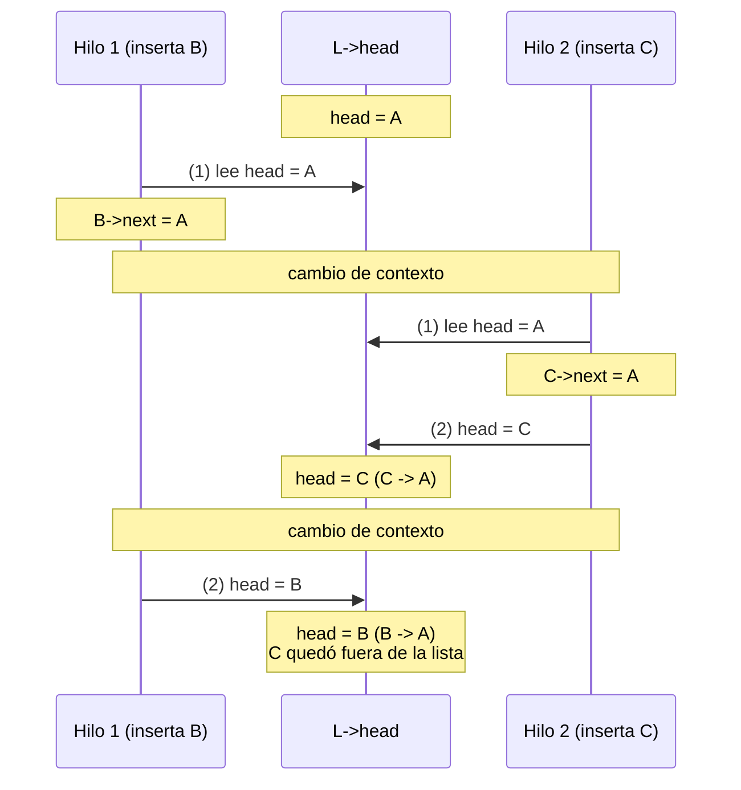
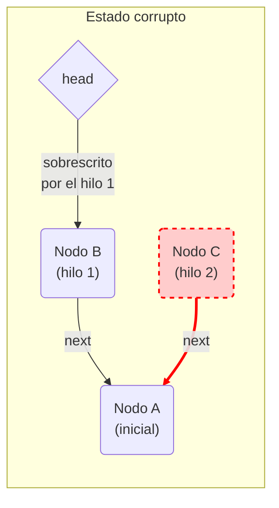

# Lista enlazada sin locks (versión no *thread-safe*)

Este directorio contiene una implementación básica de una **lista simplemente enlazada** en C, sin ningún mecanismo de sincronización.

**Propósito:** servir como **caso base** para evidenciar las condiciones de carrera (*race conditions*) que se producen cuando varios hilos modifican una estructura de datos compartida sin exclusión mutua. La versión corregida, protegida con un *mutex*, se encuentra en la carpeta [`con_locks/`](../con_locks/).

---

## Descripción técnica

Cada nodo almacena un valor entero (`key`) y un puntero al nodo siguiente.

* **Tipo:** lista simplemente enlazada (*singly linked list*).
* **Gestión de memoria:** dinámica, mediante `malloc` (la lista no se libera al final del programa, pues el objetivo del ejemplo es otro).
* **Inserción:** siempre en la cabeza (`head`), con complejidad O(1). En consecuencia, el último elemento insertado es el primero de la lista.

### Archivos

| Archivo | Contenido |
| --- | --- |
| [`linked_list.h`](linked_list.h) | Definición de `node_t` y `list_t` y prototipos de las funciones. |
| [`linked_list.c`](linked_list.c) | Implementación de `List_Init`, `List_Insert` y `List_Lookup`. |
| [`main.c`](main.c) | Programa de prueba con dos hilos que insertan de forma concurrente. |
| [`Makefile`](Makefile) | Compila los dos `.c` y genera el ejecutable `main.out`. |

### Estructuras de datos (`linked_list.h`)

```c
typedef struct __node_t {
  int key;                // valor almacenado
  struct __node_t *next;  // puntero al siguiente nodo
} node_t;

typedef struct __list_t {
  node_t *head;           // puntero al primer elemento de la lista
} list_t;
```

### Representación de la estructura

Lista con dos elementos, tras insertar primero `20` y luego `10`:



## Funciones principales

Declaradas en `linked_list.h` e implementadas en `linked_list.c`:

1. **`void List_Init(list_t *L)`**: inicializa la lista asignando `NULL` a `head`.
2. **`int List_Insert(list_t *L, int key)`**: reserva un nodo nuevo, le asigna `key` y lo enlaza al **inicio** de la lista. Retorna `0` si tiene éxito y `-1` si falla `malloc`. Las dos últimas instrucciones (enlazar el nodo y actualizar `head`) constituyen la **sección crítica**.
3. **`int List_Lookup(list_t *L, int key)`**: recorre la lista buscando `key`. Retorna `0` si lo encuentra y `-1` en caso contrario.

## Programa de prueba (`main.c`)

El programa crea **dos hilos** que insertan en la misma lista global `L`:

* `my_thread1` inserta los números pares menores que `END_VALUE`: `0, 2, 4, …`
* `my_thread2` inserta los números impares menores que `END_VALUE`: `1, 3, 5, …`

Una vez que ambos hilos terminan (`pthread_join`), el hilo principal busca con `List_Lookup` cada valor entre `0` y `END_VALUE - 1` y cuenta cuántos se encuentran. Si la lista fuera correcta, el conteo coincidiría con `END_VALUE`. Por último, imprime los 10 primeros nodos de la lista, es decir, los 10 últimos que se insertaron.

El número de hilos (dos) está fijo. `END_VALUE` vale `50000` por defecto y puede cambiarse con el primer argumento del programa. El [`main.c`](main.c) es idéntico al de [`con_locks/`](../con_locks/main.c): la única diferencia entre las dos versiones está en la lista.

> [!NOTE]
> La verificación final hace `END_VALUE` búsquedas sobre una lista de hasta `END_VALUE` nodos, es decir, su costo crece con el cuadrado de `END_VALUE`. Con el valor por defecto tarda alrededor de 2 s. Duplicar `END_VALUE` multiplica ese tiempo por cerca de cuatro.

## Compilación y ejecución

Se requiere `gcc` y la biblioteca de hilos POSIX (Linux o WSL).

### 1. Compilar

Con el `Makefile` incluido:

```bash
make          # genera main.out
make clean    # elimina los .o y el ejecutable
```

O bien, directamente:

```bash
gcc -Wall -O2 -g -pthread -o main.out main.c linked_list.c
```

### 2. Ejecutar

```bash
./main.out            # END_VALUE = 50000
./main.out 10000      # END_VALUE = 10000
```

### Salida posible

Las siguientes salidas corresponden a una ejecución de referencia del 05/11/2026 en la máquina descrita en [`entorno_ejecucion.md`](../../../../clase_14/ejemplos/entorno_ejecucion.md) (WSL1, 8 CPU lógicas). En otra máquina las cifras serán distintas, pero el fenómeno es el mismo.

```text
$ ./main.out
- Cantidad esperada de valores insertados: 50000
- Cantidad real de valores insertados: 49922
- Primeros 10 nodos de la lista: 49999 -> 49997 -> 49995 -> 49998 -> 49996 -> 49994 -> 49992 -> 49993 -> 49991 -> 49989 -> ...
$ ./main.out
- Cantidad esperada de valores insertados: 50000
- Cantidad real de valores insertados: 49986
- Primeros 10 nodos de la lista: 49999 -> 49997 -> 49995 -> 49993 -> 49991 -> 49989 -> 49987 -> 49985 -> 49983 -> 49981 -> ...
$ ./main.out
- Cantidad esperada de valores insertados: 50000
- Cantidad real de valores insertados: 49970
- Primeros 10 nodos de la lista: 49998 -> 49996 -> 49994 -> 49992 -> 49990 -> 49988 -> 49986 -> 49984 -> 49982 -> 49980 -> ...
```

Cada ejecución pierde una cantidad distinta de nodos, porque el resultado depende de cómo el planificador intercale los hilos. En la primera ejecución, los nodos iniciales muestran ese intercalado: pares e impares alternan por tramos. En una serie adicional de 30 ejecuciones el conteo varió entre `49672` y `50000`, y en **3 de las 30** no se perdió ningún nodo. Con `./main.out 10000` (20 ejecuciones) el conteo varió entre `9660` y `9982`.

Que una ejecución no pierda nodos ocurre cuando, por azar, los hilos nunca coinciden en la sección crítica: solo son dos instrucciones, frente al `malloc` y al resto del ciclo, que ocupan la mayor parte del tiempo. Una ejecución correcta **no demuestra** que el código sea correcto: la condición de carrera sigue presente aunque no se manifieste.

## Advertencia de concurrencia: condición de carrera

**Esta implementación no es segura para hilos (*not thread-safe*).**

Con un solo hilo, la lista funciona correctamente. Cuando varios hilos invocan `List_Insert` de forma concurrente sobre la misma lista, se produce una condición de carrera en estas dos instrucciones:

```c
new->next = L->head;   // (1) leer head y enlazar el nodo nuevo
L->head = new;         // (2) escribir head
```

El par (1)–(2) no es atómico. Si un hilo es interrumpido entre (1) y (2), y otro hilo completa su propia inserción en ese intervalo, el primero sobrescribe `head` con un valor calculado a partir de una lectura ya desactualizada.

### Intercalado que produce el fallo

Se parte de una lista que contiene solo el nodo `A`. El hilo 1 intenta insertar el nodo `B` y el hilo 2 el nodo `C`:



### Estado final de la memoria



**Resultado:** el nodo `C` (en rojo) no es alcanzable desde `head`. Su inserción se perdió, aunque el hilo 2 completó `List_Insert` sin error, y la memoria que ocupa ya no puede liberarse (fuga de memoria, *memory leak*). Cada vez que este intercalado ocurre se pierde un valor, lo que explica que el conteo final sea menor que `END_VALUE`.

## Solución

La versión de la carpeta [`con_locks/`](../con_locks/) protege la sección crítica con un `pthread_mutex_t`, de modo que solo un hilo a la vez puede leer y actualizar `head`. Con esa versión, el conteo coincide con el valor esperado en todas las ejecuciones. Ejecución de referencia en la misma máquina:

```text
$ ./main.out
- Cantidad esperada de valores insertados: 50000
- Cantidad real de valores insertados: 50000
- Primeros 10 nodos de la lista: 49999 -> 49997 -> 49995 -> 49993 -> 49991 -> 49989 -> 49987 -> 49985 -> 49983 -> 49981 -> ...
```

> **Referencia teórica:** [OSTEP, cap. 29: *Lock-based Concurrent Data Structures*](https://pages.cs.wisc.edu/~remzi/OSTEP/threads-locks-usage.pdf), sección 29.2 (*Concurrent Linked Lists*).

> [!NOTE]
> **Nota sobre IA:** este contenido fue elaborado y estructurado con la asistencia de un modelo de inteligencia artificial.

> [!WARNING]
> **Aclaración:** como todo código, en especial los ejemplos didácticos, este puede contener errores y debe revisarse de forma crítica.
