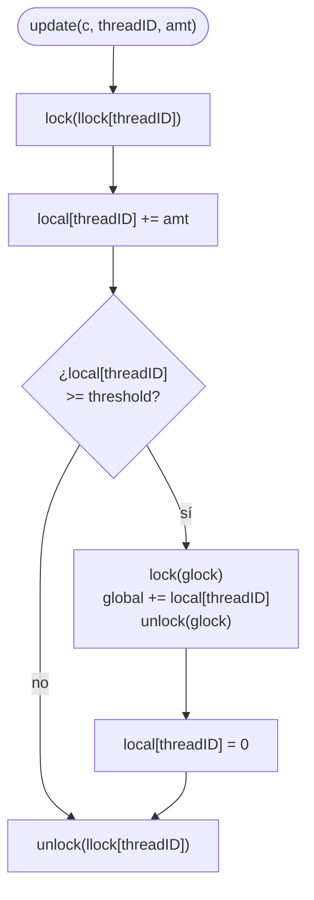

# Contadores — Parte 3: contador aproximado (*sloppy counter*)

Tercer eslabón: un contador que reduce la competencia por el lock global repartiendo el conteo en varios contadores locales, a cambio de que el valor global sea aproximado. Esta carpeta usa la implementación **tal como aparece en las diapositivas** (p. 14–25), que es la de OSTEP §29.1 (Fig. 29.4, *Approximate Counter Implementation*). OSTEP v1.10 lo llama *approximate counter*; las diapositivas, *sloppy counter*.

Las salidas son de una ejecución de referencia del 11/11/2026 en la máquina descrita en el [entorno de ejecución](../../../../clase_14/ejemplos/entorno_ejecucion.md) de la clase 14 (WSL1, `gcc` 9.4.0, AMD Ryzen 5 3500U con 4 núcleos físicos y 8 lógicos).

---

## Archivos

| Archivo | Contenido |
|---|---|
| [`sloppy_counter.h`](sloppy_counter.h) / [`sloppy_counter.c`](sloppy_counter.c) | El contador de las diapositivas (p. 20–23): `init`, `update` y `get`. |
| [`main_sloppy_counter.c`](main_sloppy_counter.c) | 16 hilos, un millón de incrementos cada uno, S = 1024. Muestra que el valor es aproximado. Genera `sloppy_example`. |
| [`benchmark_sloppy_counter.c`](benchmark_sloppy_counter.c) | 1, 2, 4, 8 y 16 hilos con S = 1024 (diapositivas p. 24). Guarda `results_sloppy.csv`. Genera `benchmark_sloppy`. |
| [`benchmark_thresh_amt1.c`](benchmark_thresh_amt1.c) | 4 hilos con S = 1, 2, 4, …, 1024 (diapositivas p. 25). Guarda `results_thresh_amt1.csv`. Genera `benchmark_thresh`. |
| [`results_sloppy.csv`](results_sloppy.csv) / [`results_thresh_amt1.csv`](results_thresh_amt1.csv) | Resultados de la ejecución de referencia. |
| [`pruebas_contador_aproximado.ipynb`](pruebas_contador_aproximado.ipynb) | Grafica los dos CSV y los compara con el contador preciso. |
| [`Makefile`](Makefile) | Compila los tres ejecutables. |

---

## Cómo funciona

```c
typedef struct __counter_t {
  int global;                       // global count
  pthread_mutex_t glock;            // global lock
  int local[NUMCPUS];               // local count (per cpu)
  pthread_mutex_t llock[NUMCPUS];   // ... and locks
  int threshold;                    // update frequency
} counter_t;
```

Un contador lógico se implementa con varios contadores físicos (diapositivas p. 14–15):

- **Contadores locales** (`local[i]`), uno por CPU, cada uno con su lock (`llock[i]`). Los hilos que corren en CPU distintas actualizan contadores distintos y no compiten entre sí.
- **Un contador global** (`global`) con su lock (`glock`).
- **Un umbral** (`threshold`, llamado S): cuando un contador local llega a S, su valor se transfiere al global y el local vuelve a 0.

Lo que hace `update()` (diapositivas p. 16 y 22):



El lock global solo se toma una vez cada S incrementos, en lugar de en cada incremento. `get()` lee únicamente `global`: lo que todavía está en los contadores locales no se cuenta, y por eso el valor es **aproximado** (diapositivas p. 23). La traza de las diapositivas (p. 19, OSTEP Fig. 29.3) muestra el mecanismo con 4 contadores locales y S = 5.

### El `threadID`

`NUMCPUS` vale 8 (las CPU lógicas de la máquina de referencia; en otra máquina se consulta con `nproc`). Los programas asignan al hilo `i` el contador local `i % NUMCPUS`, así que con más de 8 hilos dos hilos comparten un contador local; para eso existe `llock`, que mantiene correcto el contador en ese caso. El índice identifica un contador local, no la CPU donde corre el hilo: los hilos no se fijan a una CPU y el sistema operativo puede moverlos. OSTEP hace el mismo cálculo dentro de `update()` (`int cpu = threadID % NUMCPUS;`); las diapositivas lo hacen al crear el hilo.

### El parámetro S (diapositivas p. 17 y 25)

- **S pequeño**: el global se actualiza muy seguido y el contador se comporta como el preciso; con S = 1 cada incremento toma el lock local y el global. Valor exacto, desempeño pobre.
- **S grande**: el lock global casi no se usa y el contador escala, pero el global se retrasa respecto al valor real hasta en `NUMCPUS × (S − 1)` unidades (lo máximo que puede quedar en los contadores locales).

---

## Compilación

```bash
make
```

Equivale a:

```bash
gcc -Wall -I../include main_sloppy_counter.c sloppy_counter.c -pthread -o sloppy_example
gcc -Wall -I../include benchmark_sloppy_counter.c sloppy_counter.c -pthread -o benchmark_sloppy
gcc -Wall -I../include benchmark_thresh_amt1.c sloppy_counter.c -pthread -o benchmark_thresh
```

---

## Ejemplo 1 — `sloppy_example`: el valor es aproximado

```bash
./sloppy_example
```

Salida de referencia:

```
Iniciando prueba con 16 hilos (Threshold=1024)...
-> Tiempo gastado: 0.879379 seg
-> El contador debe quedar en: 16000000
-> El valor aproximado del contador es: 15998976
-> Incrementos que siguen en los contadores locales: 1024
```

`get()` devuelve 15 998 976 en lugar de 16 000 000. Los 1024 incrementos que faltan **no se perdieron**: la última línea, que suma los contadores locales al terminar, muestra que siguen ahí, sin haber llegado al umbral. Es una diferencia por diseño, no una race condition.

El residuo tampoco es aleatorio: se obtiene el mismo valor en todas las ejecuciones. Con `amt = 1`, cada contador local transfiere exactamente cada S incrementos, sin importar cómo se intercalen los hilos (cada local está protegido por su lock), así que al terminar le queda `(incrementos que recibió) mod S`:

- 16 hilos sobre 8 contadores locales: cada local recibe 2 hilos × 1 000 000 = 2 000 000 incrementos.
- 2 000 000 mod 1024 = 128 (porque 1953 × 1024 = 1 999 872).
- Total sin transferir: 8 × 128 = 1024.

---

## Ejemplo 2 — `benchmark_sloppy`: tiempo vs. número de hilos

```bash
./benchmark_sloppy
```

Salida de referencia:

```
Iniciando benchmark para 'sloppy_counter' (Threshold=1024)...
Resultados se guardarán en results_sloppy.csv
  Probando con 1 hilos...
    Tiempo: 0.0406 s, Esperado: 1000000, Real: 999424
  Probando con 2 hilos...
    Tiempo: 0.1524 s, Esperado: 2000000, Real: 1998848
  Probando con 4 hilos...
    Tiempo: 0.2620 s, Esperado: 4000000, Real: 3997696
  Probando con 8 hilos...
    Tiempo: 0.4399 s, Esperado: 8000000, Real: 7995392
  Probando con 16 hilos...
    Tiempo: 0.9105 s, Esperado: 16000000, Real: 15998976
Benchmark completado.
```

El valor obtenido sigue la misma cuenta del ejemplo 1. Con hasta 8 hilos cada uno tiene su contador local y le quedan 1 000 000 mod 1024 = 576 incrementos sin transferir (576 × N en total; por ejemplo, 2304 con 4 hilos). Con 16 hilos son 1024, como en el ejemplo 1.

Comparado con el contador preciso, con los mismos parámetros ([`../precise_counter/results_lock.csv`](../precise_counter/results_lock.csv)):

| Hilos | Preciso (s) | Aproximado, esta versión (s) |
|---|---|---|
| 1 | 0.0346 | 0.0406 |
| 2 | 0.1373 | 0.1524 |
| 4 | 0.2839 | 0.2620 |
| 8 | 0.6336 | 0.4399 |
| 16 | 1.3247 | 0.9105 |

Con 1 y 2 hilos esta versión es un poco **más lenta** que la precisa (cada incremento toma un lock local, y además el global cada 1024), y con más hilos es solo algo más rápida. No se parece a la gráfica de OSTEP (diapositivas p. 24, Fig. 29.5), donde el contador aproximado tarda casi lo mismo con 1 que con 4 hilos. La explicación está en la sección [¿Por qué no escala como en OSTEP?](#por-qué-no-escala-como-en-ostep).

---

## Ejemplo 3 — `benchmark_thresh`: tiempo vs. umbral S

Reproduce el experimento de la diapositiva p. 25 (OSTEP Fig. 29.6): cuatro hilos, cada uno incrementa el contador un millón de veces, con S de 1 a 1024.

```bash
./benchmark_thresh
```

Salida de referencia:

```
Iniciando benchmark (Hilos fijos: 4, Target por hilo: 1000000, AMT fijo: 1)
  Probando Threshold=1      ... Tiempo: 0.5499 s, Real: 4000000
  Probando Threshold=2      ... Tiempo: 0.3659 s, Real: 4000000
  Probando Threshold=4      ... Tiempo: 0.3296 s, Real: 4000000
  Probando Threshold=8      ... Tiempo: 0.3303 s, Real: 4000000
  Probando Threshold=16     ... Tiempo: 0.3179 s, Real: 4000000
  Probando Threshold=32     ... Tiempo: 0.3736 s, Real: 4000000
  Probando Threshold=64     ... Tiempo: 0.3167 s, Real: 4000000
  Probando Threshold=128    ... Tiempo: 0.3059 s, Real: 3999744
  Probando Threshold=256    ... Tiempo: 0.3099 s, Real: 3999744
  Probando Threshold=512    ... Tiempo: 0.2987 s, Real: 3999744
  Probando Threshold=1024   ... Tiempo: 0.3001 s, Real: 3997696
Benchmark completado. Resultados en 'results_thresh_amt1.csv'
```

- **Exactitud.** Cada hilo tiene su contador local y le quedan 1 000 000 mod S incrementos. Como 1 000 000 = 2⁶ × 15 625, el residuo es 0 para S ≤ 64 (valor exacto); 64 por contador para S = 128, 256 y 512 (4 × 64 = 256 en total); y 576 para S = 1024 (4 × 576 = 2304). Cuanto mayor es S, más se puede alejar el global del valor real.
- **Desempeño.** El tiempo baja de S = 1 a S = 4 y después casi no cambia. En OSTEP sigue bajando hasta quedar casi en cero. De nuevo, la diferencia se explica en la siguiente sección.

Los dos benchmarks se pueden graficar con el notebook:

```bash
jupyter notebook pruebas_contador_aproximado.ipynb
```

---

## ¿Por qué no escala como en OSTEP?

La lógica del contador es correcta y es la misma de OSTEP. La diferencia está en cómo quedan sus datos en memoria.

> [!NOTE]
> **Complemento: *false sharing* (no está en las diapositivas ni en OSTEP cap. 29).** La caché no guarda bytes sueltos sino **líneas** de 64 bytes. Cuando un núcleo escribe en una línea, el hardware invalida las copias de esa línea en las cachés de los demás núcleos (coherencia de caché, OSTEP §10.1), y el siguiente núcleo que la use debe traerla de nuevo.
>
> En `counter_t`, el arreglo `int local[8]` ocupa 32 bytes y cabe en una sola línea, y los locks de `llock[8]` (40 bytes cada uno) también están uno junto a otro. Aunque cada hilo modifica **su propio** contador local y **su propio** lock, los hilos escriben en la misma línea de caché y se la quitan unos a otros en cada incremento. A esto se le llama *false sharing*: los hilos no comparten datos, pero el hardware se comporta como si los compartieran.
>
> La solución es que cada contador local, junto con su lock, ocupe su propia línea de caché. La carpeta [`../comparison/`](../comparison/README.md) hace exactamente eso, sin cambiar la lógica de `update()`, y repite los dos benchmarks: con 4 hilos el contador aproximado pasa de 0.26 s (esta versión) a 0.04 s, y el barrido de S se parece al de OSTEP.

---

## Limpieza

```bash
make clean
```

---

## Conclusión

El contador aproximado cambia exactitud por desempeño: el valor que devuelve `get()` puede quedar por debajo del real (hasta `NUMCPUS × (S − 1)`), y S regula ese compromiso. Para que realmente escale, además, los contadores locales no deben compartir líneas de caché: ver la [comparación](../comparison/README.md).

---

## Referencias

- Arpaci-Dusseau, R. y Arpaci-Dusseau, A. *Operating Systems: Three Easy Pieces*, v1.10. Cap. 29, *Lock-based Concurrent Data Structures*, §29.1, Figs. 29.3–29.6 [[pdf]](https://pages.cs.wisc.edu/~remzi/OSTEP/threads-locks-usage.pdf), y cap. 10, *Multiprocessor Scheduling (Advanced)*, §10.1 (coherencia de caché) [[pdf]](https://pages.cs.wisc.edu/~remzi/OSTEP/cpu-sched-multi.pdf).
- Documentación del kernel de Linux: *False Sharing* [[link]](https://docs.kernel.org/kernel-hacking/false-sharing.html).

> [!IMPORTANT]
> **Sobre esta guía.** El código y esta guía se elaboraron con asistencia de un modelo de inteligencia artificial y se revisaron contra las diapositivas de la clase y OSTEP; todos los programas se compilaron y ejecutaron para obtener las salidas de referencia. Si se encuentra alguna diferencia con lo visto en clase, prevalece lo explicado por el docente; se agradece reportarla en los foros del curso.
