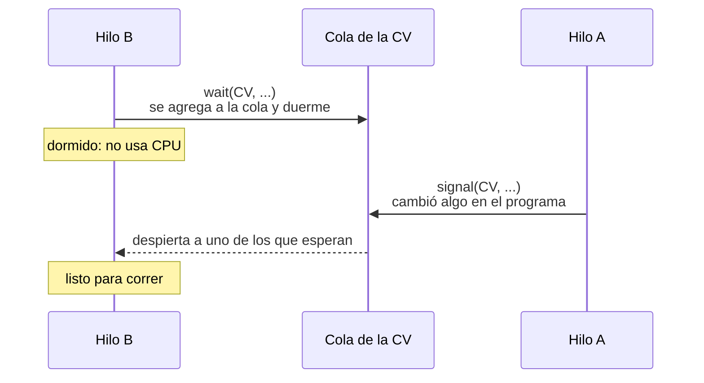
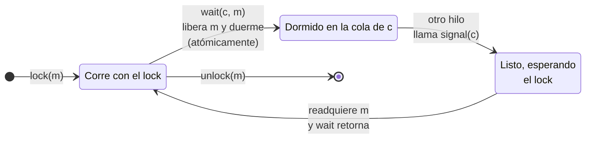
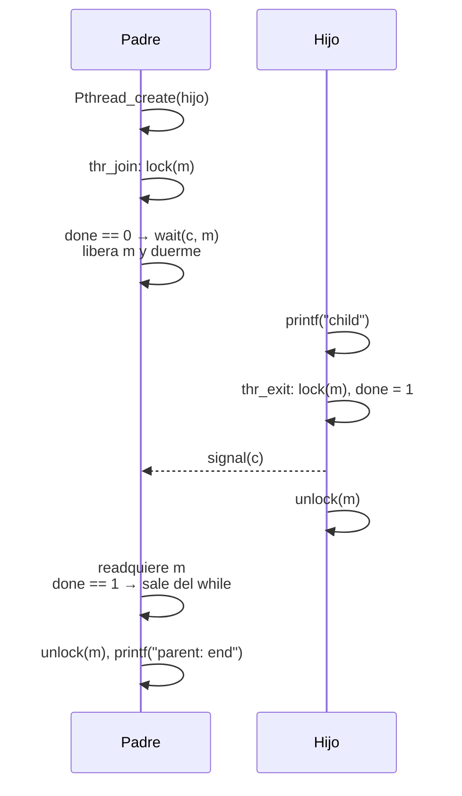
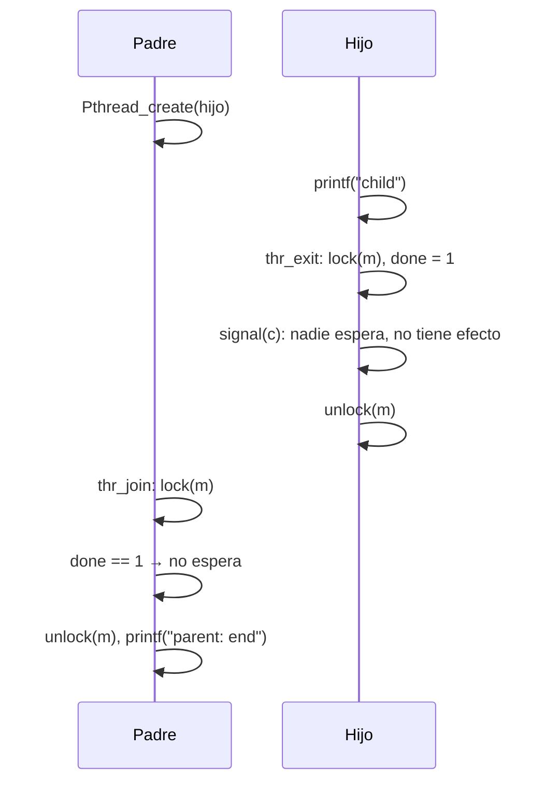
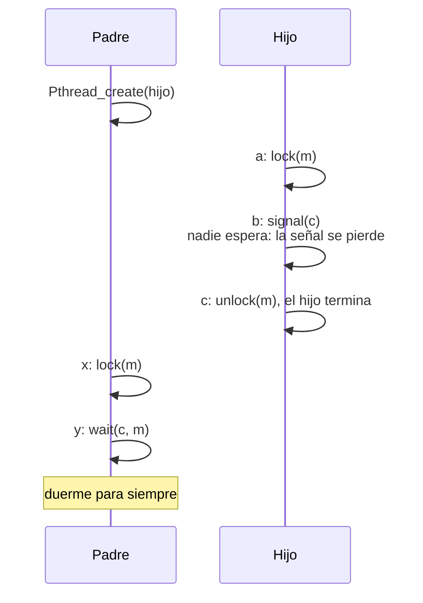
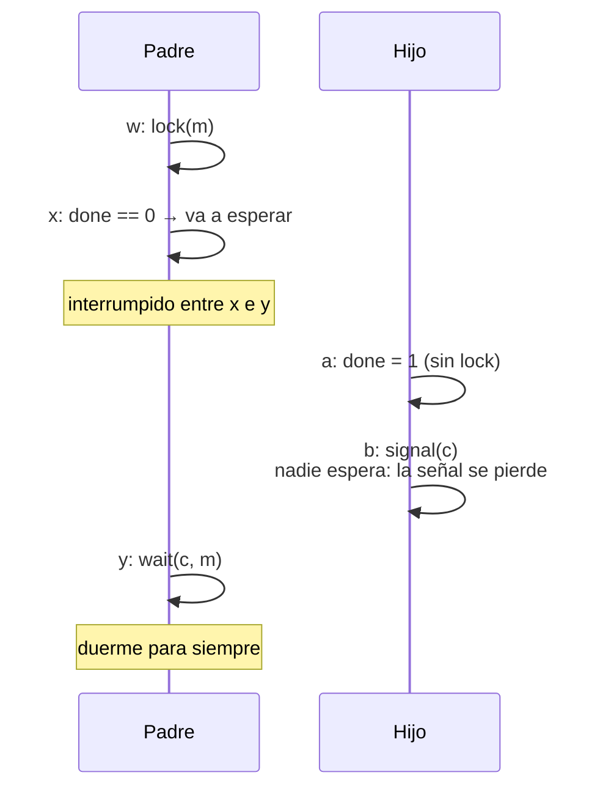
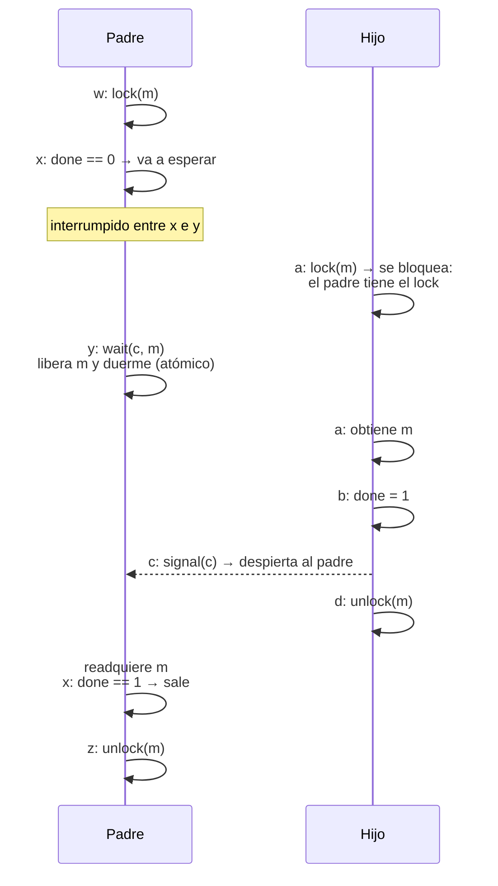

# Variables de condición (OSTEP, cap. 30)

## Objetivos de Aprendizaje

* **Explicar**: por qué los locks no bastan para imponer un orden entre hilos y por qué la espera activa (*spin*) resuelve el orden a costa de desperdiciar CPU.
* **Describir**: qué es una variable de condición (CV), qué hacen `pthread_cond_wait` y `pthread_cond_signal`, y por qué `wait` recibe el mutex.
* **Analizar**: con pruebas de escritorio, por qué fallan las implementaciones del *join* sin variable de estado o sin lock, y por qué la versión con estado, lock y `while` es correcta.
* **Construir**: la solución del productor-consumidor (*bounded buffer*) paso a paso, identificando los dos errores de la solución con una sola CV y cómo los corrigen el `while` y las dos variables de condición `empty` y `fill`.
* **Aplicar**: las reglas de uso de las variables de condición: mantener un estado, llamar a `wait` y `signal` con el lock adquirido y verificar el estado en un `while`.

> Sesiones del 10/11 (diapositivas p. 1–26), 12/11 (p. 27–59) y 19/11/2026 (p. 60–66). El martes 17/11 no hubo clase. Todo el código de esta clase está en [`clase_17/ejemplos/`](../ejemplos/README.md), con guías que explican cómo compilarlo, cómo forzar cada error y qué salidas esperar; cada sección de este apunte enlaza el programa que implementa sus diapositivas.

## Punto de partida: hilos y locks

La clase empezó con un repaso del módulo 3. Hasta ahora se habían visto dos **primitivas de concurrencia**:

1. **El hilo** (*thread*): la abstracción de la CPU. Un proceso con varios hilos tiene varias pilas (*multi-stack*), una por hilo, y cada hilo maneja su propio estado de ejecución.
2. **El lock** (candado, mutex): garantiza la **exclusión mutua**, es decir, que un solo hilo a la vez esté en la región crítica. Su patrón de uso es `acquire(lock)` → región crítica → `release(lock)` (ver el [apunte de la clase 15](../../clase_15/apuntes_zoom/README.md#locks)).

Con locks se construyeron las estructuras de datos concurrentes de la clase 16: el contador preciso, el contador aproximado, la lista enlazada, la cola y la tabla hash (ver el [apunte de la clase 16](../../clase_16/apuntes_zoom/README.md)). En esta clase se introduce la tercera primitiva: la **variable de condición**.

## El problema del orden de ejecución

La concurrencia persigue dos objetivos distintos (diapositivas p. 6–7):

| Objetivo | Qué se quiere | Primitiva |
|---|---|---|
| **Exclusión mutua** | Que dos o más hilos no estén al mismo tiempo dentro de la misma región crítica. | Locks |
| **Orden de ejecución** (*ordering*) | Que un hilo corra **después** de que otro haya hecho algo. | Variables de condición |

Un lock garantiza que dos hilos no se mezclen en la región crítica, pero no dice **cuál** entra primero. Con varios hilos, el orden lo decide el planificador y no es determinista; la meta es obtener siempre el mismo resultado sin importar en qué orden reciban la CPU.

El ejemplo de la clase es la operación ***join***: el hilo principal (padre) debe esperar a que un hilo hijo termine (p. 8–9, OSTEP Fig. 30.1).

```c
void *child(void *arg) {
    printf("child\n");
    // XXX how to indicate we are done?
    return NULL;
}

int main(int argc, char *argv[]) {
    printf("parent: begin\n");
    pthread_t c;
    Pthread_create(&c, NULL, child, NULL); // create child
    // XXX how to wait for child?
    printf("parent: end\n");
    return 0;
}
```

La salida deseada, en **todas** las ejecuciones, es:

```text
parent: begin
child
parent: end
```

Para lograrlo hacen falta dos cosas, que en el manuscrito quedaron anotadas sobre los dos comentarios `XXX`: que el **hijo avise** que terminó (más adelante, `signal`) y que el **padre espere** ese aviso (más adelante, `wait`).

## Primera solución: espera activa (*spin join*)

La primera idea (p. 10, OSTEP Fig. 30.2) es usar una variable compartida, `done`, que el hijo pone en 1 al terminar, mientras el padre la consulta una y otra vez:

```c
volatile int done = 0;

void *child(void *arg) {
    printf("child\n");
    done = 1;
    return NULL;
}

int main(int argc, char *argv[]) {
    printf("parent: begin\n");
    pthread_t c;
    pthread_create(&c, NULL, child, NULL); // create child
    while (done == 0)
        ; // spin
    printf("parent: end\n");
    return 0;
}
```

La salida es la correcta, pero la solución es **ineficiente**: mientras espera, el padre gira (*spin*) en el `while` y ocupa la CPU sin hacer trabajo útil (p. 10–11). A esto se le llama **espera activa** (*busy waiting*).

> [!NOTE]
> El *spin join* no es un *spinlock*. Un spinlock (clase 15) es un **lock** que gira mientras espera para entrar a una región crítica; aquí no hay ningún lock: el padre gira sobre una **bandera** para saber si el hijo ya terminó. Lo que comparten ambos es el defecto de la espera activa.

**Cómo verlo** ([`ejemplo1.c`](../ejemplos/variables-condicion/ejemplo1.c) y [`ejemplo2.c`](../ejemplos/variables-condicion/ejemplo2.c), [guía](../ejemplos/variables-condicion/README.md#2-primera-solución-espera-activa-ejemplo1c-p-1011)). Ambos programas aceptan como argumento los segundos que tarda el hijo en terminar; `time` muestra cuánta CPU gastó el proceso. Salida de una ejecución de referencia del 19/11/2026 (no de la sesión):

```text
$ time ./ejemplo1.out 2        # espera activa
parent: begin
child
parent: end

real	0m2.029s
user	0m1.922s
sys	0m0.031s

$ time ./ejemplo2.out 2        # variable de condición (sección siguiente)
parent: begin
child
parent: end

real	0m2.023s
user	0m0.000s
sys	0m0.000s
```

Los dos tardan unos 2 s, pero con espera activa el padre usó la CPU casi todo ese tiempo (`user` ≈ 1.9 s), mientras que con la variable de condición durmió (`user` = 0 s). La pregunta central del capítulo es entonces: **¿cómo hacer que un hilo espere una condición sin gastar CPU?**

## Variables de condición

### Concepto

Una **variable de condición** (CV, *condition variable*) es una **cola de hilos en espera** (p. 12): un hilo que necesita que algo cambie se pone a sí mismo en la cola y se duerme; otro hilo, cuando cambia ese algo, despierta a uno de los que esperan. En clase se usó la imagen de una **"cama"**: los hilos se acuestan a dormir en ella hasta que alguien los despierta, y pueden dormir varios hilos a la vez en la misma CV. La idea viene de los "semáforos privados" de Dijkstra; el nombre "variable de condición" lo propuso Hoare en su trabajo sobre monitores (OSTEP §30.1).

Las variables de condición son un tipo de datos abstracto con **dos únicas operaciones** (p. 13):

* **`wait`**: el hilo que la invoca queda bloqueado (dormido) hasta que otro hilo invoque `signal` sobre la misma CV.
* **`signal`**: reanuda **uno** de los hilos bloqueados en la CV, cualquiera de ellos. Si no hay ningún hilo bloqueado, `signal` **no tiene efecto**.



`signal` lo llama siempre un hilo **externo** (despierto) que cambió algo en el programa; un hilo dormido no puede despertarse a sí mismo.

### La API de POSIX

En Pthreads, los mutex y las CV se declaran e inicializan así (p. 15):

```c
pthread_mutex_t m = PTHREAD_MUTEX_INITIALIZER;
pthread_cond_t  c = PTHREAD_COND_INITIALIZER;
```

y sus operaciones son (p. 14 y 16):

```c
pthread_cond_wait(pthread_cond_t *c, pthread_mutex_t *m);
pthread_cond_signal(pthread_cond_t *c);
```

| Operación | Qué hace |
|---|---|
| `pthread_cond_wait(&c, &m)` | La llama un hilo que desea ponerse a sí mismo a dormir. Supone que el hilo **tiene** el lock `m`; de forma **atómica** libera el lock y pone al hilo a dormir en la cola de `c`. Cuando el hilo es despertado, **vuelve a adquirir** el lock antes de retornar. |
| `pthread_cond_signal(&c)` | La llama un hilo que cambió algo en el programa y quiere despertar a un hilo que espera esa condición. Despierta a **uno** de los hilos de la cola de `c`; si no hay ninguno, retorna sin hacer nada: la señal **no queda guardada**. |

¿Por qué `wait` recibe el mutex? Porque si el hilo se durmiera con el lock adquirido, ningún otro hilo podría entrar a la región crítica para cambiar el estado y despertarlo: el programa quedaría bloqueado. Además, liberar el lock y dormirse en un solo paso atómico es lo que evita las condiciones de carrera que se verán en la reimplementación 2 del *join*. La variable de condición y el mutex trabajan juntos: la "cama" siempre tiene un "candado" asociado; quien entra a dormir con `wait` suelta el candado, y quien sale de la cama lo vuelve a tomar.



`wait` no retorna de inmediato: el hilo se queda bloqueado dentro de `wait` hasta que lo despierten, y aun entonces debe esperar a obtener el lock para retornar.

## El *join* con variables de condición

La solución de las diapositivas (p. 17) y de OSTEP (Fig. 30.3) combina tres elementos: una **variable de estado** (`done`), un **mutex** (`m`) y una **variable de condición** (`c`):

```c
int done = 0;
pthread_mutex_t m = PTHREAD_MUTEX_INITIALIZER;
pthread_cond_t c = PTHREAD_COND_INITIALIZER;

void thr_exit() {                 // la llama el hijo al terminar
    Pthread_mutex_lock(&m);
    done = 1;
    Pthread_cond_signal(&c);
    Pthread_mutex_unlock(&m);
}

void *child(void *arg) {
    printf("child\n");
    thr_exit();
    return NULL;
}

void thr_join() {                 // la llama el padre para esperar
    Pthread_mutex_lock(&m);
    while (done == 0)
        Pthread_cond_wait(&c, &m);
    Pthread_mutex_unlock(&m);
}

int main(int argc, char *argv[]) {
    printf("parent: begin\n");
    pthread_t p;
    Pthread_create(&p, NULL, child, NULL);
    thr_join();
    printf("parent: end\n");
    return 0;
}
```

`thr_join` es una función propia, no `pthread_join`: la idea es entender **cómo se construye** una espera así. Las funciones que empiezan con mayúscula (`Pthread_mutex_lock`, `Pthread_cond_wait`, ...) son envolturas definidas en [`mythreads.h`](../ejemplos/variables-condicion/mythreads.h) que llaman a la función de Pthreads y verifican con `assert` que no haya fallado.

La solución funciona en los dos órdenes posibles de ejecución (p. 18–21).

**Caso 1: el padre llega primero a `thr_join`** (p. 18–19). El padre adquiere el lock, encuentra `done == 0` y se duerme liberando el lock. El hijo corre, imprime `child`, adquiere el lock (que ya está libre), pone `done = 1`, despierta al padre y suelta el lock. El padre readquiere el lock, ve `done == 1`, sale del `while` y termina.



**Caso 2: el hijo corre apenas se crea** (p. 20–21). El hijo imprime `child`, pone `done = 1` y llama a `signal` cuando nadie espera, así que la señal no tiene efecto. Cuando el padre llega a `thr_join`, adquiere el lock y encuentra `done == 1` desde el principio: no entra al `while`, no se duerme, suelta el lock y termina.



En ambos casos la salida es la deseada (p. 22). Lo que salva el caso 2 es `done`: la señal se pierde, pero la variable de estado **recuerda** que el hijo ya terminó.

**Cómo verlo** ([`ejemplo2.c`](../ejemplos/variables-condicion/ejemplo2.c), [guía](../ejemplos/variables-condicion/README.md#4-el-join-con-variable-de-condición-ejemplo2c-p-1722)):

```bash
make                 # desde clase_17/ejemplos/variables-condicion/
./ejemplo2.out
```

```text
parent: begin
child
parent: end
```

En la ejecución de referencia, `ejemplo2.out` produjo esta salida en 500 de 500 ejecuciones.

### Preguntas de la clase

* **¿No hay conflicto si el padre adquiere el mutex en `thr_join` y el hijo lo pide en `thr_exit`?** No: cuando el padre llama a `wait` y se duerme, libera el mutex, y por eso el hijo puede adquirirlo. Al despertar, el padre lo vuelve a adquirir antes de continuar.
* **¿Por qué el hijo llama a `signal` antes de `unlock`?** Porque así el cambio de `done` y la señal ocurren con el lock adquirido, sin que otro hilo pueda intervenir en medio (OSTEP recomienda señalizar siempre con el lock adquirido, *Tip: Always Hold The Lock While Signaling*). Esto no deja al padre con un lock tomado: el padre despertado sale de la cola de la CV, pero `pthread_cond_wait` solo retorna cuando el padre **vuelve a adquirir el mutex**. Si el hijo todavía lo tiene, el padre espera a que lo suelte. La corrección no depende del orden en que el planificador ejecute a los hilos: en una máquina con varios núcleos el padre puede correr de inmediato en otro núcleo, y aun así no entra a la región crítica hasta que el hijo ejecuta `unlock`.
* **¿Y si hay varios hilos dormidos?** Cada `signal` despierta a uno solo. Si hay que despertar a varios, alguien debe enviar una señal por cada uno (o los hilos que despiertan deben, a su vez, despertar a otros). Una sincronización mal hecha deja hilos dormidos para siempre; el productor-consumidor muestra cómo puede pasar.

## ¿Por qué es necesaria cada instrucción? Reimplementaciones del *join*

La pregunta de la p. 23 es: ¿por qué es importante cada una de las instrucciones de `thr_join` y `thr_exit`? Para responderla, las diapositivas quitan una pieza a la vez y muestran qué se rompe. Las letras (`a`, `b`, `w`, `x`, ...) son las etiquetas de las líneas que usan las diapositivas en las pruebas de escritorio.

### Reimplementación 1: sin variable de estado

Se elimina `done` (p. 24–26, OSTEP Fig. 30.4):

```c
void thr_exit() {
    pthread_mutex_lock(&m);      // a
    pthread_cond_signal(&c);     // b
    pthread_mutex_unlock(&m);    // c
}

void thr_join() {
    pthread_mutex_lock(&m);      // x
    pthread_cond_wait(&c, &m);   // y
    pthread_mutex_unlock(&m);    // z
}
```

* **Caso 1: el padre llama a `thr_join` antes de que el hijo corra (p. 25).** Funciona: el padre se duerme en `y`, el hijo lo despierta en `b` y el padre termina en `z`. Orden: padre `x y`, hijo `a b c`, padre `z`.
* **Caso 2: el hijo corre apenas se crea (p. 26).** El hijo ejecuta `a b c`: llama a `signal` cuando nadie espera y la señal **se pierde**. Después el padre ejecuta `x` e `y`: se duerme esperando una señal que ya pasó. **El padre espera por siempre**, y el programa hay que terminarlo con `Ctrl+C`.



Las variables de condición **no guardan memoria** de las señales: un `signal` sin hilos esperando no tiene efecto. Por eso hace falta una variable de estado que sí recuerde lo que pasó.

**Cómo verlo** ([`implementacion1.c`](../ejemplos/variables-condicion/implementacion1.c), [guía](../ejemplos/variables-condicion/README.md#51-reimplementación-1-sin-variable-de-estado-implementacion1c-p-2426)). El argumento opcional es un retardo, en segundos, del padre antes de llamar a `thr_join`; con `1` se fuerza el caso 2. Salida de referencia:

```text
$ ./implementacion1.out 1
parent: begin
child
^C
```

Sin el retardo el programa casi siempre termina, pero en la ejecución de referencia se bloqueó en 2 de 500 ejecuciones: **que un programa concurrente pase las pruebas no demuestra que sea correcto**.

> Continuación: sesión del 12/11/2026.

### Reimplementación 2: `thr_exit` sin lock

La **primera regla de oro** (p. 27) es que, además de usar variables de condición, **es necesario mantener el estado**: las CV se utilizan para avisar a los hilos **cuando cambia** el estado, pero el estado vive en una variable aparte. Se recupera entonces la bandera `done`, pero esta vez el hijo la modifica y señaliza **sin** adquirir el lock (p. 27–29, OSTEP Fig. 30.5):

```c
void thr_exit() {
    done = 1;                    // a
    pthread_cond_signal(&c);     // b
}

void thr_join() {
    pthread_mutex_lock(&m);      // w
    if (done == 0)               // x
        pthread_cond_wait(&c, &m); // y
    pthread_mutex_unlock(&m);    // z
}
```

* **Caso 1: el hijo corre apenas se crea (p. 28).** Funciona: el hijo ejecuta `a b`, y cuando el padre llega encuentra `done == 1` en `x`, así que salta `y` y termina en `z` (orden del padre: `w x z`). El problema de la reimplementación 1 quedó resuelto.
* **Caso 2: el padre es interrumpido después de verificar `done` y antes de dormirse (p. 29).** El padre ejecuta `w` y `x`, ve `done == 0` y decide esperar, pero antes de llegar a `y` el planificador ejecuta al hijo. Como el hijo no necesita el lock, ejecuta `a b`: pone `done = 1` y llama a `signal` cuando nadie espera. Cuando el padre vuelve a correr, ejecuta `y` con la decisión que ya había tomado y **duerme para siempre**.



La causa es una **condición de carrera** entre la verificación de `done` (`x`) y el momento de dormirse (`y`): el resultado depende del instante exacto en que el padre sea interrumpido. El efecto es el mismo de la reimplementación 1: el padre espera por siempre.

> [!IMPORTANT]
> En el *join* lo que falla no es el `if`. Cambiar el `if` por un `while` en esta versión **no** la arregla: el padre volvería a ver `done == 0` antes de dormirse y la carrera seguiría ahí. Lo que falla en la reimplementación 1 es la falta de **estado** y en la reimplementación 2 la falta de **lock** en `thr_exit`. El `while` es indispensable en el productor-consumidor, más adelante.

**Cómo verlo** ([`implementacion2.c`](../ejemplos/variables-condicion/implementacion2.c), [guía](../ejemplos/variables-condicion/README.md#52-reimplementación-2-thr_exit-sin-lock-implementacion2c-p-2729)). El argumento opcional es una pausa, en milisegundos, entre `x` e `y`, que simula la interrupción del padre en ese punto. Salida de referencia:

```text
$ ./implementacion2.out 100
parent: begin
child
^C
```

Incluso sin la pausa, la versión de las diapositivas se bloqueó en 6 de 500 ejecuciones de referencia: la ventana entre `x` e `y` es pequeña, pero en una máquina con varias CPU el hijo puede ejecutar `a` y `b` justo en ese instante.

### Reimplementación 3: estado, lock y `while`

La **segunda regla de oro** (p. 30) es **mantener el lock siempre que se llame a `signal` o a `wait`**: el mutex asegura que no haya una condición de carrera al interactuar con el estado (`done`) y con las llamadas `wait` y `signal`. Es la versión de la p. 17 (p. 30–31):

```c
void thr_exit() {
    pthread_mutex_lock(&m);      // a
    done = 1;                    // b
    pthread_cond_signal(&c);     // c
    pthread_mutex_unlock(&m);    // d
}

void thr_join() {
    pthread_mutex_lock(&m);      // w
    while (done == 0)            // x
        pthread_cond_wait(&c, &m); // y
    pthread_mutex_unlock(&m);    // z
}
```

Ahora el hijo necesita el lock para modificar `done`. Si el padre es interrumpido entre `x` e `y`, todavía tiene el lock, así que el hijo se bloquea en `a` y no puede cambiar `done` ni enviar la señal. El lock solo se libera cuando el padre ya está dormido dentro de `wait` (liberar el lock y dormirse ocurren de forma atómica), y entonces la señal del hijo sí encuentra a quién despertar (p. 31): padre `w x y`, hijo `a b c d`, padre `z`.



**Cómo verlo** ([`implementacion3.c`](../ejemplos/variables-condicion/implementacion3.c), [guía](../ejemplos/variables-condicion/README.md#53-reimplementación-3-la-versión-correcta-implementacion3c-p-3031)). Con la misma pausa de 100 ms que bloquea a la reimplementación 2, esta versión termina siempre (50 de 50 ejecuciones de referencia):

```text
$ ./implementacion3.out 100
parent: begin
child
parent: end
```

### Resumen del *join*

| Versión | Variable de estado | Lock en `thr_exit` | Cuándo falla | Resultado |
|---|---|---|---|---|
| Reimplementación 1 (p. 24–26, 33) | No | Sí | El hijo corre antes de que el padre espere | Señal perdida: el padre duerme para siempre |
| Reimplementación 2 (p. 27–29, 34) | Sí | No | El padre es interrumpido entre verificar `done` y dormirse | Condición de carrera: el padre duerme para siempre |
| Reimplementación 3 (p. 30–31, 35) | Sí | Sí | Nunca | Correcta en todos los órdenes |

Las p. 33–35 de las diapositivas recogen el código completo de cada versión; es el mismo de los programas enlazados.

## El problema del productor-consumidor

### Planteamiento

El **problema del productor-consumidor** (*producer/consumer problem*), también conocido como **problema del buffer limitado** (*bounded buffer problem*), fue planteado por Dijkstra (OSTEP §30.2). Sus elementos son (p. 36):

* Uno o más hilos **productores** generan datos y los ubican en un buffer compartido.
* Uno o más hilos **consumidores** retiran datos del buffer y los consumen.

Como producir y consumir ocurren de forma asíncrona, el buffer es un recurso compartido que requiere **acceso sincronizado**: no se puede poner un dato en un buffer lleno ni sacarlo de uno vacío, y dos hilos no pueden manipularlo a la vez.

Ejemplos (p. 37–39):

| Sistema | Productor | Buffer | Consumidor |
|---|---|---|---|
| Caja de supermercado | El cliente, que pone los productos (`put`) | La banda transportadora | El cajero, que los registra (`get`) |
| Mostrador de comidas | Los clientes, que dejan sus pedidos (`put(order)`) | La fila de pedidos | El empleado que los atiende (`get(order)`) |
| Servidor web multihilo | El hilo que recibe las peticiones HTTP y las pone en una cola de trabajo | La cola de trabajo | Los hilos que retiran las peticiones y las procesan |
| Tubería del shell: `grep foo file.txt \| wc` | `grep`, que escribe las líneas que encuentra | La tubería (*pipe*) | `wc`, que las cuenta |

### Las rutinas `put` y `get`

Para empezar, el buffer tiene **un solo** elemento, y `count` indica su estado: 0 si está vacío y 1 si está lleno (p. 40, OSTEP Fig. 30.6):

```c
int buffer;
int count = 0; // initially, empty

void put(int value) {
    assert(count == 0);
    count = 1;
    buffer = value;
}

int get() {
    assert(count == 1);
    count = 0;
    return buffer;
}
```

Solo se deben ingresar datos al buffer cuando esté vacío (`count == 0`) y solo se deben retirar cuando esté lleno (`count == 1`). Los `assert` hacen visible cualquier violación: si se pone un dato en un buffer lleno o se saca de uno vacío, el programa se detiene con `Assertion ... failed`.

Los hilos (p. 41, OSTEP Fig. 30.7): el productor ingresa `loops` enteros en el buffer, uno por ciclo, y el consumidor los retira indefinidamente:

```c
void *producer(void *arg) {
    int i;
    int loops = *(int *) arg;    // número de valores a producir
    for (i = 0; i < loops; i++) {
        put(i);
    }
    return NULL;
}

void *consumer(void *arg) {
    while (1) {
        int tmp = get();
        printf("%d\n", tmp);
    }
}
```

> [!NOTE]
> Las diapositivas (y OSTEP) escriben `int loops = (int) arg;`, que convierte el `void *` recibido en un `int`. En sistemas de 64 bits un puntero no cabe en un `int` de 32 bits: el compilador advierte la conversión (`-Wpointer-to-int-cast`) y el valor puede truncarse. Es el mismo problema de la diapositiva "Pasando un valor simple a un hilo" de la clase 14. Aquí se pasa la dirección de la variable (`&loops`) y se lee con `*(int *) arg`, como en los programas de [`ejemplos/`](../ejemplos/productor-consumidor/diapositivas/README.md).

Sin sincronización, este código falla **incluso con un solo consumidor**: nada impide que el productor llame a `put` dos veces seguidas o que el consumidor llame a `get` antes de que haya datos. Salida de referencia de [`main_singleBuffer-v0.c`](../ejemplos/productor-consumidor/diapositivas/main_singleBuffer-v0.c) (la salida estándar se descarta para ver solo los errores):

```text
$ ./main_singleBuffer-v0.out 1000 1 > /dev/null
main_singleBuffer-v0.out: main_singleBuffer-v0.c:75: put: Assertion `count == 0' failed.
main_singleBuffer-v0.out: main_singleBuffer-v0.c:81: get: Assertion `count == 1' failed.
Aborted (core dumped)
```

Se necesitan un **lock** para la exclusión mutua y una forma de **esperar** a que el buffer cambie de estado.

### Primer intento: una variable de condición y `if`

Estrategia general (p. 42): usar variables de condición para que los **consumidores esperen** cuando no hay nada que consumir (buffer vacío) y los **productores esperen** cuando el buffer está lleno. Se usa una única variable de condición (`cond`) y un lock (`mutex`) asociado (OSTEP Fig. 30.8):

```c
int loops; // must initialize somewhere...
cond_t cond;
mutex_t mutex;

void *producer(void *arg) {
    int i;
    for (i = 0; i < loops; i++) {
        pthread_mutex_lock(&mutex);            // p1
        if (count == 1)                        // p2
            pthread_cond_wait(&cond, &mutex);  // p3
        put(i);                                // p4
        pthread_cond_signal(&cond);            // p5
        pthread_mutex_unlock(&mutex);          // p6
    }
}

void *consumer(void *arg) {
    while (1) {
        pthread_mutex_lock(&mutex);            // c1
        if (count == 0)                        // c2
            pthread_cond_wait(&cond, &mutex);  // c3
        int tmp = get();                       // c4
        pthread_cond_signal(&cond);            // c5
        pthread_mutex_unlock(&mutex);          // c6
        printf("%d\n", tmp);
    }
}
```

La lógica de señalización (p. 43): en `p1`–`p3` el productor espera a que el buffer esté vacío, y en `c1`–`c3` el consumidor espera a que esté lleno. Cada uno, después de cambiar el buffer, señaliza (`p5`, `c5`) para despertar al otro.

Análisis (p. 44):

| Caso | Escenario | Conclusión |
|---|---|---|
| 1 | Un solo productor y un solo consumidor | El código funciona. |
| 2 | Un solo productor y varios consumidores | La solución tiene **dos problemas críticos**. |

**Problema 1: al despertar, el estado puede haber cambiado** (p. 45–46, OSTEP Fig. 30.9). Con un productor (`Tp`) y dos consumidores (`Tc1`, `Tc2`):

| Paso | `Tc1` | `Tc2` | `Tp` | `count` | Comentario |
|---|---|---|---|---|---|
| 1 | `c1 c2 c3` → duerme | | | 0 | No hay nada que sacar |
| 2 | (duerme) | | `p1 p2 p4` | 1 | El buffer queda lleno |
| 3 | despertado → listo | | `p5` | 1 | `Tp` despierta a `Tc1` |
| 4 | (listo) | | `p6 p1 p2 p3` → duerme | 1 | Buffer lleno: `Tp` duerme |
| 5 | (listo) | `c1 c2 c4 c5 c6` | despertado → listo | 0 | `Tc2` se cuela y toma el dato |
| 6 | `c4`: `get()` | | | 0 | **¡No hay dato!** Falla el `assert` |

Después de que el productor despertó a `Tc1`, pero **antes** de que `Tc1` corriera, `Tc2` cambió el estado del buffer. Como la verificación es un `if`, `Tc1` no vuelve a mirar `count` al despertar y llama a `get()` con el buffer vacío.

> [!NOTE]
> **Complemento (OSTEP, cap. 30): semántica de Mesa.** Despertar a un hilo con `signal` es solo una **pista** de que el estado cambió; no garantiza que, cuando el hilo despertado corra, el estado siga siendo el deseado. Esta interpretación se llama **semántica de Mesa** (por el lenguaje del primer sistema que implementó así las variables de condición, de Lampson y Redell), y es la que usan prácticamente todos los sistemas reales, incluido Pthreads. La alternativa, la **semántica de Hoare**, garantiza que el hilo despertado corre de inmediato, pero es más difícil de construir. Con semántica de Mesa, la regla es simple: **verificar la condición en un `while`**. Además, en algunas implementaciones un hilo puede despertar sin que nadie haya llamado a `signal`, o pueden despertar dos hilos con una sola señal (**despertares espurios**, *spurious wakeups*): otra razón para volver a verificar la condición al despertar.

**Cómo verlo** ([`main_singleBuffer-v1.c`](../ejemplos/productor-consumidor/diapositivas/main_singleBuffer-v1.c), [guía](../ejemplos/productor-consumidor/diapositivas/README.md#3-v1-una-variable-de-condición-y-if-p-4249)). Compilación y ejecución según las diapositivas (p. 47), desde la carpeta del programa:

```bash
gcc -I. main_singleBuffer-v1.c -Wall -lpthread -o single_buffer-if1.out
./single_buffer-if1.out <loops> <consumers>
```

La guía usa `make`, que genera el ejecutable `main_singleBuffer-v1.out`. Salida de referencia con dos consumidores (las pruebas de las p. 48–49: con uno funciona, con varios "el resultado no es el esperado"):

```text
$ stdbuf -oL ./main_singleBuffer-v1.out 1000 2 | tail -3
main_singleBuffer-v1.out: main_singleBuffer-v1.c:92: get: Assertion `count == 1' failed.
3
4
5
```

El mensaje del `assert` aparece primero porque va por la salida de error, que llega directo a la terminal; los valores consumidos antes del fallo cambian de una ejecución a otra. La [guía](../ejemplos/productor-consumidor/diapositivas/README.md#lo-que-muestra-la-traza) incluye una versión con traza (`make traza`) que imprime los pasos `p1`–`p6` y `c1`–`c6` de cada hilo.

### Segundo intento: una variable de condición y `while`

Estrategia general (p. 50–51): cambiar el `if` por `while`, en el consumidor y en el productor. Si el consumidor `Tc1` despierta, vuelve a verificar el estado del buffer, ya con el lock adquirido; si el buffer está vacío, se vuelve a dormir (OSTEP Fig. 30.10):

```c
        while (count == 1)                     // p2
            pthread_cond_wait(&cond, &mutex);  // p3
        ...
        while (count == 0)                     // c2
            pthread_cond_wait(&cond, &mutex);  // c3
```

Es la **tercera regla de oro** (p. 52): **con variables de condición se deben usar siempre ciclos `while`**. El hilo en espera siempre debe volver a verificar la condición; si no lo hace, seguirá creyendo que la condición cambió aunque no sea así. Pero la p. 52 advierte que **todavía persiste el problema 2**.

**Problema 2: la señal despierta al hilo equivocado** (p. 53–56, OSTEP Fig. 30.11). Con una sola CV, productores y consumidores duermen **en la misma cola**, y `signal` despierta a uno cualquiera de ellos:

| Paso | `Tc1` | `Tc2` | `Tp` | `count` | Comentario |
|---|---|---|---|---|---|
| 1 | `c1 c2 c3` → duerme | | | 0 | Nada que sacar |
| 2 | (duerme) | `c1 c2 c3` → duerme | | 0 | Nada que sacar |
| 3 | despertado → listo | (duerme) | `p1 p2 p4 p5` | 1 | El buffer queda lleno; `Tp` despierta a `Tc1` |
| 4 | (listo) | (duerme) | `p6 p1 p2 p3` → duerme | 1 | Buffer lleno: `Tp` duerme |
| 5 | regresa de `wait` (`c3`), `c2 c4` | (duerme) | (duerme) | 0 | `Tc1` re-verifica y toma el dato |
| 6 | `c5` | despertado → listo | (duerme) | 0 | **¡`Tc1` despierta a `Tc2`, no al productor!** |
| 7 | `c6 c1 c2 c3` → duerme | (listo) | (duerme) | 0 | Nada que sacar |
| 8 | (duerme) | `c2 c3` → duerme | (duerme) | 0 | `Tc2` re-verifica: vacío. **Todos duermen** |

`Tc1` vació el buffer, así que su señal debía despertar al productor, el único que puede volver a llenarlo. Despertó a `Tc2`, que (gracias al `while`) verificó que no hay nada y se volvió a dormir **sin señalizar**. Los tres hilos quedan dormidos esperando una señal que nadie enviará, y el programa se bloquea para siempre. En las guías de ejemplos a este bloqueo se le llama *deadlock*; OSTEP lo describe como "todos dormidos" (*everyone asleep*).

Conclusiones (p. 54 y 56):

1. Señalizar es necesario.
2. La señalización debe ser **más específica**: hay que saber a quién despertar. Un consumidor solo debe despertar a productores (no a otros consumidores) y viceversa.

**Cómo verlo** ([`main_singleBuffer-v2.c`](../ejemplos/productor-consumidor/diapositivas/main_singleBuffer-v2.c), [guía](../ejemplos/productor-consumidor/diapositivas/README.md#4-v2-una-variable-de-condición-y-while-p-5058)). Compilación y ejecución según las diapositivas (p. 57):

```bash
gcc -I. main_singleBuffer-v2.c -Wall -lpthread -o single_buffer-while1.out
./single_buffer-while1.out <loops> <consumers>
```

La captura de la diapositiva p. 58 muestra una ejecución con un productor y dos consumidores que se queda detenida después de imprimir el 93 (el orden de los valores no es estricto porque cada consumidor imprime después de soltar el lock):

```text
$ ./single_buffer-while1.out 1000 2
...
80
81
82
84
83
86
87
88
85
90
89
92
91
93
```

En la sesión del 12/11 se ejecutó en vivo con volúmenes grandes (por ejemplo, 20 000 y 200 000 iteraciones), y el programa también se bloqueó antes de terminar. En la guía, que usa `timeout` para no tener que interrumpir el programa a mano, la ejecución de referencia con dos consumidores se detuvo en el 18:

```text
$ timeout 2 stdbuf -oL ./main_singleBuffer-v2.out 1000 2 | tail -3
16
17
18
```

Con **un** solo consumidor este bloqueo no puede ocurrir: la única señal que envía el consumidor solo encuentra al productor en la cola.

### Solución: dos variables de condición

La solución (p. 59, OSTEP Fig. 30.12) es usar **dos** variables de condición, una por cada motivo de espera:

* **`empty`**: ahí duerme el **productor** cuando el buffer está lleno; la señaliza el consumidor después de sacar un dato.
* **`fill`**: ahí duerme el **consumidor** cuando el buffer está vacío; la señaliza el productor después de poner un dato.

```c
cond_t empty, fill;
mutex_t mutex;

void *producer(void *arg) {
    int i;
    for (i = 0; i < loops; i++) {
        pthread_mutex_lock(&mutex);
        while (count == 1)
            pthread_cond_wait(&empty, &mutex);
        put(i);
        pthread_cond_signal(&fill);
        pthread_mutex_unlock(&mutex);
    }
}

void *consumer(void *arg) {
    while (1) {
        pthread_mutex_lock(&mutex);
        while (count == 0)
            pthread_cond_wait(&fill, &mutex);
        int tmp = get();
        pthread_cond_signal(&empty);
        pthread_mutex_unlock(&mutex);
        printf("%d\n", tmp);
    }
}
```

| Variable de condición | Quién duerme en ella | Cuándo se duerme | Quién la señaliza | Cuándo la señaliza |
|---|---|---|---|---|
| `empty` | El productor | Buffer lleno (`count == 1`) | El consumidor | Después de sacar un dato (`get`) |
| `fill` | El consumidor | Buffer vacío (`count == 0`) | El productor | Después de poner un dato (`put`) |

Ambas variables de condición usan el **mismo** mutex, porque protegen el mismo estado (`count` y el buffer). Un consumidor ya no puede despertar por accidente a otro consumidor, ni un productor a otro productor: el problema 2 desaparece por diseño.

**Cómo verlo** ([`main_singleBuffer-v3.c`](../ejemplos/productor-consumidor/diapositivas/main_singleBuffer-v3.c), [guía](../ejemplos/productor-consumidor/diapositivas/README.md#5-v3-dos-variables-de-condición-y-while-p-59)). Con dos consumidores se consumen los 1000 valores, cada uno una vez (`wc -l` cuenta las líneas impresas):

```text
$ timeout 2 stdbuf -oL ./main_singleBuffer-v3.out 1000 2 | wc -l
1000
```

> Continuación: sesión del 19/11/2026.

## Solución final: buffer circular

La solución final **agrega más posiciones al buffer** (p. 60, OSTEP Fig. 30.13). Así el productor puede poner varios valores antes de dormirse y los consumidores pueden sacar varios antes de dormirse, con dos mejoras:

* **Mejora de concurrencia**: permite que se produzca y se consuma de manera concurrente.
* **Mejora de eficiencia**: reduce los cambios de contexto.

```c
int buffer[MAX];
int fill_ptr = 0;
int use_ptr = 0;
int count = 0;

void put(int value) {
    buffer[fill_ptr] = value;
    fill_ptr = (fill_ptr + 1) % MAX;
    count++;
}

int get() {
    int tmp = buffer[use_ptr];
    use_ptr = (use_ptr + 1) % MAX;
    count--;
    return tmp;
}
```

El buffer es **circular**: `fill_ptr` indica la posición donde se pone el siguiente valor y `use_ptr` la posición de donde se saca el siguiente; ambos regresan al inicio al llegar a `MAX`, gracias al módulo. `count` es la **cantidad de ítems** que hay en el buffer.

| Posición | 0 | 1 | 2 | 3 | 4 |
|---|---|---|---|---|---|
| Contenido | vacía | **dato** | **dato** | vacía | vacía |
| Puntero | | ↑ `use_ptr` | | ↑ `fill_ptr` | |

En el ejemplo, `MAX = 5` y `count = 2`: el siguiente `get` saca el valor de la posición 1 y el siguiente `put` escribe en la posición 3. Cuando un puntero está en la posición 4, `(4 + 1) % 5 = 0` lo devuelve al inicio.

La sincronización es la de dos CV, con las condiciones generalizadas (p. 61, OSTEP Fig. 30.14):

```c
void *producer(void *arg) {
    int i;
    for (i = 0; i < loops; i++) {
        pthread_mutex_lock(&mutex);            // p1
        while (count == MAX)                   // p2
            pthread_cond_wait(&empty, &mutex); // p3
        put(i);                                // p4
        pthread_cond_signal(&fill);            // p5
        pthread_mutex_unlock(&mutex);          // p6
    }
}

void *consumer(void *arg) {
    while (1) {
        pthread_mutex_lock(&mutex);            // c1
        while (count == 0)                     // c2
            pthread_cond_wait(&fill, &mutex);  // c3
        int tmp = get();                       // c4
        pthread_cond_signal(&empty);           // c5
        pthread_mutex_unlock(&mutex);          // c6
        printf("%d\n", tmp);
    }
}
```

* Un **productor** va a dormir solo si el buffer está **lleno** (`p2`).
* Un **consumidor** va a dormir solo si el buffer está **vacío** (`c2`).

### Código 1: sin marca de terminación

[`main_buffer-v3.c`](../ejemplos/productor-consumidor/diapositivas/main_buffer-v3.c) tiene en cuenta que el buffer puede tener más de un elemento, pero **no maneja una marca de terminación** (p. 62). Compilación y ejecución según las diapositivas:

```bash
gcc -I. main_buffer-v3.c -Wall -lpthread -o bounded-buffer.out
./bounded-buffer.out <buffersize> <loops> <consumers>
```

En la sesión se ejecutó con un productor, cuatro consumidores y 1000 valores (del 0 al 999), el escenario de la captura de la p. 63, que usa un buffer de 10 posiciones. Final de la salida en la captura:

```text
$ ./bounded-buffer.out 10 1000 4
...
989
990
991
992
993
994
995
996
997
998
999
981
978
979
^C
```

El código consume todos los valores, pero el programa **no termina**: los consumidores están en un `while (1)` y, cuando el productor acaba, se quedan esperando datos que no van a llegar, mientras `main` los espera en `Pthread_join`. Hay que detenerlo con `Ctrl+C` ("el código funciona pero se bloquea", p. 63). Esto no es el bloqueo del problema 2: no se perdió ningún valor; lo que falta es avisar a los consumidores que ya no vendrán más. Los valores 981, 978 y 979 aparecen después del 999 porque cada consumidor imprime **después** de soltar el lock: los valores se retiran en orden, pero se imprimen en el orden en que cada consumidor alcanza su `printf`.

### Código 2: con marca de terminación

[`main_buffer-v4.c`](../ejemplos/productor-consumidor/diapositivas/main_buffer-v4.c) corrige el problema anterior: al terminar, el productor pone un `-1` como marca de terminación, **uno por cada consumidor**, y cada consumidor sale de su ciclo cuando lo recibe (p. 64):

```c
// en el productor, después de producir los loops valores:
for (i = 0; i < consumers; i++) {
    Mutex_lock(&mutex);
    while (count == max)
        Cond_wait(&empty, &mutex);
    put(-1);
    Cond_signal(&fill);
    Mutex_unlock(&mutex);
}

// en el consumidor:
int tmp = 0;
while (tmp != -1) {
    ...                         // c1 a c6: igual que antes
    printf("%d\n", tmp);        // también imprime el -1 que recibe
}
```

Hace falta un `-1` por consumidor: cada consumidor que recibe la marca termina y ya no saca más datos, así que con una sola marca los demás seguirían esperando. Compilación y ejecución según las diapositivas:

```bash
gcc -I. main_buffer-v4.c -Wall -lpthread -o bounded-buffer.out
./bounded-buffer.out <buffersize> <loops> <consumers>
```

Final de la salida en la captura de la p. 65 (un productor, cuatro consumidores, buffer de 10 y 1000 valores):

```text
$ ./bounded-buffer.out 10 1000 4
...
993
972
994
995
996
997
998
999
-1
-1
974
-1
975
-1
```

Los cuatro consumidores reciben su `-1`, lo imprimen y salen, y el programa **termina** solo ("el código funciona", p. 65).

**¿Cuánto ayuda un buffer más grande?** La [guía](../ejemplos/productor-consumidor/diapositivas/README.md#cuánto-ayuda-un-buffer-más-grande) compara, en la ejecución de referencia, 100 000 valores con dos consumidores (versiones con marca de terminación):

| Programa | `real` | `sys` |
|---|---|---|
| Buffer de 1 posición (`main_singleBuffer-v4.out 100000 2`) | 3.776 s | 3.328 s |
| Buffer circular de 10 (`main_buffer-v4.out 10 100000 2`) | 0.411 s | 0.563 s |

Con una sola posición, casi cada `put` y cada `get` terminan en un `wait` y un `signal`, es decir, en dormir y despertar hilos, lo que pasa por el kernel (de ahí el tiempo `sys`). Con 10 posiciones cada hilo avanza varias veces antes de dormirse, y el programa fue unas 9 veces más rápido en esa máquina: es la reducción de cambios de contexto que anuncia la p. 60.

## Resumen y Conclusión

Las **reglas de juego** de las variables de condición (p. 66):

1. **Mantener un estado** además de las variables de condición (`done` en el *join*, `count` en el productor-consumidor). Las CV no recuerdan las señales: un `signal` sin hilos esperando se pierde.
2. **Llamar siempre a `wait` y a `signal` con el lock adquirido.** Para `wait` es obligatorio por su semántica; para `signal` es la forma más simple de evitar condiciones de carrera como la de la reimplementación 2.
3. **Verificar el estado siempre que se adquiera el lock, y hacerlo en un `while`**, porque al despertar el estado puede haber cambiado (semántica de Mesa).

A estas se suma la lección del productor-consumidor: **usar una variable de condición por cada condición de espera** (`empty` y `fill`), para que cada señal despierte al tipo de hilo correcto.

| Versión | Diapositivas | Error | Corrección |
|---|---|---|---|
| Sin sincronización | p. 40–41 | No hay exclusión mutua ni espera: fallan los `assert` | Lock y variable de condición |
| Una CV + `if` | p. 42–49 | Problema 1: al despertar no se re-verifica el estado | `while` |
| Una CV + `while` | p. 50–58 | Problema 2: la señal despierta a un hilo del mismo tipo y todos quedan dormidos | Dos CV: `empty` y `fill` |
| Dos CV + `while` | p. 59–63 | Correcta, pero los consumidores no saben cuándo terminar | Marca de terminación (`-1` por consumidor) |
| Dos CV + `while` + marca | p. 64–65 | — | — |

Con el *join* y el productor-consumidor quedan vistas las dos primeras primitivas de sincronización: el **lock**, para la exclusión mutua, y la **variable de condición**, para esperar eventos e imponer un orden.

## Para revisar de forma autónoma

> [!NOTE]
> Este tema no está en las diapositivas ni se dictó en clase. Completa el capítulo 30 de OSTEP (§30.3) y se explica aquí con base en el libro.

### *Covering conditions* y `pthread_cond_broadcast`

En el productor-consumidor, la señal correcta se pudo hacer específica con dos variables de condición. Hay casos en los que el hilo que señaliza **no puede saber** a quién despertar. OSTEP (Fig. 30.15) lo muestra con una biblioteca de memoria simplificada, tomada del trabajo de Lampson y Redell sobre el sistema Pilot:

```c
int bytesLeft = MAX_HEAP_SIZE;   // ¿cuántos bytes del heap están libres?
cond_t c;
mutex_t m;

void *allocate(int size) {
    Pthread_mutex_lock(&m);
    while (bytesLeft < size)
        Pthread_cond_wait(&c, &m);
    void *ptr = ...;             // obtener memoria del heap
    bytesLeft -= size;
    Pthread_mutex_unlock(&m);
    return ptr;
}

void free(void *ptr, int size) {
    Pthread_mutex_lock(&m);
    bytesLeft += size;           // devolver memoria al heap
    Pthread_cond_signal(&c);     // ¿a quién señalizar?
    Pthread_mutex_unlock(&m);
}
```

Suponga que no hay bytes libres. El hilo `Ta` llama a `allocate(100)` y el hilo `Tb` a `allocate(10)`: ambos se duermen. Luego `Tc` llama a `free(50)`. Su `signal` despierta a uno solo de los dos, y si despierta a `Ta`, este verifica que 50 bytes no le alcanzan y se vuelve a dormir, mientras `Tb`, que sí podía continuar con 10 bytes, sigue dormido.

La solución de Lampson y Redell es reemplazar `pthread_cond_signal` por **`pthread_cond_broadcast`**, que despierta a **todos** los hilos que esperan en la CV. Cada uno vuelve a verificar su condición en el `while`: los que pueden continuar continúan y los demás se vuelven a dormir. A una condición así se le llama ***covering condition***, porque cubre de forma conservadora todos los casos en que un hilo necesita despertar. El costo es el desempeño: se despiertan hilos que no lo necesitaban.

Con `broadcast` también se habría podido arreglar el productor-consumidor con una sola CV, pero había una solución mejor (dos CV). Como regla, si un programa solo funciona cambiando los `signal` por `broadcast` sin que haya una razón como la del ejemplo, probablemente tiene un error que conviene corregir.

## Puente hacia la siguiente clase

Después del productor-consumidor, la sesión del 19/11 empezó el tema de los **semáforos** (OSTEP, cap. 31), la primitiva de sincronización propuesta por Dijkstra, que combina en un solo objeto un **valor entero** y una **cola** de hilos en espera. Tiene dos operaciones: `sem_wait` (también llamada `P` o *down*), que decrementa el valor y bloquea al hilo si el resultado es negativo, y `sem_post` (`V` o *up*), que incrementa el valor y, si hay hilos esperando, despierta a uno. Un semáforo inicializado en 1 funciona como un **lock**, y un semáforo también puede usarse como **variable de condición**: por eso se considera la primitiva que unifica a las dos anteriores. Fue precisamente el problema del productor-consumidor el que llevó a Dijkstra y a sus colaboradores a inventar el semáforo general (OSTEP §30.2). El tema se desarrolla en la clase 18 ([diapositivas de la parte 1](../../clase_18/SO_apuntes_clase_18_parte1.pdf)).

## Para probar por cuenta propia

* **Ejemplos de la clase** ([`clase_17/ejemplos/`](../ejemplos/README.md)), en C, con salidas de una ejecución de referencia y explicaciones de [cómo probar programas que pueden bloquearse](../ejemplos/README.md#cómo-probar-programas-que-pueden-bloquearse) (`timeout`, `stdbuf -oL`, conteo de líneas):
  * [El *join*](../ejemplos/variables-condicion/README.md): espera activa frente a variable de condición y las tres reimplementaciones; cada versión rota acepta un argumento que fuerza su error. En [`ensayos/`](../ejemplos/variables-condicion/ensayos/README.md) se prueba qué pasa al quitar el `signal`, al llamarlo dos veces o al llamar a `wait` sin el lock.
  * [Productor-consumidor](../ejemplos/productor-consumidor/README.md): las versiones de las [diapositivas](../ejemplos/productor-consumidor/diapositivas/README.md) (con trazas `p1`–`p6`/`c1`–`c6` de los dos problemas) y las del [libro](../ejemplos/productor-consumidor/libro/README.md), equivalentes a los programas de la tarea del capítulo.
* **Tarea de código del cap. 30 de OSTEP** (sección *Homework (Code)* del [capítulo](https://pages.cs.wisc.edu/~remzi/OSTEP/threads-cv.pdf)): explorar con varios productores y consumidores la versión correcta y las versiones con errores (una CV con `while`, dos CV con `if`, y dos CV con el lock liberado antes de usar el buffer), y predecir en cuáles aparecen los problemas. La carpeta [`libro/`](../ejemplos/productor-consumidor/libro/README.md) relaciona cada programa con sus preguntas.

## Referencias

* Arpaci-Dusseau, R. H. y Arpaci-Dusseau, A. C. *Operating Systems: Three Easy Pieces*, cap. 30, "Condition Variables" (v1.10): <https://pages.cs.wisc.edu/~remzi/OSTEP/threads-cv.pdf>
* Arpaci-Dusseau, R. H. y Arpaci-Dusseau, A. C. *Operating Systems: Three Easy Pieces*, cap. 28, "Locks" (v1.10): <https://pages.cs.wisc.edu/~remzi/OSTEP/threads-locks.pdf>
* Lampson, B. W. y Redell, D. R. "Experience with Processes and Monitors in Mesa". *Communications of the ACM*, 23(2), 1980.
* Hoare, C. A. R. "Monitors: An Operating System Structuring Concept". *Communications of the ACM*, 17(10), 1974.
* `man pthread_cond_wait`, `man pthread_cond_signal`, `man pthread_cond_broadcast`.

---

> [!IMPORTANT]
> **Nota de Transparencia:** Este documento fue generado y adaptado mediante el uso de **IA Generativa**, a partir del manuscrito anotado de la clase y los resúmenes y notas de las sesiones de Zoom (10/11, 12/11 y 19/11/2026), complementado con el capítulo 30 de OSTEP y los ejemplos de la clase. Las salidas de los programas son las de las capturas de las diapositivas o las de una ejecución de referencia del 19/11/2026, según se indica en cada caso. El contenido ha sido supervisado, validado y refinado por intervención humana para garantizar su precisión técnica y coherencia pedagógica. No obstante, pueden haber errores.
