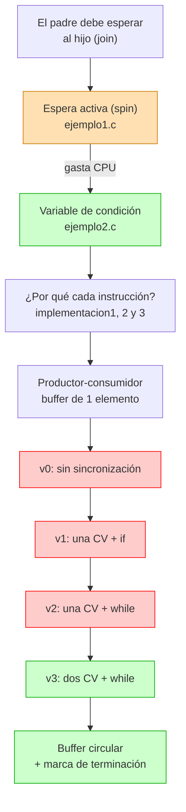

# Ejemplos — Clase 17: variables de condición

Ejemplos en C del uso de **variables de condición** (*condition variables*, CV) con la API de hilos POSIX, basados en las diapositivas de la clase y en el capítulo 30 de *Operating Systems: Three Easy Pieces* (OSTEP, v1.10), *Condition Variables*. Cada carpeta tiene un `README.md` con la explicación del código, el procedimiento de prueba y las salidas de una ejecución de referencia, interpretadas a la luz de la teoría.

Los locks (clases 15 y 16) resuelven la **exclusión mutua**: que dos hilos no estén a la vez en la misma sección crítica. Las variables de condición resuelven el segundo objetivo de la concurrencia, el **orden de ejecución** (*ordering*): que un hilo espere, sin gastar CPU, hasta que otro hilo haya hecho algo (diapositivas p. 6–7).

| Carpeta | Contenido | Diapositivas | OSTEP cap. 30 |
|---|---|---|---|
| [`variables-condicion/`](variables-condicion/README.md) | El *join*: el padre espera al hijo. Espera activa, solución con CV y tres reimplementaciones que muestran por qué cada instrucción es necesaria. Incluye [`ensayos/`](variables-condicion/ensayos/README.md) con variantes de `wait` y `signal`. | p. 7–35 | Introducción y §30.1 (Figs. 30.1–30.5) |
| [`productor-consumidor/`](productor-consumidor/README.md) | El problema del productor-consumidor (buffer acotado), de la versión sin sincronización hasta la solución final con buffer circular y marca de terminación. | p. 36–66 | §30.2 (Figs. 30.6–30.14) |

## Ruta sugerida



En rojo, las versiones que fallan; en verde, las correctas. Cada versión rota existe para mostrar un error concreto que la siguiente corrige, así que conviene recorrerlas en orden.

## Requisitos

Linux (nativo, WSL, máquina virtual o contenedor) con `gcc` y `make`. Cada carpeta tiene un `Makefile` que compila todos sus programas (`make`) y borra los ejecutables (`make clean`); los ejecutables usan la extensión `.out` y no se suben al repositorio.

Todas las carpetas incluyen una copia de [`mythreads.h`](variables-condicion/mythreads.h), que envuelve las llamadas de la API de hilos en un `assert` (por ejemplo, `Pthread_mutex_lock(m)` es `assert(pthread_mutex_lock(m) == 0)`): si una llamada falla, el programa se detiene en lugar de continuar con un error silencioso. Es la misma idea de los *wrappers* de OSTEP. Las cuatro copias son idénticas y deben mantenerse así; están repetidas para que cada carpeta se pueda compilar por separado con el comando de las diapositivas (`gcc -I. ...`).

Las salidas de las guías se obtuvieron el 19/11/2026 en la máquina descrita en el [entorno de ejecución](../../clase_14/ejemplos/entorno_ejecucion.md) de la clase 14 (WSL1 sobre Windows 10, 8 CPU lógicas). En otra máquina los números concretos cambian, porque dependen del *scheduler*, pero los comportamientos (qué versión termina, cuál se bloquea, cuál falla) son los mismos.

## Cómo probar programas que pueden bloquearse

Varias versiones están hechas para **no terminar**: unas por un *deadlock* y otras porque los consumidores esperan para siempre un dato que nunca llega. Para probarlas conviene conocer tres herramientas:

| Herramienta | Uso | Para qué |
|---|---|---|
| `Ctrl+C` | En la terminal, mientras el programa corre | Termina un programa que quedó bloqueado. |
| `timeout` | `timeout 2 ./programa ...` | Termina el programa después de 2 segundos. Si lo tuvo que terminar, el código de salida (`echo $?`) es **124**. |
| `stdbuf -oL` | `stdbuf -oL ./programa ... \| tail -3` | Hace que cada `printf` salga de inmediato. Sin esto, cuando la salida va a un *pipe* (`\|`), `printf` la acumula en un búfer y, si `timeout` termina el programa, las últimas líneas se pierden y parece que el programa imprimió menos de lo que realmente imprimió. |

Por ejemplo, para saber cuántos valores alcanzó a consumir una versión antes de quedar bloqueada:

```bash
timeout 2 stdbuf -oL ./main_singleBuffer-v2.out 1000 2 | wc -l
```

En la terminal, sin *pipe*, no hace falta `stdbuf`: la salida hacia la pantalla se vacía en cada salto de línea.

## Nombres de los ejecutables

Las diapositivas compilan cada versión con un nombre distinto; los `Makefile` usan el nombre del archivo fuente. Ambas formas son equivalentes:

| Diapositiva | Comando de las diapositivas | Ejecutable del `Makefile` |
|---|---|---|
| p. 47 | `gcc -I. main_singleBuffer-v1.c -Wall -lpthread -o single_buffer-if1.out` | `main_singleBuffer-v1.out` |
| p. 57 | `gcc -I. main_singleBuffer-v2.c -Wall -lpthread -o single_buffer-while1.out` | `main_singleBuffer-v2.out` |
| p. 62 | `gcc -I. main_buffer-v3.c -Wall -lpthread -o bounded-buffer.out` | `main_buffer-v3.out` |
| p. 64 | `gcc -I. main_buffer-v4.c -Wall -lpthread -o bounded-buffer.out` | `main_buffer-v4.out` |

## Referencias

- R. H. Arpaci-Dusseau y A. C. Arpaci-Dusseau, *Operating Systems: Three Easy Pieces*, v1.10, cap. 30: [*Condition Variables*](https://pages.cs.wisc.edu/~remzi/OSTEP/threads-cv.pdf).
- Código y tarea del capítulo en [`ostep-homework/threads-cv`](https://github.com/remzi-arpacidusseau/ostep-homework/tree/master/threads-cv).
- Páginas de manual: `man pthread_cond_wait`, `man pthread_cond_signal`.

> [!IMPORTANT]
> **Sobre estas guías.** El código y las guías se elaboraron con asistencia de un modelo de inteligencia artificial y se revisaron contra las diapositivas de la clase y OSTEP; todos los programas se compilaron y ejecutaron para obtener las salidas de referencia. Si se encuentra alguna diferencia con lo visto en clase, prevalece lo explicado por el docente; se agradece reportarla en los foros del curso.
