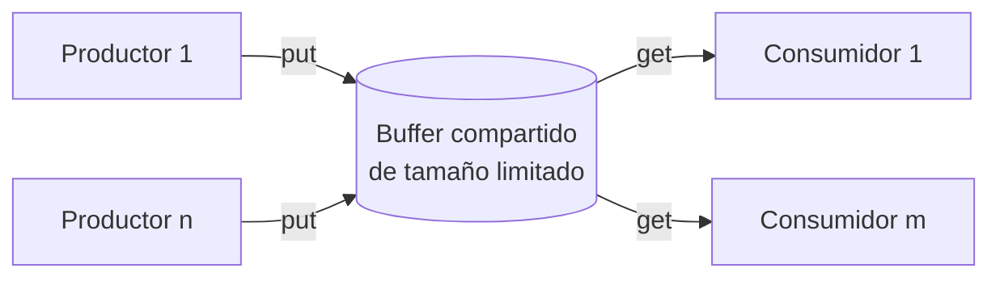

# El problema del productor-consumidor

Volver al [índice de ejemplos](../README.md).

## El problema (p. 36–39)

El problema del **productor-consumidor**, también llamado problema del **buffer acotado** (*bounded buffer*), lo planteó Dijkstra (OSTEP §30.2). Uno o más hilos **productores** generan datos y los ponen en un buffer compartido; uno o más hilos **consumidores** los retiran y los procesan.

El problema aparece en muchos sistemas reales (p. 37–39):

| Sistema | Productor | Buffer | Consumidor |
|---|---|---|---|
| Servidor web multihilo | Hilo que recibe peticiones HTTP | Cola de trabajo | Hilos que atienden las peticiones |
| Tubería del shell: `grep foo file.txt \| wc -l` | `grep`, que escribe las líneas que encuentra | Tubería (*pipe*) del kernel | `wc`, que las cuenta |

Como el buffer es un recurso compartido, el acceso debe estar sincronizado, y además hay dos esperas:

- un **productor** debe esperar si el buffer está **lleno**;
- un **consumidor** debe esperar si el buffer está **vacío**.

Un lock resuelve lo primero (exclusión mutua); para las esperas se necesitan **variables de condición**. Las versiones de esta carpeta muestran, en orden, los errores que aparecen al combinarlas mal.

## Dos series de programas

| Carpeta | Origen | Contenido |
|---|---|---|
| [`diapositivas/`](diapositivas/README.md) | Diapositivas p. 40–66 | Buffer de **un** elemento (v0–v4) y buffer circular de `max` elementos (`main_buffer-v3` y `v4`). Es la serie que sigue la clase. |
| [`libro/`](libro/README.md) | Tarea del cap. 30 de OSTEP | Cuatro versiones con buffer circular desde el principio, incluidas dos que no aparecen en las diapositivas (dos CV con `if` y el lock liberado antes de usar el buffer). |

Ambas series usan la misma estructura (un productor, varios consumidores, etiquetas `p1`–`p6` y `c1`–`c6`) y comparten varias versiones:

| Versión | `diapositivas/` | `libro/` | OSTEP cap. 30 | Resultado con 2 consumidores |
|---|---|---|---|---|
| Sin sincronización | `main_singleBuffer-v0.c` | — | Figs. 30.6 y 30.7 | Falla un `assert` |
| Una CV + `if` | `main_singleBuffer-v1.c` | — | Figs. 30.8 y 30.9 | Falla un `assert` |
| Una CV + `while` | `main_singleBuffer-v2.c` | `main_v1.c` | Figs. 30.10 y 30.11 | *Deadlock* |
| Dos CV + `if` | — | `main_v2.c` | — | Datos repetidos o inválidos |
| Dos CV + `while` | `main_singleBuffer-v3.c` y `main_buffer-v3.c` | `main_v3.c` | Figs. 30.12–30.14 | Correcto (no termina: falta la marca de fin) |
| Dos CV + `while` + marca de fin | `main_singleBuffer-v4.c` y `main_buffer-v4.c` | — | — | Correcto y termina |
| Lock liberado antes de `put`/`get` | — | `main_v4.c` | Tarea, pregunta 11 | Datos repetidos o inválidos |

Se recomienda recorrer primero [`diapositivas/`](diapositivas/README.md) y luego [`libro/`](libro/README.md).

> [!IMPORTANT]
> **Sobre esta guía.** La guía se elaboró con asistencia de un modelo de inteligencia artificial y se revisó contra las diapositivas de la clase y OSTEP (v1.10). Si se encuentra alguna diferencia con lo visto en clase, prevalece lo explicado por el docente.
