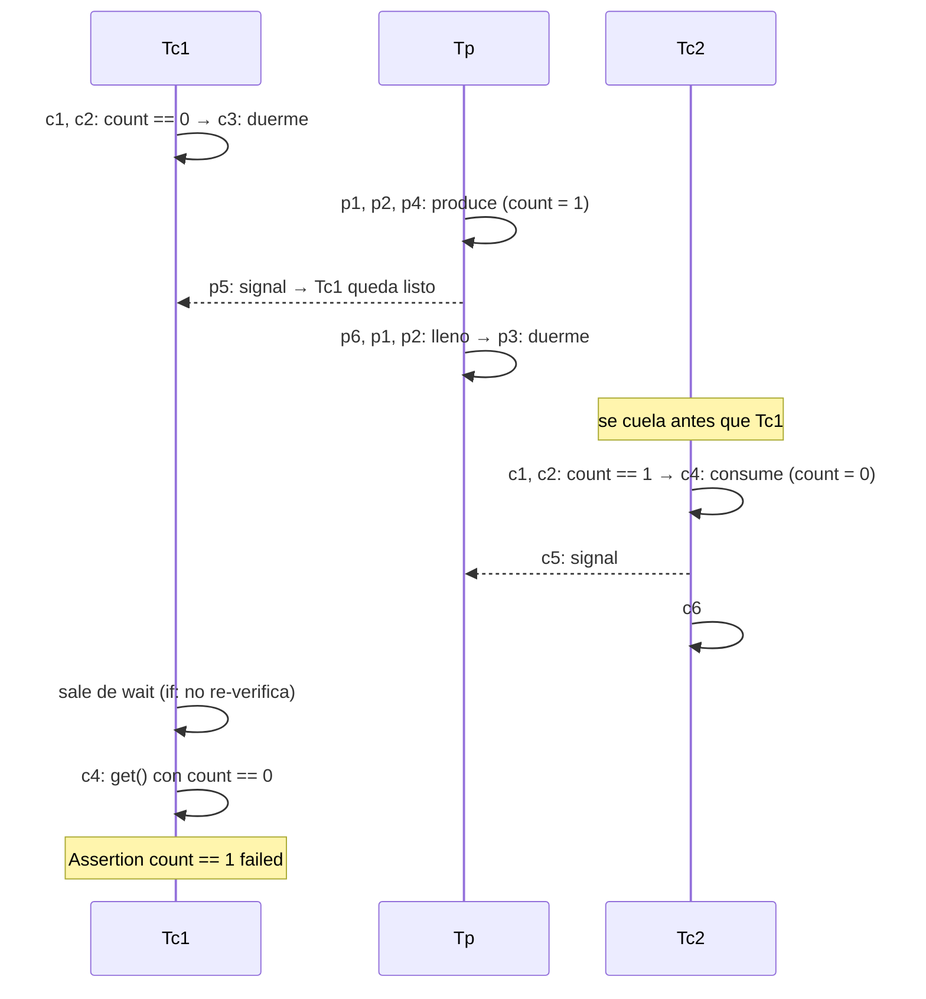
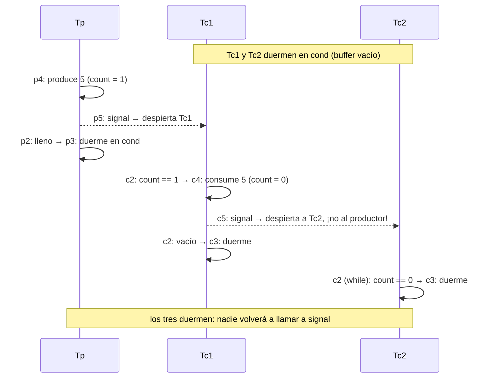
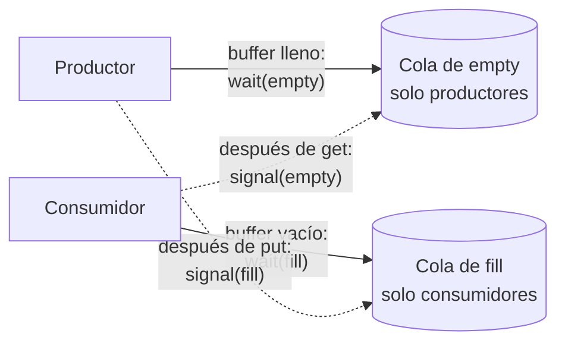

# Productor-consumidor: las versiones de las diapositivas

Esta guía recorre, en el orden de la clase, las versiones del productor-consumidor de las diapositivas (p. 40–66). Cada versión corrige el error de la anterior y, salvo las dos últimas, tiene su propio error. Para cada una se muestra el cambio en el código, cómo probarla, la salida de referencia y la explicación de esa salida con la teoría.

Volver a [productor-consumidor](../README.md) · [índice de ejemplos](../../README.md).

## Relación con las diapositivas y el libro

| Programa | Buffer | Sincronización | Diapositivas | OSTEP cap. 30 (v1.10) | Resultado con 2 consumidores |
|---|---|---|---|---|---|
| [`main_singleBuffer-v0.c`](main_singleBuffer-v0.c) | 1 elemento | Ninguna | p. 40–41 | Figs. 30.6 y 30.7 | Falla un `assert` |
| [`main_singleBuffer-v1.c`](main_singleBuffer-v1.c) | 1 elemento | Una CV + `if` | p. 42–49 | Figs. 30.8 y 30.9 | Falla un `assert` |
| [`main_singleBuffer-v2.c`](main_singleBuffer-v2.c) | 1 elemento | Una CV + `while` | p. 50–58 | Figs. 30.10 y 30.11 | *Deadlock* |
| [`main_singleBuffer-v3.c`](main_singleBuffer-v3.c) | 1 elemento | Dos CV + `while` | p. 59 | Fig. 30.12 | Correcto; no termina |
| [`main_singleBuffer-v4.c`](main_singleBuffer-v4.c) | 1 elemento | Dos CV + `while` + marca de fin | — | — | Correcto y termina |
| [`main_buffer-v3.c`](main_buffer-v3.c) | Circular de `max` | Dos CV + `while` | p. 60–63 | Figs. 30.13 y 30.14 | Correcto; no termina |
| [`main_buffer-v4.c`](main_buffer-v4.c) | Circular de `max` | Dos CV + `while` + marca de fin | p. 64–65 | — | Correcto y termina |

`main_singleBuffer-v4.c` no aparece en las diapositivas: aplica al buffer de un elemento la marca de terminación de `main_buffer-v4.c`.

## Compilación y uso

```bash
make          # compila las siete versiones (main_singleBuffer-v0.out, ...)
make traza    # compila además v1 y v2 con traza: main_singleBuffer-v1-traza.out y -v2-traza.out
make clean    # borra los ejecutables
```

```bash
./main_singleBuffer-vN.out <loops> <consumers>             # buffer de 1 elemento
./main_buffer-vN.out <buffersize> <loops> <consumers>      # buffer circular
```

- `loops`: cuántos valores produce el productor (0, 1, ..., `loops` − 1).
- `consumers`: cuántos hilos consumidores se crean (máximo 10). Siempre hay **un** productor.
- `buffersize`: cantidad de posiciones del buffer circular.

Cada consumidor imprime en una línea el valor que retira. La **traza** (`-DTRAZA`) reemplaza esos valores por los pasos de cada hilo, con las etiquetas `p1`–`p6` y `c1`–`c6` de las diapositivas: `Tp` es el productor y `Tc1`, `Tc2`, ... son los consumidores.

Antes de empezar conviene leer [cómo probar programas que pueden bloquearse](../../README.md#cómo-probar-programas-que-pueden-bloquearse): varias versiones no terminan y para probarlas se usan `timeout`, `stdbuf -oL` y `Ctrl+C`.

---

## 1. Las rutinas `put` y `get` (p. 40)

El buffer tiene un solo elemento, y `count` indica si está lleno (1) o vacío (0):

```c
int buffer;
int count = 0; // initially, empty

void put(int value) {
  assert(count == 0);   // solo se puede poner en un buffer vacío
  count = 1;
  buffer = value;
}

int get(void) {
  assert(count == 1);   // solo se puede sacar de un buffer lleno
  count = 0;
  return buffer;
}
```

Los `assert` hacen visible cualquier error de sincronización. Si alguien pone un dato en un buffer lleno o saca de un buffer vacío, el programa se detiene con el mensaje `Assertion ... failed` y el código de salida 134 (`SIGABRT`), en lugar de seguir con datos corruptos.

## 2. v0: sin sincronización (p. 41)

```c
void *producer(void *arg) {
  ...
  for (i = 0; i < loops; i++) {
    put(i);
  }
}

void *consumer(void *arg) {
  while (1) {
    int tmp = get();
    printf("%d\n", tmp);
  }
}
```

```bash
./main_singleBuffer-v0.out 1000 1 > /dev/null    # se descartan los valores para ver solo los errores
```

```text
main_singleBuffer-v0.out: main_singleBuffer-v0.c:75: put: Assertion `count == 0' failed.
main_singleBuffer-v0.out: main_singleBuffer-v0.c:81: get: Assertion `count == 1' failed.
Aborted (core dumped)
```

Falla en las 20 ejecuciones de referencia, **incluso con un solo consumidor**. Nada impide que el productor llame a `put` dos veces seguidas (falla `assert(count == 0)`) ni que el consumidor llame a `get` antes de que haya datos (falla `assert(count == 1)`). Además, `count` y `buffer` se leen y escriben desde varios hilos sin lock: es una condición de carrera. Se necesitan dos cosas: un **lock** para la exclusión mutua y una forma de **esperar** a que el buffer cambie de estado.

## 3. v1: una variable de condición y `if` (p. 42–49)

Estrategia general (p. 42): los consumidores esperan cuando no hay nada que consumir y los productores esperan cuando el buffer está lleno. Se usa un mutex y **una sola** variable de condición, `cond`:

```c
void *producer(void *arg) {
  for (i = 0; i < loops; i++) {
    Pthread_mutex_lock(&mutex);            // p1
    if (count == 1)                        // p2
      Pthread_cond_wait(&cond, &mutex);    // p3
    put(i);                                // p4
    Pthread_cond_signal(&cond);            // p5
    Pthread_mutex_unlock(&mutex);          // p6
  }
}

void *consumer(void *arg) {
  while (1) {
    Pthread_mutex_lock(&mutex);            // c1
    if (count == 0)                        // c2
      pthread_cond_wait(&cond, &mutex);    // c3
    tmp = get();                           // c4
    pthread_cond_signal(&cond);            // c5
    Pthread_mutex_unlock(&mutex);          // c6
    printf("%d\n", tmp);
  }
}
```

### Pruebas (p. 48–49)

```bash
timeout 2 stdbuf -oL ./main_singleBuffer-v1.out 1000 1 | tail -3   # 1 productor, 1 consumidor
stdbuf -oL ./main_singleBuffer-v1.out 1000 2 | tail -3             # 1 productor, 2 consumidores
```

```text
$ timeout 2 stdbuf -oL ./main_singleBuffer-v1.out 1000 1 | tail -3
997
998
999

$ stdbuf -oL ./main_singleBuffer-v1.out 1000 2 | tail -3
main_singleBuffer-v1.out: main_singleBuffer-v1.c:92: get: Assertion `count == 1' failed.
3
4
5
```

El mensaje del `assert` sale antes que los valores porque va por la salida de error, que llega directo a la terminal, mientras que `tail` muestra los valores solo cuando el programa termina. Los últimos valores consumidos (aquí, del 3 al 5) cambian de una ejecución a otra.

| Escenario | Repeticiones | Resultado |
|---|---|---|
| 1 productor, 1 consumidor | 20 | Los 1000 valores se consumen una sola vez, en orden. El programa no termina (ver nota). |
| 1 productor, 2 consumidores | 100 | Falla `assert(count == 1)` en las 100. |

> [!NOTE]
> **"Funciona" no quiere decir "termina".** Los consumidores de las versiones v0 a v3 están en un `while (1)`: cuando el productor termina, siguen esperando datos que nunca van a llegar, y `main` queda esperándolos en `Pthread_join`. Por eso, en el caso que funciona, hay que terminar el programa con `Ctrl+C` (o con `timeout`). Este detalle se resuelve en la sección 6 con una marca de terminación.

### Problema 1: al despertar, el estado puede haber cambiado (p. 46)

Las diapositivas (p. 46) y OSTEP (Fig. 30.9) describen el error así. `Tc1` encuentra el buffer vacío y se duerme. El productor pone un dato y lo despierta con `signal`. Pero **antes de que `Tc1` vuelva a correr**, `Tc2` adquiere el lock, encuentra el buffer lleno, consume el dato sin dormir y lo libera. Cuando `Tc1` por fin corre, sale de `wait` y, como la verificación era un `if`, **no vuelve a mirar `count`**: llama a `get()` con el buffer vacío y falla el `assert`.



La causa es que `signal` solo **avisa** que el estado cambió; no garantiza que el estado siga así cuando el hilo despertado corra. Esta interpretación se llama **semántica de Mesa**, y es la que usan prácticamente todos los sistemas reales. La alternativa, la **semántica de Hoare**, garantiza que el hilo despertado corre de inmediato, pero es más difícil de implementar (OSTEP §30.2).

### Lo que muestra la traza

La traza permite ver qué pasó en una ejecución real:

```bash
make traza
./main_singleBuffer-v1-traza.out 10 2
```

Salida de referencia completa:

```text
Tp  p4: produce 0
Tp  p5: signal
Tp  p3: buffer lleno, duerme
Tc2 c4: consume 0
Tc2 c5: signal
Tc2 c3: buffer vacio, duerme
Tc1 c3: buffer vacio, duerme
Tp  p3: despierta (count=0)
Tp  p4: produce 1
Tp  p5: signal
Tp  p3: buffer lleno, duerme
Tc2 c3: despierta (count=1)
Tc2 c4: consume 1
Tc2 c5: signal
Tc2 c3: buffer vacio, duerme
Tc1 c3: despierta (count=0)
main_singleBuffer-v1-traza.out: main_singleBuffer-v1.c:92: get: Assertion `count == 1' failed.
```

Se lee así:

1. El productor pone el 0 y, en la siguiente vuelta, encuentra el buffer lleno y se duerme. `Tc2` consume el 0, despierta al productor y se duerme. `Tc1` encuentra el buffer vacío y también se duerme.
2. El productor pone el 1, despierta a `Tc2` y se vuelve a dormir.
3. `Tc2` consume el 1 y llama a `signal`. En la cola esperan `Tc1` y el productor, y la señal despierta a **`Tc1`, un consumidor**.
4. `Tc1` despierta con `count=0`. Como la verificación es un `if`, no vuelve a dormirse: llama a `get()` y falla el `assert`.

De 30 trazas de referencia, 28 terminaron en este `assert` (en las otras 2 se consumieron los 10 valores y el programa quedó esperando al final). En las 28, la última señal antes de que el consumidor despertara con el buffer vacío la había enviado **el otro consumidor**, no el productor. Es una variante del mismo problema: el hilo despierta y **el estado no es el que esperaba**, sea porque otro hilo se le adelantó (p. 46) o porque la señal no era para él. En ambos casos el error de fondo es el `if`.

## 4. v2: una variable de condición y `while` (p. 50–58)

La corrección del problema 1 es pequeña: cambiar `if` por `while`, en el consumidor y en el productor (p. 50–52):

```c
    while (count == 1)                     // p2
      Pthread_cond_wait(&cond, &mutex);    // p3
    ...
    while (count == 0)                     // c2
      pthread_cond_wait(&cond, &mutex);    // c3
```

Ahora un hilo que despierta **vuelve a verificar** la condición, ya con el lock adquirido; si el estado no es el esperado, se vuelve a dormir. Es la regla de oro de la p. 52 y de OSTEP (*Tip: Use While (Not If) For Conditions*): **con variables de condición, usar siempre `while`**. El `while` también protege contra los **despertares espurios** (*spurious wakeups*): en algunas implementaciones un hilo puede despertar sin que nadie haya llamado a `signal`.

Pero la p. 52 advierte que "todavía persiste el problema 2".

### Pruebas (p. 57–58)

```bash
timeout 2 stdbuf -oL ./main_singleBuffer-v2.out 1000 1 | wc -l    # 1 consumidor
timeout 2 stdbuf -oL ./main_singleBuffer-v2.out 1000 2 | tail -3  # 2 consumidores
```

```text
$ timeout 2 stdbuf -oL ./main_singleBuffer-v2.out 1000 1 | wc -l
1000

$ timeout 2 stdbuf -oL ./main_singleBuffer-v2.out 1000 2 | tail -3
16
17
18
```

| Escenario | Repeticiones | Resultado |
|---|---|---|
| 1 productor, 1 consumidor | 20 | Se consumen los 1000 valores (y el programa queda esperando al final, como en v1). |
| 1 productor, 2 consumidores | 100 | ***Deadlock* en las 100**: el programa se detiene después de consumir entre 4 y 154 valores, según la ejecución. |

Ya no falla ningún `assert`, pero con dos consumidores el programa **se congela** a mitad de la producción. En el manuscrito de la clase (p. 58), la ejecución en vivo se detuvo hacia el valor 93.

### Problema 2: la señal despierta al hilo equivocado (p. 53–56)

Con una sola variable de condición, productores y consumidores duermen **en la misma cola**, y `signal` despierta a uno cualquiera de ellos. La traza muestra cómo termina:

```bash
./main_singleBuffer-v2-traza.out 10 2      # se bloquea: terminar con Ctrl+C
```

Últimas líneas de una ejecución de referencia:

```text
Tp  p4: produce 5
Tp  p5: signal
Tp  p3: buffer lleno, duerme
Tc1 c3: despierta (count=1)
Tc1 c4: consume 5
Tc1 c5: signal
Tc1 c3: buffer vacio, duerme
Tc2 c3: despierta (count=0)
Tc2 c3: buffer vacio, duerme
^C
```



Es exactamente el escenario de las p. 55–56 y de OSTEP (Fig. 30.11). `Tc1` vació el buffer y su señal debía despertar al productor, que es el único que puede volver a llenarlo. En lugar de eso despertó a `Tc2`; gracias al `while`, `Tc2` verifica que no hay nada y se vuelve a dormir, sin llamar a `signal`. Los tres hilos quedan dormidos esperando una señal que nadie enviará. En 28 de 30 trazas de referencia (10 valores, 2 consumidores) el programa se bloqueó así antes de consumir los 10 valores.

Con **un** consumidor esto no puede ocurrir: la única señal que puede enviar el consumidor solo encuentra al productor en la cola.

**Conclusiones (p. 56):** señalizar es necesario, pero la señal debe ser **más específica**: un consumidor solo debe despertar a productores, y un productor solo a consumidores.

## 5. v3: dos variables de condición y `while` (p. 59)

La solución es usar **dos** variables de condición, una por cada motivo de espera:

- `empty`: ahí duermen los **productores** cuando el buffer está lleno; la señalan los consumidores cuando lo vacían.
- `fill`: ahí duermen los **consumidores** cuando el buffer está vacío; la señalan los productores cuando ponen un dato.

```c
pthread_cond_t empty = PTHREAD_COND_INITIALIZER;
pthread_cond_t fill  = PTHREAD_COND_INITIALIZER;

void *producer(void *arg) {
  for (i = 0; i < loops; i++) {
    Pthread_mutex_lock(&mutex);            // p1
    while (count == 1)                     // p2
      Pthread_cond_wait(&empty, &mutex);   // p3
    put(i);                                // p4
    Pthread_cond_signal(&fill);            // p5
    Pthread_mutex_unlock(&mutex);          // p6
  }
}

void *consumer(void *arg) {
  while (1) {
    Pthread_mutex_lock(&mutex);            // c1
    while (count == 0)                     // c2
      pthread_cond_wait(&fill, &mutex);    // c3
    tmp = get();                           // c4
    pthread_cond_signal(&empty);           // c5
    Pthread_mutex_unlock(&mutex);          // c6
    printf("%d\n", tmp);
  }
}
```



Un consumidor ya no puede despertar por accidente a otro consumidor, ni un productor a otro productor: el problema 2 desaparece **por diseño** (OSTEP, Fig. 30.12).

```bash
timeout 2 stdbuf -oL ./main_singleBuffer-v3.out 1000 2 | wc -l
```

```text
1000
```

| Escenario | Repeticiones | Resultado |
|---|---|---|
| 1 productor, 2 consumidores | 50 | Se consumen los 1000 valores, cada uno una vez. |
| 1 productor, 5 consumidores | 50 | Se consumen los 1000 valores, cada uno una vez. |

En todas las ejecuciones el programa quedó esperando al final, como se explicó en la sección 3. Esto **no** es un *deadlock*: todos los valores se consumieron y lo que falta es avisar a los consumidores que ya no vendrán más. Para distinguir un caso del otro basta contar las líneas con `wc -l`: si salen las 1000, el programa solo está esperando al final.

## 6. v4: marca de terminación (`main_singleBuffer-v4.c`)

Para que el programa termine, el productor pone al final un valor especial, `-1`, **una vez por cada consumidor**, y cada consumidor sale de su ciclo cuando lo recibe:

```c
  // en el productor, después del ciclo principal:
  for (i = 0; i < consumers; i++) {
    Mutex_lock(&mutex);
    while (count == 1)
      Cond_wait(&empty, &mutex);
    put(-1);
    Cond_signal(&fill);
    Mutex_unlock(&mutex);
  }

  // en el consumidor:
  while (tmp != -1) {
    ...
    tmp = get();
    ...
  }
```

Hace falta un `-1` por consumidor: cada consumidor que lo recibe termina y ya no saca más datos, así que con una sola marca los demás seguirían esperando.

```bash
./main_singleBuffer-v4.out 1000 2 | tail -4
```

```text
998
999
-1
-1
```

El programa terminó en 100 de 100 ejecuciones con 2 consumidores y en 100 de 100 con 5. Los dos `-1` del final son las marcas que recibió cada consumidor.

## 7. Buffer circular (p. 60–65)

La solución final agrega **más posiciones** al buffer (p. 60). Con `max` posiciones, el productor puede poner varios valores antes de dormirse y los consumidores pueden sacar varios antes de dormirse, lo que mejora la **concurrencia** y reduce los **cambios de contexto**. El buffer es circular: `fill_ptr` indica dónde se pone el siguiente valor, `use_ptr` de dónde se saca, y ambos dan la vuelta al llegar a `max` (OSTEP, Fig. 30.13):

```c
void put(int value) {
  buffer[fill_ptr] = value;
  fill_ptr = (fill_ptr + 1) % max;
  count++;
}

int get(void) {
  int tmp = buffer[use_ptr];
  use_ptr = (use_ptr + 1) % max;
  count--;
  return tmp;
}
```

| Posición | 0 | 1 | 2 | 3 | 4 |
|---|---|---|---|---|---|
| Contenido | vacía | **dato** | **dato** | vacía | vacía |
| Puntero | | ↑ `use_ptr` | | ↑ `fill_ptr` | |

En el ejemplo, `max = 5` y `count = 2`: el siguiente `get` saca el valor de la posición 1 y el siguiente `put` escribe en la posición 3. Cuando un puntero pasa de la posición 4, `(ptr + 1) % max` lo devuelve a la 0. La sincronización es la misma de v3, con las condiciones generalizadas (OSTEP, Fig. 30.14): el productor duerme solo si `count == max` y el consumidor solo si `count == 0`.

```c
    while (count == max)                   // p2
      Pthread_cond_wait(&empty, &mutex);   // p3
    ...
    while (count == 0)                     // c2
      pthread_cond_wait(&fill, &mutex);    // c3
```

### Pruebas (p. 62–65)

```bash
timeout 2 stdbuf -oL ./main_buffer-v3.out 10 1000 2 | wc -l    # sin marca de terminación
./main_buffer-v4.out 10 1000 2 | tail -4                       # con marca de terminación
```

```text
$ timeout 2 stdbuf -oL ./main_buffer-v3.out 10 1000 2 | wc -l
1000

$ ./main_buffer-v4.out 10 1000 2 | tail -4
998
999
-1
-1
```

| Programa | Escenario | Repeticiones | Resultado |
|---|---|---|---|
| `main_buffer-v3.out 10 1000 2` | Buffer de 10, 2 consumidores | 50 | Se consumen los 1000 valores; no termina ("funciona pero se bloquea", p. 63). |
| `main_buffer-v4.out 10 1000 2` | Buffer de 10, 2 consumidores | 100 | Termina en las 100 (p. 65). |
| `main_buffer-v4.out 1 1000 5` | Buffer de 1, 5 consumidores | 100 | Termina en las 100. |

En `main_buffer-v3.out` las últimas líneas de la salida no siempre son `998` y `999`: cada consumidor imprime **después** de soltar el lock, así que dos consumidores pueden imprimir en un orden distinto al que sacaron los valores. Los valores son correctos; solo el orden de impresión varía.

### ¿Cuánto ayuda un buffer más grande?

Se comparó el tiempo para 100 000 valores con 2 consumidores, enviando la salida a `/dev/null` para no medir la terminal:

```bash
time ./main_singleBuffer-v4.out 100000 2 > /dev/null
time ./main_buffer-v4.out 10 100000 2 > /dev/null
```

| Programa | `real` | `user` | `sys` |
|---|---|---|---|
| `main_singleBuffer-v4.out 100000 2` (buffer de 1) | 3.776 s | 0.266 s | 3.328 s |
| `main_buffer-v4.out 10 100000 2` (buffer de 10) | 0.411 s | 0.031 s | 0.563 s |

Con un solo elemento, el productor y los consumidores tienen que turnarse en cada valor: casi cada `put` y cada `get` termina en un `wait` y un `signal`, es decir, en dormir y despertar un hilo, lo cual pasa por el kernel. Eso explica que casi todo el tiempo sea `sys`. Con 10 posiciones, cada hilo puede avanzar varias veces antes de dormirse, y el programa fue unas 9 veces más rápido en esta máquina. Es la mejora de eficiencia que anuncia la p. 60: menos cambios de contexto.

## 8. Resumen: reglas de juego (p. 66)

| Versión | Error | Corrección en la versión siguiente |
|---|---|---|
| v0 | Sin exclusión mutua ni espera | Mutex y variable de condición |
| v1 | `if`: al despertar no se re-verifica el estado | `while` |
| v2 | Una sola CV: la señal despierta a un hilo del mismo tipo | Dos CV: `empty` y `fill` |
| v3 y `main_buffer-v3` | Correcto, pero los consumidores no saben cuándo terminar | Marca de terminación (`-1` por consumidor) |
| v4 y `main_buffer-v4` | — | — |

Reglas de la p. 66, que resumen también las del [*join*](../../variables-condicion/README.md#6-resumen-p-32):

1. **Mantener un estado** además de las variables de condición (`count`).
2. **Llamar a `wait` y `signal` con el lock adquirido.**
3. **Verificar el estado siempre que se adquiera el lock**, y hacerlo en un **`while`**.

A estas se suma la lección de v2: **usar una variable de condición por cada condición de espera**, para que cada señal despierte al tipo de hilo correcto.

## Para probar por cuenta propia

1. Ejecutar `main_singleBuffer-v2.out` con 1, 2, 3 y 5 consumidores (`loops` = 1000) y contar los valores con `wc -l`. ¿Por qué con un consumidor nunca se bloquea?
2. Ejecutar `main_singleBuffer-v1-traza.out 10 2` varias veces y, en cada traza, identificar quién envió la señal que despertó al consumidor que falló.
3. Cambiar el tamaño del buffer de `main_buffer-v4.out` (1, 2, 10, 100) y medir con `time` la ejecución de 100 000 valores. ¿A partir de qué tamaño deja de mejorar?

> [!IMPORTANT]
> **Sobre esta guía.** El código y la guía se elaboraron con asistencia de un modelo de inteligencia artificial y se revisaron contra las diapositivas de la clase y OSTEP. Las salidas son de una ejecución de referencia del 19/11/2026 en la máquina descrita en el [entorno de ejecución](../../../../clase_14/ejemplos/entorno_ejecucion.md) de la clase 14; en otra máquina los conteos y los tiempos varían, pero no qué versiones fallan. Si se encuentra alguna diferencia con lo visto en clase, prevalece lo explicado por el docente.
