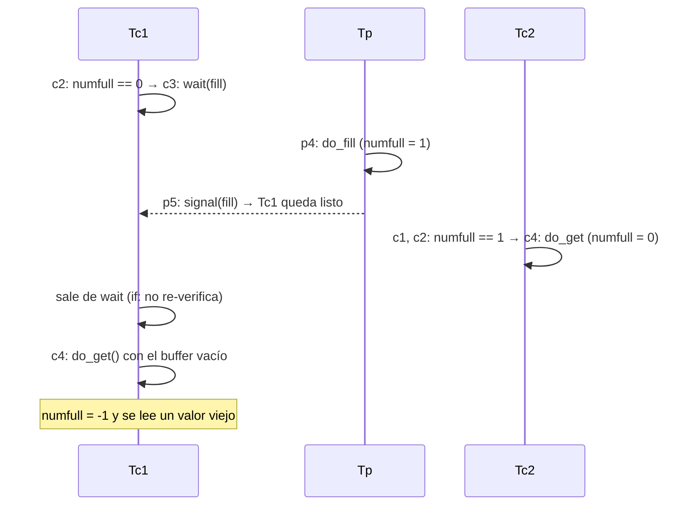
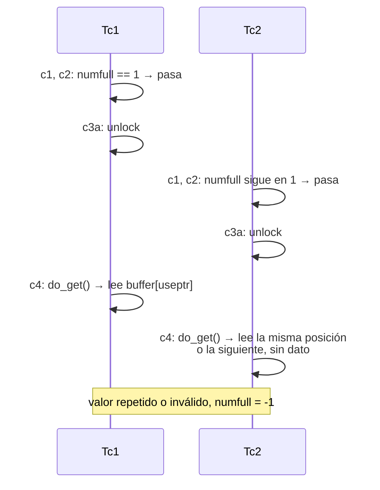

# Productor-consumidor: las versiones de la tarea de OSTEP

Esta guía complementa la de [`diapositivas/`](../diapositivas/README.md), que conviene leer primero. Las cuatro versiones de esta carpeta son adaptaciones simplificadas de los programas de la tarea (*homework*) del capítulo 30 de OSTEP. Todas usan un **buffer circular** desde el principio, y dos de ellas muestran errores que no aparecen en las diapositivas.

Volver a [productor-consumidor](../README.md) · [índice de ejemplos](../../README.md).

## Relación con el libro

| Programa | Sincronización | Equivale en la tarea de OSTEP a | Versión de las diapositivas |
|---|---|---|---|
| [`main_v1.c`](main_v1.c) | Una CV + `while` | `main-one-cv-while.c` (preguntas 8 y 9) | `main_singleBuffer-v2.c` |
| [`main_v2.c`](main_v2.c) | Dos CV + `if` | `main-two-cvs-if.c` (pregunta 10) | — |
| [`main_v3.c`](main_v3.c) | Dos CV + `while` | `main-two-cvs-while.c` (preguntas 1 a 7) | `main_buffer-v3.c` |
| [`main_v4.c`](main_v4.c) | Dos CV + `while`, pero el lock se libera antes de usar el buffer | `main-two-cvs-while-extra-unlock.c` (pregunta 11) | — |

Los programas originales de la tarea están en [`ostep-homework/threads-cv`](https://github.com/remzi-arpacidusseau/ostep-homework/tree/master/threads-cv). Además de lo que hacen estas versiones, aceptan varios productores y "cadenas de pausas" (`-P`, `-C`) que obligan a un hilo a dormir en una línea concreta, y así permiten forzar cada error de forma reproducible. El documento [`CV_condition-variables.pdf`](CV_condition-variables.pdf) reúne el pseudocódigo de las cuatro versiones (tomado de los apuntes de Remzi Arpaci-Dusseau) junto con el código de `mythreads.h`.

### Diferencias con la serie de las diapositivas

- Las rutinas se llaman `do_fill()` y `do_get()`, el contador es `numfull` y los índices son `fillptr` y `useptr`.
- **`do_fill()` y `do_get()` no tienen `assert`.** Un error de sincronización no detiene el programa: aparece como **datos repetidos, perdidos o inválidos** en la salida. Por eso, para verificar estas versiones hay que revisar los valores impresos (ver abajo).
- Ninguna tiene marca de terminación: cuando la producción termina, los consumidores quedan esperando y el programa no termina (`Ctrl+C`).

## Compilación y uso

```bash
make          # compila main_v1.out ... main_v4.out
make clean
./main_vN.out <buffersize> <loops> <consumers>
```

## Cómo verificar la salida

Con `loops = 1000`, una ejecución correcta imprime los valores del 0 al 999, **cada uno exactamente una vez** (el orden puede variar, porque cada consumidor imprime después de soltar el lock). Para comprobarlo se guarda la salida y se cuentan las líneas y los valores distintos:

```bash
timeout 2 stdbuf -oL ./main_v3.out 1 1000 2 > salida.txt
wc -l < salida.txt                        # líneas impresas
sort -n salida.txt | uniq | wc -l         # valores distintos
sort -n salida.txt | uniq -c | awk '$1 > 1' | head   # valores repetidos (y cuántas veces)
```

| Resultado | Interpretación |
|---|---|
| 1000 líneas y 1000 valores distintos | Correcto. Si `timeout` terminó el programa, solo estaba esperando al final. |
| Menos de 1000 líneas, sin repetidos | *Deadlock*: los hilos quedaron dormidos antes de terminar. |
| Valores repetidos, o distintos ≠ líneas | Error de sincronización: se consumieron datos dos veces o se leyeron posiciones inválidas. |

Las pruebas de referencia usan un límite de 1 s por ejecución y 50 ejecuciones por escenario.

---

## v1: una variable de condición y `while` (`main_v1.c`)

Es el problema 2 de las diapositivas (p. 53–56) con un buffer de `buffersize` posiciones: productores y consumidores duermen en la misma variable `cond`, y la señal de un consumidor puede despertar a otro consumidor en lugar de al productor.

```c
    while (numfull == max)    // p2
      Cond_wait(&cond, &m);   // p3
    ...
    while (numfull == 0)      // c2
      Cond_wait(&cond, &m);   // c3
```

```bash
timeout 2 stdbuf -oL ./main_v1.out 1 1000 2 | tail -3
```

```text
11
12
13
```

| Escenario | Resultado en 50 ejecuciones |
|---|---|
| Buffer de 1, 1 consumidor | Correcto en las 50 |
| Buffer de 1, 2 consumidores | ***Deadlock* en las 50**, después de consumir entre 2 y 103 valores |
| Buffer de 10, 2 consumidores | Correcto en las 50 |

El *deadlock* necesita que coincidan dos cosas: el productor dormido porque el buffer está **lleno**, y un consumidor que vacía el buffer y despierta a otro **consumidor**. Con una sola posición, eso pasa casi en cada vuelta. Con 10 posiciones, el productor duerme muy pocas veces, y un consumidor despertado por error casi siempre encuentra datos, así que los consume y vuelve a señalar, en lugar de dormirse. En estas ejecuciones no se observó ningún bloqueo, pero el error sigue en el código: que no se manifieste no lo hace correcto. La pregunta 9 de la tarea de OSTEP pide justamente construir, con pausas, una ejecución que lo provoque.

## v2: dos variables de condición e `if` (`main_v2.c`)

Esta versión corrige el problema 2 (hay dos CV, `empty` y `fill`) pero vuelve al `if`, es decir, al problema 1 de las diapositivas (p. 46):

```c
    if (numfull == max)       // p2
      Cond_wait(&empty, &m);  // p3
    ...
    if (numfull == 0)         // c2
      Cond_wait(&fill, &m);   // c3
```

```bash
timeout 2 stdbuf -oL ./main_v2.out 1 1000 2 > salida.txt
wc -l < salida.txt
sort -n salida.txt | uniq | wc -l
sort -n salida.txt | uniq -c | awk '$1 > 1' | head -5
```

```text
137076
945
      2 191
      2 197
      2 201
      2 208
      2 215
```

| Escenario | Resultado en 50 ejecuciones |
|---|---|
| Buffer de 1, 1 consumidor | Correcto en las 50 |
| Buffer de 1, 2 consumidores | **Salida incorrecta en las 50** |
| Buffer de 10, 2 consumidores | Salida incorrecta en 3; correcto en 47 |

Con dos consumidores y un buffer de una posición, el programa imprimió **137 076 líneas en 2 segundos**, para solo 1000 valores producidos, y aun así faltaron valores: solo hubo 945 distintos. Como hay dos variables de condición, a un consumidor solo lo puede despertar el productor. El error es, entonces, exactamente el de la p. 46: el productor despierta a `Tc1`, `Tc2` se cuela y consume el dato, y `Tc1`, que no vuelve a verificar, llama a `do_get()` con el buffer vacío.



Aquí no hay `assert` que detenga el programa, así que el error se propaga. `numfull` queda en **−1**, y desde ese momento ninguna condición de espera se cumple: los consumidores dejan de dormir porque `numfull == 0` es falso, y el productor también, porque `numfull == max` es falso. Los consumidores giran sacando una y otra vez valores viejos del buffer, y eso explica las más de cien mil líneas. Con un buffer de 10 el error es menos frecuente (3 de 50), porque para que ocurra el buffer debe tener justo un elemento cuando el consumidor se cuela.

## v3: dos variables de condición y `while` (`main_v3.c`)

Es la solución correcta (OSTEP, Figs. 30.13 y 30.14), equivalente a `main_buffer-v3.c` de las diapositivas.

```bash
timeout 2 stdbuf -oL ./main_v3.out 1 1000 2 > salida.txt
wc -l < salida.txt
sort -n salida.txt | uniq | wc -l
```

```text
1000
1000
```

| Escenario | Resultado en 50 ejecuciones |
|---|---|
| Buffer de 1, 1 consumidor | Correcto en las 50 |
| Buffer de 1, 2 consumidores | Correcto en las 50 |
| Buffer de 10, 2 consumidores | Correcto en las 50 |

En todas las ejecuciones el programa quedó esperando al final, porque no tiene marca de terminación.

## v4: el lock se libera antes de usar el buffer (`main_v4.c`)

Esta versión espera correctamente (dos CV y `while`), pero **suelta el lock** antes de llamar a `do_fill()`/`do_get()` y lo vuelve a tomar después, para señalar:

```c
    Mutex_lock(&m);           // c1
    while (numfull == 0)      // c2
      Cond_wait(&fill, &m);   // c3
    Mutex_unlock(&m);         // c3a  <-- se suelta el lock
    int tmp = do_get();       // c4   <-- fuera de la sección crítica
    Mutex_lock(&m);           // c4a
    Cond_signal(&empty);      // c5
    Mutex_unlock(&m);         // c6
```

Podría parecer que así se gana concurrencia, pero `do_get()` lee y modifica `buffer`, `useptr` y `numfull`, que son variables compartidas: dejar esas operaciones fuera del lock rompe la **exclusión mutua**. La verificación de `c2` ya no sirve, porque entre `c3a` y `c4` otro consumidor puede verificar la misma condición y sacar el mismo dato:



```bash
timeout 2 stdbuf -oL ./main_v4.out 1 1000 2 > salida.txt
wc -l < salida.txt
sort -n salida.txt | uniq | wc -l
sort -n salida.txt | uniq -c | awk '$1 > 1' | head -5
```

```text
1000
959
      2 200
      3 220
      2 247
      2 286
      2 311
```

| Escenario | Resultado en 50 ejecuciones |
|---|---|
| Buffer de 1, 1 consumidor | Correcto en las 50 |
| Buffer de 1, 2 consumidores | **Salida incorrecta en las 50** |
| Buffer de 10, 2 consumidores | **Salida incorrecta en las 50** |

Con un solo consumidor no se observó ningún error, pero el código sigue siendo incorrecto: el productor y el consumidor también modifican `numfull` fuera del lock (`numfull++` en `do_fill()` y `numfull--` en `do_get()`), y esa es la misma carrera del contador de las clases 14 y 15. Con dos consumidores el error aparece siempre, sea cual sea el tamaño del buffer.

La ejecución de referencia imprimió 1000 líneas, la cantidad esperada, pero solo 959 valores distintos: algunos aparecen dos o tres veces y otros no aparecen. **Contar las líneas no basta para verificar un programa concurrente**: hay que revisar los valores. La lección es la de las clases 15 y 16: toda operación sobre datos compartidos debe estar dentro de la sección crítica. Las variables de condición resuelven la **espera**; no reemplazan al lock.

## Resumen

| Versión | Problema | Con 2 consumidores y buffer de 1 |
|---|---|---|
| `main_v1` | Una sola CV: la señal despierta al hilo equivocado | *Deadlock* |
| `main_v2` | `if`: al despertar no se re-verifica el estado | Datos repetidos o inválidos |
| `main_v3` | Ninguno (no tiene marca de terminación) | Correcto |
| `main_v4` | El buffer se usa fuera de la sección crítica | Datos repetidos o perdidos |

## Para probar por cuenta propia

1. Ejecutar `main_v2.out 1 1000 1` (un solo consumidor) y verificar la salida. ¿Por qué el `if` no causa problemas con un solo consumidor?
2. Ejecutar `main_v4.out` con 1, 2 y 5 consumidores y comparar la cantidad de valores distintos.
3. Descargar los programas de [`ostep-homework/threads-cv`](https://github.com/remzi-arpacidusseau/ostep-homework/tree/master/threads-cv), leer su `README` y resolver las preguntas 8 a 11 del capítulo, que usan las cadenas de pausas para provocar cada error a voluntad.

> [!IMPORTANT]
> **Sobre esta guía.** El código y la guía se elaboraron con asistencia de un modelo de inteligencia artificial y se revisaron contra OSTEP (v1.10). Las salidas son de una ejecución de referencia del 19/11/2026 en la máquina descrita en el [entorno de ejecución](../../../../clase_14/ejemplos/entorno_ejecucion.md) de la clase 14; en otra máquina los conteos varían. Si se encuentra alguna diferencia con lo visto en clase, prevalece lo explicado por el docente.
