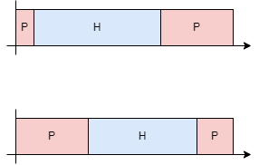
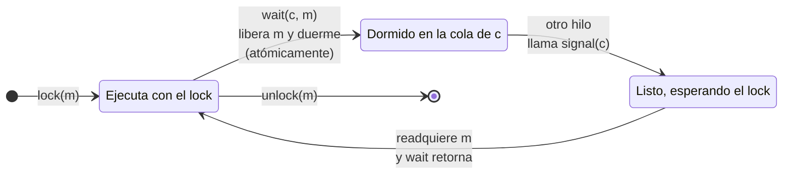
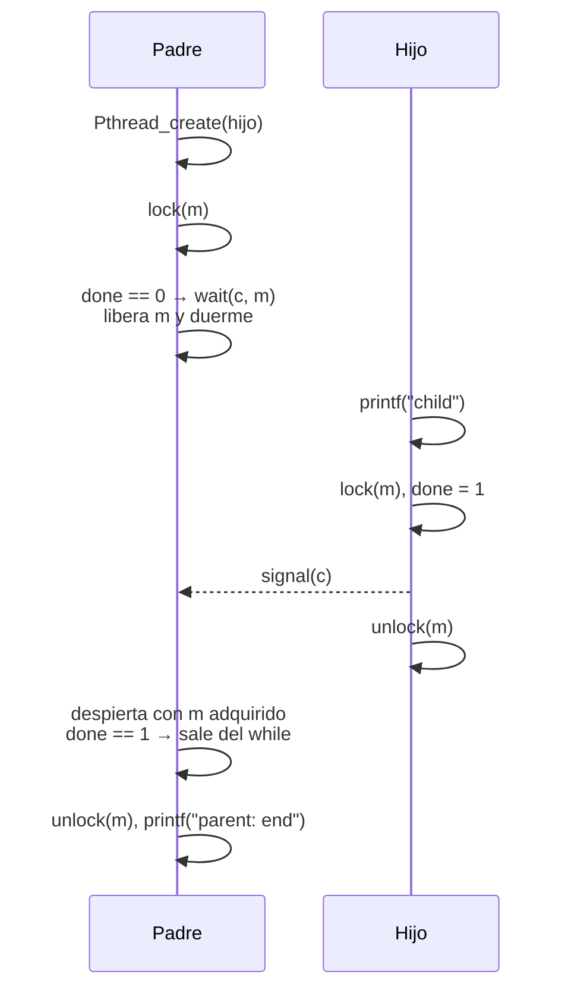
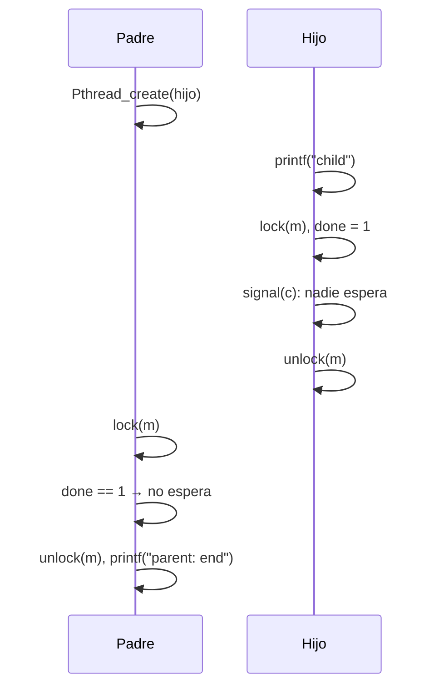
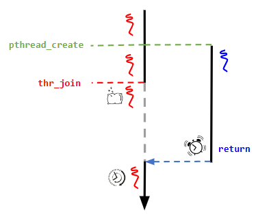
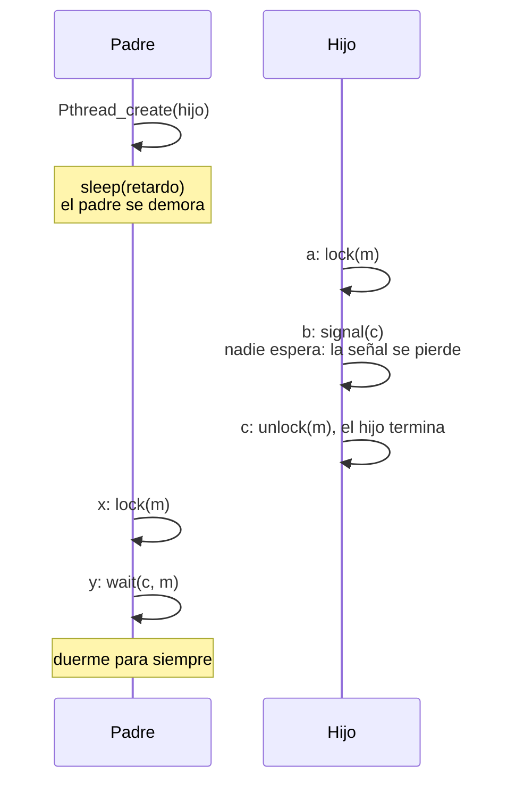
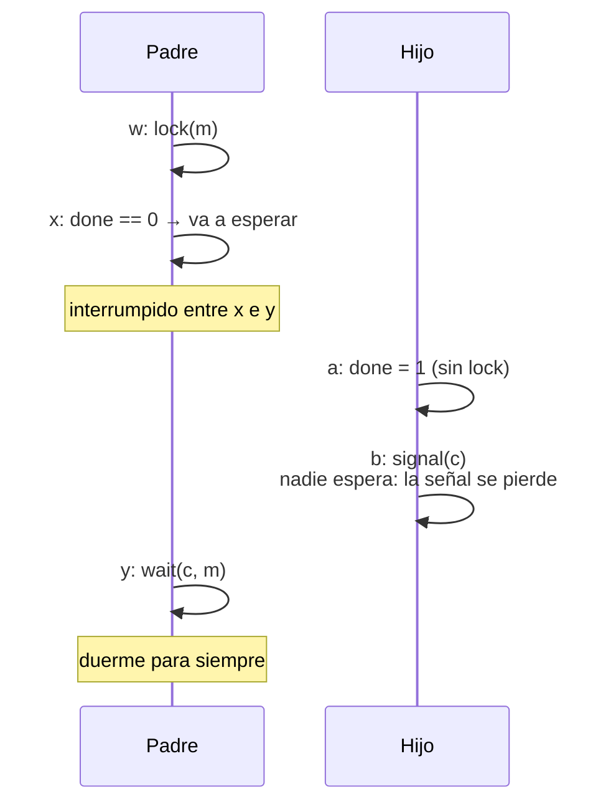
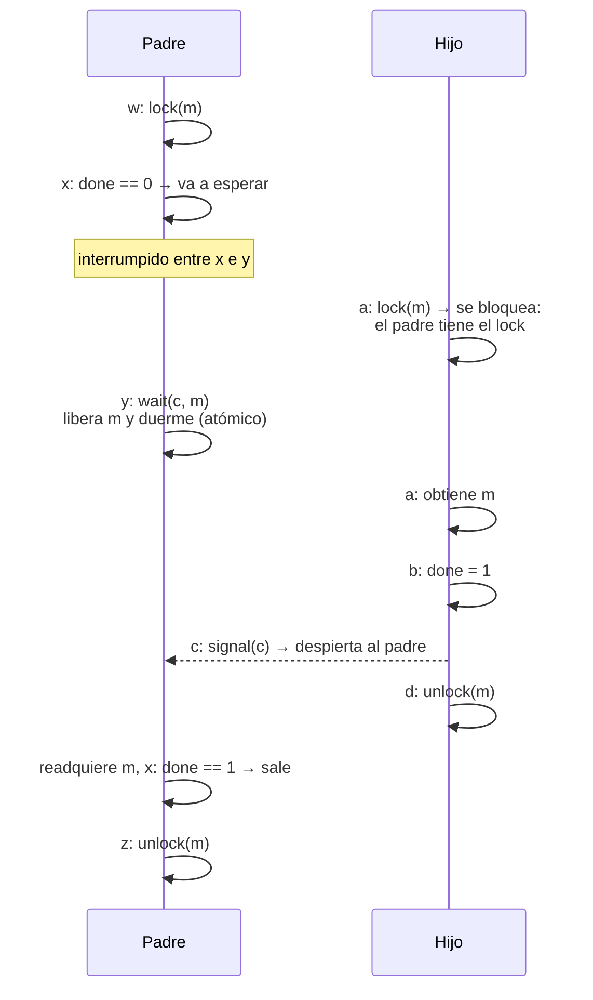

# Variables de condición: el *join*

Esta guía muestra cómo hacer que un hilo **espere a que otro termine** (la operación *join*), primero con espera activa y luego con una variable de condición. Después revisa tres reimplementaciones del *join* para responder la pregunta de la diapositiva p. 23: **¿por qué es importante cada una de las instrucciones de `thr_join` y `thr_exit`?** Cada versión rota se puede ejecutar y forzar a fallar, de modo que el error se observa en lugar de solo leerse.

Volver al [índice de ejemplos](../README.md).

## Relación con las diapositivas y el libro

| Programa | Qué muestra | Diapositivas | OSTEP cap. 30 (v1.10) |
|---|---|---|---|
| [`ejemplo1.c`](ejemplo1.c) | Espera activa (*spin*): funciona, pero gasta CPU | p. 9–11 | Figs. 30.1 y 30.2 |
| [`ejemplo2.c`](ejemplo2.c) | *Join* con variable de condición (correcto) | p. 12–22 | §30.1, Fig. 30.3 |
| [`implementacion1.c`](implementacion1.c) | Reimplementación 1: sin variable de estado (**rota**) | p. 24–26 y 33 | Fig. 30.4 |
| [`implementacion2.c`](implementacion2.c) | Reimplementación 2: `thr_exit` sin lock (**rota**) | p. 27–29 y 34 | Fig. 30.5 |
| [`implementacion3.c`](implementacion3.c) | Reimplementación 3: estado, lock y `while` (correcta) | p. 30–31 y 35 | Fig. 30.3 |
| [`ensayos/test1.c`](ensayos/README.md) | Variantes: sin `signal`, doble `signal`, `wait` sin lock | — | §30.1 |

## Compilación

Desde esta carpeta:

```bash
make          # compila los cinco programas: ejemplo1.out, ejemplo2.out, implementacion1.out, ...
make clean    # borra los ejecutables
```

Cada programa también se puede compilar por separado, por ejemplo:

```bash
gcc -Wall -I. -o ejemplo2.out ejemplo2.c -pthread
```

`-I.` le indica al compilador que busque `mythreads.h` en la carpeta actual y `-pthread` enlaza la biblioteca de hilos. Las diapositivas usan `-lpthread`, que en Linux tiene el mismo efecto para estos programas.

Todos los programas aceptan un **argumento opcional** que fuerza el escenario que se quiere estudiar. Sin el argumento, cada programa es exactamente el código de las diapositivas.

---

## 1. El problema: imponer un orden (p. 8–9)

El hilo principal crea un hijo y quiere imprimir `parent: end` solo cuando el hijo haya terminado (OSTEP, Fig. 30.1):

```c
void *child(void *arg) {
  printf("child\n");
  // XXX how to indicate we are done?
  return NULL;
}

int main(int argc, char *argv[]) {
  printf("parent: begin\n");
  pthread_t c;
  Pthread_create(&c, NULL, child, NULL); // create child
  // XXX how to wait for child?
  printf("parent: end\n");
  return 0;
}
```

La salida deseada, siempre, es:

```text
parent: begin
child
parent: end
```

Sin ningún mecanismo de espera, el planificador decide el orden y el padre podría imprimir `parent: end` antes que el hijo imprima `child`, o incluso terminar el proceso antes de que el hijo corra. `pthread_join` resuelve este problema; el objetivo de la clase es entender **cómo se construye** una espera así.



## 2. Primera solución: espera activa (`ejemplo1.c`, p. 10–11)

El hijo avisa que terminó escribiendo en una variable compartida, y el padre la consulta una y otra vez (OSTEP, Fig. 30.2):

```c
volatile int done = 0;

void *child(void *arg) {
  if (espera > 0)         // agregado: por defecto no se espera
    sleep(espera);
  printf("child\n");
  done = 1;
  return NULL;
}

int main(int argc, char *argv[]) {
  ...
  pthread_create(&c, NULL, child, NULL); // create child
  while (done == 0)
    ; // spin
  printf("parent: end\n");
  return 0;
}
```

La solución funciona, pero el padre **gira** (*spin*) en el `while`: ocupa una CPU completa sin hacer trabajo útil mientras espera. Para medirlo, los dos primeros programas aceptan un argumento con los segundos que tarda el hijo en terminar. Con `time` se compara el tiempo transcurrido (`real`) con el tiempo de CPU que usó el proceso en modo usuario (`user`):

```bash
time ./ejemplo1.out 2    # espera activa
time ./ejemplo2.out 2    # variable de condición (sección 4)
```

Salida de referencia:

```text
$ time ./ejemplo1.out 2
parent: begin
child
parent: end

real	0m2.029s
user	0m1.922s
sys	0m0.031s

$ time ./ejemplo2.out 2
parent: begin
child
parent: end

real	0m2.023s
user	0m0.000s
sys	0m0.000s
```

| Programa | `real` | `user` | Interpretación |
|---|---|---|---|
| `ejemplo1.out 2` (espera activa) | 2.029 s | 1.922 s | El padre usó la CPU durante casi todos los 2 s de espera. |
| `ejemplo2.out 2` (variable de condición) | 2.023 s | 0.000 s | El padre durmió: el sistema operativo lo sacó de la CPU hasta que el hijo lo despertó. |

Los dos programas tardan lo mismo, pero solo el segundo deja la CPU libre para otros hilos. Este es el problema central del capítulo (OSTEP, *The Crux: How To Wait For A Condition*): ¿cómo esperar a que una condición se cumpla **sin** gastar CPU?

> [!NOTE]
> **Complemento: el papel de `volatile`.** `volatile` le indica al compilador que `done` puede cambiar por fuera del flujo del hilo que la lee, así que debe leerla de memoria en cada vuelta del ciclo. Sin `volatile` y con optimización (`-O2`), el compilador puede leer `done` una sola vez, guardarla en un registro y convertir el `while` en un ciclo infinito. `volatile` no hace que la espera activa sea eficiente ni reemplaza a la sincronización: solo evita esa optimización.

## 3. Variables de condición (p. 12–16)

Una **variable de condición** es una **cola de hilos en espera** (p. 12). Un hilo que necesita que algo cambie se pone a sí mismo en la cola y se duerme; otro hilo, cuando cambia ese algo, despierta a uno de los que esperan. La idea viene de los "semáforos privados" de Dijkstra; el nombre "variable de condición" lo propuso Hoare en su trabajo sobre monitores (OSTEP §30.1).

En Pthreads (p. 15–16):

```c
pthread_mutex_t m = PTHREAD_MUTEX_INITIALIZER;
pthread_cond_t  c = PTHREAD_COND_INITIALIZER;

pthread_cond_wait(pthread_cond_t *c, pthread_mutex_t *m);
pthread_cond_signal(pthread_cond_t *c);
```

| Operación | Qué hace |
|---|---|
| `pthread_cond_wait(&c, &m)` | Supone que el hilo **tiene** el lock `m`. De forma **atómica** libera el lock y pone al hilo a dormir en la cola de `c`. Cuando el hilo despierta, **vuelve a adquirir** el lock antes de retornar. |
| `pthread_cond_signal(&c)` | Despierta a **uno** de los hilos que esperan en `c`. Si no hay ninguno, no hace nada: la señal **no queda guardada** para el futuro. |

Que `wait` reciba el lock no es un detalle de la interfaz: es lo que permite verificar la condición y dormirse sin que otro hilo cambie el estado en medio (sección 5.2). El siguiente diagrama muestra los estados por los que pasa un hilo que llama a `wait`:



Hay que notar que `signal` **no** pone al hilo despertado a correr de inmediato: lo pasa a la cola de listos, y el hilo todavía debe competir por el lock. Esta diferencia es la clave del productor-consumidor (ver [`../productor-consumidor/`](../productor-consumidor/README.md)).

> [!TIP]
> **Las variables de condición no guardan estado.** `signal` sin hilos esperando se pierde. Por eso toda variable de condición va acompañada de una **variable de estado** (aquí, `done`) que sí recuerda lo que pasó, y de un **lock** que protege esa variable.

## 4. El *join* con variable de condición (`ejemplo2.c`, p. 17–22)

Esta es la solución de las diapositivas (p. 17) y de OSTEP (Fig. 30.3):

```c
int done = 0;
pthread_mutex_t m = PTHREAD_MUTEX_INITIALIZER;
pthread_cond_t c = PTHREAD_COND_INITIALIZER;

void thr_exit(void) {            // la llama el hijo al terminar
  Pthread_mutex_lock(&m);
  done = 1;
  Pthread_cond_signal(&c);
  Pthread_mutex_unlock(&m);
}

void thr_join(void) {            // la llama el padre para esperar
  Pthread_mutex_lock(&m);
  while (done == 0) {
    Pthread_cond_wait(&c, &m);
  }
  Pthread_mutex_unlock(&m);
}
```

```bash
./ejemplo2.out
```

```text
parent: begin
child
parent: end
```

En 500 ejecuciones seguidas, `ejemplo2.out` produjo siempre esta salida. Las diapositivas analizan los dos órdenes posibles en que pueden correr el padre y el hijo; la solución funciona en ambos.

**Caso 1: el padre llega primero a `thr_join`** (p. 18–19). El padre encuentra `done == 0` y se duerme; el hijo lo despierta al terminar.



**Caso 2: el hijo corre apenas se crea** (p. 20–21). El hijo pone `done = 1` y llama a `signal` cuando nadie espera (la señal se pierde, pero no importa). El padre encuentra `done == 1` y no se duerme.





## 5. ¿Por qué es necesaria cada instrucción? (p. 23–35)

Las diapositivas quitan una pieza a la vez y muestran qué se rompe. Las etiquetas de las líneas (`a`, `b`, `w`, `x`, ...) son las de las diapositivas.

### 5.1 Reimplementación 1: sin variable de estado (`implementacion1.c`, p. 24–26)

```c
void thr_exit(void) {
  pthread_mutex_lock(&m);      // a
  pthread_cond_signal(&c);     // b
  pthread_mutex_unlock(&m);    // c
}

void thr_join(void) {
  pthread_mutex_lock(&m);      // x
  pthread_cond_wait(&c, &m);   // y
  pthread_mutex_unlock(&m);    // z
}
```

- **Caso 1, el padre espera primero (p. 25):** funciona. El padre se duerme en `y` y el hijo lo despierta en `b`.
- **Caso 2, el hijo corre primero (p. 26):** el hijo llama a `signal` cuando nadie espera y la señal se pierde. Luego el padre llama a `wait` y **duerme para siempre**: ningún hilo lo volverá a despertar.



**Cómo probarlo.** El argumento opcional es la cantidad de segundos que el padre se demora entre crear al hijo y llamar a `thr_join`. Con `0` (por defecto) casi siempre se da el caso 1; con `1` se fuerza el caso 2:

```bash
./implementacion1.out        # caso 1: termina
./implementacion1.out 1      # caso 2: se bloquea; terminar con Ctrl+C
```

Salida de referencia del caso 2 (el programa no termina; se detuvo con `Ctrl+C`):

```text
$ ./implementacion1.out 1
parent: begin
child
^C
```

| Ejecución | Repeticiones | Terminó | Quedó bloqueado |
|---|---|---|---|
| `./implementacion1.out` | 500 | 498 | 2 |
| `./implementacion1.out 1` | 50 | 0 | 50 |

Sin el retardo, el programa casi siempre termina: crear un hilo toma más tiempo que llegar a `thr_join`, así que el padre suele dormirse antes de que el hijo corra (caso 1). Pero en 2 de 500 ejecuciones el hijo alcanzó a correr primero y el programa se bloqueó. **Que un programa concurrente pase las pruebas no demuestra que sea correcto**: el error está ahí y solo hace falta el orden adecuado para que aparezca.

Lo frágil que es ese orden se vio al preparar esta guía. Una primera versión del programa llamaba a `sleep(retardo)` incluso con `retardo = 0`; `sleep(0)` no espera, pero es una llamada al sistema que le da al planificador la oportunidad de ejecutar otro hilo. Ese único cambio hizo que el programa se bloqueara en **261 de 500** ejecuciones. Por eso la versión final solo llama a `sleep` cuando el argumento es mayor que cero.

**Lección (p. 27):** además de la variable de condición hay que **mantener el estado**. Con `done`, el padre puede saber que el hijo ya terminó aunque la señal se haya perdido.

### 5.2 Reimplementación 2: `thr_exit` sin lock (`implementacion2.c`, p. 27–29)

Esta versión agrega `done`, pero el hijo lo modifica y envía la señal **sin** adquirir el lock:

```c
void thr_exit(void) {
  done = 1;                    // a
  pthread_cond_signal(&c);     // b
}

void thr_join(void) {
  pthread_mutex_lock(&m);      // w
  if (done == 0)               // x
    pthread_cond_wait(&c, &m); // y
  pthread_mutex_unlock(&m);    // z
}
```

- **Caso 1, el hijo corre primero (p. 28):** funciona. El padre encuentra `done == 1` en `x` y no espera; el problema de la reimplementación 1 quedó resuelto.
- **Caso 2, el padre es interrumpido entre `x` e `y` (p. 29):** el padre verifica que `done == 0`, pero antes de dormirse el planificador ejecuta al hijo. Como el hijo no necesita el lock, pone `done = 1` y envía la señal mientras nadie espera. Cuando el padre vuelve a correr, ejecuta `y` con la decisión que ya tomó y **duerme para siempre**. Es una **condición de carrera**: el resultado depende del momento exacto en que el padre sea interrumpido.



**Cómo probarlo.** Sin argumento, el programa es el de las diapositivas y la carrera ocurre solo de vez en cuando. El argumento opcional es una pausa en milisegundos entre `x` e `y`, que simula la interrupción del padre en ese punto:

```bash
./implementacion2.out        # casi siempre termina
./implementacion2.out 100    # el padre se demora 100 ms entre x e y: se bloquea siempre
```

```text
$ ./implementacion2.out 100
parent: begin
child
^C
```

| Ejecución | Repeticiones | Terminó | Quedó bloqueado |
|---|---|---|---|
| `./implementacion2.out` | 500 | 494 | 6 |
| `./implementacion2.out 100` | 50 | 1 | 49 |

Sin ninguna ayuda, la versión de las diapositivas **se bloqueó en 6 de 500 ejecuciones**: la ventana entre `x` e `y` es pequeña, pero en una máquina con varias CPU el hijo puede ejecutar `a` y `b` justo en ese instante. Un error así es especialmente peligroso porque aparece rara vez y es difícil de reproducir.

Con la pausa de 100 ms el bloqueo es casi seguro. La única ejecución que terminó corresponde al caso 1: el hijo alcanzó a poner `done = 1` antes de que el padre llegara a `x`, así que el padre nunca entró a la ventana.

### 5.3 Reimplementación 3: la versión correcta (`implementacion3.c`, p. 30–31)

```c
void thr_exit(void) {
  pthread_mutex_lock(&m);      // a
  done = 1;                    // b
  pthread_cond_signal(&c);     // c
  pthread_mutex_unlock(&m);    // d
}

void thr_join(void) {
  pthread_mutex_lock(&m);      // w
  while (done == 0)            // x
    pthread_cond_wait(&c, &m); // y
  pthread_mutex_unlock(&m);    // z
}
```

Ahora el hijo necesita el lock para modificar `done`. Si el padre es interrumpido entre `x` e `y`, todavía tiene el lock, así que el hijo se bloquea en `a` y no puede cambiar `done` ni enviar la señal. El lock solo se libera cuando el padre ya está dormido dentro de `wait` (la liberación y el dormirse son atómicos), y entonces la señal del hijo sí encuentra a quién despertar:



Con la misma pausa que bloquea a la reimplementación 2, esta versión termina siempre:

```bash
./implementacion3.out 100
```

```text
$ time ./implementacion3.out 100
parent: begin
child
parent: end

real	0m0.120s
user	0m0.000s
sys	0m0.000s
```

| Ejecución | Repeticiones | Terminó | Quedó bloqueado |
|---|---|---|---|
| `./implementacion3.out` | 500 | 500 | 0 |
| `./implementacion3.out 100` | 50 | 50 | 0 |

El tiempo total (0.12 s) es la pausa de 100 ms más lo que tarda el hijo en correr: el padre no gastó CPU mientras esperaba.

> [!NOTE]
> **Corrección frente al material del semestre pasado.** En la versión anterior de `implementacion3.c`, `thr_join` usaba `if (done == 0)`. Las diapositivas (p. 30–31 y 35) y OSTEP (Fig. 30.3) usan `while`, y así quedó el código. En este programa en particular el `if` también funcionaría, porque solo hay un hilo que espera y uno que señala, pero `while` es la regla general: obliga a verificar de nuevo la condición al despertar. El productor-consumidor muestra un caso en el que el `if` falla.

## 6. Resumen (p. 32)

| Versión | Variable de estado | Lock en `thr_exit` | Cuándo falla | Error |
|---|---|---|---|---|
| Reimplementación 1 | No | Sí | El hijo corre antes de que el padre espere | Señal perdida: el padre duerme para siempre |
| Reimplementación 2 | Sí | No | El padre es interrumpido entre verificar `done` y dormirse | Condición de carrera: señal perdida |
| Reimplementación 3 | Sí | Sí | Nunca | — |

Reglas que deja el ejemplo (diapositivas p. 27, 30 y 66; OSTEP, *Tip: Always Hold The Lock While Signaling*):

1. **Mantener una variable de estado** además de la variable de condición: la CV no recuerda las señales.
2. **Tener el lock al llamar a `wait` y a `signal`.** Para `wait` es obligatorio por su semántica (supone que el lock está adquirido); para `signal` es la forma más simple de evitar carreras como la de la reimplementación 2.
3. **Verificar la condición en un `while`** después de adquirir el lock.

## 7. Ensayos

La carpeta [`ensayos/`](ensayos/README.md) parte del *join* correcto y cambia una sola cosa por vez: quitar el `signal`, llamarlo dos veces o llamar a `wait` sin tener el lock.

## Referencias

- Diapositivas de la clase 17, p. 6–35.
- R. H. Arpaci-Dusseau y A. C. Arpaci-Dusseau, *Operating Systems: Three Easy Pieces*, v1.10, cap. 30: [*Condition Variables*](https://pages.cs.wisc.edu/~remzi/OSTEP/threads-cv.pdf), introducción y §30.1.
- `man pthread_cond_wait`, `man pthread_cond_signal`.

> [!IMPORTANT]
> **Sobre esta guía.** El código y la guía se elaboraron con asistencia de un modelo de inteligencia artificial y se revisaron contra las diapositivas de la clase y OSTEP. Las salidas son de una ejecución de referencia del 19/11/2026 en la máquina descrita en el [entorno de ejecución](../../../clase_14/ejemplos/entorno_ejecucion.md) de la clase 14; en otra máquina los conteos pueden variar. Si se encuentra alguna diferencia con lo visto en clase, prevalece lo explicado por el docente.
