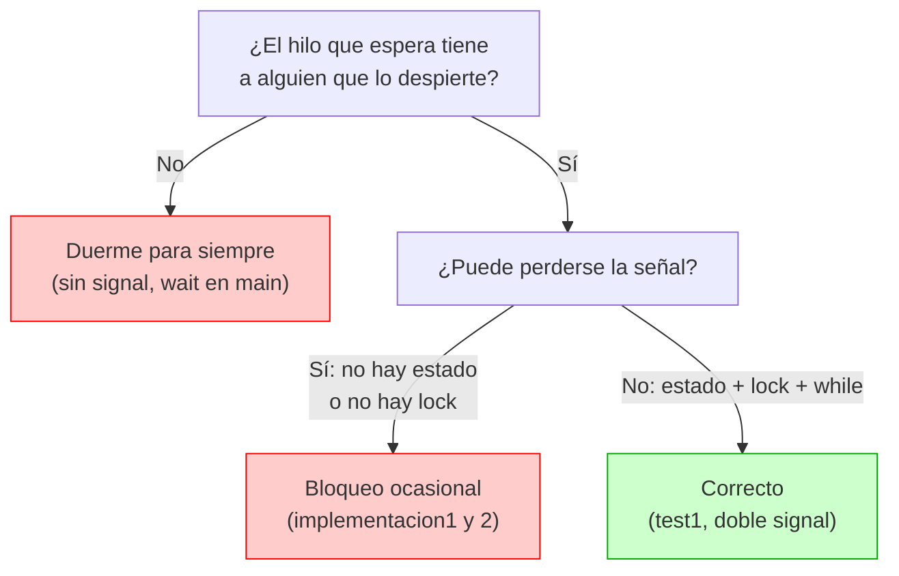

# Ensayos con `wait` y `signal`

Estos ensayos parten del *join* correcto ([`../ejemplo2.c`](../ejemplo2.c)) y cambian **una sola cosa** por vez, para comprobar en la práctica lo que dice la teoría sobre `pthread_cond_wait` y `pthread_cond_signal`. Antes de leer los resultados conviene intentar predecir qué hará cada variante.

Volver a la [guía del *join*](../README.md).

## Las variantes

Todas salen del mismo archivo, [`test1.c`](test1.c); cada variante se activa al compilar con una opción `-D`:

| Ejecutable | Opción | Qué cambia |
|---|---|---|
| `test1.out` | — | Nada: es el *join* correcto. |
| `test1-sin-signal.out` | `-DSIN_SIGNAL` | `thr_exit()` pone `done = 1`, pero no llama a `signal`. |
| `test1-doble-signal.out` | `-DDOBLE_SIGNAL` | `thr_exit()` llama dos veces a `signal`. |
| `test1-wait-en-main.out` | `-DWAIT_EN_MAIN` | `main()` llama a `wait` antes de crear al hijo, sin haber adquirido el lock. |

```c
void thr_exit(void) {
  Pthread_mutex_lock(&m);
  done = 1;
#ifndef SIN_SIGNAL
  Pthread_cond_signal(&c);
#endif
#ifdef DOBLE_SIGNAL
  Pthread_cond_signal(&c);
#endif
  Pthread_mutex_unlock(&m);
}
```

## Compilación y ejecución

```bash
make                                   # genera los cuatro ejecutables
./test1.out
timeout 2 ./test1-sin-signal.out       # timeout lo termina si se bloquea
./test1-doble-signal.out
timeout 2 ./test1-wait-en-main.out
```

Si `timeout` tuvo que terminar el programa, `echo $?` muestra `124`.

## Resultados

Salida de referencia de una ejecución de cada variante (`rc` es el código de salida):

```text
$ ./test1.out
parent: begin
child
parent: end

$ timeout 2 ./test1-sin-signal.out
parent: begin
child
rc=124

$ ./test1-doble-signal.out
parent: begin
child
parent: end

$ timeout 2 ./test1-wait-en-main.out
parent: begin
rc=124
```

Conteo en 200 ejecuciones de cada variante, con un límite de 1 s por ejecución:

| Variante | Terminó | Quedó bloqueada |
|---|---|---|
| `test1.out` | 200 | 0 |
| `test1-sin-signal.out` | 1 | 199 |
| `test1-doble-signal.out` | 200 | 0 |
| `test1-wait-en-main.out` | 0 | 200 |

## Interpretación

**Sin `signal`.** El padre se duerme en `wait` y nadie lo despierta: el hijo cambia `done`, pero cambiar una variable no despierta a nadie. La variable de condición solo despierta a un hilo cuando alguien llama a `signal`. La única ejecución que terminó fue una en la que el hijo corrió primero: el padre encontró `done == 1` y ni siquiera llegó a dormirse. Es el mismo caso 2 de la diapositiva p. 20, y muestra que la variable de estado sí protege cuando no hay espera.

**Doble `signal`.** No cambia nada. El primer `signal` despierta al padre (si estaba esperando) y el segundo no encuentra a nadie en la cola, así que no tiene efecto (p. 13–14). Como las señales no se acumulan, enviar una de más no causa daño, pero tampoco sirve para "guardar" un aviso para después.

**`wait` sin el lock.** El programa imprime `parent: begin` y se queda dormido para siempre. Tiene dos errores:

1. **Nadie va a llamar a `signal`**: el hijo todavía no existe, porque `Pthread_create` está después del `wait`. Un hilo que espera debe tener a otro hilo que lo vaya a despertar.
2. **`wait` se llamó sin tener el lock.** La semántica de `wait` supone que el lock está adquirido, porque lo primero que hace es liberarlo (OSTEP, *Tip: Always Hold The Lock While Signaling*). POSIX establece que llamar a `pthread_cond_wait` con un mutex que el hilo no tiene produce un **comportamiento indefinido**. En esta máquina la llamada no reportó ningún error (el `assert` de `Pthread_cond_wait` no se disparó) y el hilo simplemente se durmió, pero no hay que contar con eso: con un mutex de tipo `PTHREAD_MUTEX_ERRORCHECK`, por ejemplo, la llamada debe retornar el error `EPERM`.



> [!IMPORTANT]
> **Sobre esta guía.** El código y la guía se elaboraron con asistencia de un modelo de inteligencia artificial. Las salidas son de una ejecución de referencia del 19/11/2026 en la máquina descrita en el [entorno de ejecución](../../../../clase_14/ejemplos/entorno_ejecucion.md) de la clase 14. Si se encuentra alguna diferencia con lo visto en clase, prevalece lo explicado por el docente.
