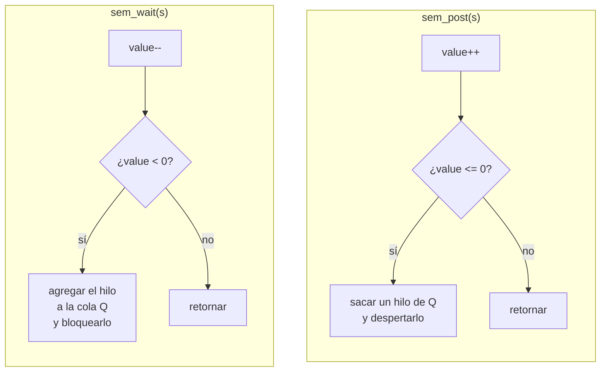
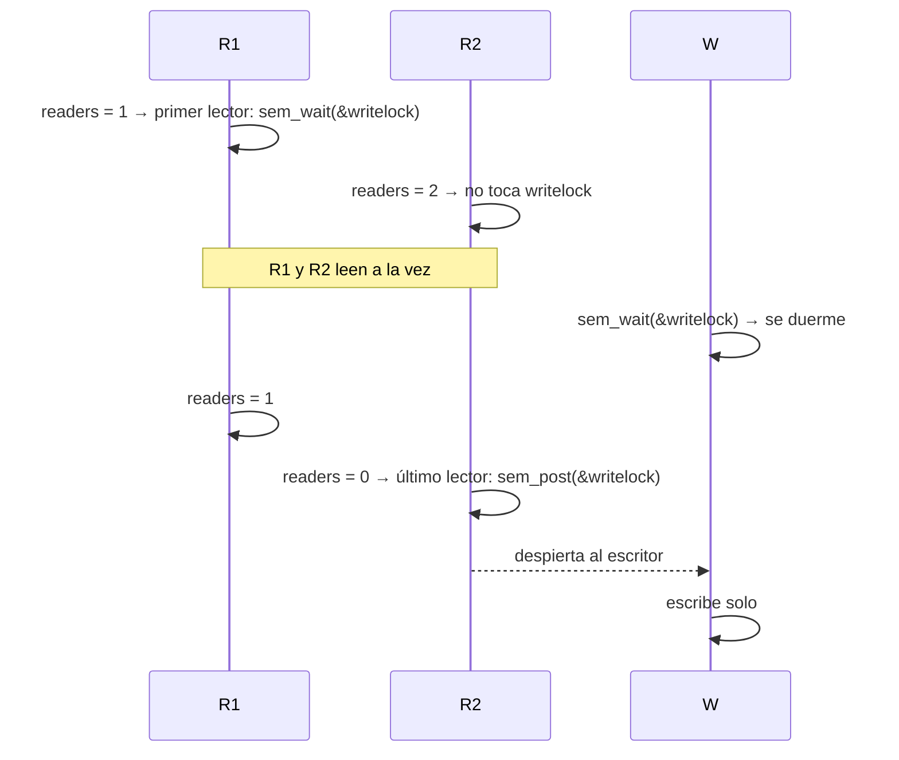
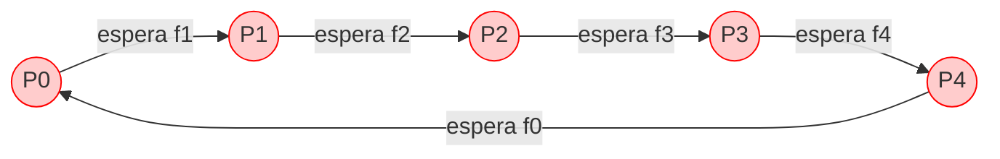

# Semáforos (OSTEP, cap. 31)

## Objetivos de Aprendizaje

* **Definir**: qué es un semáforo (un valor entero y una cola de hilos en espera) y qué hacen sus operaciones `sem_wait()` y `sem_post()`.
* **Explicar**: cómo el valor inicial determina el comportamiento del semáforo: 1 para la exclusión mutua, 0 para ordenar la ejecución y `N` para administrar `N` recursos.
* **Analizar**: con trazas de dos hilos, por qué un semáforo en 1 garantiza la exclusión mutua y por qué uno en 0 garantiza el orden, sin importar qué hilo corra primero.
* **Construir**: un lock y un *join* con semáforos, y un semáforo con un lock y una variable de condición (Zemáforo).
* **Resolver**: el problema del productor-consumidor con los semáforos `empty`, `full` y `mutex`, identificando la *race condition* y el *deadlock* de los intentos intermedios.
* **Evaluar**: el lock de lectores-escritores (y su riesgo de inanición) y el problema de los filósofos comensales (por qué se produce el *deadlock* y cómo se rompe la espera circular).

> Esta clase se dictó en tres sesiones: el **19/11/2026** (diapositivas de la parte 1, p. 1–20), el **24/11/2026** (parte 1, p. 20–26, y parte 2, p. 6–26) y el **26/11/2026** (parte 2, p. 27–49). La primera parte de la sesión del 19/11, el cierre del productor-consumidor con variables de condición, está en el [apunte de la clase 17](../../clase_17/apuntes_zoom/README.md#solución-final-buffer-circular). El código de esta clase está en [`clase_18/ejemplos/`](../ejemplos/README.md), con guías que explican cómo compilarlo y qué salidas esperar.

## Punto de partida: locks y variables de condición

La clase empezó repasando las primitivas de sincronización vistas en el módulo 3 (p. 2–5):

1. **El lock**: un objeto de memoria que proporciona **exclusión mutua**. Tiene dos estados, tomado (*locked*) y libre (*free*), y dos operaciones, `acquire()` y `release()`, que rodean la región crítica (ver el [apunte de la clase 15](../../clase_15/apuntes_zoom/README.md#locks)).
2. **La variable de condición**: un tipo de datos abstracto que es una cola de hilos dormidos. Un hilo se pone a dormir en ella con `wait` hasta que otro hilo, que no está dormido, lo despierta con `signal` (ver el [apunte de la clase 17](../../clase_17/apuntes_zoom/README.md#variables-de-condición)).
3. **El *join* con variables de condición**: para que el padre espere al hijo hicieron falta una variable de estado (`done`), un mutex y una variable de condición (ver el [apunte de la clase 17](../../clase_17/apuntes_zoom/README.md#el-join-con-variables-de-condición)).

La tercera primitiva, tema de esta clase, es el **semáforo**.

## Contextualización: una nueva primitiva

Con locks y variables de condición se pueden resolver los problemas de concurrencia vistos hasta ahora. El **semáforo** es una primitiva de sincronización introducida por Edsger Dijkstra y sus colaboradores a finales de los años sesenta (OSTEP cita su artículo de 1968 sobre el sistema operativo THE) como **una sola primitiva para todo lo relacionado con la sincronización**: con un semáforo se puede construir tanto un lock como una variable de condición (p. 6). En clase se presentó como "la estructura por excelencia" de la concurrencia.

> [!NOTE]
> La diapositiva p. 6 asocia el semáforo con *Go To Statement Considered Harmful* (1968). Ese es otro artículo de Dijkstra, famoso por iniciar la discusión sobre la programación estructurada; el semáforo aparece en *The Structure of the "THE" Multiprogramming System* (1968), que es el que cita OSTEP para esta primitiva.

La pregunta clave del capítulo (p. 6, OSTEP *The Crux: How To Use Semaphores*):

* ¿Cómo se pueden usar semáforos en lugar de locks y variables de condición?
* ¿Cuál es la definición de un semáforo?
* ¿Qué es un semáforo binario?
* ¿Es sencillo construir un semáforo usando locks y variables de condición?
* ¿Es posible construir locks y variables de condición a partir de semáforos?

## ¿Qué es un semáforo?

### Definición

Un **semáforo** es un objeto con un **valor entero** que solo puede manipularse con dos operaciones (p. 7):

| Operación (POSIX) | Otros nombres | Efecto sobre el valor |
|---|---|---|
| `sem_wait()` | `wait()`, `P()`, `down()` | −1 |
| `sem_post()` | `signal()`, `V()`, `up()` | +1 |

En la definición clásica (p. 7), `wait` espera mientras el valor no sea positivo y luego lo decrementa, y `signal` lo incrementa:

```c
wait(S) {
    while (S <= 0)
        ; // busy wait
    S--;
}

signal(S) {
    S++;
}
```

Las dos operaciones deben ejecutarse de forma **atómica**: si dos hilos ejecutaran `wait` a la vez sobre un semáforo con valor 1, los dos podrían ver `S = 1` y entrar. Esta definición describe **qué** hace un semáforo, no cómo se implementa: el `while` vacío es espera activa, y una implementación real duerme al hilo en lugar de hacerlo girar (ver más abajo).

> [!NOTE]
> **Complemento (OSTEP, cap. 31): los nombres `P` y `V`.** Dijkstra llamó a las operaciones `P()` y `V()`, por palabras en neerlandés. Según OSTEP, originalmente `P` venía de *passering* (pasar) y `V` de *vrijgave* (liberar); después Dijkstra escribió que `P` venía de *prolaag*, una contracción de *probeer* (intentar) y *verlaag* (disminuir), y `V` de *verhoog* (aumentar).

### Inicialización

Antes de usar un semáforo hay que declararlo e inicializarlo (p. 8, OSTEP Fig. 31.1):

```c
#include <semaphore.h>

sem_t s;
sem_init(&s, 0, 1);   // initialize s to the value 1
```

* El **tercer argumento** es el valor inicial (aquí, 1). Como se verá, el valor inicial **determina el comportamiento** del semáforo.
* El **segundo argumento** (`is_shared`) indica con quién se comparte: `0` significa que el semáforo se comparte entre los hilos de un mismo proceso, que es el caso de todos los ejemplos del curso. Un valor distinto de 0 sirve para sincronizar procesos distintos (ver `man sem_init`).

### `sem_wait()`

`sem_wait()` (también llamada *wait* o *test*) decrementa el valor del semáforo en 1 y, si el resultado es negativo, el hilo se suspende a la espera de un `sem_post()` (p. 9, OSTEP Fig. 31.2):

```c
int sem_wait(sem_t *s) {
    decrement the value of semaphore s by one
    wait if value of semaphore s is negative
}
```

Es decir, si al llamarla el valor es mayor o igual a 1, `sem_wait()` retorna de inmediato; en caso contrario, el hilo se bloquea. Varios hilos pueden quedar bloqueados a la vez en el mismo semáforo.

### `sem_post()`

`sem_post()` (también *post*, *signal* o *increment*) incrementa el valor del semáforo en 1 y, si hay hilos esperando, despierta a uno de ellos (p. 10). A diferencia de `sem_wait()`, nunca espera nada:

```c
int sem_post(sem_t *s) {
    increment the value of semaphore s by one
    if there are one or more threads waiting, wake one
}
```

### Implementación: un valor y una cola

Para no desperdiciar CPU en espera activa, un semáforo se implementa con **un valor y una cola** de hilos bloqueados (p. 11). En clase se representó el valor como un **contador** y la cola como la "cama" de las variables de condición:

```c
typedef struct {
    int value;
    struct process *Q;
} sem_t;

void sem_init(sem_t *s, int value) {
    s->value = value;
}

void sem_wait(sem_t *s) {      // Must be executed atomically
    s->value--;
    if (s->value < 0) {
        add this process to s->Q;
        block();
    }
}

void sem_post(sem_t *s) {      // Must be executed atomically
    s->value++;
    if (s->value <= 0) {
        remove a process P from s->Q;
        wakeup(P);
    }
}
```



En este modelo, **un valor negativo indica cuántos hilos están esperando** (p. 9): con el valor en −2 hay dos hilos en la cola. Por eso `sem_post()` despierta a un hilo cuando, después de incrementar, el valor sigue siendo menor o igual a 0.

> [!NOTE]
> **Complemento (OSTEP, cap. 31): dos modelos del valor.** La diapositiva p. 7 describe el semáforo como un objeto con un valor entero **no negativo**, y su definición clásica nunca deja el valor por debajo de 0; el modelo de las p. 9 y 11 sí lo deja negativo para contar los hilos que esperan. Los dos modelos dejan pasar y bloquean a los mismos hilos; solo cambia el número que se observa. La implementación de Linux sigue el primero: el valor nunca baja de 0, y `sem_getvalue()` devuelve 0 aunque haya hilos bloqueados (OSTEP §31.8). La [traza de `ordering_sem`](../ejemplos/parte1/diapositivas/ordering_sem/README.md#ejecución) lo muestra.

### Tipos de semáforos

| | Semáforo binario (≈ mutex) | Semáforo general (*counting semaphore*) |
|---|---|---|
| Valor inicial | 1 | `N` |
| Representa | Un recurso que solo un hilo puede usar a la vez | Un recurso con `N` unidades disponibles |
| Entrada | Un solo hilo a la vez | Hilos mientras haya unidades disponibles |
| Al hacer `post` | Si hay hilos esperando, despierta a uno | Si hay hilos esperando, despierta a uno |

En la sesión del 19/11 se trabajó el semáforo binario (p. 12). El semáforo general aparece más adelante, en el [productor-consumidor](#el-problema-del-productor-consumidor-p-825): el semáforo `empty` empieza en `MAX`, el número de espacios libres del buffer.

## Semáforos binarios: el semáforo como lock

### ¿Con qué valor se inicializa?

Un semáforo puede usarse como lock: la sección crítica va entre `sem_wait()` y `sem_post()` (p. 13, OSTEP Fig. 31.3):

```c
sem_t m;
sem_init(&m, 0, X);   // initialize semaphore to X; what should X be?
sem_wait(&m);
// critical section here
sem_post(&m);
```

El valor inicial `X` debe ser **1**. El primer hilo que llama a `sem_wait()` decrementa el valor a 0; como no es negativo, `sem_wait()` retorna y el hilo entra a la sección crítica. Si otro hilo llama a `sem_wait()` mientras tanto, decrementa el valor a −1 y se bloquea, hasta que el primero llame a `sem_post()`.

### Un hilo

Si solo un hilo usa el semáforo (p. 14, OSTEP Fig. 31.4), el valor baja a 0 al entrar a la sección crítica y vuelve a 1 al salir:

| Valor del semáforo | Hilo 0 |
|---|---|
| 1 | llama a `sem_wait()` |
| 0 | `sem_wait()` retorna |
| 0 | (sección crítica) |
| 0 | llama a `sem_post()` |
| 1 | `sem_post()` retorna |

### Dos hilos

El caso interesante es cuando el hilo 0 tiene el lock (llamó a `sem_wait()` pero todavía no a `sem_post()`) y el hilo 1 intenta entrar a la región crítica llamando a `sem_wait()` (p. 15–17, OSTEP Fig. 31.5). La traza muestra también el estado de cada hilo en el planificador: corriendo (*Running*), listo (*Ready*) o dormido (*Sleep*):

| Valor | Hilo 0 | Estado | Hilo 1 | Estado |
|---|---|---|---|---|
| 1 | | Running | | Ready |
| 1 | llama a `sem_wait()` | Running | | Ready |
| 0 | `sem_wait()` retorna | Running | | Ready |
| 0 | (inicia la sección crítica) | Running | | Ready |
| 0 | interrupción: pasa al hilo 1 | Ready | | Running |
| 0 | | Ready | llama a `sem_wait()` | Running |
| −1 | | Ready | decrementa el semáforo | Running |
| −1 | | Ready | valor negativo: se duerme | Sleep |
| −1 | pasa al hilo 0 | Running | | Sleep |
| −1 | (termina la sección crítica) | Running | | Sleep |
| −1 | llama a `sem_post()` | Running | | Sleep |
| 0 | incrementa el semáforo | Running | | Sleep |
| 0 | despierta al hilo 1 | Running | | Ready |
| 0 | `sem_post()` retorna | Running | | Ready |
| 0 | interrupción: pasa al hilo 1 | Ready | | Running |
| 0 | | Ready | `sem_wait()` retorna | Running |
| 0 | | Ready | (sección crítica) | Running |
| 0 | | Ready | llama a `sem_post()` | Running |
| 1 | | Ready | `sem_post()` retorna | Running |

En ningún momento los dos hilos estuvieron a la vez en la sección crítica: el hilo 1 se durmió al intentar entrar y solo pudo hacerlo después de que el hilo 0 llamó a `sem_post()`. Además, mientras esperó no gastó CPU, a diferencia de un spinlock. Como un lock solo tiene dos estados (tomado y libre), a un semáforo usado así se le llama **semáforo binario**.

**Cómo verlo** ([`binary.c`](../ejemplos/parte1/diapositivas/binary_sem/binary.c), [guía](../ejemplos/parte1/diapositivas/binary_sem/README.md)). Dos hilos incrementan un contador compartido 10 000 000 de veces cada uno, con la sección crítica entre `Sem_wait` y `Sem_post` (envolturas de `sem_wait`/`sem_post` que verifican errores); el `Makefile` genera también una variante sin el semáforo:

```c
void *child(void *arg) {
    int i;
    for (i = 0; i < 10000000; i++) {
        Sem_wait(&mutex);
        counter++;          // critical section
        Sem_post(&mutex);
    }
    return NULL;
}
```

```bash
make                         # desde clase_18/ejemplos/parte1/diapositivas/binary_sem/
./binary.out
./binary-sin-semaforo.out
```

Salida de una ejecución de referencia del 19/11/2026 (no de la sesión):

```text
$ ./binary.out
result: 20000000 (should be 20000000)

$ ./binary-sin-semaforo.out
result: 10998822 (should be 20000000)
```

Con el semáforo el resultado fue exacto en 20 de 20 ejecuciones; sin él, osciló entre 10 358 097 y 13 687 153, porque los dos hilos ejecutan `counter++` a la vez y se pierden incrementos (la condición de carrera de la clase 14).

## Lock implementado con un semáforo

La p. 18 plantea el ejercicio: con las operaciones del semáforo, completar la estructura `lock_t` y las funciones `init`, `acquire` y `release` de la interfaz de lock de la clase 15. La diapositiva describe el semáforo binario como uno con valor **booleano**: `bsem_wait()` espera hasta que el valor sea 1 y luego lo pone en 0, y `bsem_signal()` lo pone en 1 y despierta a uno de los hilos que esperan. Para la implementación usa esta versión de las operaciones, en la que el valor nunca baja de 0:

```c
void sem_init(sem_t *s, int initval) {
    s->value = initval;
}

void sem_wait(sem_t *s) {
    while (s->value <= 0)
        put_self_to_sleep();
    s->value--;
}

void sem_post(sem_t *s) {
    s->value++;
    wake_one_waiting_thread();
}
```

La solución (p. 19): un lock **es** un semáforo inicializado en 1, en el que `acquire` es `sem_wait` y `release` es `sem_post`.

```c
typedef struct __lock_t {
    sem_t value;
} lock_t;

void init(lock_t *lock) {
    sem_init(&lock->value, 0, 1);
}

void acquire(lock_t *lock) {
    sem_wait(&lock->value);
}

void release(lock_t *lock) {
    sem_post(&lock->value);
}
```

**Cómo verlo** ([`my_lock.c`](../ejemplos/parte1/sem_as_lock/my_lock.c), [`binary.c`](../ejemplos/parte1/sem_as_lock/binary.c), [guía](../ejemplos/parte1/sem_as_lock/README.md)). Es el mismo contador de la sección anterior, escrito con `acquire()` y `release()`:

```text
$ ./binary.out
result: 20000000 (should be 20000000)
```

## Código de test (p. 20)

La sesión terminó con el código de prueba del lock: `num` hilos, en los que cada uno toma el semáforo una vez, incrementa el contador un millón de veces y lo libera. Las respuestas a sus preguntas "*What goes here?*" quedaron anotadas en el manuscrito:

```c
sem_t lock;

void *worker(void *arg) {
    int i;
    sem_wait(&lock);            // What goes here?
    for (i = 0; i < 1e6; i++)
        counter++;
    sem_post(&lock);            // What goes here?
    return NULL;
}

int main(int argc, char *argv[]) {
    int num = atoi(argv[1]);
    pthread_t pid[PMAX];
    sem_init(&lock, 0, 1 /* What goes here? */);
    for (int i = 0; i < num; i++)
        Pthread_create(&pid[i], 0, worker, 0);
    for (int i = 0; i < num; i++)
        Pthread_join(pid[i], NULL);
    printf("counter: %d\n", counter);
    return 0;
}
```

> **Sesión del 24/11/2026.** La sesión empezó retomando este código (manuscrito, p. 20: "Inicio: 24/11/2026 · Trazar el código").

La observación que quedó anotada es que el candado es función del semáforo, y lo que lo convierte en candado es su **inicialización en 1**. El primer hilo que llega a `sem_wait(&lock)` deja el valor en 0 y entra; los demás se bloquean hasta el `sem_post(&lock)` del que está adentro. Como cada hilo toma el semáforo una sola vez, alrededor de todo su ciclo, los `num` hilos hacen sus incrementos uno detrás de otro y el resultado es exacto.

**Cómo verlo** ([`test_lock.c`](../ejemplos/parte1/sem_as_lock/test_lock.c), [guía](../ejemplos/parte1/sem_as_lock/README.md#prueba-2-test_lockc-el-código-de-test-p-20)). El programa recibe el número de hilos y, de forma opcional, el valor inicial del semáforo, para probar la pregunta de la p. 13:

```bash
./test_lock.out <num> [valor_inicial]
```

Ejecuciones de referencia del 19/11/2026 (no de la sesión):

| Ejecución | Resultado |
|---|---|
| `./test_lock.out 4` (valor inicial 1) | `counter: 4000000`, exacto en 20 de 20 ejecuciones |
| `timeout 2 ./test_lock.out 4 0` | No termina: ningún hilo pasa `sem_wait()` (código de salida 124 de `timeout`) |
| `./test_lock.out 4 2` | Entre 2 037 004 y 2 525 800 de 4 000 000 en 20 ejecuciones: dos hilos a la vez en la sección crítica |

Con valor inicial 0 nadie puede entrar, y con un valor mayor que 1 entran varios hilos a la vez: el semáforo deja de ser un lock y pasa a ser un semáforo general.

## Semáforos para ordenar la ejecución (p. 21–26)

Además de la exclusión mutua, los semáforos sirven para **ordenar eventos** en un programa concurrente: un hilo espera a que algo ocurra y otro hilo avisa cuando ocurrió (p. 21; OSTEP §31.3). Es el papel que en la clase 17 cumplieron las variables de condición, y por eso la diapositiva habla de "semáforos como variables de condición".

El ejemplo es el mismo *join* de la clase 17: el padre debe imprimir `parent: end` solo después de que el hijo imprima `child` (OSTEP, Fig. 31.6):

```c
sem_t s;

void *child(void *arg) {
    printf("child\n");
    sem_post(&s);               // signal here: child is done
    return NULL;
}

int main(int argc, char *argv[]) {
    sem_init(&s, 0, X);         // what should X be?
    printf("parent: begin\n");
    pthread_t c;
    pthread_create(&c, NULL, child, NULL);
    sem_wait(&s);               // wait here for child
    printf("parent: end\n");
    return 0;
}
```

> [!NOTE]
> El código de las diapositivas p. 21–22 y 24 tiene errores de transcripción: `pthread_tc;`, `pthread_create(c, NULL, child, NULL)` e `int main(intargc, ...)`. Arriba están corregidos: `pthread_t c;`, `pthread_create(&c, ...)` e `int argc`. Además, en la p. 26 el hijo de la versión con semáforo no tiene `return NULL`.

El padre llama a `sem_wait()` y el hijo a `sem_post()`. El valor inicial `X` debe ser **0** (respuesta anotada en la p. 21): al principio no hay nada que "entregar", y la unidad que deja pasar al padre la crea el `sem_post()` del hijo cuando termina. OSTEP lo resume así (*Tip: Setting The Value Of A Semaphore*): el valor inicial es la cantidad de recursos que se entregan de inmediato. Para el lock era 1 (el lock empieza libre); para ordenar es 0.

### Los dos órdenes posibles (p. 22–25)

Para comprobar que la solución funciona hay que revisar los dos órdenes en que pueden correr los hilos. Las trazas son las de OSTEP, en el modelo en el que un valor negativo cuenta los hilos que esperan.

**Caso 1: el padre llama a `sem_wait()` antes de que el hijo llame a `sem_post()`** (OSTEP, Fig. 31.7):

| Valor | Padre | Estado | Hijo | Estado |
|---|---|---|---|---|
| 0 | crea al hijo | Running | (existe, puede correr) | Ready |
| 0 | llama a `sem_wait()` | Running | | Ready |
| −1 | decrementa el semáforo | Running | | Ready |
| −1 | valor negativo: se duerme | Sleep | | Ready |
| −1 | pasa al hijo | Sleep | el hijo corre | Running |
| −1 | | Sleep | llama a `sem_post()` | Running |
| 0 | | Sleep | incrementa el semáforo | Running |
| 0 | | Ready | despierta al padre | Running |
| 0 | | Ready | `sem_post()` retorna | Running |
| 0 | | Ready | interrupción: pasa al padre | Ready |
| 0 | `sem_wait()` retorna | Running | | Ready |

**Caso 2: el hijo termina antes de que el padre llame a `sem_wait()`** (OSTEP, Fig. 31.8):

| Valor | Padre | Estado | Hijo | Estado |
|---|---|---|---|---|
| 0 | crea al hijo | Running | (existe, puede correr) | Ready |
| 0 | interrupción: pasa al hijo | Ready | el hijo corre | Running |
| 0 | | Ready | llama a `sem_post()` | Running |
| 1 | | Ready | incrementa el semáforo | Running |
| 1 | | Ready | nadie espera: no despierta a nadie | Running |
| 1 | | Ready | `sem_post()` retorna | Running |
| 1 | el padre corre | Running | interrupción: pasa al padre | Ready |
| 1 | llama a `sem_wait()` | Running | | Ready |
| 0 | decrementa el semáforo | Running | | Ready |
| 0 | valor no negativo: no se duerme | Running | | Ready |
| 0 | `sem_wait()` retorna | Running | | Ready |

En los dos casos la salida es la deseada (`parent: begin`, `child`, `parent: end`). En el caso 2 el `sem_post()` del hijo no despierta a nadie, pero **deja el valor en 1**, y por eso el padre no se duerme después: el semáforo recuerda el aviso.

> [!NOTE]
> En las diapositivas las tablas de traza quedaron **intercambiadas**, como se advirtió en clase ("Ojo: tabla trocada"): la de la p. 23, titulada "Caso 1", muestra al hijo haciendo `sem_post()` primero, que es el caso 2, y la de la p. 25, titulada "Caso 2", muestra al padre dormido con el valor en −1, que es el caso 1. Los títulos son los correctos; las tablas de arriba ya están en su caso. Lo mismo vale para las tablas hechas a mano en las p. 24 y 26.

**Cómo verlo** ([`sem_as_CV.c`](../ejemplos/parte1/diapositivas/ordering_sem/sem_as_CV.c), [guía](../ejemplos/parte1/diapositivas/ordering_sem/README.md#los-dos-órdenes-posibles-p-2225)). Sin argumentos es el código de las diapositivas; `[espera_hijo] [espera_padre]`, en segundos, fuerzan cada caso, y la variante con traza imprime el valor del semáforo en cada paso:

```bash
make && make traza           # desde clase_18/ejemplos/parte1/diapositivas/ordering_sem/
./sem_as_CV-traza.out 1 0    # caso 1: el padre espera primero
./sem_as_CV-traza.out 0 1    # caso 2: el hijo termina primero
```

Salida de una ejecución de referencia del 19/11/2026 (no de la sesión):

```text
$ ./sem_as_CV-traza.out 1 0
parent: begin
  [padre] despues de sem_init()        valor del semaforo = 0
  [padre] antes de sem_wait()          valor del semaforo = 0
child
  [hijo ] antes de sem_post()          valor del semaforo = 0
  [hijo ] despues de sem_post()        valor del semaforo = 1
  [padre] despues de sem_wait()        valor del semaforo = 0
parent: end
```

En el caso 1, mientras el padre duerme, la traza muestra 0 donde OSTEP muestra −1: en Linux el valor nunca baja de 0 (ver la nota sobre los [dos modelos del valor](#implementación-un-valor-y-una-cola)). El comportamiento es el mismo: el padre no avanza hasta el `sem_post()` del hijo.

### Semáforo frente a variable de condición (p. 26)

La p. 26 compara el mismo *join* con las dos primitivas:

| Con variable de condición (clase 17) | Con semáforo |
|---|---|
| Una variable de estado `done`, un mutex y una variable de condición | Un semáforo inicializado en 0 |
| El hijo toma el lock, pone `done = 1`, llama a `signal` y suelta el lock | El hijo llama a `sem_post()` |
| El padre toma el lock y espera en un `while (done == 0)` | El padre llama a `sem_wait()` |

La versión con semáforo es más simple porque el semáforo **guarda estado**: su valor recuerda un `sem_post()` aunque nadie estuviera esperando (caso 2), mientras que un `signal` sin hilos esperando se pierde, y por eso la variable de condición necesita la variable `done` (ver la [reimplementación 1 del *join*](../../clase_17/apuntes_zoom/README.md#reimplementación-1-sin-variable-de-estado) de la clase 17). Con un mismo objeto se resuelven la exclusión mutua (valor inicial 1) y el orden (valor inicial 0); por esa simplicidad y versatilidad, en clase los estudiantes dijeron preferir los semáforos a la combinación de mutex y variables de condición.

## El problema del productor-consumidor (p. 8–25)

> **Parte 2 de las diapositivas.** La sesión del 24/11 continuó con el deck de la parte 2: tras un repaso del lock y del *join* con semáforos (p. 6–7), la pregunta clave fue **cómo usar semáforos** en los problemas de concurrencia (p. 8). El primero es el productor-consumidor, que en la clase 17 se resolvió con un lock y variables de condición.

### El problema (p. 9–10)

El problema del productor-consumidor, también llamado problema del **buffer limitado** (*bounded buffer*), es el de la [clase 17](../../clase_17/apuntes_zoom/README.md#el-problema-del-productor-consumidor): uno o más productores ponen elementos en un buffer compartido y uno o más consumidores los sacan, a ritmos distintos y sin turnarse en un orden fijo. Las rutinas `put()` y `get()` manejan un buffer circular de `MAX` posiciones (p. 10, OSTEP Fig. 31.9):

```c
int buffer[MAX];
int fill = 0;
int use  = 0;

void put(int value) {
    buffer[fill] = value;       // Line F1
    fill = (fill + 1) % MAX;    // Line F2
}

int get() {
    int tmp = buffer[use];      // Line G1
    use = (use + 1) % MAX;      // Line G2
    return tmp;
}
```

En clase se propuso una analogía: el buffer es como un **pastillero**, con un número fijo de compartimientos; el productor llena compartimientos vacíos y el consumidor vacía compartimientos llenos.

### Implementación 1: dos semáforos (p. 11–12)

La solución usa dos semáforos que **cuentan** compartimientos (OSTEP, Fig. 31.10):

```c
sem_t empty;
sem_t full;

void *producer(void *arg) {
    int i;
    for (i = 0; i < loops; i++) {
        sem_wait(&empty);       // Line P1
        put(i);                 // Line P2
        sem_post(&full);        // Line P3
    }
}

void *consumer(void *arg) {
    int tmp = 0;
    while (tmp != -1) {
        sem_wait(&full);        // Line C1
        tmp = get();            // Line C2
        sem_post(&empty);       // Line C3
        printf("%d\n", tmp);
    }
}

int main(int argc, char *argv[]) {
    // ...
    sem_init(&empty, 0, MAX);   // MAX are empty
    sem_init(&full, 0, 0);      // 0 are full
    // ...
}
```

| Semáforo | Cuenta | Valor inicial | `sem_wait` | `sem_post` |
|---|---|---|---|---|
| `empty` | espacios vacíos | `MAX`: al inicio hay `MAX` lugares libres | el productor, antes de `put()` | el consumidor, después de `get()` |
| `full` | espacios llenos | 0: no hay nada en el buffer | el consumidor, antes de `get()` | el productor, después de `put()` |

El productor espera a que haya un espacio vacío y avisa que hay uno lleno; el consumidor hace lo simétrico. `empty` es un **semáforo general**: empieza en `MAX` y deja pasar a los productores mientras quede espacio. En el ejemplo del manuscrito (p. 14–15), con `MAX = 6` el buffer empieza con 6 espacios vacíos y 0 llenos; después de dos `put()`, `empty` vale 4 y `full` vale 2.

**Caso 1: un solo espacio (`MAX = 1`, p. 12).** Con un productor, un consumidor y `sem_init(&empty, 0, 1)`, los dos semáforos se pasan el turno: el productor pone un dato y se duerme en `empty` hasta que el consumidor lo saque, y el consumidor se duerme en `full` hasta que haya un dato. Funciona.

**Cómo verlo** ([`pc_single.c`](../ejemplos/parte2/producer_consumer/single_buffer/pc_single.c), [guía](../ejemplos/parte2/producer_consumer/single_buffer/README.md)). Es el código de las p. 11–12 con `MAX = 1`. Todos los programas del productor-consumidor imprimen lo que saca cada consumidor y, al final, una línea de verificación que cuenta valores perdidos y repetidos ([uso común](../ejemplos/parte2/README.md#uso-común-de-los-programas)). Salida de una ejecución de referencia del 23/11/2026 (no de la sesión):

```text
$ ./pc_single.out 3 1 1
C1 <- 0
C1 <- 1
C1 <- 2
C1 <- -1
Verificacion: producidos 3, consumidos 3, perdidos 0, repetidos 0, invalidos 0 -> CORRECTO
```

### Caso 2: buffer circular y *race condition* (p. 13–16)

Con `MAX > 1` y **varios productores**, aparece un problema: como `empty` vale `MAX`, varios productores pueden pasar `sem_wait(&empty)` a la vez y entrar juntos a `put()`. Pero `put()` lee y modifica `fill`: **llenar el buffer e incrementar el índice es una sección crítica** (p. 16). La traza de la p. 16 (OSTEP §31.4) con dos productores, `Pa` y `Pb`:

| Pa | Pb | `empty` | `full` | Comentario |
|---|---|---|---|---|
| | | `MAX` | 0 | valores iniciales; `fill = 0` |
| P1 | | `MAX` − 1 | 0 | `Pa`: `sem_wait(&empty)` |
| P2 | | `MAX` − 1 | 0 | `Pa` llama a `put()` |
| F1 | | `MAX` − 1 | 0 | `Pa` escribe en la posición 0 |
| | | `MAX` − 1 | 0 | interrupción: pasa a `Pb` |
| | P1 | `MAX` − 2 | 0 | `Pb`: `sem_wait(&empty)` |
| | P2 | `MAX` − 2 | 0 | `Pb` llama a `put()`; `fill` sigue en 0 |
| | F1 | `MAX` − 2 | 0 | `Pb` escribe en la posición 0: **sobrescribe** el dato de `Pa` |
| | F2 | `MAX` − 2 | 0 | `fill = 1` |

Cuando `Pa` continúe, ejecutará F2 y dejará `fill` en 2: la posición 1 nunca se escribió y el dato de `Pa` se perdió. Es una ***race condition***: el resultado depende de cuándo el planificador interrumpe a cada productor.

**Cómo verlo** ([`pc_attemp1.c`](../ejemplos/parte2/producer_consumer/circular_buffer/pc_attemp1/pc_attemp1.c), [guía](../ejemplos/parte2/producer_consumer/circular_buffer/pc_attemp1/README.md#resultados)). Un quinto argumento opcional hace que `put()` espere entre F1 y F2, como en la traza. Salida de una ejecución de referencia del 23/11/2026, con dos productores, un consumidor y una pausa de 1 ms:

```text
$ ./pc_attemp1.out 10 5 2 1 1000
C1 <- 0
C1 <- 1
C1 <- 1
C1 <- 0
C1 <- 2
C1 <- 0
C1 <- 3
C1 <- 0
C1 <- 4
C1 <- 0
C1 <- -1
Verificacion: producidos 10, consumidos 10, perdidos 3, repetidos 3, invalidos 0 -> INCORRECTO
```

Los `0` intercalados son las posiciones que ningún productor escribió. Sin la pausa, con 10 000 valores por productor, el programa falló en las 100 ejecuciones de referencia: en 17 perdió datos y en 83 quedó bloqueado, porque el índice del consumidor queda adelante de `fill` y la marca de fin nunca le llega.

### Primer intento de solución: agregar un mutex (p. 17–20)

La solución es agregar **exclusión mutua** para proteger la sección crítica, con un tercer semáforo, `mutex`, inicializado en 1 (p. 17): la inicialización de `empty` y `full` no cambia. El primer intento lo pone alrededor de **todo** el cuerpo del ciclo (p. 18, OSTEP Fig. 31.11):

```c
void *producer(void *arg) {
    int i;
    for (i = 0; i < loops; i++) {
        sem_wait(&mutex);       // Line P0 (NEW LINE)
        sem_wait(&empty);       // Line P1
        put(i);                 // Line P2
        sem_post(&full);        // Line P3
        sem_post(&mutex);       // Line P4 (NEW LINE)
    }
}

void *consumer(void *arg) {
    int tmp = 0;
    while (tmp != -1) {
        sem_wait(&mutex);       // Line C0 (NEW LINE)
        sem_wait(&full);        // Line C1
        tmp = get();            // Line C2
        sem_post(&empty);       // Line C3
        sem_post(&mutex);       // Line C4 (NEW LINE)
        printf("%d\n", tmp);
    }
}
```

La *race condition* desaparece, pero aparece un ***deadlock*** (p. 19–20). Con un productor y un consumidor, si el consumidor corre primero:

1. El consumidor adquiere el mutex (`C0`).
2. Llama a `sem_wait(&full)` (`C1`). No hay datos, así que se bloquea y libera la CPU, pero **sigue teniendo el mutex**.
3. El productor llama a `sem_wait(&mutex)` (`P0`) y también se bloquea.

| P | C | `empty` | `full` | `mutex` | Comentario |
|---|---|---|---|---|---|
| | | `MAX` | 0 | 1 | inicialización |
| | C0 | `MAX` | 0 | 0 | C adquiere el mutex |
| | C1 | `MAX` | −1 | 0 | C se bloquea en `sem_wait(&full)` |
| | | `MAX` | −1 | 0 | interrupción: pasa a P |
| P0 | | `MAX` | −1 | −1 | P se bloquea en `sem_wait(&mutex)` |


Es un ciclo simple: el consumidor **tiene** el mutex y **espera** `full`; el productor podría hacer `sem_post(&full)`, pero **espera** el mutex. Ninguno avanza.

> [!NOTE]
> La tabla de la p. 20 de las diapositivas trae un error: en la fila `C1` dice que el consumidor se bloquea en `wait(empty)`, cuando el código muestra `sem_wait(&full)`, y los valores de `empty` y `full` no corresponden a ese paso. La tabla de arriba está corregida: el consumidor no toca `empty`, que se queda en `MAX`, y `full` queda en −1 (en el modelo de OSTEP) mientras el consumidor espera.

**Cómo verlo** ([`pc_attemp2.c`](../ejemplos/parte2/producer_consumer/circular_buffer/pc_attemp2/pc_attemp2.c), [guía](../ejemplos/parte2/producer_consumer/circular_buffer/pc_attemp2/README.md#el-deadlock-de-las-diapositivas-p-1920)). El programa se bloquea, así que se ejecuta con `timeout`. La variante con traza imprime en qué línea está cada hilo, y un último argumento opcional hace que el productor espere para que el consumidor corra primero. Salida de una ejecución de referencia del 23/11/2026:

```text
$ timeout 1 ./pc_attemp2-traza.out 10 1000 1 1 100
C1 C0: sem_wait(&mutex)
C1 C1: tiene el mutex; sem_wait(&full)
P1 P0: sem_wait(&mutex)
```

Sin esa espera, el *deadlock* más frecuente en las ejecuciones de referencia fue el simétrico: el productor llena el buffer y se duerme en `sem_wait(&empty)` con el mutex tomado, mientras el consumidor espera el mutex. Es el mismo error visto desde el otro lado: **un hilo se duerme en un semáforo mientras sostiene el mutex que el otro necesita para despertarlo**.

### La solución: reducir el ámbito del lock (p. 21–25)

La solución es **reducir el ámbito del lock**: el mutex envuelve solo `put()` y `get()`, que es la sección crítica, y los `sem_wait`/`sem_post` sobre `empty` y `full` quedan por fuera (p. 22–23; OSTEP Fig. 31.12). La implementación definitiva (p. 25):

```c
sem_t empty;
sem_t full;
sem_t mutex;

void *producer(void *arg) {
    int i;
    for (i = 0; i < loops; i++) {
        sem_wait(&empty);       // Line P1
        sem_wait(&mutex);       // Line P2
        put(i);                 // Line P3
        sem_post(&mutex);       // Line P4
        sem_post(&full);        // Line P5
    }
}

void *consumer(void *arg) {
    int tmp = 0;
    while (tmp != -1) {
        sem_wait(&full);        // Line C1
        sem_wait(&mutex);       // Line C2
        tmp = get();            // Line C3
        sem_post(&mutex);       // Line C4
        sem_post(&empty);       // Line C5
        printf("%d\n", tmp);
    }
}

int main(int argc, char *argv[]) {
    // ...
    sem_init(&empty, 0, MAX);   // MAX are empty
    sem_init(&full, 0, 0);      // 0 are full
    sem_init(&mutex, 0, 1);     // mutex = 1
    // ...
}
```

Ahora un hilo solo toma el mutex **después** de pasar su `sem_wait` sobre `empty` o `full`, es decir, cuando ya sabe que puede avanzar, y lo suelta enseguida. La traza de la p. 24 repite el escenario que antes se bloqueaba, con el consumidor corriendo primero:

| P | C | `empty` | `full` | `mutex` | Comentario |
|---|---|---|---|---|---|
| | | `MAX` | 0 | 1 | inicialización |
| | C1 | `MAX` | −1 | 1 | C se bloquea en `sem_wait(&full)`, **sin** el mutex |
| | | `MAX` | −1 | 1 | interrupción: pasa a P |
| P1 | | `MAX` − 1 | −1 | 1 | P: `sem_wait(&empty)` |
| P2 | | `MAX` − 1 | −1 | 0 | P adquiere el mutex |
| P3 | | `MAX` − 1 | −1 | 0 | P entra a la región crítica (`put`) |
| P4 | | `MAX` − 1 | −1 | 1 | P libera el mutex |
| P5 | | `MAX` − 1 | 0 | 1 | P: `sem_post(&full)` despierta a C |
| | | `MAX` − 1 | 0 | 1 | interrupción: pasa a C |
| | C2 | `MAX` − 1 | 0 | 0 | C adquiere el mutex |
| | C3 | `MAX` − 1 | 0 | 0 | C entra a la región crítica (`get`) |
| | C4 | `MAX` − 1 | 0 | 1 | C libera el mutex |
| | C5 | `MAX` | 0 | 1 | C: `sem_post(&empty)` |

> [!NOTE]
> En las diapositivas, la p. 22 etiqueta dos líneas distintas como `P4` (el `sem_post(&mutex)` y el `sem_post(&full)`); la segunda es `P5`, como en la p. 25. La tabla de la p. 24 dice "P4 → post(full)" y "**P** libera el mutex: C4"; corresponden a `P5` y a "C libera el mutex". OSTEP conserva los números de las versiones anteriores y llama `P1.5`, `P2.5`, `C1.5` y `C2.5` a las líneas del mutex.

**Cómo verlo** ([`pc_work.c`](../ejemplos/parte2/producer_consumer/circular_buffer/pc_work/pc_work.c), [guía](../ejemplos/parte2/producer_consumer/circular_buffer/pc_work/README.md)). En la sesión se ejecutó esta versión con varios productores y consumidores, y terminó correctamente. Salida de una ejecución de referencia del 23/11/2026 (no de la sesión):

```text
$ ./pc_work.out 10 1000 1 1 | tail -3
C1 <- 999
C1 <- -1
Verificacion: producidos 1000, consumidos 1000, perdidos 0, repetidos 0, invalidos 0 -> CORRECTO
```

Fue correcta en las 300 ejecuciones de referencia de tres escenarios (incluidos 4 productores y 4 consumidores). Con un buffer de 10 posiciones, pasar 100 000 valores tomó 0.601 s, frente a 3.394 s con un buffer de una sola posición ([guía](../ejemplos/parte2/producer_consumer/circular_buffer/pc_work/README.md#cuánto-ayuda-un-buffer-más-grande)): con más espacio, los hilos se duermen menos veces.

> [!NOTE]
> **Complemento (OSTEP, cap. 31): la marca de fin.** El consumidor sale de su ciclo cuando recibe un `-1` (`while (tmp != -1)`), igual que en la clase 17, pero las diapositivas no muestran quién lo pone. En el código de OSTEP lo pone el productor al terminar, un `-1` por consumidor; eso solo funciona con un productor, porque con dos los consumidores pueden salir antes de que el otro productor termine. En los programas de `ejemplos/` lo pone `main` cuando ya terminaron todos los productores ([uso común](../ejemplos/parte2/README.md#uso-común-de-los-programas)).

## El problema de los lectores-escritores (p. 26–34)

> **Corte de sesión.** El problema y sus restricciones (p. 26–27) se presentaron al final de la sesión del 24/11; el manuscrito marca en la p. 27 "Fin: 24/11/2026 · Inicio: 26/11/2026", y el análisis de la estructura y de su código se hizo el 26/11.

### El problema (p. 26–27)

Varios hilos hacen operaciones concurrentes sobre un conjunto de datos compartidos, y esas operaciones son solo **lecturas** o **escrituras**, como en una base de datos (OSTEP §31.5). Las restricciones son:

| Operación | Qué hace | Restricción |
|---|---|---|
| Escritura | Cambia los datos (accede a la región crítica) | Solo **un** escritor puede acceder a los datos a la vez |
| Lectura | Solo lee los datos | **Varios** lectores pueden leer a la vez, siempre que no haya una escritura en curso |

Un lock común sería demasiado restrictivo: las lecturas no se estorban entre sí, y aun así las obligaría a turnarse.

### El lock de lectores-escritores (p. 28–31)

La estructura `rwlock_t` es un tipo especial de lock para operaciones de lectura y escritura, implementado con dos semáforos binarios y un contador (OSTEP, Fig. 31.13):

```c
typedef struct _rwlock_t {
    sem_t lock;        // binary semaphore (basic lock)
    sem_t writelock;   // used to allow ONE writer or MANY readers
    int   readers;     // count of readers reading in critical section
} rwlock_t;

void rwlock_init(rwlock_t *rw) {
    rw->readers = 0;
    sem_init(&rw->lock, 0, 1);
    sem_init(&rw->writelock, 0, 1);
}

void rwlock_acquire_writelock(rwlock_t *rw) {
    sem_wait(&rw->writelock);
}

void rwlock_release_writelock(rwlock_t *rw) {
    sem_post(&rw->writelock);
}

void rwlock_acquire_readlock(rwlock_t *rw) {
    sem_wait(&rw->lock);
    rw->readers++;
    if (rw->readers == 1)       // first reader gets writelock
        sem_wait(&rw->writelock);
    sem_post(&rw->lock);
}

void rwlock_release_readlock(rwlock_t *rw) {
    sem_wait(&rw->lock);
    rw->readers--;
    if (rw->readers == 0)       // last reader lets it go
        sem_post(&rw->writelock);
    sem_post(&rw->lock);
}
```

| Campo | Papel |
|---|---|
| `readers` | Número de lectores que están leyendo en ese momento |
| `writelock` | Garantiza "un escritor **o** muchos lectores": lo toma el escritor para escribir, o el **primer** lector en nombre de todos |
| `lock` | Lock básico que protege el contador `readers`, para que dos lectores no lo modifiquen a la vez |

> [!NOTE]
> `lock` **no** es un "lock de lectura", aunque así se lo llame a veces: solo protege el contador. Lo que deja fuera a los escritores es que el primer lector toma `writelock` y el último lo libera.

**Escritura** (p. 29, 32). El escritor hace `sem_wait(&writelock)`: si nadie lo tiene, lo deja en 0 y entra; mientras escribe, ningún otro escritor ni ningún lector puede entrar. Al terminar hace `sem_post(&writelock)`.

**Lectura** (p. 30, 33). Cada lector toma `lock`, incrementa `readers` y suelta `lock`. Solo el **primer** lector (`readers == 1`) hace además `sem_wait(&writelock)`, lo que "abre" el recurso para los lectores y lo cierra para los escritores. Los lectores siguientes entran sin tocar `writelock`. Al salir, cada lector decrementa `readers`, y el **último** (`readers == 0`) hace `sem_post(&writelock)`, con lo que un escritor que esperaba puede entrar.



### El problema de la equidad: inanición (p. 34)

Mientras haya un lector adentro, `writelock` sigue tomado. Si llegan lectores sin parar y `readers` nunca vuelve a 0, el escritor puede esperar indefinidamente: es **inanición** (*starvation*). Hay soluciones más sofisticadas, por ejemplo impedir que entren nuevos lectores cuando hay un escritor esperando, pero quedan fuera del alcance del curso. OSTEP añade una advertencia (*Tip: Simple And Dumb Can Be Better*, la "ley de Hill"): un lock de lectores-escritores agrega trabajo y no siempre es más rápido que un lock simple.

**Cómo verlo** ([`rwlock.c`](../ejemplos/parte3/reader_writer_locks/rwlock.c), [guía](../ejemplos/parte3/reader_writer_locks/README.md)). Cada lector lee un contador compartido y cada escritor lo incrementa; el programa mide cuántos lectores estuvieron dentro a la vez y si algún escritor estuvo acompañado. Salida de una ejecución de referencia del 23/11/2026 (no de la sesión), con 4 lectores y 2 escritores:

```text
$ ./rwlock.out 100000 100000 4 2
W2: escritura terminada en t = 0.126 s
W1: escritura terminada en t = 0.130 s
R2: lectura terminada en t = 0.248 s, ultimo valor leido 200000
R1: lectura terminada en t = 0.252 s, ultimo valor leido 200000
R4: lectura terminada en t = 0.255 s, ultimo valor leido 200000
R3: lectura terminada en t = 0.256 s, ultimo valor leido 200000
contador final: 200000 (esperado 200000)
lectores simultaneos (maximo): 4
violaciones de la exclusion: 0
```

Cuatro lectores estuvieron dentro a la vez y ningún escritor estuvo acompañado. La inanición solo apareció con lecturas largas (variante `rwlock-lectura-larga.out`): el escritor no pudo terminar sus escrituras hasta que se fue el último lector ([guía](../ejemplos/parte3/reader_writer_locks/README.md#el-problema-de-la-equidad-inanición-p-34)).

## El problema de los filósofos comensales (p. 35–46)

### El problema (p. 35–39)

El problema de los filósofos comensales (*dining philosophers*) lo formuló Dijkstra en 1965 para representar el problema de sincronización de procesos en un sistema operativo (OSTEP §31.6). Cinco filósofos están sentados alrededor de una mesa redonda y entre cada par hay un palillo (cinco en total). Cada filósofo pasa su vida pensando, sin necesitar palillos, o comiendo, y para comer necesita **los dos** palillos que tiene a los lados; por eso compiten por ellos. Cada filósofo es un hilo que ejecuta este ciclo:

```c
while (1) {
    think();
    get_forks(p);
    eat();
    put_forks(p);
}
```

Los objetivos de una solución son tres (p. 37):

1. Que no haya **interbloqueos** (*deadlocks*).
2. Que ningún filósofo se quede sin comer (**inanición**, *starvation*).
3. **Máxima concurrencia**: que coman a la vez todos los que puedan (con cinco palillos, hasta dos filósofos).

Para referirse a los palillos se usan dos funciones auxiliares (p. 36, 38; las "soluciones de Downey"): el filósofo `p` tiene a su izquierda el palillo `p` y a su derecha el `(p + 1) % 5`. El módulo hace que el filósofo 4 tome a su derecha el palillo 0. Cada palillo es un semáforo inicializado en 1 (p. 39, 41):

```c
int left(int p)  { return p; }
int right(int p) { return (p + 1) % 5; }

sem_t forks[5];                        // uno por palillo
for (int i = 0; i < 5; i++)
    sem_init(&forks[i], 0, 1);         // initialized to 1
```

### La solución simple: *deadlock* (p. 40–44)

```c
void get_forks(int p) {
    sem_wait(&forks[left(p)]);
    sem_wait(&forks[right(p)]);
}

void put_forks(int p) {
    sem_post(&forks[left(p)]);
    sem_post(&forks[right(p)]);
}
```

Muchas veces funciona: la p. 42 muestra a los filósofos 1 y 3 comiendo a la vez, cada uno con sus dos palillos. Pero si **todos tienen hambre** al mismo tiempo y cada uno toma el palillo de su izquierda antes de que otro tome el de su derecha (p. 43–44), cada filósofo queda bloqueado para siempre sosteniendo un palillo y esperando a que el vecino suelte el otro:



Cada flecha va de un filósofo al vecino que tiene el palillo que necesita: es una **espera circular**, y ninguno puede avanzar.

### La solución: cambiar el orden de un filósofo (p. 45–46)

Dijkstra lo resolvió haciendo que **un** filósofo, el último (4), tome los palillos en el orden contrario (OSTEP, Fig. 31.16):

```c
void get_forks(int p) {
    if (p == 4) {
        sem_wait(&forks[right(p)]);
        sem_wait(&forks[left(p)]);
    } else {
        sem_wait(&forks[left(p)]);
        sem_wait(&forks[right(p)]);
    }
}
```

El filósofo 4 intenta primero el palillo 0, el mismo que el filósofo 0 toma primero. Uno de los dos lo obtiene y el otro espera **sin sostener ningún palillo**, así que el ciclo de la figura ya no se puede cerrar: no se da la situación en la que cada filósofo tiene un palillo y espera otro. Hay otras soluciones, y otros problemas clásicos de sincronización, como el de los fumadores y el del barbero dormilón (p. 46).

**Cómo verlo** ([`dining_philosophers_deadlock.c`](../ejemplos/parte3/dining_philosophers/dining_philosophers_deadlock.c), [`dining_philosophers_no_deadlock.c`](../ejemplos/parte3/dining_philosophers/dining_philosophers_no_deadlock.c), [guía](../ejemplos/parte3/dining_philosophers/README.md)). En la sesión del 26/11 se ejecutaron las dos versiones: con 1000 comidas por filósofo, la solución simple quedó bloqueada, y la que cambia el orden del filósofo 4 terminó. En las ejecuciones de referencia del 23/11/2026, la versión simple quedó en *deadlock* en 48 de 50 ejecuciones con 10 000 comidas y en ninguna con 10; la otra terminó en 50 de 50. La variante `_print` muestra el ciclo: las últimas líneas de una ejecución bloqueada (cada filósofo escribe en su columna):

```text
                    2: try 2
                              3: try 3
0: try 1
          1: try 2
                                        4: try 4
                    2: try 3
                              3: try 4
                                        4: try 0
```

Cada filósofo terminó intentando su palillo derecho: el 0 espera el 1, el 1 el 2, …, y el 4 el 0.

## Implementación de Zemáforos (p. 47–48)

Para cerrar, la p. 47 hace el camino inverso: construir un semáforo con un lock y una variable de condición (OSTEP §31.8). OSTEP lo llama *Zemaphore* ("Zemáforo"), y su código sigue la receta de la clase 17: un estado (`value`), un lock que lo protege y una variable de condición para dormir mientras no se cumpla la condición (OSTEP, Fig. 31.17):

```c
typedef struct __Zem_t {
    int value;
    pthread_cond_t cond;
    pthread_mutex_t lock;
} Zem_t;

// only one thread can call this
void Zem_init(Zem_t *s, int value) {
    s->value = value;
    Cond_init(&s->cond);
    Mutex_init(&s->lock);
}

void Zem_wait(Zem_t *s) {
    Mutex_lock(&s->lock);
    while (s->value <= 0)
        Cond_wait(&s->cond, &s->lock);
    s->value--;
    Mutex_unlock(&s->lock);
}

void Zem_post(Zem_t *s) {
    Mutex_lock(&s->lock);
    s->value++;
    Cond_signal(&s->cond);
    Mutex_unlock(&s->lock);
}
```

| | Semáforo de Dijkstra (p. 47) | Zemáforo (p. 47) |
|---|---|---|
| `wait` | Decrementa; si el valor queda negativo, espera | Espera mientras el valor sea `<= 0`; luego decrementa |
| `post` | Incrementa; si el valor es `<= 0`, despierta a un hilo | Incrementa y despierta a un hilo |
| Valor con `N` hilos esperando | −`N` | 0 |

Como dice la p. 48, en esta implementación **el valor no representa el número de hilos bloqueados**, porque nunca baja de 0. Es fácil de implementar y es el comportamiento de los semáforos de Linux.

**Cómo verlo** ([`zemaphore.h`](../ejemplos/parte3/zemaforos/zemaphore.h), [`zem_test.c`](../ejemplos/parte3/zemaforos/zem_test.c), [guía](../ejemplos/parte3/zemaforos/README.md)). La prueba usa el Zemáforo para el *join*, como lock y con varios hilos esperando. Salida de una ejecución de referencia del 23/11/2026 (no de la sesión):

```text
$ ./zem_test.out 4 1000000
1. join
  parent: begin
  child
  parent: end
2. lock
  counter: 4000000 (esperado 4000000)
3. espera de 4 hilos
  valor con 4 hilos esperando: 0
  valor despues de 4 posts: 0
```

> [!NOTE]
> **Complemento (OSTEP, cap. 31): el camino inverso es difícil.** Construir un semáforo con un lock y una variable de condición es sencillo; lo contrario, construir variables de condición con semáforos, es mucho más difícil, y OSTEP cuenta que programadores con experiencia lo intentaron en Windows y aparecieron muchos errores. Por eso advierte (*Tip: Be Careful With Generalization*) que ver el semáforo como una generalización de los locks y las variables de condición no es tan general como parece.

## Resumen y Conclusión

Con esta clase se cerró la parte teórica del módulo 3, de concurrencia. Las tres primitivas de sincronización del módulo (manuscrito, p. 49):

| Primitiva | Para qué | Operaciones | Clase |
|---|---|---|---|
| Lock (mutex) | Exclusión mutua en la región crítica | `lock()` / `unlock()` | 15 y 16 |
| Variable de condición | Esperar a que se cumpla una condición (orden) | `wait()` / `signal()` | 17 |
| Semáforo | Las dos cosas, según su valor inicial | `sem_wait()` / `sem_post()` | 18 |

El semáforo tiene un estado, y la forma de usarlo depende de su **valor inicial** (p. 49):

| Valor inicial | Uso | Ejemplo de la clase |
|---|---|---|
| 1 | Exclusión mutua (semáforo binario, como un mutex) | El lock con semáforo; `mutex` en el productor-consumidor; cada palillo de los filósofos; `lock` y `writelock` del lock de lectores-escritores |
| 0 | Orden entre hilos (como el *join*) | El padre espera al hijo; `full` en el productor-consumidor |
| `N` | Administrar `N` recursos disponibles (semáforo general) | `empty` (en `MAX`) en el productor-consumidor |

Las operaciones son `sem_wait()`, que decrementa el valor y, si queda negativo, pone a esperar al hilo (modelo de OSTEP; en Linux espera a que el valor sea positivo y luego decrementa), y `sem_post()`, que incrementa el valor y despierta a uno de los hilos que esperan. Las dos son atómicas.

Los problemas clásicos de sincronización analizados:

| Problema | Semáforos | Error de la versión ingenua | Solución |
|---|---|---|---|
| Buffer limitado (productor-consumidor) | `empty` (`MAX`), `full` (0) y `mutex` (1) | *Race condition* sin mutex; *deadlock* con el mutex alrededor de todo | Mutex solo alrededor de `put()`/`get()` |
| Lectores-escritores | `lock` (1) y `writelock` (1), más el contador `readers` | — | El primer lector toma `writelock` y el último lo libera; riesgo de inanición del escritor |
| Filósofos comensales | `forks[5]`, cada uno en 1 | *Deadlock* por espera circular | Un filósofo toma los palillos en el orden contrario |

La p. 49 dice que los semáforos son "equivalentes" a locks y variables de condición. Es cierto que con un semáforo se obtiene un lock (valor 1) y una forma de ordenar hilos (valor 0), como se vio en esta clase; pero OSTEP es más cauto, porque construir una variable de condición completa con semáforos es difícil (ver el complemento de la sección anterior).

## Para revisar de forma autónoma

En clase se indicó que el video **"Clase 16: Problemas de concurrencia"** del Prof. Danny Múnera, en el canal del curso (lista de reproducción de semáforos y problemas de concurrencia), cubre la parte de concurrencia que no se explicó en clase y debe verse de forma autónoma.

Del capítulo 31 de OSTEP quedan dos temas que no se dictaron:

* **La traza del caso 1 del productor-consumidor** (`MAX = 1`, p. 12). OSTEP analiza los dos órdenes en que pueden empezar el productor y el consumidor; están en la [guía de `pc_single`](../ejemplos/parte2/producer_consumer/single_buffer/README.md#los-dos-órdenes-posibles).
* ***Thread throttling* (§31.7)**, otro uso del semáforo general.

> [!NOTE]
> **Complemento (OSTEP, cap. 31): *thread throttling*.** Si un programa crea cientos de hilos y todos entran a la vez a una región que reserva mucha memoria, la suma de las reservas puede superar la memoria física y el sistema empieza a hacer *thrashing* (clase 13). La solución es un semáforo inicializado en el número máximo de hilos que pueden estar a la vez en esa región: cada hilo hace `sem_wait()` antes de entrar y `sem_post()` al salir, y así nunca hay más de `N` adentro. OSTEP llama a esto *throttling* y lo considera una forma de **control de admisión**. Es el mismo semáforo general de `empty`, usado para limitar en lugar de contar espacios.

## Para probar por cuenta propia

1. **Escribir el lector-escritor en código** (sugerencia anotada en la p. 27). Antes de leer la p. 28, escribir en pseudocódigo un lock que cumpla las restricciones de la p. 27 y compararlo con `rwlock_t`.
2. **Ver la inanición del escritor.** Ejecutar `rwlock.out` y `rwlock-lectura-larga.out` con 4 lectores y un escritor que llega tarde, y comparar en qué momento termina el escritor ([guía](../ejemplos/parte3/reader_writer_locks/README.md#el-problema-de-la-equidad-inanición-p-34)).
3. **Provocar los dos *deadlocks* del productor-consumidor.** Ejecutar `pc_attemp2-traza.out` con y sin la espera del productor e identificar en la traza quién tiene el mutex ([guía](../ejemplos/parte2/producer_consumer/circular_buffer/pc_attemp2/README.md)).
4. **Filósofos.** Ejecutar `dining_philosophers_deadlock.out` con 10, 1000 y 10 000 comidas y explicar por qué el *deadlock* aparece con más frecuencia cuantas más comidas hay. Luego cambiar `get_forks()` para que los filósofos pares tomen primero el palillo derecho y probar si hay *deadlock*.
5. **Tarea del capítulo.** Los ejercicios del cap. 31 de OSTEP ([`ostep-homework/threads-sema`](https://github.com/remzi-arpacidusseau/ostep-homework/tree/master/threads-sema)) piden implementar con semáforos un *fork/join*, un punto de encuentro, una barrera y lectores-escritores sin inanición.

## Referencias

* Arpaci-Dusseau, R. H. y Arpaci-Dusseau, A. C. *Operating Systems: Three Easy Pieces*, cap. 31, "Semaphores" (v1.10): <https://pages.cs.wisc.edu/~remzi/OSTEP/threads-sema.pdf>
* Dijkstra, E. W. "The Structure of the 'THE' Multiprogramming System". *Communications of the ACM*, 11(5), 1968.
* Downey, A. B. *The Little Book of Semaphores* (lectores-escritores, filósofos comensales y otros problemas clásicos).
* Código del capítulo: [`ostep-code/threads-sema`](https://github.com/remzi-arpacidusseau/ostep-code/tree/master/threads-sema).
* `man sem_overview`, `man sem_init`, `man sem_wait`, `man sem_post`.

---

> [!IMPORTANT]
> **Nota de Transparencia:** Este documento fue generado y adaptado mediante el uso de **IA Generativa**, a partir de los manuscritos anotados de la clase (partes 1 y 2) y los resúmenes y las notas de las sesiones de Zoom (19/11, 24/11 y 26/11/2026), complementado con el capítulo 31 de OSTEP y los ejemplos de la clase. Las salidas de los programas son de ejecuciones de referencia (19/11/2026 para la parte 1 de los ejemplos y 23/11/2026 para las partes 2 y 3), no de las sesiones, según se indica en cada caso. El contenido ha sido supervisado, validado y refinado por intervención humana para garantizar su precisión técnica y coherencia pedagógica. No obstante, pueden haber errores.
