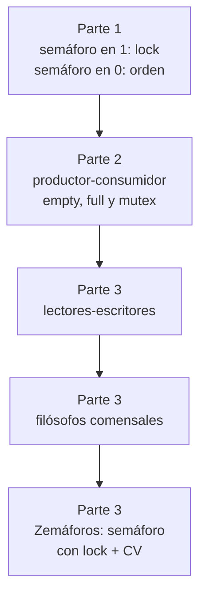

# Ejemplos — Clase 18: semáforos

Ejemplos en C del uso de **semáforos** (OSTEP, cap. 31, *Semaphores*), organizados en tres partes que siguen el orden del capítulo y de los dos decks de la clase (parte 1: p. 1–32; parte 2: p. 1–57).

| Parte | Contenido | Diapositivas | OSTEP cap. 31 |
|---|---|---|---|
| [`parte1/`](parte1/README.md) | Semáforos como locks (semáforo binario) y para ordenar la ejecución entre hilos | Parte 1, p. 13–26 | §31.1–31.3 |
| [`parte2/`](parte2/README.md) | El problema del productor-consumidor con semáforos: de la versión con un solo elemento a la solución definitiva, pasando por la *race condition* y el *deadlock* | Parte 2, p. 9–25 | §31.4 |
| [`parte3/`](parte3/README.md) | Lock de lectores-escritores, filósofos comensales y Zemáforos (un semáforo construido con un lock y una variable de condición) | Parte 2, p. 26–48 | §31.5, §31.6 y §31.8 |

## Ruta sugerida



## Requisitos

Linux (nativo, WSL, máquina virtual o contenedor) con `gcc` y `make`. Cada carpeta tiene un `Makefile` que compila sus programas (`make`) y borra los ejecutables (`make clean`); los ejecutables usan la extensión `.out` y no se suben al repositorio.

Todas las carpetas incluyen una copia de dos cabeceras de OSTEP: `common.h` (funciones de tiempo) y `common_threads.h` (envolturas que verifican con `assert` cada llamada a la API de hilos; por ejemplo, `Sem_init(&s, v)` equivale a `sem_init(&s, 0, v)`). Todas las copias de cada cabecera son idénticas y deben mantenerse así.

Las salidas de las guías se obtuvieron en la máquina descrita en el [entorno de ejecución](../../clase_14/ejemplos/entorno_ejecucion.md) de la clase 14 (WSL1 sobre Windows 10, 8 CPU lógicas): la parte 1 el 19/11/2026 y las partes 2 y 3 el 23/11/2026. En otra máquina los números cambian, pero no qué programa da el resultado correcto.

Varias versiones están hechas para **no terminar** (*deadlock*). Para probarlas sin tener que interrumpirlas con `Ctrl+C` se usa `timeout`, que termina el programa después de unos segundos y deja el código de salida 124:

```bash
timeout 2 ./pc_attemp2.out 10 1000 1 1; echo $?
```

## Referencias

- R. H. Arpaci-Dusseau y A. C. Arpaci-Dusseau, *Operating Systems: Three Easy Pieces*, v1.10, cap. 31: [*Semaphores*](https://pages.cs.wisc.edu/~remzi/OSTEP/threads-sema.pdf).
- Código del capítulo en [`ostep-code/threads-sema`](https://github.com/remzi-arpacidusseau/ostep-code/tree/master/threads-sema).
- Páginas de manual: `man sem_overview`, `man sem_init`, `man sem_wait`, `man sem_post`.

> [!IMPORTANT]
> **Sobre estas guías.** El código y las guías se elaboraron con asistencia de un modelo de inteligencia artificial y se revisaron contra las diapositivas de la clase y OSTEP; todos los programas se compilaron y ejecutaron para obtener las salidas de referencia. Si se encuentra alguna diferencia con lo visto en clase, prevalece lo explicado por el docente; se agradece reportarla en los foros del curso.
