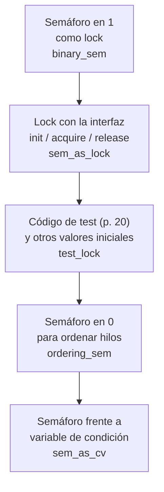

# Ejemplos — Clase 18, parte 1: semáforos como locks y para ordenar hilos

Ejemplos en C del uso de **semáforos** POSIX (`sem_init`, `sem_wait`, `sem_post`), basados en las diapositivas de la parte 1 de la clase 18 y en el capítulo 31 de *Operating Systems: Three Easy Pieces* (OSTEP, v1.10), *Semaphores*. Cada carpeta tiene un `README.md` con la explicación del código, el procedimiento de prueba y las salidas de una ejecución de referencia.

Un semáforo es un objeto con un valor entero y dos operaciones: `sem_wait()` (también `P` o *down*) y `sem_post()` (`V` o *up*). Con él se pueden resolver los dos objetivos de la concurrencia vistos hasta ahora: la **exclusión mutua**, que en las clases 15 y 16 se resolvió con locks, y el **orden de ejecución**, que en la clase 17 se resolvió con variables de condición. La diferencia está en el **valor inicial** del semáforo.

Volver al [índice de ejemplos de la clase 18](../README.md).

| Carpeta | Contenido | Valor inicial | Diapositivas | OSTEP cap. 31 |
|---|---|---|---|---|
| [`diapositivas/binary_sem/`](diapositivas/binary_sem/README.md) | Semáforo binario como lock: dos hilos incrementan un contador. Incluye la variante sin semáforo. | 1 | p. 13–17 | §31.2, Figs. 31.3–31.5 |
| [`sem_as_lock/`](sem_as_lock/README.md) | Lock (`init`, `acquire`, `release`) implementado con un semáforo, y el "código de test" de la p. 20, que permite probar otros valores iniciales. | 1 | p. 18–20 | §31.2 |
| [`diapositivas/ordering_sem/`](diapositivas/ordering_sem/README.md) | El padre espera al hijo (*join*) con un semáforo. Incluye una traza del valor del semáforo. | 0 | p. 21–26 | §31.3, Figs. 31.6–31.8 |
| [`sem_as_cv/`](sem_as_cv/README.md) | El mismo *join*, con el semáforo encapsulado en una interfaz `my_cv`; compara el semáforo con una variable de condición. No está en las diapositivas. | 0 | — | §31.3 y §31.8 |

## Ruta sugerida



## Requisitos

Linux (nativo, WSL, máquina virtual o contenedor) con `gcc` y `make`. Cada carpeta tiene un `Makefile` que compila sus programas (`make`) y borra los ejecutables (`make clean`); los ejecutables usan la extensión `.out` y no se suben al repositorio.

Todas las carpetas incluyen una copia de dos cabeceras de OSTEP: [`common.h`](diapositivas/binary_sem/common.h), con funciones de tiempo, y [`common_threads.h`](diapositivas/binary_sem/common_threads.h), con envolturas que verifican con `assert` que cada llamada de la API de hilos no falle. En particular, `Sem_init(&s, valor)` equivale a `sem_init(&s, 0, valor)`: el `0` indica que el semáforo se comparte entre los hilos de un mismo proceso (p. 8). Las cuatro copias de cada cabecera son idénticas y deben mantenerse así.

Las salidas de las guías se obtuvieron el 19/11/2026 en la máquina descrita en el [entorno de ejecución](../../../clase_14/ejemplos/entorno_ejecucion.md) de la clase 14 (WSL1 sobre Windows 10, 8 CPU lógicas). En otra máquina los números cambian, pero no qué programa da el resultado correcto.

Uno de los ensayos de [`sem_as_lock/`](sem_as_lock/README.md) (un semáforo inicializado en 0) no termina nunca, a propósito. Para probarlo sin tener que interrumpirlo con `Ctrl+C` se usa `timeout`, que lo termina después de unos segundos y deja el código de salida 124:

```bash
timeout 2 ./test_lock.out 4 0; echo $?
```

## Referencias

- R. H. Arpaci-Dusseau y A. C. Arpaci-Dusseau, *Operating Systems: Three Easy Pieces*, v1.10, cap. 31: [*Semaphores*](https://pages.cs.wisc.edu/~remzi/OSTEP/threads-sema.pdf).
- Código del capítulo en [`ostep-code/threads-sema`](https://github.com/remzi-arpacidusseau/ostep-code/tree/master/threads-sema).
- Páginas de manual: `man sem_overview`, `man sem_init`, `man sem_wait`, `man sem_post`.

> [!IMPORTANT]
> **Sobre estas guías.** El código y las guías se elaboraron con asistencia de un modelo de inteligencia artificial y se revisaron contra las diapositivas de la clase y OSTEP; todos los programas se compilaron y ejecutaron para obtener las salidas de referencia. Si se encuentra alguna diferencia con lo visto en clase, prevalece lo explicado por el docente; se agradece reportarla en los foros del curso.
