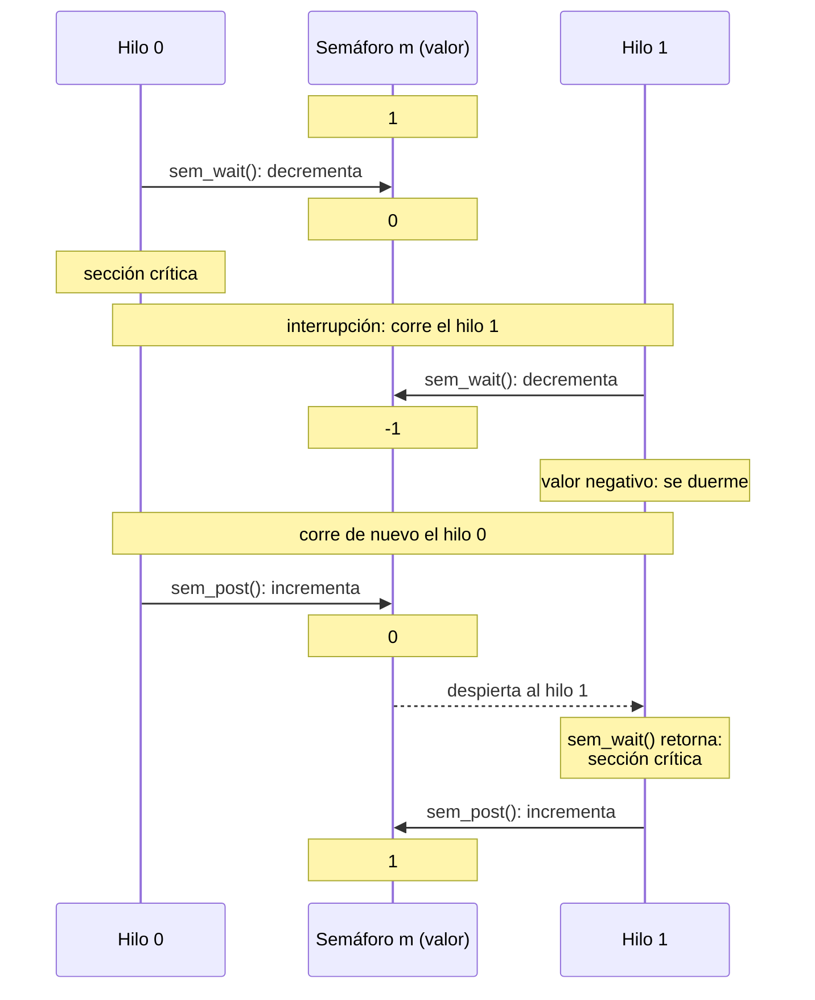

# Semáforo binario como lock

Este ejemplo usa un **semáforo inicializado en 1** para proteger una sección crítica, es decir, como un lock. Dos hilos incrementan un contador compartido 10 000 000 de veces cada uno; con el semáforo el resultado es siempre 20 000 000, y sin él se pierden incrementos.

Volver al [índice de la parte 1](../../README.md).

## Relación con las diapositivas y el libro

| Programa | Qué muestra | Diapositivas | OSTEP cap. 31 (v1.10) |
|---|---|---|---|
| [`binary.c`](binary.c) → `binary.out` | Sección crítica entre `sem_wait()` y `sem_post()`: resultado correcto | p. 13–17 | §31.2, Figs. 31.3–31.5 |
| [`binary.c`](binary.c) → `binary-sin-semaforo.out` | El mismo programa sin el semáforo: condición de carrera | — | — |

## Compilación

Desde esta carpeta:

```bash
make          # genera binary.out y binary-sin-semaforo.out
make clean    # borra los ejecutables
```

La variante sin semáforo se genera desde el mismo archivo con la opción `-DSIN_SEMAFORO`, que quita las llamadas a `sem_wait()` y `sem_post()`. A mano:

```bash
gcc -Wall -I. -pthread -o binary.out binary.c
gcc -Wall -I. -pthread -DSIN_SEMAFORO -o binary-sin-semaforo.out binary.c
```

## El código (p. 13)

Un semáforo puede usarse como lock: la sección crítica va entre `sem_wait()` y `sem_post()` (OSTEP, Fig. 31.3):

```c
sem_t m;
sem_init(&m, 0, X);   // initialize semaphore to X; what should X be?
sem_wait(&m);
// critical section here
sem_post(&m);
```

¿Cuál debe ser el valor de `X`? **1**. El primer hilo que llama a `sem_wait()` decrementa el valor a 0 y entra; mientras ese hilo esté en la sección crítica, cualquier otro que llame a `sem_wait()` encuentra el valor en 0 y se bloquea. Cuando el primero llama a `sem_post()`, el valor sube y uno de los hilos bloqueados puede entrar. Un semáforo usado así se llama **semáforo binario**, porque solo tiene dos estados útiles: libre (1) y tomado (0). La [parte de `sem_as_lock/`](../../sem_as_lock/README.md) muestra qué pasa con otros valores de `X`.

En el programa, cada hilo toma y suelta el semáforo en **cada** incremento:

```c
volatile int counter = 0;
sem_t mutex;

void *child(void *arg) {
  int i;
  for (i = 0; i < 10000000; i++) {
    Sem_wait(&mutex);
    // Critical section
    counter++;
    Sem_post(&mutex);
  }
  return NULL;
}

int main(int argc, char *argv[]) {
  Sem_init(&mutex, 1);
  ...
}
```

`Sem_init`, `Sem_wait` y `Sem_post` son envolturas de [`common_threads.h`](common_threads.h): `Sem_init(&mutex, 1)` es `sem_init(&mutex, 0, 1)` (el `0` indica que el semáforo se comparte entre los hilos de un mismo proceso, p. 8), y cada envoltura verifica con `assert` que la llamada no haya fallado.

## Ejecución

```bash
time ./binary.out
time ./binary-sin-semaforo.out
```

Salida de referencia:

```text
$ time ./binary.out
result: 20000000 (should be 20000000)

real	0m1.128s
user	0m0.859s
sys	0m1.297s

$ time ./binary-sin-semaforo.out
result: 10998822 (should be 20000000)

real	0m0.204s
user	0m0.375s
sys	0m0.016s
```

| Programa | Repeticiones | Resultado |
|---|---|---|
| `binary.out` | 20 | 20 000 000 en las 20 |
| `binary-sin-semaforo.out` | 20 | Entre 10 358 097 y 13 687 153; ninguna llegó a 20 000 000 |

Sin el semáforo, los dos hilos ejecutan `counter++` a la vez. Ese incremento son tres instrucciones de máquina (cargar el valor en un registro, sumarle 1 y guardarlo), y si los dos hilos cargan el mismo valor antes de que alguno lo guarde, uno de los dos incrementos se pierde: es la condición de carrera de la clase 14.

El semáforo corrige el resultado, pero tiene un costo: el programa tardó unas cinco veces más. Cada incremento implica un `sem_wait()` y un `sem_post()`, y cuando el otro hilo tiene el semáforo, dormir y despertar pasa por el kernel (de ahí el tiempo `sys`). Tomar el lock en cada incremento es un **grano fino** extremo; en [`sem_as_lock/`](../../sem_as_lock/README.md) se compara con tomarlo una sola vez por hilo.

## Traza con dos hilos (p. 14–17)

Las diapositivas siguen el valor del semáforo con dos hilos (OSTEP, Figs. 31.4 y 31.5). El hilo 0 toma el semáforo y, mientras está en la sección crítica, una interrupción le pasa la CPU al hilo 1, que también quiere entrar:



En ningún momento los dos hilos están a la vez en la sección crítica, que es lo que pide la exclusión mutua.

> [!NOTE]
> **Complemento (OSTEP, cap. 31): el valor negativo.** En el modelo de las diapositivas (p. 9 y 11) y de OSTEP (§31.1), `sem_wait()` decrementa siempre el valor y, si queda negativo, el hilo se duerme; así, un valor negativo indica cuántos hilos están esperando (el −1 de la traza). Es una forma de describir el semáforo. La implementación de Linux no lleva esa cuenta: el valor nunca baja de 0, y `sem_getvalue()` devuelve 0 aunque haya hilos esperando (OSTEP lo menciona en §31.8). Los dos modelos permiten la entrada de los mismos hilos; solo cambia el número que se observa. En [`ordering_sem/`](../ordering_sem/README.md) se imprime el valor real con `sem_getvalue()`.

## Para probar por cuenta propia

1. Cambiar el valor inicial del semáforo de `binary.c` a 2 y ejecutar varias veces. ¿Por qué el resultado ya no es siempre 20 000 000?
2. Mover `Sem_post(&mutex)` antes de `counter++`. ¿Sigue protegida la variable? ¿Qué propiedad de la exclusión mutua se viola?
3. Comparar con `time` el programa con el semáforo y el programa con el lock de Pthreads de la [clase 15](../../../../../clase_15/ejemplos/README.md). ¿Cuál tarda más? ¿Por qué podrían diferir, si los dos protegen la misma sección crítica?

## Referencias

- Diapositivas de la clase 18, parte 1, p. 7–17.
- R. H. Arpaci-Dusseau y A. C. Arpaci-Dusseau, *Operating Systems: Three Easy Pieces*, v1.10, cap. 31: [*Semaphores*](https://pages.cs.wisc.edu/~remzi/OSTEP/threads-sema.pdf), §31.1, §31.2 y §31.8. El programa es el `binary.c` de [`ostep-code/threads-sema`](https://github.com/remzi-arpacidusseau/ostep-code/tree/master/threads-sema).
- `man sem_init`, `man sem_wait`, `man sem_post`.

> [!IMPORTANT]
> **Sobre esta guía.** El código y la guía se elaboraron con asistencia de un modelo de inteligencia artificial y se revisaron contra las diapositivas de la clase y OSTEP. Las salidas son de una ejecución de referencia del 19/11/2026 en la máquina descrita en el [entorno de ejecución](../../../../../clase_14/ejemplos/entorno_ejecucion.md) de la clase 14; en otra máquina los números concretos cambian. Si se encuentra alguna diferencia con lo visto en clase, prevalece lo explicado por el docente.
