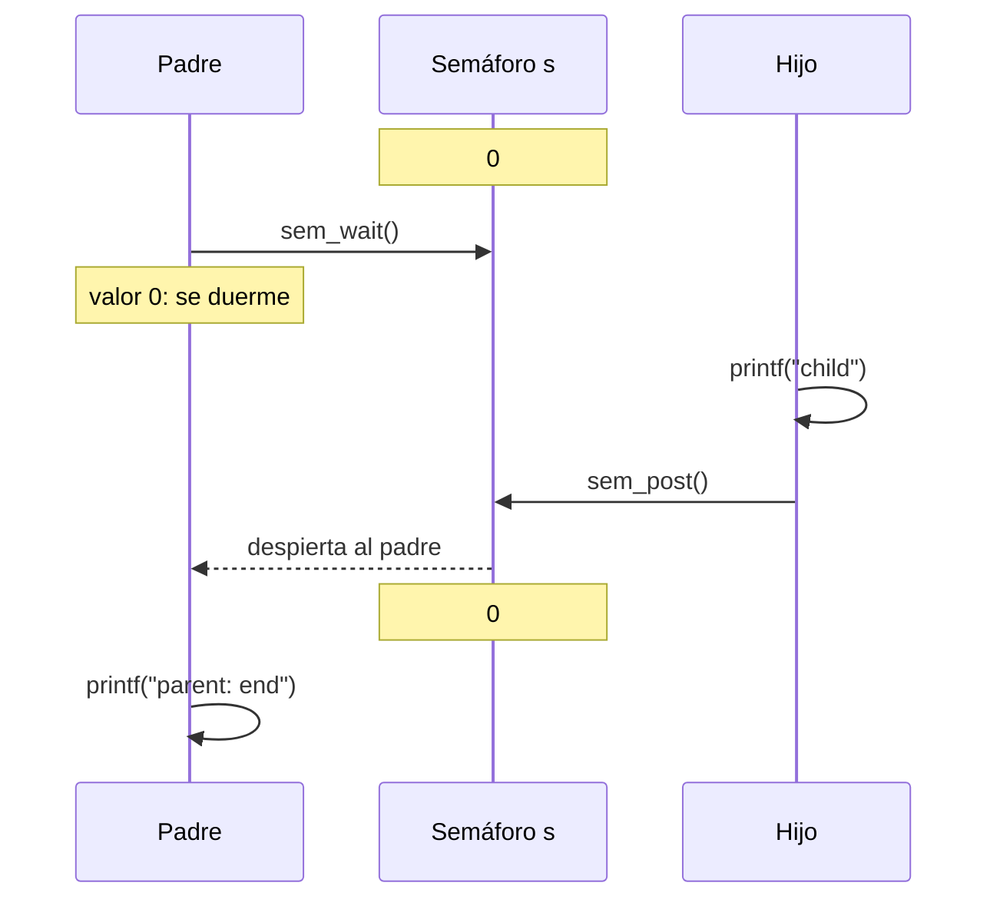
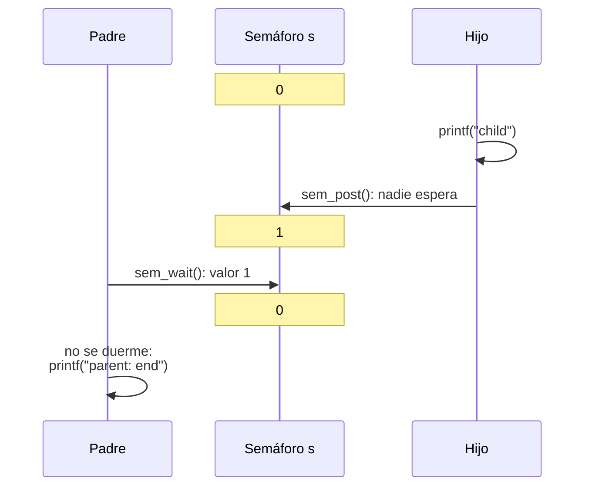

# Semáforo para ordenar la ejecución: el padre espera al hijo

Los semáforos también sirven para **ordenar eventos**: que un hilo espere hasta que otro haya hecho algo. Es el mismo problema del *join* de la clase 17, resuelto ahora con un solo semáforo inicializado en **0**.

Volver al [índice de la parte 1](../../README.md).

## Relación con las diapositivas y el libro

| Programa | Qué muestra | Diapositivas | OSTEP cap. 31 (v1.10) |
|---|---|---|---|
| [`sem_as_CV.c`](sem_as_CV.c) → `sem_as_CV.out` | El padre espera al hijo con un semáforo en 0 | p. 21–26 | §31.3, Figs. 31.6–31.8 |
| [`sem_as_CV.c`](sem_as_CV.c) → `sem_as_CV-traza.out` | El mismo programa, imprimiendo el valor del semáforo en cada paso | p. 23 y 25 | Figs. 31.7 y 31.8 |

## Compilación

Desde esta carpeta:

```bash
make          # genera sem_as_CV.out
make traza    # genera además sem_as_CV-traza.out (compilado con -DTRAZA)
make clean    # borra los ejecutables
```

## El código (p. 21, OSTEP Fig. 31.6)

```c
sem_t s;

void *child(void *arg) {
  printf("child\n");
  Sem_post(&s); // signal here: child is done
  return NULL;
}

int main(int argc, char *argv[]) {
  Sem_init(&s, 0); // X = 0
  printf("parent: begin\n");
  pthread_t c;
  Pthread_create(&c, NULL, child, NULL);
  Sem_wait(&s); // wait here for child
  printf("parent: end\n");
  return 0;
}
```

El padre llama a `sem_wait()` y el hijo llama a `sem_post()` cuando termina. ¿Con qué valor `X` debe inicializarse el semáforo? Con **0**: el padre debe bloquearse si el hijo todavía no ha terminado, y con el valor en 0 `sem_wait()` no puede pasar hasta que el hijo haga `sem_post()`.

> [!NOTE]
> Las diapositivas p. 21–22 escriben `pthread_tc;`, `pthread_create(c, NULL, child, NULL);` e `int main(intargc, ...)`. Son errores de transcripción: lo correcto es `pthread_t c;`, `pthread_create(&c, NULL, child, NULL);` (el primer argumento es la dirección del `pthread_t`) e `int main(int argc, ...)`, como en el programa y en OSTEP.

## Los dos órdenes posibles (p. 22–25)

Hay dos casos, según quién llegue primero a su operación. El programa acepta dos argumentos opcionales, en segundos, que fuerzan cada caso:

```bash
./sem_as_CV.out [espera_hijo] [espera_padre]
```

Sin argumentos es el código de las diapositivas. Con `espera_hijo > 0` el hijo se demora antes de imprimir, así que el padre llega primero a `sem_wait()`; con `espera_padre > 0` el padre se demora antes de `sem_wait()`, así que el hijo llega primero a `sem_post()`.

**Caso 1: el padre llama a `sem_wait()` antes de que el hijo llame a `sem_post()`** (OSTEP, Fig. 31.7). El valor está en 0, así que el padre se duerme. Cuando el hijo hace `sem_post()`, despierta al padre, que continúa.



**Caso 2: el hijo termina antes de que el padre llame a `sem_wait()`** (OSTEP, Fig. 31.8). El `sem_post()` del hijo encuentra que nadie espera y deja el valor en 1. Cuando el padre llama a `sem_wait()`, el valor es 1: lo decrementa a 0 y continúa sin dormirse.



> [!NOTE]
> En las diapositivas, las tablas de traza de los dos casos quedaron intercambiadas: la de la p. 23, titulada "Caso 1: padre llama `sem_wait()` antes que hijo llama `sem_post()`", muestra al hijo haciendo `sem_post()` primero (valor 1), que es el caso 2; y la de la p. 25, titulada "Caso 2", muestra al padre durmiéndose con el valor en −1, que es el caso 1. Los títulos son los correctos y coinciden con OSTEP (Figs. 31.7 y 31.8).

### Ejecución

```bash
./sem_as_CV.out              # código de las diapositivas
./sem_as_CV-traza.out 1 0    # caso 1: el padre espera primero
./sem_as_CV-traza.out 0 1    # caso 2: el hijo termina primero
```

Salida de referencia:

```text
$ ./sem_as_CV.out
parent: begin
child
parent: end

$ ./sem_as_CV-traza.out 1 0
parent: begin
  [padre] despues de sem_init()        valor del semaforo = 0
  [padre] antes de sem_wait()          valor del semaforo = 0
child
  [hijo ] antes de sem_post()          valor del semaforo = 0
  [hijo ] despues de sem_post()        valor del semaforo = 1
  [padre] despues de sem_wait()        valor del semaforo = 0
parent: end

$ ./sem_as_CV-traza.out 0 1
parent: begin
  [padre] despues de sem_init()        valor del semaforo = 0
child
  [hijo ] antes de sem_post()          valor del semaforo = 0
  [hijo ] despues de sem_post()        valor del semaforo = 1
  [padre] antes de sem_wait()          valor del semaforo = 1
  [padre] despues de sem_wait()        valor del semaforo = 0
parent: end
```

| Ejecución | Repeticiones | Orden correcto |
|---|---|---|
| `./sem_as_CV.out` | 500 | 500 |

En las dos trazas la salida es la deseada. Sin argumentos, en la ejecución de referencia se dio el caso 1: crear el hilo tarda más que llegar a `sem_wait()`, así que el padre casi siempre espera primero.

> [!NOTE]
> **Complemento (OSTEP, cap. 31): en Linux el valor no baja de 0.** En el caso 1, mientras el padre duerme, la diapositiva p. 25 y OSTEP (Fig. 31.7) muestran el valor en −1: en ese modelo, `sem_wait()` decrementa siempre y un valor negativo cuenta los hilos que esperan. La traza muestra 0 en ese momento, porque la implementación de Linux no deja que el valor sea negativo; OSTEP lo menciona en §31.8. El comportamiento es el mismo en los dos modelos: el padre se bloquea mientras el hijo no haya hecho `sem_post()`. Además, el valor se lee con `sem_getvalue()` en una llamada aparte, así que es una foto del momento: otro hilo puede cambiarlo justo después.

### El padre no gasta CPU mientras espera

```text
$ time ./sem_as_CV.out 2 0
parent: begin
child
parent: end

real	0m2.028s
user	0m0.000s
sys	0m0.016s
```

El padre esperó 2 s al hijo sin usar la CPU (`user` = 0 s): `sem_wait()` lo durmió, igual que `pthread_cond_wait()` en la clase 17 y a diferencia de la espera activa.

## Semáforo frente a variable de condición (p. 26)

La diapositiva p. 26 compara las dos soluciones del *join*:

| Con variable de condición (clase 17) | Con semáforo |
|---|---|
| Variable de estado `done`, mutex y variable de condición | Un semáforo inicializado en 0 |
| El hijo toma el lock, pone `done = 1`, llama a `signal` y suelta el lock | El hijo llama a `sem_post()` |
| El padre toma el lock y espera en un `while (done == 0)` | El padre llama a `sem_wait()` |

La versión con semáforo es más simple porque **el semáforo guarda estado**: su valor recuerda que hubo un `sem_post()` aunque nadie estuviera esperando (caso 2). Un `pthread_cond_signal()` sin hilos esperando, en cambio, se pierde, y por eso la variable de condición necesita la variable `done`; sin ella, el padre puede dormir para siempre, como muestra la [reimplementación 1 del *join*](../../../../../clase_17/ejemplos/variables-condicion/README.md#51-reimplementación-1-sin-variable-de-estado-implementacion1c-p-2426) de la clase 17.

## Para probar por cuenta propia

1. Inicializar el semáforo en 1 en lugar de 0. ¿El padre espera al hijo? ¿Qué salidas son posibles ahora?
2. Crear dos hijos que hagan `sem_post()` sobre el mismo semáforo. ¿Cuántas veces debe llamar el padre a `sem_wait()` para esperar a los dos?
3. En la traza del caso 1, ¿qué línea imprimiría el valor −1 si el semáforo siguiera el modelo de las diapositivas?

## Referencias

- Diapositivas de la clase 18, parte 1, p. 21–26.
- R. H. Arpaci-Dusseau y A. C. Arpaci-Dusseau, *Operating Systems: Three Easy Pieces*, v1.10, cap. 31: [*Semaphores*](https://pages.cs.wisc.edu/~remzi/OSTEP/threads-sema.pdf), §31.3 y §31.8.
- `man sem_wait`, `man sem_post`, `man sem_getvalue`.

> [!IMPORTANT]
> **Sobre esta guía.** El código y la guía se elaboraron con asistencia de un modelo de inteligencia artificial y se revisaron contra las diapositivas de la clase y OSTEP. Las salidas son de una ejecución de referencia del 19/11/2026 en la máquina descrita en el [entorno de ejecución](../../../../../clase_14/ejemplos/entorno_ejecucion.md) de la clase 14. Si se encuentra alguna diferencia con lo visto en clase, prevalece lo explicado por el docente.
