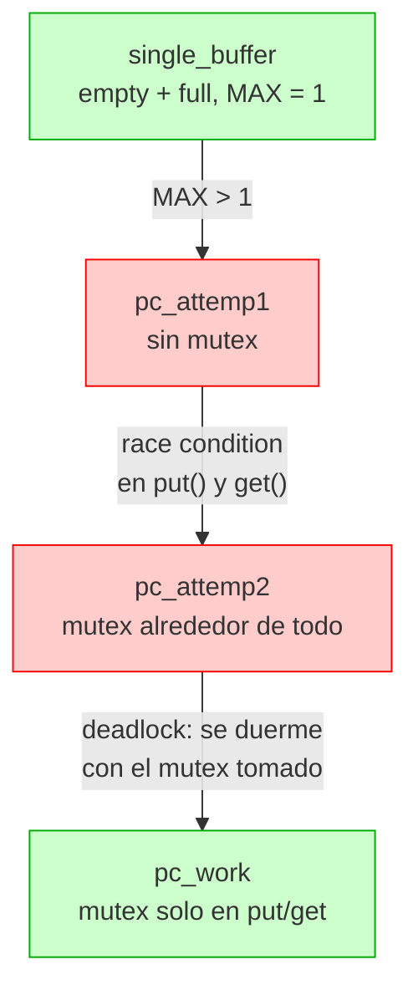

# Ejemplos — Clase 18, parte 2: el productor-consumidor con semáforos

En la [clase 17](../../../clase_17/ejemplos/productor-consumidor/README.md) el problema del productor-consumidor (buffer acotado) se resolvió con un mutex y dos variables de condición. Aquí se resuelve con **semáforos**, siguiendo las diapositivas de la parte 2 (p. 9–25) y OSTEP §31.4. Como allí, cada versión rota muestra un error concreto que la siguiente corrige.

Volver al [índice de ejemplos de la clase 18](../README.md).

## El problema (p. 9–10)

Uno o más **productores** ponen datos en un buffer compartido de tamaño `MAX` y uno o más **consumidores** los sacan. Un productor debe esperar si el buffer está lleno y un consumidor si está vacío. Las rutinas `put()` y `get()` manejan un buffer circular (OSTEP, Fig. 31.9):

```c
int buffer[MAX];
int fill = 0;
int use  = 0;

void put(int value) {
    buffer[fill] = value;       // Line F1
    fill = (fill + 1) % MAX;    // Line F2
}

int get() {
    int tmp = buffer[use];      // Line G1
    use = (use + 1) % MAX;      // Line G2
    return tmp;
}
```

Con semáforos, las dos esperas se expresan con dos **contadores de recursos**:

| Semáforo | Cuenta | Valor inicial | Quién hace `sem_wait` | Quién hace `sem_post` |
|---|---|---|---|---|
| `empty` | espacios vacíos | `MAX` | el productor, antes de `put` | el consumidor, después de `get` |
| `full` | espacios llenos | `0` | el consumidor, antes de `get` | el productor, después de `put` |

Es la regla de la *Tip: Setting The Value Of A Semaphore* de OSTEP: el valor inicial es la cantidad de recursos que se pueden entregar de inmediato. Al principio hay `MAX` espacios vacíos y ningún dato.

## Las versiones

| Carpeta | Sincronización | Diapositivas | OSTEP | Resultado |
|---|---|---|---|---|
| [`producer_consumer/single_buffer/`](producer_consumer/single_buffer/README.md) | `empty` y `full`, buffer de **un** elemento | p. 10–12 | Figs. 31.9 y 31.10 con `MAX = 1` | Correcto |
| [`producer_consumer/circular_buffer/pc_attemp1/`](producer_consumer/circular_buffer/pc_attemp1/README.md) | `empty` y `full`, buffer circular, **sin mutex** | p. 13–16 | Fig. 31.10 | *Race condition* con varios productores o consumidores |
| [`producer_consumer/circular_buffer/pc_attemp2/`](producer_consumer/circular_buffer/pc_attemp2/README.md) | Mutex alrededor de **todo** el cuerpo, incluido el `sem_wait` de `empty`/`full` | p. 17–21 | Fig. 31.11 | *Deadlock* |
| [`producer_consumer/circular_buffer/pc_work/`](producer_consumer/circular_buffer/pc_work/README.md) | Mutex **solo** alrededor de `put()`/`get()` | p. 22–25 | Fig. 31.12 | Correcto con cualquier cantidad de hilos |
| [`producer_consumer/work/`](producer_consumer/work/README.md) | El código original de OSTEP, sin modificar | — | `producer_consumer_works.c` | Correcto (un productor) |



## Uso común de los programas

Los cuatro programas de las diapositivas comparten la misma estructura y la misma forma de comprobar el resultado:

```bash
./pc_single.out <loops> <productores> <consumidores>
./pc_attemp1.out <buffersize> <loops> <productores> <consumidores> [pausa_us]
./pc_attemp2.out <buffersize> <loops> <productores> <consumidores> [espera_ms]
./pc_work.out    <buffersize> <loops> <productores> <consumidores>
```

- **Valores.** Cada productor pone los valores `0, 1, ..., loops - 1`, y cada consumidor imprime en una línea lo que saca (`C1 <- 5`).
- **Marca de fin.** Cuando todos los productores terminan, `main` pone un `-1` por cada consumidor, y cada consumidor sale de su ciclo al recibirlo (`while (tmp != -1)`, como en OSTEP).
- **Verificación.** Al final, `main` comprueba que cada valor se haya consumido exactamente `<productores>` veces e imprime una línea como esta:

  ```text
  Verificacion: producidos 2000, consumidos 2000, perdidos 0, repetidos 0, invalidos 0 -> CORRECTO
  ```

  La verificación está en [`verifica.h`](producer_consumer/single_buffer/verifica.h). No forma parte de la sincronización: cada consumidor cuenta en un arreglo propio y `main` los suma cuando todos terminaron.

> [!NOTE]
> **Por qué la marca de fin la pone `main`.** En OSTEP (y en la versión del semestre pasado) cada productor pone las marcas `-1` al terminar su ciclo. Eso solo funciona con **un** productor: con dos, el primero que termina pone sus marcas mientras el otro todavía produce, los consumidores salen antes de tiempo y el segundo productor se queda esperando `empty` con el buffer lleno. Las diapositivas no muestran la marca de fin, así que aquí la pone `main` después de esperar a todos los productores; el código del productor y del consumidor queda igual al de las diapositivas.

Los programas imprimen cada línea de inmediato (`setvbuf`), así que se puede usar `timeout` con un *pipe* (`| tail`) sin perder las últimas líneas de un programa que se bloquea.

## Referencias

- Diapositivas de la clase 18, parte 2, p. 9–25.
- R. H. Arpaci-Dusseau y A. C. Arpaci-Dusseau, *Operating Systems: Three Easy Pieces*, v1.10, cap. 31: [*Semaphores*](https://pages.cs.wisc.edu/~remzi/OSTEP/threads-sema.pdf), §31.4.

> [!IMPORTANT]
> **Sobre esta guía.** La guía se elaboró con asistencia de un modelo de inteligencia artificial y se revisó contra las diapositivas de la clase y OSTEP. Si se encuentra alguna diferencia con lo visto en clase, prevalece lo explicado por el docente.
