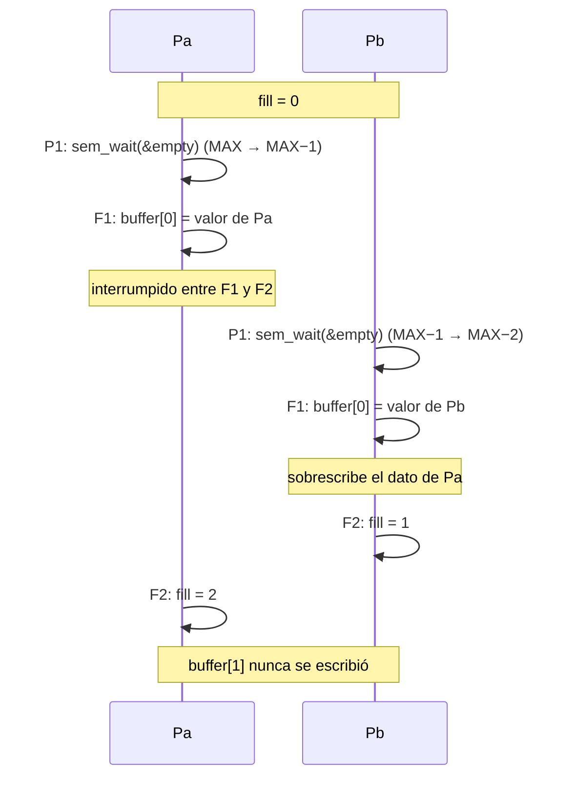

# Buffer circular sin mutex: *race condition*

Con un buffer de varios elementos (`MAX > 1`), los mismos dos semáforos de [`single_buffer`](../../single_buffer/README.md) ya no bastan cuando hay más de un productor o más de un consumidor (diapositivas de la parte 2, p. 13–16; OSTEP §31.4). Esta versión muestra por qué.

Volver al [índice de la parte 2](../../../README.md).

## Relación con las diapositivas y el libro

| Programa | Qué muestra | Diapositivas | OSTEP cap. 31 (v1.10) |
|---|---|---|---|
| [`pc_attemp1.c`](pc_attemp1.c) → `pc_attemp1.out` | `empty` (empieza en `MAX`) y `full` (empieza en 0) con un buffer circular, sin mutex | p. 13–16 | Figs. 31.9 y 31.10 |

## Compilación y uso

```bash
make          # genera pc_attemp1.out
make clean

./pc_attemp1.out <buffersize> <loops> <productores> <consumidores> [pausa_us]
```

`pausa_us` es opcional (por defecto 0, que es el código de las diapositivas). Hace que `put()` espere esa cantidad de microsegundos entre las líneas F1 y F2, y así simula que el productor es interrumpido justo en ese punto, como en la traza de la p. 16.

## El código (p. 13–15)

El productor y el consumidor son los de [`single_buffer`](../../single_buffer/README.md), pero el buffer es un arreglo circular y `empty` empieza en `MAX`, porque hay `MAX` espacios vacíos (p. 14):

```c
void put(int value) {
    buffer[fill] = value;       // Line F1
    fill = (fill + 1) % MAX;    // Line F2
}

void *producer(void *arg) {
    for (i = 0; i < loops; i++) {
        sem_wait(&empty);       // Line P1
        put(i);                 // Line P2
        sem_post(&full);        // Line P3
    }
}

sem_init(&empty, 0, MAX);       // MAX are empty
sem_init(&full, 0, 0);          // 0 are full
```

Con **un** productor y **un** consumidor funciona: `empty` impide que el productor sobrescriba datos no consumidos, `full` impide que el consumidor lea espacios vacíos, y cada índice (`fill`, `use`) lo modifica un solo hilo.

## El problema: dos productores en `put()` (p. 16)

Como `empty` vale `MAX`, hasta `MAX` productores pueden pasar `sem_wait(&empty)` a la vez y entrar juntos a `put()`. Pero `put()` lee y modifica `fill`, una variable compartida: **es una sección crítica sin proteger**. La traza de la p. 16 (y de OSTEP) muestra el caso:



Se pierde el dato de `Pa` y la posición 1 queda con lo que tuviera antes. Los dos productores hacen `sem_post(&full)`, así que el consumidor sacará dos datos: el de `Pb` y uno viejo. Los consumidores tienen el mismo problema en `get()` con el índice `use`.

## Resultados

Con la pausa de 1 ms entre F1 y F2, dos productores y un consumidor (5 valores por productor), dos de tres ejecuciones de referencia mostraron la carrera:

```text
$ ./pc_attemp1.out 10 5 2 1 1000
C1 <- 0
C1 <- 1
C1 <- 1
C1 <- 0
C1 <- 2
C1 <- 0
C1 <- 3
C1 <- 0
C1 <- 4
C1 <- 0
C1 <- -1
Verificacion: producidos 10, consumidos 10, perdidos 3, repetidos 3, invalidos 0 -> INCORRECTO
```

Los `0` intercalados son espacios que ningún productor escribió: contienen el 0 con que se inicializó el buffer. Por eso hay valores **repetidos** (el 0 aparece de más) y **perdidos** (los que se sobrescribieron).

| Ejecución | Repeticiones | Correcto | Incorrecto | Se bloqueó |
|---|---|---|---|---|
| `./pc_attemp1.out 10 1000 1 1` (1 productor, 1 consumidor) | 100 | 100 | 0 | 0 |
| `./pc_attemp1.out 10 10000 2 1` (2 productores, sin pausa) | 100 | 0 | 17 | 83 |
| `./pc_attemp1.out 10 20 2 1 1000` (2 productores, pausa de 1 ms) | 50 | 0 | 44 | 6 |
| `./pc_attemp1.out 10 10000 1 2` (2 consumidores) | 100 | 99 | 1 | 0 |
| `./pc_attemp1.out 10 10000 2 2` (2 y 2) | 50 | 7 | 29 | 14 |

Con un productor y un consumidor el programa es correcto en todas las ejecuciones. Con **dos productores** y 10 000 valores cada uno, falló en las 100 ejecuciones, **sin necesidad de la pausa**: en 17 terminó con datos perdidos y repetidos (entre 2 y 251 valores perdidos) y en 83 se quedó bloqueado. Con solo 20 valores por productor la ventana entre F1 y F2 rara vez se alcanza, y por eso la pausa sirve para verlo con pocas líneas de salida. Con dos consumidores (y un productor) la carrera en `get()` apareció solo en 1 de 100 ejecuciones: es igual de real, pero mucho menos frecuente en esta máquina.

**¿Por qué a veces se bloquea?** Si dos productores pierden un incremento de `fill` (los dos leen `fill = k` y los dos escriben `k + 1`), `full` cuenta un dato más de los que hay en posiciones nuevas, y el índice `use` del consumidor termina **adelante** de `fill`. Las marcas `-1` que pone `main` al final caen en posiciones que el consumidor ya pasó: el consumidor saca todos los datos que anuncia `full` sin ver nunca un `-1` y se queda esperando para siempre en `sem_wait(&full)`. Una *race condition* no solo corrompe datos: también puede romper la lógica que depende de ellos.

**Solución (p. 17):** agregar exclusión mutua alrededor de la sección crítica, es decir, llenar el buffer y avanzar el índice. La forma de hacerlo importa: ver [`pc_attemp2`](../pc_attemp2/README.md).

## Para probar por cuenta propia

1. Ejecutar `./pc_attemp1.out 10 20 2 1 1000` varias veces y comparar los valores perdidos y repetidos. ¿Por qué el valor repetido es casi siempre 0?
2. Con un solo productor y la pausa (`./pc_attemp1.out 10 20 1 1 1000`), ¿hay errores? ¿Por qué?

## Referencias

- Diapositivas de la clase 18, parte 2, p. 13–17.
- R. H. Arpaci-Dusseau y A. C. Arpaci-Dusseau, *Operating Systems: Three Easy Pieces*, v1.10, cap. 31: [*Semaphores*](https://pages.cs.wisc.edu/~remzi/OSTEP/threads-sema.pdf), §31.4 (*A Solution: Adding Mutual Exclusion*).

> [!IMPORTANT]
> **Sobre esta guía.** El código y la guía se elaboraron con asistencia de un modelo de inteligencia artificial y se revisaron contra las diapositivas de la clase y OSTEP. Las salidas son de una ejecución de referencia del 23/11/2026 en la máquina descrita en el [entorno de ejecución](../../../../../../clase_14/ejemplos/entorno_ejecucion.md) de la clase 14; en otra máquina la frecuencia de los errores cambia. Si se encuentra alguna diferencia con lo visto en clase, prevalece lo explicado por el docente.
