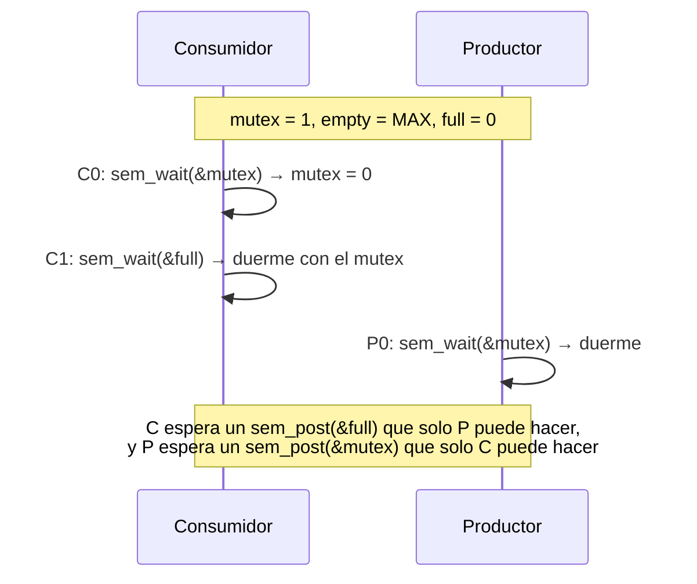

# Mutex alrededor de todo el ciclo: *deadlock*

Para corregir la *race condition* de [`pc_attemp1`](../pc_attemp1/README.md), la p. 17 de las diapositivas propone agregar exclusión mutua con un tercer semáforo, `mutex`, inicializado en 1. Esta versión lo pone alrededor de **todo** el cuerpo del ciclo, incluido el `sem_wait` sobre `empty` o `full`, y el resultado es un ***deadlock*** (diapositivas de la parte 2, p. 17–21; OSTEP, Fig. 31.11).

Volver al [índice de la parte 2](../../../README.md).

## Relación con las diapositivas y el libro

| Programa | Qué muestra | Diapositivas | OSTEP cap. 31 (v1.10) |
|---|---|---|---|
| [`pc_attemp2.c`](pc_attemp2.c) → `pc_attemp2.out` | Mutex alrededor de todo el ciclo: *deadlock* | p. 17–21 | Fig. 31.11 (*Adding Mutual Exclusion (Incorrectly)*) |
| `pc_attemp2-traza.out` (`-DTRAZA`) | La misma versión, imprimiendo en qué línea está cada hilo antes de cada `sem_wait` | p. 19–20 | — |

## Compilación y uso

```bash
make          # genera pc_attemp2.out
make traza    # genera además pc_attemp2-traza.out
make clean

./pc_attemp2.out <buffersize> <loops> <productores> <consumidores> [espera_ms]
```

`espera_ms` es opcional (por defecto 0, que es el código de las diapositivas): cada productor espera esa cantidad de milisegundos antes de empezar, de modo que el consumidor corra primero con el buffer vacío. Es el escenario que analizan las p. 19–20.

El programa se bloquea, así que conviene ejecutarlo con `timeout` (código de salida 124 si lo tuvo que terminar):

```bash
timeout 2 ./pc_attemp2.out 10 1000 1 1; echo $?
```

## El código (p. 18)

```c
void *producer(void *arg) {
    for (i = 0; i < loops; i++) {
        sem_wait(&mutex);       // Line P0 (NEW LINE)
        sem_wait(&empty);       // Line P1
        put(i);                 // Line P2
        sem_post(&full);        // Line P3
        sem_post(&mutex);       // Line P4 (NEW LINE)
    }
}

void *consumer(void *arg) {
    while (tmp != -1) {
        sem_wait(&mutex);       // Line C0 (NEW LINE)
        sem_wait(&full);        // Line C1
        tmp = get();            // Line C2
        sem_post(&empty);       // Line C3
        sem_post(&mutex);       // Line C4 (NEW LINE)
        printf(...);
    }
}

sem_init(&mutex, 0, 1);         // mutex = 1 (p. 17)
```

## El *deadlock* de las diapositivas (p. 19–20)

Las p. 19–20 y OSTEP describen el caso con un productor y un consumidor, en el que el consumidor corre primero:

1. El consumidor adquiere el mutex (`C0`).
2. Llama a `sem_wait(&full)` (`C1`). No hay datos, así que se bloquea y libera la CPU, **pero se queda con el mutex**.
3. El productor llama a `sem_wait(&mutex)` (`P0`) y se bloquea.



Es un ciclo simple: el consumidor **tiene** el mutex y **espera** `full`; el productor podría hacer `sem_post(&full)`, pero **espera** el mutex. Ninguno avanza.

Con la espera de 100 ms para el productor, la traza reproduce exactamente ese orden:

```text
$ timeout 1 ./pc_attemp2-traza.out 10 1000 1 1 100
C1 C0: sem_wait(&mutex)
C1 C1: tiene el mutex; sem_wait(&full)
P1 P0: sem_wait(&mutex)
```

> [!NOTE]
> **Sobre la tabla de la p. 20.** En el *deadlock*, `empty` no cambia (el consumidor no lo toca) y `full` queda en −1 en el modelo de OSTEP, porque el consumidor está esperando en él. En Linux `full` se queda en 0: el valor nunca baja de 0 (ver la [parte 1](../../../../parte1/diapositivas/ordering_sem/README.md)).

## El *deadlock* simétrico: el productor con el mutex

Sin la espera, el *deadlock* más frecuente en las ejecuciones de referencia fue otro: el productor se crea primero, llena el buffer y, en la siguiente vuelta, se duerme en `sem_wait(&empty)` **con el mutex tomado**. El consumidor, que es el único que podría vaciar un espacio, se queda en `sem_wait(&mutex)`. Con un buffer de 3 elementos:

```text
$ timeout 1 ./pc_attemp2-traza.out 3 10 1 1
P1 P0: sem_wait(&mutex)
P1 P1: tiene el mutex; sem_wait(&empty)
P1 P0: sem_wait(&mutex)
P1 P1: tiene el mutex; sem_wait(&empty)
P1 P0: sem_wait(&mutex)
P1 P1: tiene el mutex; sem_wait(&empty)
P1 P0: sem_wait(&mutex)
P1 P1: tiene el mutex; sem_wait(&empty)
C1 C0: sem_wait(&mutex)
```

El productor puso tres datos (las tres primeras vueltas) y en la cuarta se durmió con el buffer lleno. El consumidor nunca consiguió el mutex. Es el mismo error visto desde el otro lado: **un hilo se duerme en un semáforo mientras sostiene el mutex que el otro necesita para despertarlo**.

Conteo en 50 ejecuciones de cada escenario, clasificadas según el último estado de cada hilo en la traza:

| Ejecución | Terminó | *Deadlock*: el productor tiene el mutex y espera `empty` | *Deadlock*: el consumidor tiene el mutex y espera `full` |
|---|---|---|---|
| `10 1000 1 1` | 0 | 39 | 11 |
| `10 1000 1 1 100` (el productor espera 100 ms) | 0 | 0 | 50 |
| `1 1000 1 1` (buffer de 1) | 0 | 46 | 4 |
| `10 1000 2 2` | 0 | 37 | 13 |

Ninguna ejecución terminó: el error no depende de un orden poco frecuente, sino que ocurre en cuanto el buffer se llena o se vacía. Sin la traza, el programa simplemente no imprime nada:

```text
$ timeout 2 ./pc_attemp2.out 10 1000 1 1 | wc -l; echo ${PIPESTATUS[0]}
0
124
```

**Solución (p. 22–23):** reducir el ámbito del lock. El mutex debe envolver solo `put()` y `get()`, que es la sección crítica, y los `sem_wait` sobre `empty` y `full` deben quedar por fuera: ver [`pc_work`](../pc_work/README.md).

## Para probar por cuenta propia

1. ¿Por qué con `espera_ms` siempre se da el caso del consumidor, y sin ella casi siempre el del productor?
2. Cambiar solo el consumidor a la versión correcta y dejar el productor como está. ¿Sigue habiendo *deadlock*? ¿En qué caso?

## Referencias

- Diapositivas de la clase 18, parte 2, p. 17–23.
- R. H. Arpaci-Dusseau y A. C. Arpaci-Dusseau, *Operating Systems: Three Easy Pieces*, v1.10, cap. 31: [*Semaphores*](https://pages.cs.wisc.edu/~remzi/OSTEP/threads-sema.pdf), §31.4 (*Avoiding Deadlock*).

> [!IMPORTANT]
> **Sobre esta guía.** El código y la guía se elaboraron con asistencia de un modelo de inteligencia artificial y se revisaron contra las diapositivas de la clase y OSTEP. Las salidas son de una ejecución de referencia del 23/11/2026 en la máquina descrita en el [entorno de ejecución](../../../../../../clase_14/ejemplos/entorno_ejecucion.md) de la clase 14; en otra máquina la proporción entre los dos tipos de *deadlock* cambia. Si se encuentra alguna diferencia con lo visto en clase, prevalece lo explicado por el docente.
