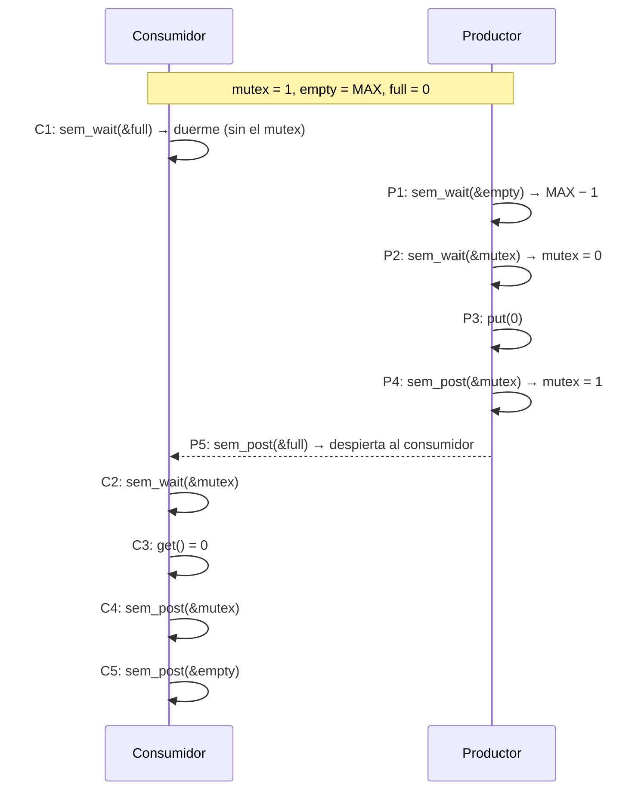

# La solución: mutex solo alrededor de `put()` y `get()`

La solución definitiva del productor-consumidor con semáforos (diapositivas de la parte 2, p. 22–25; OSTEP, Fig. 31.12) **reduce el ámbito del lock**: el mutex envuelve solo `put()` y `get()`, que es la sección crítica, y los `sem_wait` sobre `empty` y `full` quedan por fuera. Así se corrigen a la vez la *race condition* de [`pc_attemp1`](../pc_attemp1/README.md) y el *deadlock* de [`pc_attemp2`](../pc_attemp2/README.md).

Volver al [índice de la parte 2](../../../README.md).

## Relación con las diapositivas y el libro

| Programa | Qué muestra | Diapositivas | OSTEP cap. 31 (v1.10) |
|---|---|---|---|
| [`pc_work.c`](pc_work.c) → `pc_work.out` | `empty`, `full` y `mutex`, con el mutex solo alrededor de `put()`/`get()` | p. 22–25 | Fig. 31.12 (*Adding Mutual Exclusion (Correctly)*) |

## Compilación y uso

```bash
make          # genera pc_work.out
make clean

./pc_work.out <buffersize> <loops> <productores> <consumidores>
```

## El código (p. 25)

```c
void *producer(void *arg) {
    for (i = 0; i < loops; i++) {
        sem_wait(&empty);       // Line P1  (OSTEP: P1)
        sem_wait(&mutex);       // Line P2  (OSTEP: P1.5, lock)
        put(i);                 // Line P3  (OSTEP: P2)
        sem_post(&mutex);       // Line P4  (OSTEP: P2.5, unlock)
        sem_post(&full);        // Line P5  (OSTEP: P3)
    }
}

void *consumer(void *arg) {
    while (tmp != -1) {
        sem_wait(&full);        // Line C1  (OSTEP: C1)
        sem_wait(&mutex);       // Line C2  (OSTEP: C1.5, lock)
        tmp = get();            // Line C3  (OSTEP: C2)
        sem_post(&mutex);       // Line C4  (OSTEP: C2.5, unlock)
        sem_post(&empty);       // Line C5  (OSTEP: C3)
        printf(...);
    }
}

// en main (la inicialización no cambia, p. 21):
sem_init(&empty, 0, MAX);       // MAX are empty
sem_init(&full, 0, 0);          // 0 are full
sem_init(&mutex, 0, 1);         // mutex = 1
```

Las diapositivas numeran las líneas `P1`–`P5` y `C1`–`C5`; OSTEP conserva los números de las versiones anteriores y llama `P1.5`, `P2.5`, `C1.5` y `C2.5` a las líneas nuevas del mutex. El código es el mismo.

## Por qué funciona

Cada semáforo tiene ahora un solo papel:

| Semáforo | Papel | Valor inicial |
|---|---|---|
| `empty` | Orden: el productor espera un espacio vacío | `MAX` |
| `full` | Orden: el consumidor espera un dato | `0` |
| `mutex` | Exclusión mutua: un solo hilo a la vez dentro de `put()` o `get()` | `1` |

- **No hay *race condition*.** `put()` y `get()` se ejecutan con el mutex tomado, así que dos productores no pueden escribir en la misma posición ni perder un incremento de `fill` (y lo mismo para los consumidores con `use`).
- **No hay *deadlock*.** Un hilo solo toma el mutex **después** de pasar su `sem_wait` sobre `empty` o `full`, es decir, cuando ya sabe que puede avanzar, y lo suelta enseguida. Nunca se duerme en `empty` o `full` sosteniendo el mutex, que era el error de `pc_attemp2`.

La traza de la p. 24 muestra el caso que antes se bloqueaba: el consumidor corre primero y se duerme en `sem_wait(&full)` (`C1`), pero **sin** el mutex; el productor entonces puede tomarlo, poner el dato, soltarlo y hacer `sem_post(&full)`, que despierta al consumidor.



> [!TIP]
> **Una regla práctica.** El mutex protege los datos compartidos (el buffer y sus índices) y se sostiene el menor tiempo posible; las esperas por una condición (hay espacio, hay datos) se hacen **sin** sostenerlo. Es la misma idea de la clase 17, donde `pthread_cond_wait` suelta el mutex al dormir.

## Resultados

```text
$ ./pc_work.out 10 1000 1 1 | tail -3
C1 <- 999
C1 <- -1
Verificacion: producidos 1000, consumidos 1000, perdidos 0, repetidos 0, invalidos 0 -> CORRECTO
```

| Ejecución | Repeticiones | Resultado |
|---|---|---|
| `./pc_work.out 10 1000 1 1` | 100 | Correcto en las 100 |
| `./pc_work.out 1 10000 2 4` (buffer de 1, 2 productores, 4 consumidores) | 100 | Correcto en las 100 |
| `./pc_work.out 10 10000 4 4` | 100 | Correcto en las 100 |

Con los mismos parámetros con los que [`pc_attemp1`](../pc_attemp1/README.md#resultados) falló siempre (dos productores, 10 000 valores), esta versión es correcta en todas las ejecuciones.

### ¿Cuánto ayuda un buffer más grande?

Tiempo para pasar 100 000 valores de un productor a un consumidor, según el tamaño del buffer (salida descartada con `> /dev/null`):

| Ejecución | `real` | `user` | `sys` |
|---|---|---|---|
| `./pc_work.out 1 100000 1 1` | 3.394 s | 0.188 s | 3.266 s |
| `./pc_work.out 10 100000 1 1` | 0.601 s | 0.063 s | 0.781 s |
| `./pc_work.out 100 100000 1 1` | 0.432 s | 0.047 s | 0.594 s |

Con un solo espacio, el productor y el consumidor se turnan en cada valor y casi cada `sem_wait` duerme a un hilo, lo que pasa por el kernel (de ahí el tiempo en `sys`; [`single_buffer`](../../single_buffer/README.md) tarda lo mismo). Con 10 espacios cada hilo puede avanzar varias veces antes de dormirse, y el programa fue unas 5.6 veces más rápido; de 10 a 100 la mejora es mucho menor. Es la misma observación de la clase 17 con variables de condición.

## Para probar por cuenta propia

1. Intercambiar el orden de `sem_post(&mutex)` y `sem_post(&full)` en el productor. ¿Sigue siendo correcto? ¿Por qué el orden de los `sem_post` importa menos que el de los `sem_wait`?
2. Mover el `sem_wait(&mutex)` y el `sem_post(&mutex)` dentro de `put()` y `get()`, como sugiere la nota al pie de OSTEP. ¿Cambia algo?

## Referencias

- Diapositivas de la clase 18, parte 2, p. 21–25.
- R. H. Arpaci-Dusseau y A. C. Arpaci-Dusseau, *Operating Systems: Three Easy Pieces*, v1.10, cap. 31: [*Semaphores*](https://pages.cs.wisc.edu/~remzi/OSTEP/threads-sema.pdf), §31.4 (*At Last, A Working Solution*).

> [!IMPORTANT]
> **Sobre esta guía.** El código y la guía se elaboraron con asistencia de un modelo de inteligencia artificial y se revisaron contra las diapositivas de la clase y OSTEP. Las salidas son de una ejecución de referencia del 23/11/2026 en la máquina descrita en el [entorno de ejecución](../../../../../../clase_14/ejemplos/entorno_ejecucion.md) de la clase 14; en otra máquina los tiempos cambian. Si se encuentra alguna diferencia con lo visto en clase, prevalece lo explicado por el docente.
