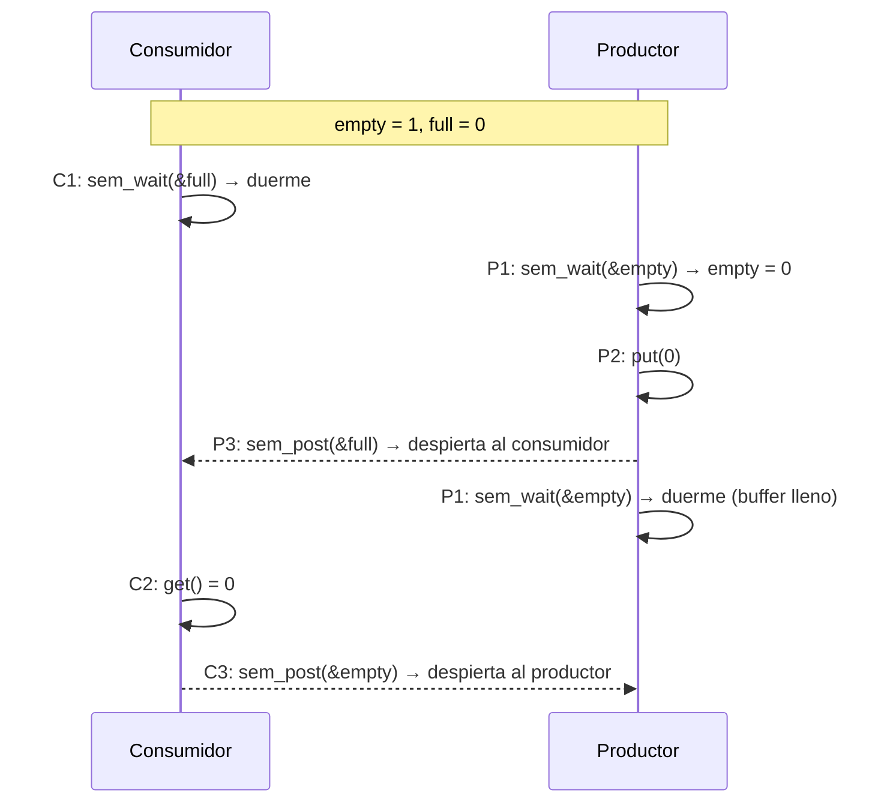

# Productor-consumidor con un buffer de un elemento

Primera implementación del productor-consumidor con semáforos (diapositivas de la parte 2, p. 10–12): dos semáforos, `empty` y `full`, y un buffer de **un solo elemento** (`MAX = 1`). Es correcta, y sirve para entender qué hace cada semáforo antes de pasar al buffer circular.

Volver al [índice de la parte 2](../../README.md).

## Relación con las diapositivas y el libro

| Programa | Qué muestra | Diapositivas | OSTEP cap. 31 (v1.10) |
|---|---|---|---|
| [`pc_single.c`](pc_single.c) → `pc_single.out` | `empty` (empieza en 1) y `full` (empieza en 0) con un buffer de un elemento | p. 10–12 | Figs. 31.9 y 31.10 con `MAX = 1` |
| [`verifica.h`](verifica.h) | Cuenta los valores consumidos y comprueba el resultado (no es parte de la sincronización) | — | — |

## Compilación y uso

```bash
make          # genera pc_single.out
make clean    # borra el ejecutable

./pc_single.out <loops> <productores> <consumidores>
```

Cada productor pone los valores `0, 1, ..., loops - 1`; cada consumidor imprime lo que saca. La marca de fin y la verificación final se explican en el [índice de la parte 2](../../README.md#uso-común-de-los-programas).

## El código (p. 11–12)

```c
int buffer;                 // MAX = 1

void put(int value) {
    buffer = value;         // Line F1
}

int get(void) {
    int tmp = buffer;       // Line G1
    return tmp;
}

sem_t empty;                // espacios vacíos
sem_t full;                 // espacios llenos

void *producer(void *arg) {
    for (i = 0; i < loops; i++) {
        sem_wait(&empty);   // Line P1
        put(i);             // Line P2
        sem_post(&full);    // Line P3
    }
}

void *consumer(void *arg) {
    while (tmp != -1) {
        sem_wait(&full);    // Line C1
        tmp = get();        // Line C2
        sem_post(&empty);   // Line C3
        printf(...);
    }
}

// en main:
sem_init(&empty, 0, 1);     // 1 is empty
sem_init(&full, 0, 0);      // 0 is full
```

El productor espera a que el buffer esté vacío (`sem_wait(&empty)`) antes de poner un dato y avisa que hay un dato (`sem_post(&full)`). El consumidor hace lo simétrico. Los dos semáforos se pasan el turno: con un solo espacio, `empty + full` vale siempre 1 (o 0 mientras un hilo está entre su `sem_wait` y su `sem_post`), así que el productor y el consumidor se alternan.

## Los dos órdenes posibles

Las diapositivas solo muestran el código de este caso. OSTEP (§31.4, *First Attempt*) analiza los dos órdenes en que pueden empezar los hilos con `MAX = 1`. Las dos ejecuciones dan el resultado correcto.

**El consumidor corre primero.** Llama a `sem_wait(&full)` con `full` en 0 y se duerme. En el modelo de OSTEP el valor queda en −1 (un hilo esperando); en Linux se queda en 0 (ver la [parte 1](../../../parte1/diapositivas/ordering_sem/README.md)).



**El productor corre primero.** Pasa `sem_wait(&empty)` (vale 1), pone el dato y hace `sem_post(&full)`. Si sigue corriendo, en la siguiente vuelta se duerme en `sem_wait(&empty)`, que ya vale 0, hasta que el consumidor saque el dato.

## Resultados

```text
$ ./pc_single.out 3 1 1
C1 <- 0
C1 <- 1
C1 <- 2
C1 <- -1
Verificacion: producidos 3, consumidos 3, perdidos 0, repetidos 0, invalidos 0 -> CORRECTO

$ ./pc_single.out 4 2 2
C1 <- 0
C1 <- 0
C1 <- 2
C1 <- 1
C1 <- 3
C2 <- 1
C2 <- 2
C1 <- 3
C1 <- -1
C2 <- -1
Verificacion: producidos 8, consumidos 8, perdidos 0, repetidos 0, invalidos 0 -> CORRECTO
```

Con dos productores cada valor aparece dos veces (uno por productor), y el orden en que salen depende del planificador.

| Ejecución | Repeticiones | Resultado |
|---|---|---|
| `./pc_single.out 1000 1 1` | 100 | Correcto en las 100 |
| `./pc_single.out 1000 2 3` | 100 | Correcto en las 100 |

**¿Por qué funciona también con varios productores y consumidores?** Con `MAX = 1`, `empty` es un semáforo **binario**: deja pasar a un solo productor a la vez entre `P1` y `P3`, así que actúa como un lock para `put()`. Lo mismo hace `full` con los consumidores y `get()`. Y como `empty + full` nunca pasa de 1, un `put()` y un `get()` tampoco se solapan. Con `MAX > 1` esto deja de ser cierto, y ese es el tema de [`pc_attemp1`](../circular_buffer/pc_attemp1/README.md).

**El costo de un solo espacio.** Producir y consumir 100 000 valores con un productor y un consumidor tomó 3.2 s, casi todo en el kernel:

```text
$ time ./pc_single.out 100000 1 1 > /dev/null

real	0m3.219s
user	0m0.281s
sys	0m3.094s
```

Con un solo espacio, el productor y el consumidor se tienen que turnar en cada valor, y casi cada `sem_wait` termina durmiendo al hilo y cada `sem_post` despertando al otro. La comparación con un buffer más grande está en [`pc_work`](../circular_buffer/pc_work/README.md#cuánto-ayuda-un-buffer-más-grande).

## Para probar por cuenta propia

1. Inicializar `empty` en 0 en lugar de 1. ¿Qué pasa y por qué? (Pista: `timeout 2 ./pc_single.out 10 1 1; echo $?`.)
2. Quitar el `sem_wait(&full)` del consumidor. ¿Qué valores imprime?

## Referencias

- Diapositivas de la clase 18, parte 2, p. 10–12.
- R. H. Arpaci-Dusseau y A. C. Arpaci-Dusseau, *Operating Systems: Three Easy Pieces*, v1.10, cap. 31: [*Semaphores*](https://pages.cs.wisc.edu/~remzi/OSTEP/threads-sema.pdf), §31.4.

> [!IMPORTANT]
> **Sobre esta guía.** El código y la guía se elaboraron con asistencia de un modelo de inteligencia artificial y se revisaron contra las diapositivas de la clase y OSTEP. Las salidas son de una ejecución de referencia del 23/11/2026 en la máquina descrita en el [entorno de ejecución](../../../../../clase_14/ejemplos/entorno_ejecucion.md) de la clase 14; en otra máquina el orden de las líneas y los tiempos cambian. Si se encuentra alguna diferencia con lo visto en clase, prevalece lo explicado por el docente.
