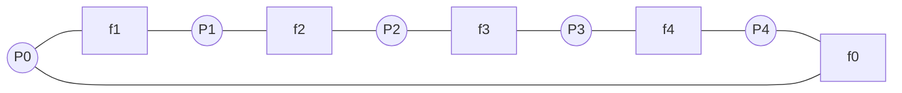
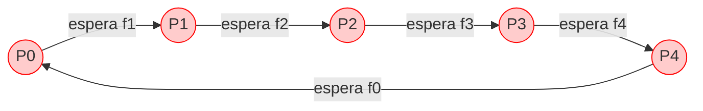

# Filósofos comensales

El problema de los **filósofos comensales** (*dining philosophers*), planteado y resuelto por Dijkstra, es uno de los problemas de concurrencia más conocidos (diapositivas de la parte 2, p. 35–46; OSTEP §31.6). Su utilidad práctica es poca, pero muestra con claridad cómo se produce un ***deadlock*** y cómo se evita.

Volver al [índice de la parte 3](../README.md).

## Relación con las diapositivas y el libro

| Programa | Qué muestra | Diapositivas | OSTEP cap. 31 (v1.10) |
|---|---|---|---|
| [`dining_philosophers_deadlock.c`](dining_philosophers_deadlock.c) | Todos los filósofos toman primero el palillo izquierdo: *deadlock* | p. 40–44 | Fig. 31.15 |
| [`dining_philosophers_deadlock_print.c`](dining_philosophers_deadlock_print.c) | La misma versión, imprimiendo lo que hace cada filósofo | p. 42–44 | Fig. 31.15 |
| [`dining_philosophers_no_deadlock.c`](dining_philosophers_no_deadlock.c) | El filósofo 4 toma los palillos en el orden contrario: sin *deadlock* | p. 45–46 | Fig. 31.16 |
| [`dining_philosophers_no_deadlock_print.c`](dining_philosophers_no_deadlock_print.c) | La misma versión, imprimiendo lo que hace cada filósofo | p. 45–46 | Fig. 31.16 |

Los cuatro programas vienen de [`ostep-code/threads-sema`](https://github.com/remzi-arpacidusseau/ostep-code/tree/master/threads-sema); solo se corrigieron mensajes y se hizo que cada línea salga de inmediato.

## Compilación y uso

```bash
make          # genera los cuatro ejecutables .out
make clean

./dining_philosophers_deadlock.out <num_loops>      # cada filósofo come <num_loops> veces
```

## El problema (p. 35–39)

Cinco filósofos están sentados alrededor de una mesa y entre cada par hay un palillo (cinco en total). Cada filósofo alterna entre pensar, que no necesita palillos, y comer, que necesita **los dos** palillos que tiene a los lados. Cada palillo es un semáforo binario, inicializado en 1 (`sem_t forks[5]`).

```c
while (1) {               // ciclo de cada filósofo (p. 36)
    think();
    get_forks(p);
    eat();
    put_forks(p);
}

int left(int p)  { return p; }              // palillo de la izquierda
int right(int p) { return (p + 1) % 5; }    // palillo de la derecha
```



El filósofo `p` tiene a su izquierda el palillo `p` y a su derecha el palillo `(p + 1) % 5`. El `% 5` hace que el filósofo 4 tome a su derecha el palillo 0 (OSTEP, Fig. 31.14). Los objetivos son tres (p. 37): que no haya ***deadlock***, que ningún filósofo se quede sin comer (sin **inanición**) y la **máxima concurrencia**.

## La solución simple: *deadlock* (p. 40–44)

```c
void get_forks(int p) {
    sem_wait(&forks[left(p)]);
    sem_wait(&forks[right(p)]);
}

void put_forks(int p) {
    sem_post(&forks[left(p)]);
    sem_post(&forks[right(p)]);
}
```

Si cada filósofo toma su palillo izquierdo antes de que alguno alcance a tomar el derecho, todos quedan con un palillo en la mano esperando el del vecino, que nunca lo va a soltar:



Cada flecha va de un filósofo al vecino que tiene el palillo que necesita. El ciclo `P0 → P1 → P2 → P3 → P4 → P0` es una **espera circular**: ninguno puede avanzar.

```bash
timeout 2 ./dining_philosophers_deadlock.out 10000; echo $?
```

| Ejecución | Repeticiones | Quedó en *deadlock* |
|---|---|---|
| `./dining_philosophers_deadlock.out 10000` | 50 | 48 |
| `./dining_philosophers_deadlock.out 10` | 50 | 0 |

Con 10 000 comidas por filósofo, el programa quedó en *deadlock* en 48 de 50 ejecuciones; con solo 10 comidas, en ninguna. El error es el mismo: lo que cambia es cuántas veces se presenta la oportunidad de que los cinco tomen su palillo izquierdo a la vez. Que un programa concurrente pase las pruebas cortas no demuestra que sea correcto.

La versión `_print` muestra cada paso; cada filósofo escribe en su propia columna. Las últimas líneas de una ejecución que quedó bloqueada:

```text
                                        4: done
                                        4: think
                    2: try 2
                              3: try 3
0: try 1
          1: try 2
                                        4: try 4
                    2: try 3
                              3: try 4
                                        4: try 0
```

Cada filósofo terminó en `try` de su palillo **derecho**: el 0 espera el 1, el 1 el 2, el 2 el 3, el 3 el 4 y el 4 el 0. Antes, cada uno había tomado su palillo izquierdo (el 0 el 0, el 1 el 1, …). Es exactamente el ciclo de la figura, y es lo que muestran las diapositivas p. 43–44 con `philosopher #k getfork # k`.

## La solución: cambiar el orden de un filósofo (p. 45–46)

Dijkstra resolvió el problema haciendo que **un** filósofo, el 4, tome los palillos en el orden contrario (OSTEP, Fig. 31.16):

```c
void get_forks(int p) {
    if (p == 4) {
        sem_wait(&forks[right(p)]);
        sem_wait(&forks[left(p)]);
    } else {
        sem_wait(&forks[left(p)]);
        sem_wait(&forks[right(p)]);
    }
}
```

El filósofo 4 intenta primero el palillo 0, el mismo que el filósofo 0 toma primero. Uno de los dos lo obtiene y el otro se queda esperando **sin sostener ningún palillo**, así que el ciclo de la figura anterior ya no se puede cerrar: siempre hay al menos un filósofo que puede comer y luego soltar sus palillos.

| Ejecución | Repeticiones | Quedó en *deadlock* |
|---|---|---|
| `./dining_philosophers_no_deadlock.out 10000` | 50 | 0 |

```text
$ time ./dining_philosophers_no_deadlock.out 100000
dining: started
dining: finished

real	0m0.066s
user	0m0.016s
sys	0m0.109s
```

Con un ciclo de cada filósofo:

```text
$ ./dining_philosophers_no_deadlock_print.out 1
dining: started
0: start
0: think
0: try 0
0: try 1
0: eat
0: done
                    2: start
                    2: think
                    2: try 2
                    2: try 3
                    2: eat
                    2: done
                              3: start
                              3: think
          1: start
          1: think
          1: try 1
          1: try 2
          1: eat
          1: done
                                        4: start
                                        4: think
                                        4: try 0
                                        4: try 4
                                        4: eat
                                        4: done
                              3: try 3
                              3: try 4
                              3: eat
                              3: done
dining: finished
```

Hay otras soluciones (por ejemplo, permitir que solo cuatro filósofos intenten comer a la vez, con un semáforo inicializado en 4). Las diapositivas (p. 46) mencionan otros problemas clásicos de sincronización: el de los fumadores y el del barbero dormilón.

> [!NOTE]
> **Complemento: las cuatro condiciones del *deadlock*.** Para que ocurra un *deadlock* deben darse a la vez cuatro condiciones: exclusión mutua (un palillo lo usa un filósofo a la vez), retener y esperar (un filósofo sostiene un palillo mientras espera el otro), no expropiación (nadie le quita un palillo a otro) y espera circular. La solución de Dijkstra elimina la **espera circular** imponiendo un orden. OSTEP estudia estas condiciones en el cap. 32, *Common Concurrency Problems*.

## Para probar por cuenta propia

1. Cambiar `get_forks()` para que **todos** los filósofos pares tomen primero el palillo derecho y los impares el izquierdo. ¿Hay *deadlock*?
2. Agregar un semáforo `mesa` inicializado en 4 y hacer `sem_wait(&mesa)` antes de `get_forks()` y `sem_post(&mesa)` después de `put_forks()`, con la versión que hacía *deadlock*. ¿Por qué funciona?

## Referencias

- Diapositivas de la clase 18, parte 2, p. 35–46.
- R. H. Arpaci-Dusseau y A. C. Arpaci-Dusseau, *Operating Systems: Three Easy Pieces*, v1.10, cap. 31: [*Semaphores*](https://pages.cs.wisc.edu/~remzi/OSTEP/threads-sema.pdf), §31.6, y cap. 32: [*Common Concurrency Problems*](https://pages.cs.wisc.edu/~remzi/OSTEP/threads-bugs.pdf).
- A. B. Downey, *The Little Book of Semaphores*, cap. 4.4 (las funciones `left` y `right`).

> [!IMPORTANT]
> **Sobre esta guía.** La guía se elaboró con asistencia de un modelo de inteligencia artificial y se revisó contra las diapositivas de la clase y OSTEP. Las salidas son de una ejecución de referencia del 23/11/2026 en la máquina descrita en el [entorno de ejecución](../../../../clase_14/ejemplos/entorno_ejecucion.md) de la clase 14; en otra máquina la frecuencia del *deadlock* cambia. Si se encuentra alguna diferencia con lo visto en clase, prevalece lo explicado por el docente.
