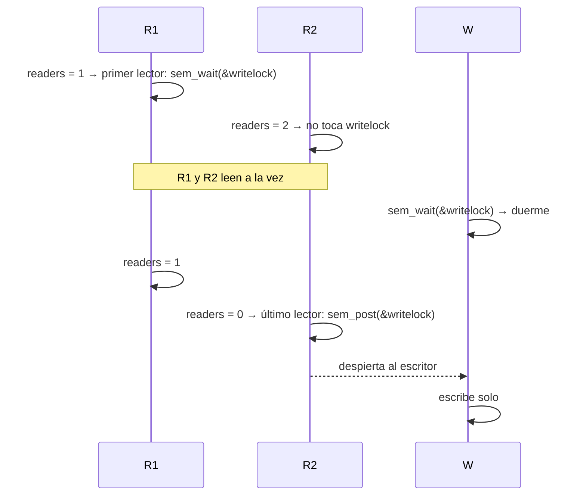

# Lock de lectores-escritores

Un lock común es demasiado restrictivo cuando varios hilos solo quieren **leer** un dato compartido: las lecturas no se estorban entre sí, y aun así el lock las obliga a turnarse. El **lock de lectores-escritores** (*reader-writer lock*) permite muchos lectores a la vez o un solo escritor (diapositivas de la parte 2, p. 26–34; OSTEP §31.5).

Volver al [índice de la parte 3](../README.md).

## Relación con las diapositivas y el libro

| Programa | Qué muestra | Diapositivas | OSTEP cap. 31 (v1.10) |
|---|---|---|---|
| [`rwlock.c`](rwlock.c) → `rwlock.out` | El `rwlock_t` con semáforos y una prueba con lectores y escritores que comprueba la exclusión | p. 28–33 | §31.5, Fig. 31.13 |
| `rwlock-lectura-larga.out` (`-DLECTURA_LARGA`) | La misma prueba con lecturas más largas: muestra la inanición de los escritores | p. 34 | §31.5 |

## Compilación y uso

```bash
make          # genera rwlock.out y rwlock-lectura-larga.out
make clean

./rwlock.out <read_loops> <write_loops> [lectores] [escritores] [espera_ms]
```

Cada lector lee un contador compartido `read_loops` veces y cada escritor lo incrementa `write_loops` veces (por defecto, 1 lector y 1 escritor). Primero se crean los lectores y luego los escritores. `espera_ms` (opcional) hace que cada escritor espere antes de empezar, para que llegue cuando los lectores ya están leyendo.

Al final el programa informa:

- el valor final del contador, que debe ser `escritores × write_loops`;
- el **máximo de lectores simultáneos** dentro de la sección crítica;
- las **violaciones de la exclusión**: veces que un escritor estuvo acompañado por otro hilo.

Para contar los hilos que están dentro de la sección crítica, el programa usa operaciones atómicas (`__atomic_add_fetch`) que no forman parte del lock: son solo una forma de observarlo. Cada hilo informa además el instante en que terminó.

## El problema (p. 26–27)

| Tipo de hilo | Qué hace | Restricción |
|---|---|---|
| Escritor | Cambia los datos | Solo **un** escritor a la vez, y sin lectores |
| Lector | Solo lee los datos | **Varios** lectores a la vez, siempre que no haya un escritor |

## El lock (p. 28–31, OSTEP Fig. 31.13)

```c
typedef struct _rwlock_t {
    sem_t lock;        // binary semaphore (basic lock): protege readers
    sem_t writelock;   // allow ONE writer/MANY readers
    int   readers;     // #readers in critical section
} rwlock_t;

void rwlock_init(rwlock_t *rw) {
    rw->readers = 0;
    sem_init(&rw->lock, 0, 1);
    sem_init(&rw->writelock, 0, 1);
}

void rwlock_acquire_writelock(rwlock_t *rw) { sem_wait(&rw->writelock); }
void rwlock_release_writelock(rwlock_t *rw) { sem_post(&rw->writelock); }

void rwlock_acquire_readlock(rwlock_t *rw) {
    sem_wait(&rw->lock);
    rw->readers++;
    if (rw->readers == 1)          // first reader gets writelock
        sem_wait(&rw->writelock);
    sem_post(&rw->lock);
}

void rwlock_release_readlock(rwlock_t *rw) {
    sem_wait(&rw->lock);
    rw->readers--;
    if (rw->readers == 0)          // last reader lets it go
        sem_post(&rw->writelock);
    sem_post(&rw->lock);
}
```

Los dos semáforos tienen papeles distintos:

- **`writelock`** garantiza "un escritor **o** muchos lectores". Un escritor lo toma para escribir. Los lectores lo toman **en grupo**: el **primer** lector que entra lo toma por todos y el **último** que sale lo libera. Mientras haya al menos un lector adentro, ningún escritor puede entrar.
- **`lock`** es solo un lock básico que protege el contador `readers`, para que dos lectores no lo modifiquen a la vez. No es un "lock de lectura": lo que excluye a los escritores es `writelock`.



## Resultados

```text
$ ./rwlock.out 100000 100000 4 2
W2: escritura terminada en t = 0.126 s
W1: escritura terminada en t = 0.130 s
R2: lectura terminada en t = 0.248 s, ultimo valor leido 200000
R1: lectura terminada en t = 0.252 s, ultimo valor leido 200000
R4: lectura terminada en t = 0.255 s, ultimo valor leido 200000
R3: lectura terminada en t = 0.256 s, ultimo valor leido 200000
contador final: 200000 (esperado 200000)
lectores simultaneos (maximo): 4
violaciones de la exclusion: 0
```

En 20 ejecuciones con 4 lectores y 2 escritores, el contador fue exacto y no hubo ninguna violación de la exclusión en las 20. El máximo de lectores simultáneos fue 4 en 15 ejecuciones y 3 en las otras 5: **varios lectores estuvieron dentro de la sección crítica a la vez**, que es justamente lo que un lock común no permite.

## El problema de la equidad: inanición (p. 34)

Mientras haya un lector adentro, `writelock` sigue tomado. Si los lectores se suceden sin que `readers` vuelva nunca a 0, un escritor puede esperar indefinidamente: es **inanición** (*starvation*). OSTEP lo señala como la debilidad de esta implementación.

**Con lecturas cortas no se observó.** Con 4 lectores que leen un millón de veces y un escritor que llega a los 50 ms, en las 10 ejecuciones de referencia el escritor terminó a los 0.052 s, mientras que los lectores terminaron entre 1.8 y 2.1 s:

```text
$ ./rwlock.out 1000000 1000 4 1 50
W1: escritura terminada en t = 0.052 s
R1: lectura terminada en t = 1.939 s, ultimo valor leido 1000
...
```

La lectura (`local = counter`) es tan corta que `readers` vuelve a 0 con mucha frecuencia, y en uno de esos instantes el escritor consigue `writelock`.

**Con lecturas largas sí.** La variante `rwlock-lectura-larga.out` agrega un ciclo vacío dentro de la sección de lectura, de modo que los cuatro lectores se solapan y `readers` casi nunca llega a 0:

```text
$ ./rwlock-lectura-larga.out 20000 1000 4 1 50
R2: lectura terminada en t = 0.661 s, ultimo valor leido 0
R4: lectura terminada en t = 0.664 s, ultimo valor leido 0
R3: lectura terminada en t = 0.686 s, ultimo valor leido 124
R1: lectura terminada en t = 0.696 s, ultimo valor leido 124
W1: escritura terminada en t = 0.696 s
contador final: 1000 (esperado 1000)
lectores simultaneos (maximo): 4
violaciones de la exclusion: 0
```

El escritor llegó a los 50 ms y no terminó sus 1000 escrituras hasta que se fue el último lector, casi 0.7 s después. Dos lectores leyeron 0 en su última lectura: en todo su recorrido el escritor nunca pudo escribir. En las 10 ejecuciones de referencia, el escritor terminó al mismo tiempo que el último lector o después, y en 8 de ellas al menos 3 de los 4 lectores leyeron siempre 0.

OSTEP sugiere la idea de una solución: **impedir que entren nuevos lectores cuando hay un escritor esperando**. Las diapositivas (p. 34) remiten a implementaciones más elaboradas. OSTEP también advierte (*Tip: Simple And Dumb Can Be Better*, la "ley de Hill") que un lock de lectores-escritores agrega trabajo y no siempre es más rápido que un lock simple.

## Para probar por cuenta propia

1. Ejecutar `rwlock.out` con `espera_ms` en 0 y en 50. ¿Por qué con 0 el escritor termina aún más rápido?
2. Modificar `rwlock_acquire_readlock()` para que un lector espere si hay un escritor esperando. (Pista: un semáforo adicional que tome el escritor antes de `writelock` y que cada lector tome y suelte al entrar.) Medir de nuevo con `rwlock-lectura-larga.out`.

## Referencias

- Diapositivas de la clase 18, parte 2, p. 26–34.
- R. H. Arpaci-Dusseau y A. C. Arpaci-Dusseau, *Operating Systems: Three Easy Pieces*, v1.10, cap. 31: [*Semaphores*](https://pages.cs.wisc.edu/~remzi/OSTEP/threads-sema.pdf), §31.5.
- A. B. Downey, *The Little Book of Semaphores*, §4.2 (lectores-escritores y la solución sin inanición).

> [!IMPORTANT]
> **Sobre esta guía.** El código y la guía se elaboraron con asistencia de un modelo de inteligencia artificial y se revisaron contra las diapositivas de la clase y OSTEP. Las salidas son de una ejecución de referencia del 23/11/2026 en la máquina descrita en el [entorno de ejecución](../../../../clase_14/ejemplos/entorno_ejecucion.md) de la clase 14; en otra máquina los tiempos cambian y la inanición puede aparecer con lecturas más cortas o más largas. Si se encuentra alguna diferencia con lo visto en clase, prevalece lo explicado por el docente.
